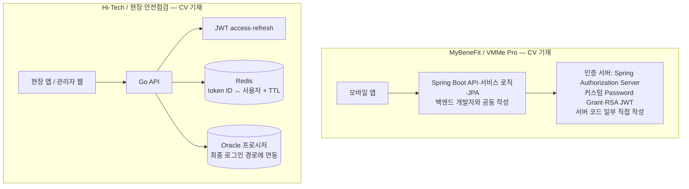

## 이력서 경험과 백엔드 면접 기초

이 문서는 CV 의 백엔드 관련 문장을 면접에서 정확하고 설득력 있게 설명하기 위한 출발점입니다. 아래 답변은 초안입니다. 실제 구현과 다른 부분은 반드시 본인의 사실에 맞게 고쳐야 합니다.

### 내 경험을 한 문장으로 정리하기

>모바일 개발을 주력으로 해왔지만, 현장 앱과 서비스에서 API·인증·데이터 연동도 직접 구현해 왔습니다. 최근에는 백엔드 개발자와 Kotlin·Spring Boot·JPA 로 서비스 API 를 함께 만들었고, Spring Authorization Server 기반 인증 서버의 코드 일부를 작성했으며, 운영 배포를 위해 Argo CD 를 직접 구성했습니다. 과거에는 Go·Node.js 서버, Oracle 프로시저, Redis 기반 토큰 세션 관리를 다뤘습니다. 고트래픽 예약 시스템의 운영 경험은 제한적이므로, 그 부분은 기본 원리와 설계 판단을 중심으로 설명하겠습니다.

이 문장은 과장 없이 모바일 주력 경력과 실제 서버 경험을 함께 드러냅니다. `직접 구현`, `함께 개발`, `운영`, `학습` 을 섞어 말하지 마세요.

### 이력서에서 질문으로 이어질 키워드

| CV 키워드                         | 비유로 잡는 핵심                            | 준비할 설명                                              |
| ------------------------------ | ------------------------------------ | --------------------------------------------------- |
| REST API                       | 창구의 요청서와 응답 양식                       | 어떤 리소스를 어떤 HTTP method 로 다뤘는지, 인증·검증·오류 응답은 어떻게 했는지 |
| Kotlin·Spring Boot             | 조립 규칙과 실행 가능한 서버 틀                   | 요청이 Controller→Service→저장소/외부 연동으로 흐른 예             |
| Go·Node.js                     | 다른 언어로 만든 같은 서버 역할의 창구               | 본인이 작성한 endpoint, 입력 검증, 응답/오류 처리 범위                |
| Oracle·저장 프로시저                 | DB 안에 둔 기존 업무 절차 호출                  | 앱/API 와 프로시저의 책임 분담, 입출력과 오류 처리                     |
| Redis JWT 세션 정보                | 임시 출입증 번호와 폐기 목록을 빠르게 확인하는 보관함       | token ID 와 사용자 매핑, TTL, 로그아웃 삭제, refresh 교체 흐름      |
| OAuth2 인증 서버                   | 앱이 사용자 대신 보호된 자원에 접근하도록 권한을 중개하는 발급소 | Spring Authorization Server + 커스텀 Password Grant 구조, 직접 작성한 코드, 토큰 수명(access 5 분·refresh 14 일)과 검증 |
| MSA·개발환경 배포                    | 여러 전문 작업장을 필요한 순서로 함께 가동             | 개발: Ansible VM + Jenkins + Docker Compose, 운영: Argo CD 로 구분해 설명      |
| Jenkins·GitHub Actions·Argo CD | 변경을 검증하고 환경에 전달하는 자동 작업선             | 서비스별 수동 실행을 job 하나로 모은 일, Argo CD 설치·Application 등록·매니페스트 작성 |

두 경험은 서로 다른 프로젝트입니다. 면접에서 최근 Spring Boot OAuth2 작업과 과거 Go/JWT/Redis/Oracle 경험을 한 구현처럼 합치지 말고, 각 프로젝트의 사용자 흐름과 본인 책임을 따로 설명하세요.

### 비유: API 는 식당 주문서

클라이언트는 손님, API 는 주문 창구, 서버 로직은 주방, DB 는 주문·재고 장부에 비유할 수 있습니다. 주문서에는 무엇을 원하는지(경로와 body), 누가 요청하는지(인증), 입력이 유효한지(검증)가 담깁니다. 서버는 업무 규칙을 적용한 뒤 결과와 오류를 일정한 형식으로 돌려줍니다.

면접에서 "API 를 만들었다"고만 하지 말고 아래 순서로 구체화하세요.

1. 어떤 사용자가 어떤 업무를 처리했나?
2. 요청에 어떤 식별자와 데이터가 있었나?
3. 서버가 검증하고 호출한 로직/저장소는 무엇인가?
4. 성공·실패 응답은 어떻게 나뉘었나?
5. 중복 요청, 네트워크 실패, 권한 오류는 어떻게 다뤘나?

### 대표 질문 1: 백엔드 경험이 적은데 왜 지원했나요?

#### 답변 A — 20 초

"제 주력은 모바일이지만, API 와 인증, DB 연동까지 제품 흐름 전체를 다뤄 왔습니다. 백엔드 전담 역할의 경험은 더 쌓아야 하지만, 현장 서비스에서 서버와 데이터 흐름을 직접 구현·운영한 경험을 바탕으로 빠르게 기여하고 싶습니다."

#### 답변 B — 60 초, 경험 중심

"최근에는 백엔드 개발자와 Kotlin·Spring Boot 로 서비스 API 를 함께 만들며 JPA 엔티티와 Repository 를 작성했고, Spring Authorization Server 기반 인증 서버의 코드 일부를 맡았습니다. 운영 배포는 Argo CD 를 직접 설치하고 서비스별 매니페스트를 작성해 구성했습니다. 이전 제조·현장 프로젝트에서는 Go·Node.js API, Oracle 저장 프로시저 연동, JWT access·refresh 토큰과 Redis 세션 정보 관리를 맡았습니다. 다만 대규모 예약 트래픽 운영은 제 경험의 공백입니다. 그 부분은 데이터 정합성과 트랜잭션 설계를 우선 익혀 현업 코드와 테스트로 보완하겠습니다."

**꼬리질문 1:** "그렇다면 백엔드 개발자로 바로 기여할 수 있는 근거는 뭔가요?"

**답변:** "새로운 기술 하나만 안다는 뜻이 아니라, 클라이언트 요청부터 API, 인증, 데이터 저장, 배포까지 연결해 문제를 추적한 경험이 있습니다. 현장 인증에서 토큰 폐기와 재발급을 구현했고, VMMe Pro 에서는 Kotlin·Spring Boot·JPA 서버와 인증 서버 코드를 작성하고 운영 배포 경로까지 만들었습니다. 이 경험으로 제품 규칙과 실패 상황부터 확인하며 새 코드베이스를 빠르게 파악할 수 있습니다."

**꼬리질문 2:** "예약 정합성 경험이 없는데, 첫 업무가 그쪽이면 어떻게 하겠어요?"

**답변:** "먼저 기존 도메인 규칙과 트랜잭션 경계를 읽고, 정상·중복·경계 조건 테스트를 확인하겠습니다. 작은 변경을 기존 패턴에 맞춰 구현한 뒤 동시 요청과 롤백을 재현하는 테스트를 추가하겠습니다. 설계가 필요한 부분은 데이터 제약과 트랜잭션으로 보장할 항목을 먼저 제안하고 리뷰를 받겠습니다."

### 대표 질문 2: 서버/API 에서 본인이 직접 한 일은 어디까지인가요?

#### 답변 A — 범위를 먼저 말하기

"프로젝트마다 다릅니다. 현장 안전점검에서는 앱과 관리 화면뿐 아니라 Go API, JWT 흐름, Redis 토큰 매핑, Oracle 프로시저 연동을 맡았습니다. 최근 VMMe Pro 에서는 백엔드 개발자와 함께 API 와 서비스 로직을 작성하며 JPA 엔티티와 Repository 를 직접 만들었고, 인증 서버에서는 커스텀 grant 처리와 claim 구성 같은 토큰 발급 코드 일부를 작성했습니다. 운영 트래픽 튜닝을 주도한 경험은 없습니다."

>직접 작성한 인증 서버 클래스 이름 2~3 개(예: `PasswordGrantAuthenticationProvider`, `CustomJwtTokenCustomizer`, `SecurityConfiguration` 중 실제로 쓴 것)를 이 답변에 넣어 말하면 더 구체적입니다.

#### 답변 B — 실제 요청 흐름으로 설명

"현장 앱이 NFC/QR 로 얻은 식별 정보와 점검 데이터를 API 에 보냅니다. 서버는 사용자를 확인하고, 기존 Oracle 시스템에 저장된 점검 기준이나 프로시저를 통해 검증·처리를 한 뒤 결과를 앱과 웹에 돌려줍니다. 제 역할은 클라이언트에서 서버 요청을 연결하고, API·토큰 처리와 데이터 연동을 구현하는 것이었습니다. 검증 규칙은 Oracle 프로시저가, 인증과 응답 형식은 Go API 가 맡는 식으로 책임이 나뉘어 있었습니다."

**꼬리질문 1:** "DB 트랜잭션은 직접 설계했나요?"

**답변:** "Hi-Tech 에서는 업무 처리를 Oracle 프로시저가 맡고 API 는 호출과 결과 변환을 맡았습니다. VMMe Pro 에서는 Spring 서비스와 JPA Repository 를 작성했지만, 격리 수준을 바꾸거나 여러 서비스에 걸친 트랜잭션을 설계해야 하는 고경합 문제를 직접 다뤄 보지는 않았습니다. 그런 문제는 조건부 UPDATE, 유니크 제약, 짧은 트랜잭션부터 검토하겠습니다."

**꼬리질문 2:** "경험이 부족한 것을 어떻게 메우고 있나요?"

**답변:** "요청받은 DB·Spring·JPA·Redis·OAuth2 주제를 예약 흐름으로 묶어 학습하고 있습니다. 개념을 외우는 데 그치지 않고, 두 요청이 동시에 들어올 때 DB 에서 어떤 조건으로 한 건만 확정되는지와 실패·재시도 때 중복을 어떻게 막는지 정리하고 있습니다."

### 대표 질문 3: Redis 를 왜 사용했나요?

#### 답변 A — 간단히

"현장 인증 흐름에서 token ID 와 사용자 연결 정보를 만료시간과 함께 Redis 에 저장했습니다. 로그아웃 시 해당 정보를 삭제하고 refresh 시 교체해, 토큰 자체 만료 전에 세션을 폐기할 수 있게 했습니다."

#### 답변 B — 목적과 한계까지

"JWT 는 서명 검증만으로는 서버가 발급 후 즉시 무효화하기 어렵습니다. 그래서 token ID 와 사용자 연결 상태를 Redis 에 두고, 요청 시 토큰의 유효성과 서버 측 세션 상태를 함께 확인하는 구조였습니다. 로그아웃 시 서버 측 정보를 제거하고 refresh 시 새 토큰 기준으로 갱신했습니다. VMMe Pro 인증 서버도 Redisson 으로 사용자별 기기 세션을 `{profile}:session:{userId}` 키에 180 초 TTL 로 두어 중복 로그인을 확인하는 데 Redis 를 씁니다. 두 경우 모두 인증 상태 저장 용도이고, 캐시 최적화나 분산락 운영과는 다른 쓰임입니다."

**꼬리질문 1:** "JWT 를 쓰는데 왜 서버 저장소가 필요한가요?"

**답변:** "JWT 의 서명과 만료만 확인하면 발급 후 로그아웃하거나 탈취된 토큰을 즉시 막기 어렵습니다. 서버 측 token ID 상태를 확인하면 폐기 목록 또는 활성 세션 관리가 가능해집니다. 대신 요청마다 Redis 조회가 필요하고 Redis 장애 시 인증 정책을 정해야 합니다."

**꼬리질문 2:** "Redis 가 장애 나면 인증을 허용할 건가요?"

**답변:** "인증 상태 저장소라면 기본은 fail-closed, 즉 폐기 여부를 확인할 수 없을 때 보호 API 를 거부하는 쪽이 맞다고 봅니다. 폐기된 토큰을 통과시키는 것이 더 큰 사고이기 때문입니다. 대신 Redis 장애가 곧 전체 로그인 장애가 되므로 Redis 를 replica 와 failover 로 이중화하고, 짧은 timeout 과 장애 알림을 둡니다. 결제처럼 민감한 API 는 항상 거부하고, 공개 상품 조회처럼 위험이 낮은 API 는 인증 없이도 동작하게 나누는 방법도 있습니다."

### 면접 전 사실 확인 목록

아래 항목은 본인의 기억과 코드/문서로 확인한 뒤 답변에 반영하세요.

**이미 확인된 사실**

- VMMe Pro 인증 서버는 Spring Authorization Server 기반이고, token endpoint 에 커스텀 Password Grant converter/provider 를 연결했습니다. grant 는 `password`, `client_credentials`, `refresh_token` 이고 access 5 분·refresh 14 일, refresh 재사용 끔(rotation)입니다. 자세한 구조는 [OAuth2 문서 5.1](05_OAuth2_인증.md) 에 있습니다.
- 본인은 인증 서버 코드 일부와 서비스의 JPA 엔티티·Repository 를 직접 작성했고, 운영 Argo CD 를 직접 설치·등록·매니페스트 작성했습니다. 개발 환경은 Ansible 로 구성한 VM 에서 Jenkins 가 Docker Compose 로 전체 서비스를 띄웁니다.

**면접 전 기억으로 채울 것**

- 인증 서버에서 직접 작성한 클래스 2~3 개의 이름과 역할
- Hi-Tech Redis key 의 실제 구성, TTL 기준, refresh 시 삭제/교체 순서
- Hi-Tech 로그아웃 때 지운 값이 access token 의 token ID 인지 refresh 세션인지
- DB 호출에서 프로시저가 처리한 규칙과 앱/API 계층이 처리한 규칙의 대표 예 하나
- 운영 중 실패 사례 하나: 증상, 로그로 원인을 찾은 과정, 조치

확인하지 못한 상세를 기억으로 채우지 마세요. "현재 확인 가능한 범위는 여기까지이고, 당시 코드를 보면 정확히 구분할 수 있다"라고 설명하는 편이 안전합니다.

### 공식 참고 자료

- [Spring Framework reference](https://docs.spring.io/spring-framework/reference/)
- [Spring Data JPA reference](https://docs.spring.io/spring-data/jpa/reference/)
- [Redis documentation](https://redis.io/docs/latest/)
- [OAuth 2.0 Security Best Current Practice (RFC 9700)](https://www.rfc-editor.org/rfc/rfc9700.html)
