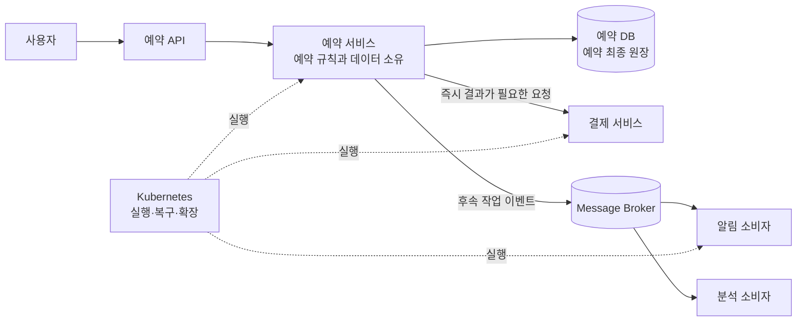
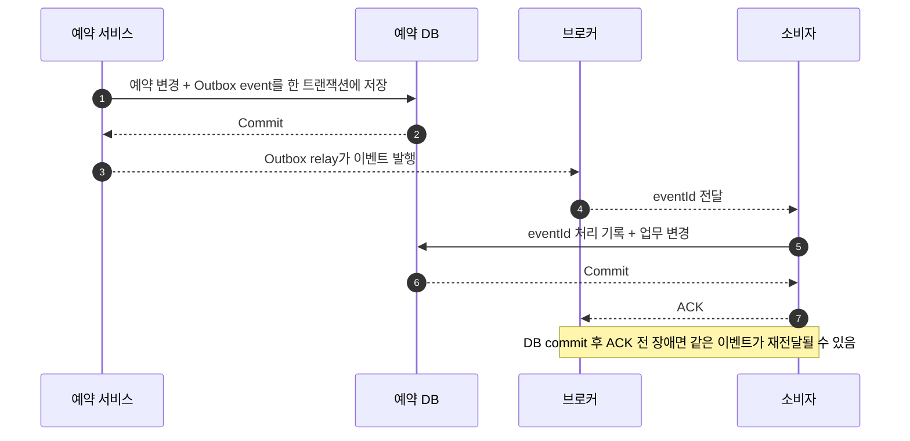
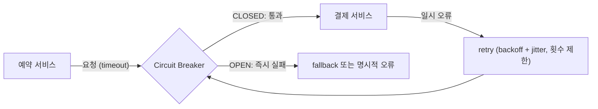
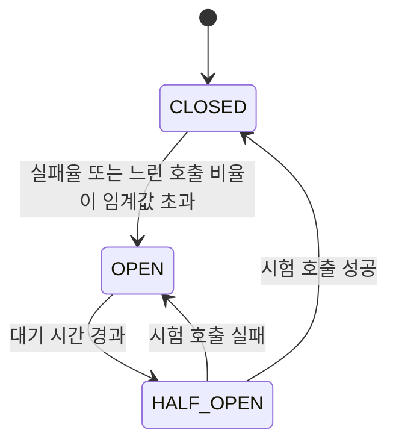
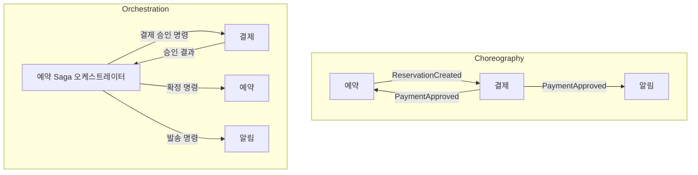
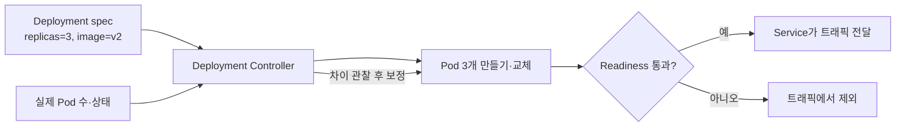
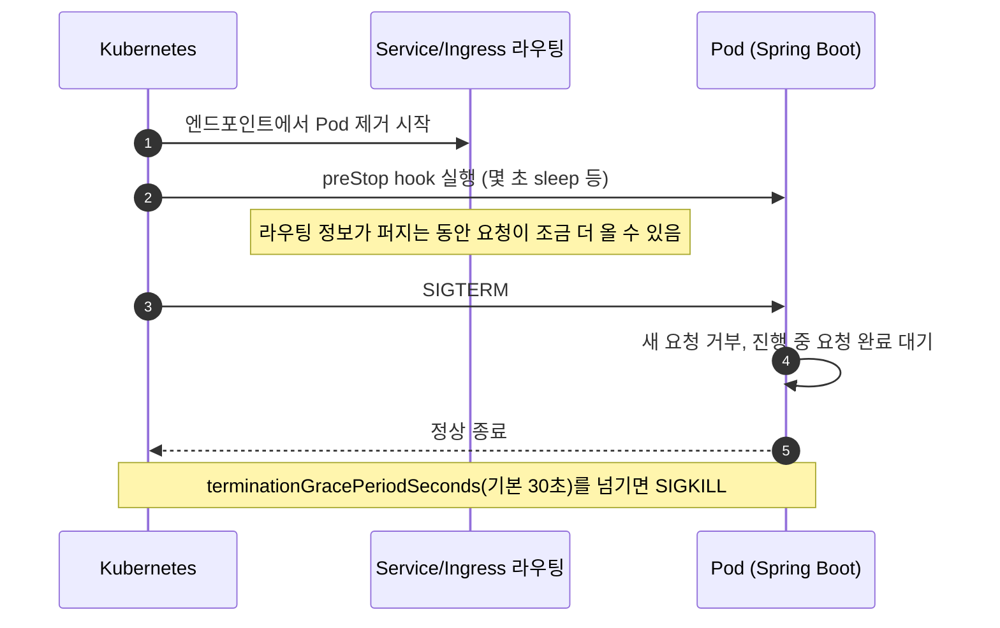

## MSA·Kubernetes·MQ 면접 준비

이 문서는 와그가 MSA 구조라고 들은 상황에서, 백엔드 면접 전에 서비스 경계·Kubernetes·메시지 큐의 기본 원리를 설명할 수 있도록 정리한 노트입니다. 이력서에 적힌 개발 환경 구성(Ansible VM + Jenkins + Docker Compose)과 운영 배포(Argo CD 설치, Application 등록, 서비스 매니페스트 작성)는 **직접 한 배포 경험**으로 설명합니다. 대규모 트래픽에서의 Kubernetes 운영(오토스케일링, 장애 대응)과 MQ 구축은 개념으로 설명합니다. 아래 설계 답변은 면접용 사고 과정이며 실제 와그의 내부 구조를 안다는 뜻이 아닙니다.

### 1. 먼저 잡을 그림

#### 비유: 여행 예약을 처리하는 여러 전문 창구

하나의 큰 여행사 사무실 안에 예약, 결제, 알림 담당 창구가 있다고 생각해 봅시다. 모놀리스는 한 사무실의 한 업무 시스템에서 이 일을 모두 처리합니다. MSA 는 업무별로 서비스를 나누고 각 서비스가 자기 책임과 데이터를 관리하게 합니다. 예약 서비스가 결제를 요청하고, 결제 서비스가 결제 결과를 알리며, 알림 서비스가 고객에게 안내를 보냅니다.

서비스가 나뉘면 각 창구를 따로 배포하고 확장할 수 있지만, 창구 사이의 연락과 실패 처리를 설계해야 합니다. 네트워크 호출이 실패할 수 있고, 한 업무가 여러 서비스에 걸치면 단일 DB 트랜잭션으로 모두 되돌리기 어렵습니다. 그러므로 "서비스를 잘게 나누는 것" 자체가 목적이 아니라 **독립 변경·확장 이점을 얻을 만큼 경계가 분명한가**가 핵심입니다.

Kubernetes 는 컨테이너로 포장된 서비스를 원하는 개수와 상태로 실행하고, 죽은 인스턴스를 다시 띄우며, 네트워크 주소를 연결하는 오케스트레이터입니다. MQ 는 서비스가 상대 서비스에 바로 전화하지 않고 "이 일을 처리해 달라"는 메시지를 우편함에 넣어 두는 비동기 통신 수단입니다. MSA 는 서비스 구조, Kubernetes 는 실행·운영 기반, MQ 는 통신 방식이라 서로 다른 층의 개념입니다.

```text
사용자 → 예약 API → 예약 서비스 ──(동기 HTTP)──> 결제 서비스
                              └──(비동기 메시지)──> 알림 서비스

Kubernetes: 각 서비스 컨테이너를 실행하고 발견·복구·확장
MQ: 비동기 작업/사건을 보관하고 소비자에게 전달
```



이 그림에서 MSA 는 서비스 책임의 경계, MQ 는 서비스 간 전달 방식, Kubernetes 는 그 서비스의 실행 기반입니다. 예약 서비스가 소유한 예약 DB 가 예약의 최종 원장이며, Redis 캐시나 메시지 전달 여부와는 별도의 경계입니다.

#### 이력서 경험의 정확한 경계

CV 에는 개발 배포가 GitHub Actions webhook 으로 Jenkins 를 호출해 MSA 전체를 기동하고, 운영 배포는 Argo CD 로 진행한다고 적혀 있습니다. 면접에서는 다음처럼 구분하세요.

- **말할 수 있는 경험:**
  - **개발:** 서비스마다 수동으로 실행하던 절차를 Jenkins job 하나로 모아, Ansible 로 구성한 개발 VM 에서 Docker Compose 로 MSA 전체를 띄우게 했습니다. GitHub Actions webhook 이 그 job 을 호출합니다. 일부 서비스가 빠질 가능성을 줄인 것이 성과입니다.
  - **운영:** 백엔드 개발자가 서비스별 배포를 일관되게 관리하길 원해서, Argo CD 를 직접 설치하고 서비스별 Application 을 등록하며 배포 매니페스트를 작성했습니다.
- **개념으로 설명할 것:** HPA 기반 오토스케일링과 대규모 트래픽 장애 대응, 네트워크 정책 설계, MQ 기반 예약·결제 시스템 구축, 와그 내부 서비스 토폴로지. 직접 작성한 매니페스트에 들어간 리소스(Deployment, Service 등)는 경험으로, 작성하지 않은 리소스는 개념으로 말합니다.
- **와그에 대해 말할 때:** "와그가 MSA 구조라고 안내받았습니다. 내부 서비스 경계와 인프라 구성은 입사 후 확인해야 한다고 생각합니다."라고 전제합니다.

### 2. MSA 기본

#### 비유: 전문 부서와 각자의 장부

예약팀, 결제팀, 알림팀은 각자 책임지는 업무와 장부를 가집니다. 예약팀이 결제팀 장부를 직접 고쳐서는 안 됩니다. 예약 변경은 결제 서비스가 제공하는 API 나 이벤트를 통해 요청해야 합니다. 서비스별 데이터 소유권을 분명히 해야 한 팀의 스키마 변경이 다른 서비스의 내부 구현을 깨뜨리지 않습니다.

**서비스 경계**는 보통 기술 계층이 아니라 업무 능력/도메인을 기준으로 잡습니다. 예컨대 `예약 서비스`, `상품 서비스`, `결제 서비스` 처럼 업무 규칙이 함께 바뀌는 것들을 묶습니다. 너무 잘게 나누면 네트워크 왕복, 배포·관측 복잡도, 분산 트랜잭션 문제가 늘고, 너무 크게 두면 독립 배포와 확장 이점이 줄어듭니다.

MSA 에서는 서비스 간 일관성이 한 DB 트랜잭션으로 자동 보장되지 않습니다. 예약 생성→결제 승인처럼 여러 서비스에 걸친 처리는 상태 전이와 보상 작업을 설계하는 사가(Saga) 패턴을 고려할 수 있습니다. 예를 들어 예약을 `결제대기` 로 만들고 결제 성공 이벤트가 오면 `확정`, 실패나 제한 시간 초과면 `취소` 로 바꾸며 재고나 좌석을 되돌리는 방식입니다. 사가는 하나의 원자적 롤백이 아니므로 중간 상태, 재시도, 중복 이벤트, 보상 실패를 다뤄야 합니다.

#### 동기 호출과 비동기 메시지

| 방식 | 예약 예시 | 장점 | 비용·주의점 |
|---|---|---|---|
| 동기 HTTP | 예약 API 가 결제 API 에 승인 요청을 보내고 응답을 기다림 | 즉시 결과를 반환하기 쉽고 흐름이 직관적 | 상대 장애·지연이 호출자에 전파되고, 타임아웃과 재시도 설계가 필요 |
| 비동기 MQ | 예약 서비스가 `ReservationCreated` 를 발행하고 결제/알림 소비자가 처리 | 호출자가 소비자 가동을 기다리지 않고, 버퍼링과 독립 확장 가능 | 결과가 늦게 반영될 수 있고, 중복·순서·재처리·관측을 설계해야 함 |

HTTP 는 바로 답을 받아야 하는 조회/검증이나 짧은 업무 요청에 적합할 수 있습니다. MQ 는 이메일 발송, 분석 적재, 후속 처리처럼 즉시 결과가 없어도 되는 작업, 순간 부하를 흡수할 작업에 유용합니다. MQ 로 바꾸면 실패가 없어지는 것이 아니라 실패가 **즉시 호출 실패에서 지연·재전달·미처리 메시지 관리 문제로 이동**합니다.

#### 메시지 전달과 중복 처리

브로커는 보통 메시지를 적어도 한 번(at-least-once) 전달하도록 구성할 수 있습니다. 소비자가 DB 반영 후 ACK 를 보내기 전에 죽으면 메시지가 다시 올 수 있습니다. 그래서 소비자는 중복 처리를 감당해야 합니다. 예를 들어 각 이벤트에 `eventId` 를 두고 처리 이력을 유니크하게 저장하거나, 업무 변경을 멱등하게 만듭니다. 예약 생성 요청에도 idempotency key 또는 DB 고유 제약을 사용해 동일 요청 재전송으로 예약이 두 건 생기지 않도록 합니다.



"정확히 한 번(exactly-once)"이라는 말은 브로커 기능만으로 전체 비즈니스 효과가 자동으로 딱 한 번 실행된다는 뜻으로 단순화하면 안 됩니다. 브로커 안의 처리 보장과 DB·외부 결제사까지 포함한 업무 효과는 별개입니다. 실무 답변은 중복 가능성을 인정하고 **멱등 처리 + 상태 확인 + 재처리 가능한 기록**을 중심으로 설명하세요.

메시지 순서는 브로커와 설정에 따라 다릅니다. 모든 이벤트의 전역 순서를 기대하기보다 예약 ID 같은 키 단위로 파티션/큐를 정하고 해당 키에 대한 순서가 필요한지 확인합니다. 재시도는 일시 오류에 제한 횟수와 지연(backoff)을 두고, 계속 실패하는 메시지는 DLQ(Dead Letter Queue)로 격리해 원인을 조사·수정한 뒤 재처리합니다. 영구적인 검증 오류를 무한 재시도하면 안 됩니다.

#### 이벤트 발행과 DB 저장 사이의 틈

예약 DB 저장은 성공했는데 이벤트 발행이 실패하면 알림/결제가 영영 시작되지 않을 수 있습니다. 반대로 이벤트를 먼저 발행하고 DB 저장이 실패할 수도 있습니다. 이를 줄이는 방법으로 **Transactional Outbox**를 사용할 수 있습니다. 하나의 DB 트랜잭션에서 예약 상태와 발행 대기 이벤트를 함께 저장한 다음, 별도 릴레이가 outbox 를 브로커에 발행하고 성공 여부를 기록합니다. 소비자 멱등 처리와 함께 써야 하며, 중복 발행 가능성은 여전히 고려합니다.

#### 장애 전파 막기: timeout, retry, circuit breaker, bulkhead

**비유:** 협력 업체 한 곳이 전화를 받지 않을 때 모든 직원이 그 전화를 붙들고 기다리면 사무실 전체가 멈춥니다. 대기 시간을 정하고(timeout), 잠깐 뒤 다시 걸되 무작정 반복하지 않고(retry), 계속 안 받으면 한동안 전화를 걸지 않으며(circuit breaker), 그 업체 담당 인원을 따로 정해 다른 업무 인력까지 묶이지 않게(bulkhead) 합니다.



- **Timeout:** 모든 원격 호출에 연결 timeout 과 응답(read) timeout 을 둡니다. timeout 이 없으면 느린 하위 서비스 때문에 호출자의 스레드·커넥션이 계속 묶여, 호출자까지 응답하지 못하는 **연쇄 장애**가 납니다. 값은 하위 서비스의 정상 p99 와 사용자 요청 전체의 시간 예산을 보고 정합니다.
- **Retry:** 네트워크 끊김이나 503 처럼 **일시적이고**, 다시 보내도 결과가 같은 **멱등한** 요청만 재시도합니다. 400 같은 검증 오류는 재시도하지 않습니다. 간격은 **지수 backoff + jitter(무작위 지연)** 로 벌려, 모든 클라이언트가 같은 순간에 다시 몰리는 retry storm 을 막고 횟수를 제한합니다. 여러 계층이 각자 3 번씩 재시도하면 3×3×3 = 27 배로 부하가 커지므로 재시도는 한 계층에서만 합니다.
- **Circuit breaker:** 최근 호출의 실패율·느린 호출 비율을 보고 상태를 바꿉니다.
  - `CLOSED`: 정상 상태. 호출을 통과시키며 결과를 집계합니다.
  - `OPEN`: 실패율이 임계값을 넘으면 일정 시간 호출을 보내지 않고 **즉시 실패**합니다. 망가진 하위 서비스에 부하를 더하지 않고, 호출자도 기다리지 않습니다.
  - `HALF_OPEN`: 대기 시간이 지나면 제한된 수의 시험 호출만 보내, 성공하면 `CLOSED`, 실패하면 다시 `OPEN` 으로 갑니다.
- **Bulkhead:** 하위 서비스별로 동시 호출 수(세마포어)나 스레드 풀을 따로 둬, 한 서비스가 느려져도 그 몫의 자원만 묶이게 합니다.
- **Fallback:** 캐시된 값이나 기본값으로 대신 응답할 수 있지만, 결제·재고처럼 **틀린 성공을 주면 안 되는** 호출은 fallback 으로 성공을 꾸미지 않고 명확한 실패나 `처리중` 상태를 돌려줍니다.

Spring 에서는 Resilience4j 로 이 패턴을 적용하는 경우가 많습니다. 애너테이션을 함께 붙이면 기본 적용 순서는 바깥부터 `Retry → CircuitBreaker → RateLimiter → TimeLimiter → Bulkhead → 실제 호출` 입니다. 즉 재시도 한 번 한 번이 circuit breaker 집계에 들어갑니다.



#### 2PC 를 쓰지 않는 이유와 Saga 의 두 방식

**2PC(Two-Phase Commit)** 는 코디네이터가 모든 참여자에게 "커밋할 준비가 됐는가(prepare)"를 묻고, 모두 준비되면 "커밋하라(commit)"를 보내는 분산 트랜잭션 프로토콜입니다. MSA 에서 잘 쓰지 않는 이유는 다음과 같습니다.

- **가용성:** 참여자가 모두 살아 있어야 커밋할 수 있습니다. 서비스가 늘수록 전체 성공 확률이 떨어집니다.
- **블로킹:** prepare 뒤 코디네이터가 죽으면 참여자는 커밋할지 롤백할지 모른 채 락을 쥐고 기다립니다.
- **지연과 락 보유:** 두 번의 왕복 동안 각 DB 의 락이 유지돼 처리량이 떨어집니다.
- **지원 범위:** 메시지 브로커나 외부 결제사(PG) API 는 대부분 XA 같은 2PC 참여를 지원하지 않습니다.

그래서 서비스마다 **로컬 트랜잭션**을 커밋하고, 실패하면 이미 끝난 단계를 **보상 트랜잭션**으로 되돌리는 **Saga** 를 씁니다. Saga 에는 격리성이 없어 중간 상태가 다른 요청에 보이므로, `결제대기` 같은 상태를 두어 아직 확정되지 않았음을 표시합니다(semantic lock).

| 방식 | 동작 | 장점 | 단점 |
|---|---|---|---|
| Choreography(코레오그래피) | 각 서비스가 다른 서비스의 이벤트를 구독하고 반응. 중앙 조정자 없음 | 단계가 적을 때 단순하고 서비스 간 결합이 낮음 | 전체 흐름이 코드 곳곳에 흩어져 추적·변경이 어렵고, 이벤트가 순환할 수 있음 |
| Orchestration(오케스트레이션) | 오케스트레이터가 각 서비스에 명령을 보내고 상태 머신으로 진행·타임아웃·보상을 관리 | 흐름이 한곳에 명시되어 모니터링·타임아웃·보상이 쉬움 | 오케스트레이터에 로직과 의존이 몰림 |



**선택 기준:** 단계가 2~3 개이고 각 서비스가 독립적으로 반응하면 choreography, 예약→결제→공급사 확정→바우처 발급처럼 단계가 많고 타임아웃·보상 순서가 중요하면 orchestration 이 관리하기 쉽습니다. 오케스트레이터는 DB 에 상태를 저장하는 직접 구현이나 Temporal 같은 워크플로 엔진으로 만들 수 있습니다.

### 3. Kubernetes 기본

#### 비유: 운영자가 원하는 상태를 적으면 현장 관리자가 맞춰 가는 곳

Kubernetes 에 "예약 API 복제본을 3 개 실행하고, 이미지 버전은 v2 이며, 준비된 인스턴스만 트래픽을 받게 하라"고 선언하면 컨트롤러가 실제 상태를 관찰해 원하는 상태로 맞춥니다. 컨테이너 하나를 직접 켜고 끄는 명령보다 **원하는 상태(desired state)를 선언하고 시스템이 조정(reconcile)**하는 방식입니다.



컨트롤러는 선언된 복제 수와 실제 상태를 계속 비교합니다. readiness 실패는 트래픽 경로에서 빼는 판단과 관련되고, liveness 실패는 컨테이너 재시작 판단과 관련됩니다. Pod 자체가 사라지고 새 주소를 받아도 Service 가 안정적인 접근점을 제공합니다.

| 개념 | 쉬운 설명 | 면접에 필요한 포인트 |
|---|---|---|
| Pod | 함께 배치되는 컨테이너 실행 단위 | 대개 서비스 인스턴스 하나의 실행 단위. IP 가 바뀔 수 있어 고정 주소로 의존하지 않음 |
| Deployment | Pod 의 원하는 개수·버전과 롤아웃을 관리 | replica 수, 새 버전 교체, 장애 Pod 재생성의 선언적 기준 |
| Service | 변할 수 있는 Pod 집합 앞의 안정적인 네트워크 주소 | 라벨 셀렉터로 준비된 Pod 에 트래픽을 전달. 서비스 디스커버리의 기본 수단 |
| Ingress | 외부 HTTP(S) 요청을 클러스터 안 서비스로 라우팅하는 규칙 | 실제 라우팅은 Ingress Controller 가 수행. TLS·host/path 라우팅 구성 가능 |
| ConfigMap / Secret | 설정과 민감 설정을 Pod 에 전달 | Secret 이라고 자동으로 안전한 것은 아님. 접근 권한, 암호화·외부 secret 관리가 중요 |
| Readiness probe | 트래픽을 받을 준비가 되었는지 확인 | 실패한 Pod 는 서비스 엔드포인트에서 제외될 수 있음 |
| Liveness probe | 프로세스가 정상 진행 중인지 확인 | 실패하면 컨테이너 재시작. 외부 의존 DB 장애를 liveness 실패로 만들면 재시작 폭주 위험 |
| Startup probe | 느린 기동이 끝날 때까지 시작 상태를 확인 | 기동이 느린 앱에서 초기 liveness 판정을 늦춤 |
| HPA | 지표에 따라 Pod 복제본 수를 자동 조정 | 요청 부하 대응에 도움. 적절한 지표와 리소스 요청/제한, 앱·DB 용량 검토 필요 |

**Service discovery**는 서비스 이름을 안정된 DNS 이름으로 제공해 Pod IP 가 바뀌어도 다른 서비스가 찾게 하는 기능으로 이해하면 됩니다. 외부 클라이언트는 보통 Ingress/로드밸런서 경로를 통하고, 클러스터 내부 호출은 Service DNS 를 사용합니다. 구성은 클러스터와 팀의 플랫폼에 따라 다릅니다.

**ConfigMap 과 Secret**은 애플리케이션 설정을 이미지에 박아 넣지 않고 배포 환경에서 주입하도록 돕습니다. Secret 객체도 기본적으로 비밀 관리 전체를 해결하지 않으므로 RBAC 권한 최소화, at-rest 암호화, 외부 secret manager 연동 등을 확인해야 합니다. 실제 방식은 조직 표준을 따릅니다.

#### 배포와 건강 상태

Deployment 의 rolling update 는 새 Pod 를 준비하고 구 Pod 를 줄이며 교체할 수 있습니다. readiness 가 준비되지 않은 Pod 에 트래픽을 보내지 않도록 하고, 구·신 버전이 잠시 공존해도 API 와 DB 스키마가 호환되는지 고려해야 합니다. 롤백은 애플리케이션 이미지를 이전 버전으로 돌릴 수 있어도, 이미 수행한 DB 마이그레이션이나 외부 부작용까지 자동 취소하지 않습니다.

HPA 는 Pod 개수만 늘릴 수 있습니다. DB connection pool, 외부 결제사의 한도, MQ 소비량이 병목이면 Pod 를 늘려도 해결되지 않거나 부하를 키울 수 있습니다. 적절한 requests/limits, 대시보드와 알림, 용량 한계도 같이 봐야 합니다.

#### Graceful shutdown: 롤링 배포 중 요청을 잃지 않기

Pod 가 종료될 때는 두 일이 **동시에** 시작됩니다. 하나는 Service 의 엔드포인트 목록에서 Pod 를 빼는 일이고, 다른 하나는 kubelet 이 컨테이너에 `SIGTERM` 을 보내는 일입니다. 엔드포인트 제거가 kube-proxy 와 Ingress 컨트롤러에 퍼지는 데 시간이 걸리므로, 앱이 `SIGTERM` 을 받자마자 종료하면 아직 그 Pod 로 오는 요청이 실패합니다.



- **preStop hook:** `SIGTERM` 전에 몇 초 기다려 라우팅에서 빠질 시간을 줍니다.
- **Spring Boot graceful shutdown:** `server.shutdown=graceful` 이면 새 요청을 받지 않고 진행 중 요청이 끝날 때까지 기다립니다(Spring Boot 3.4 부터 기본값). 대기 상한은 `spring.lifecycle.timeout-per-shutdown-phase`(기본 30 초)입니다.
- **`terminationGracePeriodSeconds`:** preStop 과 앱 종료를 합친 시간의 상한입니다. 기본 30 초가 지나면 `SIGKILL` 로 강제 종료되므로, preStop 대기와 앱의 최대 종료 시간을 더한 값보다 크게 잡습니다.
- **PID 1 이 신호를 받는지 확인:** 컨테이너를 `sh -c "java -jar …"` 같은 셸 형식으로 띄우면 셸이 `SIGTERM` 을 Java 프로세스에 전달하지 않을 수 있습니다. Dockerfile 에서 `ENTRYPOINT ["java", "-jar", "app.jar"]` 같은 exec 형식을 씁니다.
- **메시지 소비자·배치:** 새 메시지 수신을 멈추고, 처리 중인 메시지를 끝내 ACK 한 뒤 종료합니다. 끝내지 못한 메시지는 재전달되므로 여기서도 멱등 처리가 필요합니다.
- **Rolling update 설정:** Deployment 의 `maxSurge`(추가로 더 띄울 수 있는 Pod 수, 기본 25%)와 `maxUnavailable`(동시에 내려가도 되는 Pod 수, 기본 25%)로 교체 속도와 가용 용량을 조절합니다.

#### requests/limits, OOMKilled, JVM 메모리

- **requests:** 스케줄러가 Pod 를 배치할 때 확보해야 하는 자원입니다. HPA 의 CPU 사용률(%)도 requests 를 기준으로 계산합니다.
- **limits:** 컨테이너가 쓸 수 있는 상한입니다. **CPU 를 넘으면 throttling(느려짐)**, **메모리를 넘으면 커널이 컨테이너를 강제 종료(OOMKilled, 종료 코드 137)** 합니다.
- **QoS 클래스:** 모든 컨테이너의 CPU·메모리 requests 와 limits 가 같으면 `Guaranteed`, 일부만 지정하면 `Burstable`, 아무것도 없으면 `BestEffort` 입니다. 노드 메모리가 부족하면 `BestEffort` 부터 축출됩니다.
- **JVM 과 컨테이너 메모리:** 최신 JVM 은 컨테이너 메모리 limit 을 인식하지만, 메모리가 아주 작은 경우를 빼면 기본 최대 힙은 limit 의 25% 입니다. 보통 `-XX:MaxRAMPercentage` 로 힙 비율을 정하되, 힙 밖의 메타스페이스·스레드 스택·다이렉트 버퍼·코드 캐시도 limit 안에 들어가야 하므로 여유를 남깁니다.
- **OOMKilled 와 `OutOfMemoryError` 는 다릅니다.** `OutOfMemoryError` 는 JVM 이 힙이 부족하다고 던지는 예외이고, OOMKilled 는 프로세스 전체 메모리가 컨테이너 limit 을 넘어 커널이 죽인 것입니다. 앞의 경우는 힙 덤프와 힙 크기를, 뒤의 경우는 힙 밖 메모리와 limit 설정을 먼저 봅니다.
- **CPU limit 과 지연:** CPU limit 에 걸리면 throttling 으로 응답 지연의 꼬리(p99)가 길어질 수 있어, 팀에 따라 CPU 는 requests 만 두고 limit 을 두지 않기도 합니다. 정답이 하나인 설정은 아니므로 throttling 비율과 p99 지표로 판단합니다.

### 4. 면접 문답: MSA

#### 질문 1: MSA 의 장단점과 서비스 경계는 어떻게 보나요?

**20 초 답변**

"MSA 는 업무별 서비스를 독립 배포·확장할 수 있지만, 네트워크 실패와 데이터 일관성, 운영 복잡도를 함께 가져옵니다. 서비스는 기술 계층보다 업무 책임과 데이터 소유권을 기준으로 나누고, 예약·결제처럼 여러 경계에 걸친 흐름은 명시적인 상태 전이로 다뤄야 한다고 이해합니다."

**경험 연결 답변**

"VMMe Pro 에서는 여러 서비스를 함께 배포해야 하는 MSA 환경의 배포 절차를 맡았습니다. 개발 서버에서는 서비스마다 수동으로 띄우던 절차를 Jenkins job 하나와 Docker Compose 로 모아 빠지는 서비스가 없게 했고, 운영에서는 Argo CD 로 서비스별 배포를 Git 기준으로 관리했습니다. 서비스 경계에 대해서는 각 서비스가 자기 데이터와 규칙을 소유하고, API 나 이벤트로 계약을 유지하는 것이 핵심이라고 봅니다."

**꼬리질문 1:** "왜 예약·결제 서비스를 한 DB 트랜잭션으로 묶지 않나요?"

**답변:** "서비스별 DB 소유권을 유지하면 한 서비스가 다른 서비스의 테이블을 직접 변경하지 않고 독립 배포가 쉬워집니다. 대신 여러 서비스에 걸친 원자적 트랜잭션을 잃으므로 예약을 결제 대기 상태로 만들고 결제 결과에 따라 확정·취소하는 사가 같은 흐름을 설계할 수 있습니다."

**꼬리질문 2:** "결제는 성공했는데 예약 확정 메시지가 유실되면 고객은 돈만 빠져나갈 텐데요?"

**답변:** "그 위험을 전제로 결제 결과와 예약 상태를 추적 가능한 식별자로 연결하고, 이벤트 발행은 outbox 처럼 DB 변경과 함께 기록하는 방식을 검토하겠습니다. 소비자는 이벤트 ID 로 중복을 막고, 일정 시간 동안 상태가 맞지 않는 건을 탐지해 재처리하거나 보상 결제를 수행하는 운영 경로가 필요합니다. 실제 정책은 결제 취소 가능 시간과 상품 규칙을 확인해야 합니다."

#### 질문 2: 동기 HTTP 와 MQ 중 예약 흐름에 무엇을 쓰겠습니까?

**20 초 답변**

"사용자에게 즉시 결과가 필요한 가격·예약 가능 여부 확인은 동기 응답이 편리하고, 이메일·분석처럼 뒤에서 처리해도 되는 일은 MQ 에 적합합니다. 결제 승인처럼 결과가 예약 확정 조건인 작업은 비동기로 만들더라도 예약 대기 상태, 결과 전달, 시간 초과 처리를 설계해야 합니다."

**경험 연결 답변**

"제가 MQ 를 직접 운영한 경험은 없습니다. MSA 의 개발 환경을 기동하는 자동화는 해봤고, MQ 는 서비스를 느슨하게 연결하고 순간 부하를 버퍼링하는 용도로 이해하고 있습니다. 예약/결제에서는 사용자 응답 시간, 실패 시 상태 복구, 중복 처리 조건을 보고 동기 호출과 이벤트를 나누겠습니다."

**꼬리질문 1:** "MQ 를 넣으면 결제 서비스 장애에도 예약 요청은 성공으로 응답해도 되나요?"

**답변:** "요청을 접수했다는 응답과 예약 확정 응답을 구분해야 합니다. 결제 승인이 필수인 상품이라면 `결제대기` 로 접수했다고 알리고, 승인 완료 후 확정하는 방식이 가능합니다. 상품 정책상 즉시 확정이 필요하면 결제 결과를 기다려야 할 수 있습니다. 비동기화는 비즈니스 응답 의미를 바꾸므로 제품 요구에 맞춰야 합니다."

**꼬리질문 2:** "사용자가 상태를 조회했는데 아직 결제대기라며 항의하면 어떻게 하나요?"

**답변:** "예약 ID 로 상태를 조회할 수 있게 하고, 접수·결제대기·확정·실패·취소의 상태와 마지막 갱신 시각을 제공하겠습니다. 대기 시간이 기준을 넘으면 운영 알림을 만들고, 같은 결제를 중복 실행하지 않도록 idempotency key 와 결제사 거래 ID 를 확인하겠습니다. UX 문구와 대기 기준도 제품과 합의해야 합니다."

#### 질문 3: MSA 의 서비스 간 데이터 일관성은 어떻게 보장하나요?

**20 초 답변**

"모든 서비스를 하나의 ACID 트랜잭션으로 묶기 어렵기 때문에, 각 서비스 내부는 DB 트랜잭션으로 보장하고 서비스 간은 이벤트·상태 전이·보상 처리로 수렴시킵니다. 중복 전달을 고려해 소비자를 멱등하게 만들고, 미완료 상태를 관측하고 재처리할 수 있어야 합니다."

**경험 연결 답변**

"분산 트랜잭션을 직접 운영한 경험은 없습니다. 예약 API 를 설계한다면 먼저 무엇을 즉시 확정해야 하는지와 실패 후 되돌릴 수 있는 행동을 도메인 담당자와 정하겠습니다. 예를 들어 예약 생성과 outbox 저장은 같은 서비스 DB 트랜잭션으로 처리하고, 결제 결과에 따라 상태를 전이시키는 방법을 검토하겠습니다."

**꼬리질문 1:** "사가의 보상은 데이터베이스 롤백과 같은가요?"

**답변:** "아닙니다. DB 롤백처럼 과거 실행을 지우는 것이 아니라, 이미 완료된 업무를 반대 의미의 새 작업으로 보상합니다. 예를 들어 승인된 결제를 취소하고 재고 예약을 풀 수 있습니다. 보상 자체도 실패할 수 있으므로 재시도, 운영 개입, 고객 안내가 필요합니다."

**꼬리질문 2:** "재고를 풀었는데 이미 다른 사용자가 예약했다면 어떻게 되나요?"

**답변:** "보상 순서와 재고 예약의 만료/확정 모델을 먼저 정의해야 합니다. 재고를 임시 hold 로 잡고 제한 시간 안에 결제가 끝나지 않으면 해제하는 방식이 후보입니다. 각 상태 전이는 조건부 갱신이나 제약으로 보호하고, 동시성 테스트로 초과 판매가 없는지 검증하겠습니다. 구체 정책은 상품의 취소 규칙에 따라 달라집니다."

#### 질문 4: 결제 서비스가 느려질 때 예약 서비스까지 장애가 번지지 않게 하려면?

**20 초 답변**

"모든 원격 호출에 timeout 을 두고, 일시 오류만 backoff 와 jitter 를 넣어 제한적으로 재시도하며, 실패율이 높아지면 circuit breaker 로 호출을 끊어 즉시 실패시킵니다. bulkhead 로 결제 호출에 쓰는 동시 호출 수를 제한해 다른 API 의 자원까지 묶이지 않게 합니다."

**상세 답변**

"timeout 이 없으면 결제 응답을 기다리는 스레드와 커넥션이 쌓여 예약 서비스의 다른 API 까지 멈춥니다. 그래서 연결·응답 timeout 을 하위 서비스의 p99 와 전체 시간 예산에 맞춰 두고, 재시도는 멱등한 요청의 일시 오류에만 한 계층에서 합니다. circuit breaker 는 실패율이 임계값을 넘으면 OPEN 으로 바꿔 즉시 실패시키고, 대기 시간이 지나면 HALF_OPEN 에서 시험 호출로 회복을 확인합니다. Spring 에서는 Resilience4j 로 이 정책을 선언적으로 적용할 수 있습니다."

**꼬리질문 1:** "재시도는 많이 할수록 성공률이 올라가지 않나요?"

**답변:** "장애 중인 서비스에 재시도가 몰리면 오히려 회복을 방해하고, 여러 계층이 각자 재시도하면 부하가 곱으로 커집니다. 일시 오류와 멱등 요청에만, 한 계층에서, 지수 backoff 와 jitter 로 간격을 벌려 횟수와 전체 시간 예산 안에서 재시도합니다. 결제처럼 부작용이 있는 요청은 idempotency key 없이 재시도하지 않습니다."

**꼬리질문 2:** "circuit breaker 가 OPEN 이면 사용자에게 무엇을 돌려주나요?"

**답변:** "데이터 성격에 따라 다릅니다. 추천 목록 같은 부가 기능은 캐시나 기본값 fallback 으로 응답할 수 있습니다. 결제처럼 틀린 성공이 위험한 호출은 성공을 꾸미지 않고 '결제 처리 지연' 같은 명확한 실패나 결제대기 상태를 돌려주고 나중에 재처리합니다. fallback 이 장애를 숨기지 않도록 OPEN 전환은 지표와 알림으로 드러냅니다."

#### 질문 5: 왜 2PC 대신 Saga 를 쓰고, choreography 와 orchestration 은 어떻게 고르나요?

**20 초 답변**

"2PC 는 모든 참여자가 살아 있어야 하고, 코디네이터가 죽으면 참여자가 락을 쥔 채 멈추며, 브로커나 외부 결제사는 참여를 지원하지 않는 경우가 많습니다. 그래서 서비스별 로컬 트랜잭션과 보상으로 이루어진 Saga 를 씁니다. 단계가 적으면 이벤트에 반응하는 choreography, 단계와 보상 순서가 복잡하면 오케스트레이터가 상태를 관리하는 orchestration 을 고릅니다."

**상세 답변**

"choreography 는 예약 서비스가 ReservationCreated 를 발행하고 결제 서비스가 반응하는 식이라 결합이 낮지만, 흐름이 여러 서비스에 흩어져 전체 상태를 보기 어렵습니다. orchestration 은 예약 Saga 오케스트레이터가 결제 승인, 확정, 알림 명령을 차례로 보내고 상태 머신에 진행 상황을 저장하므로 타임아웃과 보상 순서를 한곳에서 관리할 수 있습니다. 예약→결제→공급사 확정처럼 단계가 많은 흐름은 orchestration 이 더 다루기 쉽다고 생각합니다."

**꼬리질문 1:** "Saga 는 격리성이 없다는데 무슨 문제가 생기나요?"

**답변:** "중간 상태가 다른 요청에 보입니다. 결제 전인 예약이 확정처럼 보이거나, 보상되기 전의 값을 다른 요청이 사용할 수 있습니다. 결제대기처럼 미확정 상태를 명시하고, 상태 전이는 조건부 갱신으로 보호하며, 되돌리기 쉬운 단계를 먼저 실행하는 순서로 위험을 줄입니다."

**꼬리질문 2:** "오케스트레이터가 중간에 죽으면 어떻게 되나요?"

**답변:** "진행 상태를 DB 에 저장해 두면 재시작한 뒤 마지막 단계부터 이어갈 수 있습니다. 이때 같은 명령이 다시 나갈 수 있으므로 각 단계의 명령과 처리는 멱등해야 하고, 타임아웃이 지난 단계는 상대 서비스의 상태를 다시 조회해 확인합니다. Temporal 같은 워크플로 엔진은 이 상태 저장과 재시도를 기본으로 제공합니다."

### 5. 면접 문답: Kubernetes

#### 질문 1: Kubernetes 를 무엇에 쓰나요? MSA 와 어떤 관계인가요?

**20 초 답변**

"Kubernetes 는 컨테이너 앱의 원하는 실행 상태를 선언하면 Pod 를 배치·복구·확장하고 네트워크 연결을 제공하는 오케스트레이터입니다. MSA 를 실행하기 좋은 기반 중 하나지만 MSA 그 자체는 아니고, Kubernetes 없이도 MSA 를 운영할 수 있습니다."

**경험 연결 답변**

"운영 Kubernetes 에 Argo CD 를 직접 설치하고, 서비스별 Application 을 등록하고 배포 매니페스트를 작성했습니다. 개발 환경은 Kubernetes 가 아니라 Ansible 로 구성한 VM 에서 Jenkins 가 Docker Compose 로 전체 서비스를 띄우는 구조였습니다. 그래서 한 호스트의 Compose 와 클러스터의 선언형 배포가 어떻게 다른지 양쪽 모두 다뤄 봤습니다. 대규모 트래픽에서의 오토스케일링과 장애 대응은 아직 운영해 보지 않았습니다."

**꼬리질문 1:** "Pod, Deployment, Service 차이를 설명해보세요."

**답변:** "Pod 는 컨테이너가 실행되는 단위입니다. Deployment 는 원하는 수의 Pod 와 버전, 교체를 관리합니다. Pod 는 재생성되며 주소가 달라질 수 있어서 Service 가 Pod 집합 앞에 안정된 주소를 제공하고 트래픽을 전달합니다."

**꼬리질문 2:** "Pod 가 계속 재시작하면 어디부터 확인할 건가요?"

**답변:** "이벤트와 컨테이너 종료 코드, 직전 로그를 보고 이미지·명령 오류, 환경 설정 누락, 메모리 제한 초과, 의존 서비스 연결 실패를 좁히겠습니다. readiness/liveness/startup probe 설정과 리소스 요청·제한도 확인합니다. 재시작 횟수만 보고 probe 를 느슨하게 만들기보다 원인을 확인하고, 최근 배포 변경과 지표를 비교하겠습니다."

#### 질문 2: Readiness 와 liveness probe 는 왜 구분하나요?

**20 초 답변**

"Readiness 는 이 Pod 에 트래픽을 보내도 되는지, liveness 는 프로세스가 회복 불가능하게 멈췄는지 판단합니다. 준비가 안 된 인스턴스는 트래픽에서 빼고, 살아 있지 않은 컨테이너는 재시작할 수 있어 목적이 다릅니다."

**상세 답변**

"애플리케이션 기동이 느릴 때 startup probe 로 초기 기동 시간을 주고, readiness 는 필수 초기화가 끝났는지 확인하며, liveness 는 자체 프로세스 상태를 확인하도록 역할을 나눠야 한다고 이해합니다."

**꼬리질문 1:** "DB 가 잠깐 느려지면 liveness 가 실패하도록 하면 안 되나요?"

**답변:** "DB 지연 같은 외부 의존성 문제를 liveness 에 연결하면 정상 프로세스까지 반복 재시작하며 장애를 키울 수 있습니다. readiness 에서 요청을 받을 수 없는 상태를 반영할지는 검토할 수 있지만, DB 장애 중 모든 인스턴스를 트래픽에서 빼면 복구 경로가 막힐 수도 있습니다. 프로브는 앱 자체의 회복 불능 상태와 요청 처리 가능 상태를 구분하고 장애 시나리오로 검증해야 합니다."

**꼬리질문 2:** "readiness 가 성공했는데 실제 요청은 실패하면요?"

**답변:** "readiness 는 제한된 조건을 검사하므로 실제 모든 경로의 성공을 보장하진 않습니다. 요청 오류율, 지연, 의존성 지표와 함께 봐야 합니다. 헬스체크를 과도하게 깊게 만들어 매 요청마다 전체 의존성을 검사하기보다, 서비스가 트래픽을 받을 최소 조건을 명확히 정하고 관측 지표로 보완하겠습니다."

#### 질문 3: 트래픽이 늘면 Kubernetes 가 자동으로 해결해주나요?

**20 초 답변**

"HPA 가 CPU 나 메모리 같은 지표에 따라 Pod 수를 늘릴 수 있지만, DB 나 외부 API 가 병목이면 효과가 제한됩니다. 애플리케이션 무상태성, 리소스 설정, 연결 풀, 하위 서비스 용량과 확장 지표를 함께 확인해야 합니다."

**상세 답변**

"자동 확장은 배포 자동화와 별개의 설계 영역입니다. 서비스의 트래픽 패턴과 병목 지표, 서비스별 부하 특성을 확인한 뒤 우선순위를 정하고, 필요하면 부하 테스트와 안전한 한계값을 정해 적용하겠습니다."

**꼬리질문 1:** "Pod 만 10 배 늘리면 처리량도 10 배가 되지 않나요?"

**답변:** "항상 그렇지 않습니다. DB 연결 수가 급증하거나 공유 자원 경합이 늘면 DB 가 먼저 포화될 수 있고, 외부 결제 API 제한이나 단일 파티션 소비량이 병목일 수 있습니다. 각 단계의 포화 지표와 큐 적체를 보고 서비스별로 확장해야 합니다."

**꼬리질문 2:** "그럼 자동 확장의 효과는 어떻게 확인하죠?"

**답변:** "요청량뿐 아니라 지연시간, 오류율, CPU·메모리, DB connection/쿼리 지연, MQ lag 같은 지표를 기준으로 부하 테스트를 하겠습니다. scale-up/down 지연과 최대 복제본 제한을 확인하고, 비정상 부하에서 비용이나 하위 시스템 보호가 되는지도 검증합니다."

#### 질문 4: 롤링 배포 중 요청이 끊기지 않게 하려면 어떻게 하나요?

**20 초 답변**

"readiness probe 로 준비된 Pod 에만 트래픽을 보내고, 종료할 때는 preStop 으로 라우팅에서 빠질 시간을 준 뒤 SIGTERM 을 받으면 Spring Boot graceful shutdown 으로 진행 중 요청을 끝내고 종료합니다. terminationGracePeriodSeconds 는 그 시간보다 크게 잡습니다."

**상세 답변**

"Pod 종료 때 엔드포인트 제거와 SIGTERM 전송이 동시에 시작되기 때문에, 앱이 바로 종료하면 라우팅이 갱신되기 전에 들어온 요청이 실패합니다. preStop 에서 몇 초 기다리고, server.shutdown=graceful 로 새 요청은 거부하되 진행 중 요청은 마무리합니다. 컨테이너는 exec 형식 ENTRYPOINT 로 Java 가 직접 SIGTERM 을 받게 하고, maxSurge 와 maxUnavailable 로 교체 중 용량을 유지합니다. 구버전과 신버전이 잠시 함께 뜨므로 API 와 DB 스키마의 하위 호환도 지킵니다."

**꼬리질문 1:** "graceful shutdown 만 켜면 되지 preStop 은 왜 필요하죠?"

**답변:** "엔드포인트 제거와 SIGTERM 이 동시에 일어나기 때문입니다. 앱이 새 요청 거부를 시작한 뒤에도 kube-proxy 나 Ingress 의 라우팅 정보가 아직 갱신되지 않아 요청이 들어올 수 있습니다. preStop 대기가 그 틈을 메워 줍니다."

**꼬리질문 2:** "배포 중 구버전과 신버전이 함께 떠 있으면 무엇을 조심하나요?"

**답변:** "두 버전이 같은 API 응답, 이벤트 스키마, DB 스키마를 함께 이해해야 합니다. 필드는 선택적으로 추가하고 삭제는 나중에 하며(expand→contract), 메시지에는 버전 정보를 두고 하위 호환을 유지합니다. 그래야 배포 도중에도, 롤백할 때도 서로의 데이터를 읽을 수 있습니다."

#### 질문 5: Pod 가 OOMKilled 로 계속 재시작됩니다. 어떻게 보나요?

**20 초 답변**

"컨테이너 메모리가 limit 을 넘어 커널이 강제 종료한 것입니다. JVM 힙과 힙 밖 메모리(메타스페이스, 스레드 스택, 다이렉트 버퍼)를 합친 크기가 limit 안에 들어가는지 보고, 실제 사용 추이에 맞춰 limit 이나 MaxRAMPercentage 를 조정합니다."

**상세 답변**

"먼저 Pod 이벤트와 종료 코드 137 로 OOMKilled 인지 확인하고, 메모리 사용 추이가 꾸준히 늘어나는지(누수) 아니면 특정 요청에서 급증하는지 봅니다. JVM 이 Java OutOfMemoryError 를 던진 것인지, 프로세스 전체가 limit 을 넘은 것인지 구분합니다. 힙 비율이 너무 높아 힙 밖 메모리 여유가 없으면 MaxRAMPercentage 를 낮추거나 limit 을 올리고, 누수가 의심되면 힙 덤프와 네이티브 메모리 추적으로 원인을 찾습니다."

**꼬리질문 1:** "OOMKilled 와 Java 의 OutOfMemoryError 는 같은 건가요?"

**답변:** "다릅니다. OutOfMemoryError 는 JVM 이 힙이나 메타스페이스가 부족하다고 던지는 예외이고, 프로세스는 살아 있을 수 있습니다. OOMKilled 는 프로세스 전체 메모리가 컨테이너 limit 을 넘어 커널이 죽인 것이라 JVM 로그 없이 사라질 수 있습니다. 앞은 힙 크기와 힙 덤프를, 뒤는 힙 밖 메모리와 limit 설정을 먼저 봅니다."

**꼬리질문 2:** "requests 와 limits 는 어떻게 정하나요?"

**답변:** "부하 테스트와 운영 지표에서 평소 사용량으로 requests 를, 피크와 여유분으로 limits 를 정합니다. 메모리는 넘으면 바로 죽으므로 requests 와 limits 를 같게 두어 예측 가능하게 하는 경우가 많고, CPU limit 은 throttling 이 지연을 늘릴 수 있어 지표를 보고 판단합니다. HPA 의 CPU 사용률도 requests 기준이므로 requests 가 현실과 맞아야 확장도 제대로 동작합니다."

### 6. 면접 문답: MQ

#### 질문 1: MQ 를 왜 쓰며 HTTP 와 언제 구분하나요?

**20 초 답변**

"MQ 는 발신자와 소비자를 시간적으로 분리하고, 메시지를 쌓아 순간 부하를 흡수하며 후속 처리를 비동기로 할 때 유용합니다. 즉시 결과가 필요한 조회·검증은 HTTP 가 간단하고, 알림이나 후속 처리처럼 지연을 허용하는 일은 MQ 를 고려합니다."

**경험 연결 답변**

"MQ 기반 시스템을 직접 구축한 경험은 없습니다. 개발 배포 자동화에서 MSA 전체를 함께 기동하도록 절차를 정리한 경험은 있습니다. MQ 는 런타임 서비스 간 결합도를 낮출 수 있지만, 비동기 상태와 재처리 운영이 따라온다는 점을 이해하고 있습니다. 우선 기존 코드에서 어떤 broker 와 메시지 계약을 쓰는지 확인하겠습니다."

**꼬리질문 1:** "모든 서비스 간 호출을 MQ 로 바꾸면 더 느슨하게 결합되지 않나요?"

**답변:** "비동기화가 적합하지 않은 요청까지 MQ 로 바꾸면 사용자가 기다릴 상태가 늘고, 흐름 추적과 오류 처리도 어려워집니다. 즉시 확인이 필요한 응답, 일관성 요구, 업무 지연 허용 여부를 기준으로 동기와 비동기를 혼합하는 편이 맞습니다."

**꼬리질문 2:** "예약 확인 API 가 결제 완료까지 기다리지 않으면 계약이 불명확하지 않나요?"

**답변:** "API 계약에서 요청 접수와 예약 확정을 구분하고, 응답에 예약 ID 와 현재 상태를 명시해야 합니다. 클라이언트는 상태 조회나 알림을 통해 최종 결과를 받습니다. 제품이 즉시 확정 응답을 요구한다면 동기 결제 흐름이 더 적절할 수 있으므로, 사용자 경험과 실패 복구 요구를 먼저 확인하겠습니다."

#### 질문 2: 메시지 중복이나 소비자 재시도는 어떻게 처리하나요?

**20 초 답변**

"소비자가 처리한 뒤 ACK 전에 죽으면 같은 메시지가 다시 올 수 있으므로 중복 전달을 전제로 합니다. event ID 를 처리 이력에 유니크하게 기록하거나 업무 작업을 멱등하게 만들고, 일시 오류는 제한 재시도와 backoff, 반복 실패는 DLQ 와 경보로 다룹니다."

**경험 연결 답변**

"MQ 중복 처리 경험은 없습니다. 예약 API 관점에서는 같은 사용자 요청이 재전송돼도 예약이 두 건 생기지 않게 idempotency key 와 DB 제약을 적용하는 원리를 알고 있습니다. 이벤트 소비에서도 event ID 와 처리 결과를 저장하고, 외부 결제처럼 부작용이 있는 작업은 공급자 거래 ID 로 중복 방지를 확인해야 합니다."

**꼬리질문 1:** "DB 커밋 후 ACK 전에 죽는 경우는 어떻게 하죠?"

**답변:** "메시지는 다시 전달될 수 있으므로 소비자는 이미 처리한 event ID 인지 확인하고 중복이면 업무 효과를 다시 적용하지 않은 채 ACK 할 수 있습니다. 처리 이력과 업무 데이터의 기록을 가능한 한 같은 DB 트랜잭션으로 묶어 이력만 저장되고 업무 반영은 빠지는 불일치를 피해야 합니다."

**꼬리질문 2:** "event ID 처리 테이블이 너무 커지면요?"

**답변:** "보존 기간은 재전달 최대 기간, 재처리 정책, 감사 요구를 바탕으로 정합니다. 파티셔닝·TTL·아카이브 등 저장 관리가 후보지만, 기록을 지운 뒤 늦은 중복 메시지가 와도 업무 제약이나 멱등 키로 안전한지 검토해야 합니다. 보존 정책은 장애 복구 시나리오와 함께 정해야 합니다."

#### 질문 3: 재시도와 DLQ, 메시지 순서는 어떻게 다루나요?

**20 초 답변**

"일시 장애만 제한 횟수로 지연 재시도하고, 영구 검증 오류나 반복 실패는 DLQ 로 보내 원인을 조사합니다. 전체 메시지 순서를 무조건 보장하려 하기보다 예약 ID 처럼 순서가 필요한 키 범위를 정하고, 그 키 안에서만 순서를 유지할 수 있는지 확인합니다."

**경험 연결 답변**

"브로커 운영 설정을 한 경험은 없습니다. 운영에 들어가면 메시지 재시도 횟수, DLQ 경보, 재처리 권한과 절차, key 별 순서 요구를 기존 팀 기준에서 파악하겠습니다. 단순히 실패 메시지를 계속 재시도하는 것이 아니라 일시 오류와 영구 오류를 구분해야 한다고 이해합니다."

**꼬리질문 1:** "DLQ 에 쌓인 메시지는 자동 재생하면 되나요?"

**답변:** "원인이 잘못된 데이터나 호환되지 않는 코드라면 자동 재생은 같은 실패를 반복하거나 부작용을 만들 수 있습니다. 실패 사유를 분류하고, 코드/데이터 수정과 중복 안전성을 확인한 다음 대상 메시지와 재처리 범위를 정해 재생해야 합니다. 재생 전후 건수와 업무 상태도 대조해야 합니다."

**꼬리질문 2:** "오래된 예약 이벤트가 새 이벤트 뒤에 도착하면요?"

**답변:** "이벤트에 aggregate ID 와 버전/순번을 포함하고, 소비자가 현재 상태와 비교해 오래된 이벤트를 무시하거나 재조정하도록 설계할 수 있습니다. 메시지 순서를 보장하는 broker 설정만 믿기보다 업무 상태 전이 자체가 불가능한 역행을 거부하도록 해야 합니다. 어떤 이벤트가 순서를 요구하는지는 도메인 규칙을 확인해야 합니다."

#### 질문 4: Kafka 와 RabbitMQ 의 차이를 아나요?

**20 초 답변**

"둘 다 메시징에 쓰이지만 전형적인 사용 모델이 다릅니다. RabbitMQ 는 exchange 와 queue 를 이용한 작업 분배·라우팅에 익숙하고, Kafka 는 파티션 로그를 보존해 여러 소비자가 각자 offset 으로 읽는 이벤트 스트리밍에 강합니다. 실제 선택은 처리량, 재생·보존, 라우팅, 운영 경험에 따라 합니다."

**경험 연결 답변**

"둘 중 어느 것도 운영한 경험은 없습니다. 개념 수준에서 RabbitMQ 는 task queue 와 유연한 routing, Kafka 는 지속 로그와 소비자별 재생·고처리량 이벤트 파이프라인에 자주 쓰인다고 이해합니다. 면접에서는 서비스의 요구와 기존 운영 기반에 따라 선택한다고 답하겠습니다."

**꼬리질문 1:** "그럼 예약 서비스는 어느 것을 쓰겠습니까?"

**답변:** "요구사항 없이 특정 제품을 단정하지 않겠습니다. 작업 큐 중심인지, 이벤트를 장기간 보존해 여러 소비자가 독립적으로 다시 읽어야 하는지, 초당 처리량과 순서 범위가 어떤지부터 묻겠습니다. 이미 조직 표준과 운영 역량이 있다면 그에 맞추는 것이 비용과 안정성에 유리할 수도 있습니다."

**꼬리질문 2:** "Kafka 에서 소비자가 재시작하면 어디서부터 읽나요?"

**답변:** "소비자 그룹의 partition 별 offset 을 기준으로 이어 읽으며, offset 커밋 시점과 업무 DB 반영 순서를 맞춰야 중복이나 유실 위험을 관리할 수 있습니다. DB 반영 전에 offset 을 먼저 커밋하면 실패 시 메시지를 건너뛸 수 있고, 반영 뒤 커밋 전에 죽으면 다시 처리될 수 있으므로 멱등 처리가 필요합니다."

### 7. 면접 문답: 개발 Jenkins 와 운영 Argo CD

#### 질문 1: 개발과 운영의 배포 방식이 왜 다른가요?

**20 초 답변**

"개발 서버는 이미 Jenkins 로 배포하고 있었는데, 서비스마다 수동으로 띄우다 보니 일부가 빠질 위험이 있었습니다. 그래서 GitHub Actions webhook 이 Jenkins job 하나를 호출하고, 그 job 이 개발 VM 에서 Docker Compose 로 MSA 전체를 같은 방식으로 띄우게 했습니다. 운영은 백엔드 개발자가 서비스별 배포를 일관되게 관리하길 원해서, 제가 Argo CD 를 설치하고 Application 과 매니페스트를 작성해 구성했습니다."

**경험 연결 답변**

"개발 환경까지 Kubernetes 와 Argo CD 로 옮기기에는 시간이 부족했기 때문에, 개발은 기존 Jenkins 를 살려 절차를 하나로 모으는 데 집중하고 운영부터 Argo CD 로 구성했습니다. Hi-Tech 에서 Jenkins 로 앱과 백엔드 CI/CD 를 구축해 본 경험이 개발 쪽 자동화를 빠르게 정리하는 데 도움이 됐습니다. 그 결과 개발은 VM 위의 Compose, 운영은 Kubernetes 위의 Argo CD 로 실행 기반이 다른 상태가 됐고, 이 차이를 줄이려면 두 환경이 같은 이미지를 쓰고 설정만 환경 변수로 주입하는 것이 다음 단계라고 생각합니다."

**꼬리질문 1:** "개발과 운영이 달라서 배포 오류가 생기지 않나요?"

**답변:** "환경 차이는 위험 요인입니다. 같은 이미지 태그와 애플리케이션 산출물을 승격하는지, 설정과 인프라 차이를 어떻게 관리하는지, 운영 배포의 검증·승인 절차가 무엇인지 확인해야 합니다. 제가 당시 개발 Jenkins 를 바꾸지 않은 배경은 시간 제약이었으므로, 장기 개선으로는 개발과 운영의 차이를 문서화하고 가능한 배포 단계를 공통화할 수 있습니다."

**꼬리질문 2:** "왜 개발도 Argo CD 로 통일하지 않았나요?"

**답변:** "당시 개발 환경은 Jenkins 기반으로 이미 사용 중이었고 변경 시간은 제한되어 있었습니다. production 은 백엔드 개발자가 요청한 MSA 배포 요구에 맞춰 Argo CD 기반으로 준비했습니다. 전 환경 통일이 장기적으로 운영 복잡도를 줄일 수 있는지는 동작 검증, 권한, 개발자 흐름과 전환 비용을 평가해야 합니다. 당시 결정과 현재 최선의 설계는 구분해서 말씀드리겠습니다."

#### 질문 2: Argo CD 는 무엇이고 Kubernetes 와 왜 잘 맞나요?

**20 초 답변**

"Argo CD 는 Kubernetes 용 GitOps CD 도구입니다. Git 에 선언된 원하는 리소스 상태와 클러스터의 실제 상태를 비교하고, 차이가 있으면 동기화해 선언 상태에 맞춥니다. Kubernetes 도 선언적 desired state 를 조정하는 구조라 Git 을 배포 기준점으로 삼기 쉽습니다."

**경험 연결 답변**

"운영에 Argo CD 를 직접 설치하고, 서비스별 Application 을 등록해 Git 의 매니페스트 경로를 클러스터와 namespace 에 연결했으며, 배포 매니페스트를 작성했습니다. 그래서 배포 상태를 Git 커밋 단위로 추적하고, 클러스터와 선언의 차이를 Argo CD 화면에서 확인하는 흐름을 직접 운영했습니다."

**꼬리질문 1:** "CI 와 CD 는 각각 무엇을 하나요?"

**답변:** "CI 는 변경을 빌드하고 테스트해 배포 가능한 산출물을 만드는 검증 단계입니다. CD 는 검증된 산출물을 환경에 전달하고 배포 상태를 관리합니다. Argo CD 는 주로 Kubernetes 의 선언 상태를 맞추는 CD 역할을 맡고, 이미지 빌드와 테스트는 GitHub Actions 나 Jenkins 같은 CI 가 담당하는 구성이 흔합니다."

**꼬리질문 2:** "Git 에 잘못된 manifest 가 올라가면 자동으로 운영에 나가나요?"

**답변:** "자동 동기화 여부는 설정에 따라 다릅니다. 자동 sync 를 써도 리뷰·검증·승인, 환경 분리, 권한 제한, 동기화 실패 알림이 필요합니다. 운영은 보호된 브랜치와 변경 승인, 점진 배포나 롤백 절차를 포함해 잘못된 변경의 영향을 줄여야 합니다. Argo CD 자체가 코드 리뷰나 정책 검증을 대신하지는 않습니다."

#### 질문 3: Argo CD 가 Jenkins 를 대체하나요? 배포 실패는 어떻게 확인하나요?

**20 초 답변**

"보통 완전히 대체한다기보다 역할을 나눌 수 있습니다. Jenkins/GitHub Actions 는 빌드·테스트·이미지 발행을 하고, Argo CD 는 Git 의 Kubernetes 선언 상태를 클러스터에 반영합니다. 실패하면 Argo CD 의 sync/health 상태, 이벤트, Pod 로그와 이미지·설정 변경을 확인합니다."

**경험 연결 답변**

"제 사례에서는 두 도구가 서로 다른 환경을 맡았습니다. 개발은 GitHub Actions webhook 이 Jenkins job 을 시작하고, Jenkins 가 개발 VM 에서 Docker Compose 로 전체 서비스를 띄웠습니다. 운영은 Argo CD 가 Git 의 매니페스트를 Kubernetes 에 반영했습니다. 운영 배포가 실패하면 Argo CD 의 sync·health 상태와 이벤트, Pod 로그, 직전 매니페스트 변경을 차례로 확인합니다."

**꼬리질문 1:** "Argo CD 가 OutOfSync 라고 하면 무조건 sync 하면 되나요?"

**답변:** "아닙니다. Git 변경이 의도된 것인지, 누군가 클러스터를 직접 수정한 drift 인지, controller 가 생성하는 동적 필드 차이인지 먼저 비교해야 합니다. 운영 리소스를 무조건 덮어쓰면 수동 긴급 조치를 잃을 수 있으므로 변경 출처와 영향 범위를 확인한 뒤 sync 또는 Git 수정으로 상태를 정리하겠습니다."

**꼬리질문 2:** "새 버전 배포 직후 오류율이 올랐지만 Argo CD 상태는 Healthy 면요?"

**답변:** "Healthy 는 Kubernetes 리소스의 준비 상태이지 업무 성공률 보장은 아닙니다. 배포 시각과 오류율·지연시간·로그를 연결해 앱/DB 호환성이나 비즈니스 회귀를 확인합니다. 영향이 크면 팀의 롤백 절차로 이전 이미지를 되돌리고, DB 변경과 외부 부작용은 별도로 점검합니다. 배포 건강과 서비스 건강을 함께 관측해야 합니다."

### 8. 압박 질문에 답하는 공통 틀

면접관이 "직접 해본 게 없는데 왜 이걸 말하나요?"라고 하면 아래 4 단계로 답하세요.

1. **경험 범위:** "MQ 와 대규모 트래픽의 Kubernetes 운영은 직접 해 보지 않았습니다."
2. **실제 인접 경험:** "다만 운영 Kubernetes 에 Argo CD 를 설치하고 서비스별 매니페스트를 작성했고, 개발 환경은 Jenkins 와 Docker Compose 로 MSA 전체 기동을 자동화했습니다."
3. **원리:** "개념상 Kubernetes 는 원하는 실행 상태를 맞추고, MQ 는 비동기 메시지 전달과 재처리를 관리합니다."
4. **적용 접근:** "실제 시스템에서는 기존 서비스 경계, 배포 규칙, 실패·재처리 절차를 읽고 작은 변경부터 테스트하겠습니다."

다음 표현은 실제 본인 범위와 맞는지 확인해서 사용하세요.

- 정확한 표현: "Argo CD 를 설치하고 서비스별 Application 과 매니페스트를 작성해 production 배포를 구성했습니다."
- 정확한 표현: "개발 환경은 Jenkins job 하나가 Docker Compose 로 MSA 전체를 띄우게 했습니다."
- 피해야 할 표현: "Kubernetes 기반 MSA 플랫폼을 설계·운영했습니다."(서비스 경계 설계와 대규모 운영까지 한 것처럼 들림)
- 질문에 정보가 없을 때: "그 구성은 직접 다루지 않았습니다. 요구사항이 X 라면 A 와 B 를 비교하고, 장애/정합성은 C 로 검증하겠습니다."

### 9. 수요일 면접 전 30 분 복습

1. **5 분:** MSA(업무별 서비스), Kubernetes(선언적 실행/복구), MQ(비동기 전달)의 역할을 한 문장씩 말합니다.
2. **10 분:** 예약 생성→결제대기→결제 결과→확정/취소의 상태 흐름을 설명합니다. 중복 메시지, outbox, 멱등 처리, DLQ 를 연결합니다.
3. **10 분:** Pod/Deployment/Service/Ingress, readiness/liveness, Secret, HPA 를 한 문장씩 말합니다.
4. **5 분:** 개발 Jenkins 와 운영 Argo CD 가 다른 이유, 본인이 직접 맡은 범위와 제한을 정직하게 설명합니다.
5. **추가 5 분:** timeout·retry(backoff+jitter)·circuit breaker 3 상태·bulkhead, 2PC 를 안 쓰는 이유와 choreography/orchestration 차이를 말합니다.
6. **추가 5 분:** preStop → SIGTERM → graceful shutdown → SIGKILL 순서, requests/limits 와 OOMKilled(종료 코드 137)와 JVM `MaxRAMPercentage` 를 말합니다.

### 공식 참고 자료

- Kubernetes [Concepts](https://kubernetes.io/docs/concepts/), [Workloads](https://kubernetes.io/docs/concepts/workloads/), [Service](https://kubernetes.io/docs/concepts/services-networking/service/), [Ingress](https://kubernetes.io/docs/concepts/services-networking/ingress/), [Probes](https://kubernetes.io/docs/concepts/configuration/liveness-readiness-startup-probes/), [ConfigMap](https://kubernetes.io/docs/concepts/configuration/configmap/), [Secret](https://kubernetes.io/docs/concepts/configuration/secret/), [Horizontal Pod Autoscaling](https://kubernetes.io/docs/tasks/run-application/horizontal-pod-autoscale/)
- RabbitMQ [AMQP concepts](https://www.rabbitmq.com/tutorials/amqp-concepts), [Acknowledgements and confirms](https://www.rabbitmq.com/docs/confirms)
- Apache Kafka [Introduction](https://kafka.apache.org/intro), [Design](https://kafka.apache.org/documentation/#design)
- Argo CD [Core Concepts](https://argo-cd.readthedocs.io/en/stable/core_concepts/)
- Resilience4j [CircuitBreaker](https://resilience4j.readme.io/docs/circuitbreaker), [Bulkhead](https://resilience4j.readme.io/docs/bulkhead), [Retry](https://resilience4j.readme.io/docs/retry)
- microservices.io [Saga pattern](https://microservices.io/patterns/data/saga.html)
- Kubernetes [Pod termination](https://kubernetes.io/docs/concepts/workloads/pods/pod-lifecycle/#pod-termination), [Resource management](https://kubernetes.io/docs/concepts/configuration/manage-resources-containers/), [Pod QoS classes](https://kubernetes.io/docs/concepts/workloads/pods/pod-qos/)
- Spring Boot [Graceful Shutdown](https://docs.spring.io/spring-boot/reference/web/graceful-shutdown.html)

면접 전 공식 문서를 전부 읽을 필요는 없습니다. 이 노트의 개념 대비와 답변을 먼저 연습하고, 질문이 들어온 세부만 공식 문서에서 확인하세요.
