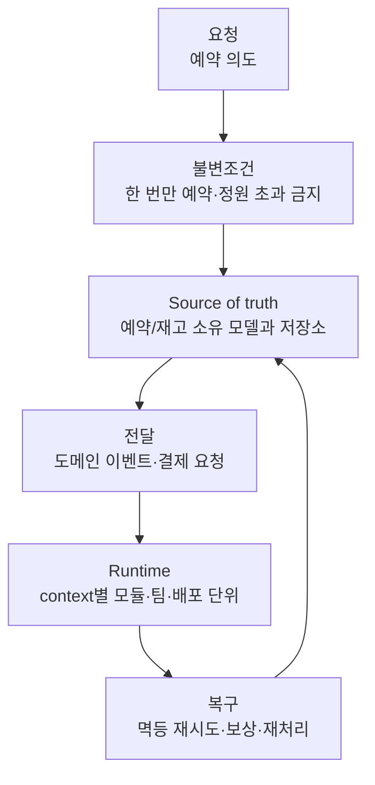
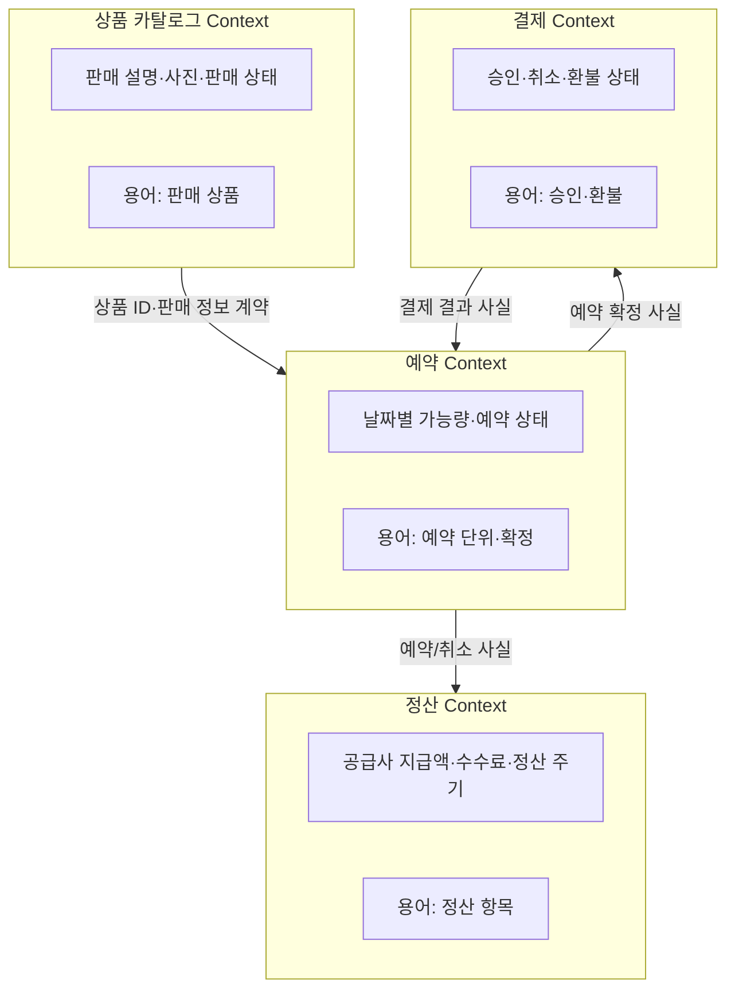
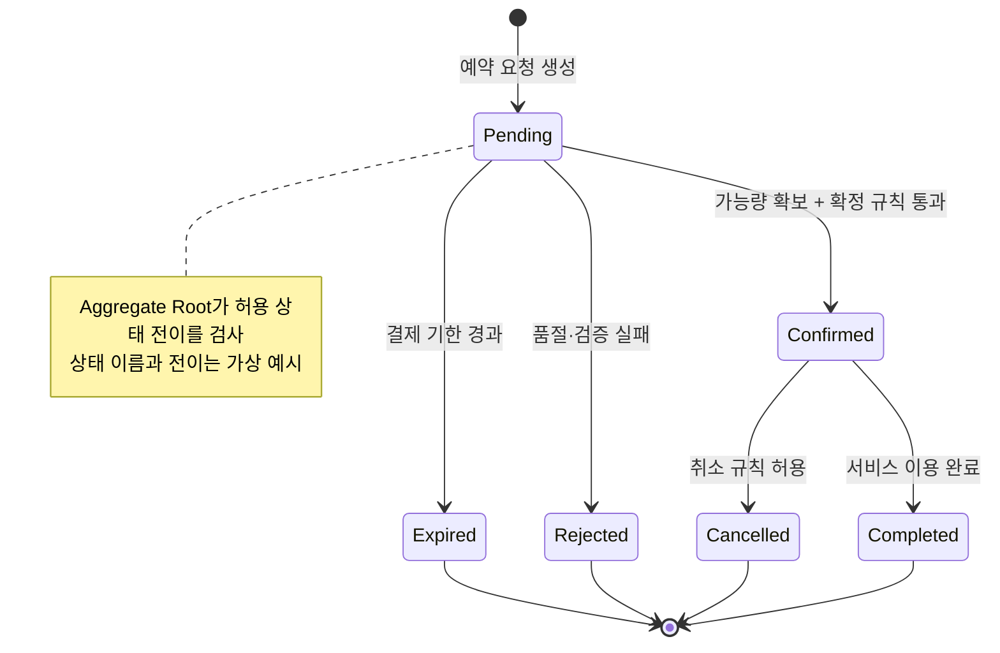

## DDD 면접 준비: 업무 모델과 경계를 설계하기

이 문서는 **여행 상품 조회 → 예약 요청 → 결제 → 정산**을 예시로 Domain-Driven Design(DDD)의 목적과 주요 개념을 연결합니다. 회사의 내부 시스템이나 실제 도메인 모델을 설명하는 자료가 아닙니다. 면접에서 사용할 가상의 예시이며, 실제 와그가 어떤 bounded context, aggregate, 서비스 구조를 쓰는지는 단정하지 않습니다.

### 큰 그림: 요청에서 회복까지

이력서에 등장하는 mental model 을 DDD 에 연결하면 다음처럼 볼 수 있습니다.

```text
요청 → 업무 불변조건 → source of truth → 전달 → runtime → 복구
```



DDD 는 이 흐름에서 **업무 규칙이 어디에 있고, 누가 그 규칙과 데이터를 소유하며, 경계 사이에 어떤 계약으로 전달할지**를 명확히 하는 설계 접근입니다. 모든 규칙이 한 요청 안에서 원자적으로 처리되는 것은 아닙니다. Aggregate 안의 불변조건은 한 일관성 경계에서 지키고, 경계를 넘는 업무 과정은 이벤트·재시도·보상으로 다룰 수 있습니다.

### 1. DDD 의 목적과 흔한 오해

#### 비유

여행 상담팀, 예약팀, 정산팀이 모두 "상품"이라는 말을 쓰더라도 같은 것을 뜻하지 않을 수 있습니다. 상담팀은 사진과 설명이 있는 판매 목록을, 예약팀은 특정 날짜의 좌석·정원을, 정산팀은 공급사와 정산할 계약 항목을 말할 수 있습니다. 한 개의 거대한 데이터 모델로 모두를 표현하려 하면 각자의 규칙이 뒤섞입니다.

DDD 는 복잡한 업무를 이해하고 소프트웨어 모델에 담는 방법입니다. 개발자와 도메인 전문가가 규칙을 함께 찾고, 코드와 대화에서 같은 의미의 말을 사용하며, 의미와 규칙이 달라지는 곳에 경계를 둡니다. 기술 계층이나 DB 테이블부터 시작하기보다 **업무가 어떤 결과를 보장해야 하는지**부터 살핍니다.

#### DDD 가 하려는 일

- 복잡하고 자주 바뀌는 핵심 업무 규칙을 명시하고 테스트 가능한 모델에 둡니다.
- 같은 용어가 대화·문서·코드에서 같은 뜻으로 쓰이게 합니다.
- 서로 다른 모델과 변경 속도를 가진 영역의 경계를 찾습니다.
- 그 경계 안에서 entity, value object, aggregate 같은 tactical pattern 을 선택합니다.
- 업무가 단순한 곳에는 간단한 CRUD 모델을 허용하고, 복잡도가 높은 핵심 영역에 모델링 노력을 집중합니다.

#### DDD 가 자동으로 의미하지 않는 것

- DDD = microservices 가 아닙니다. 단일 모놀리스 안에서도 bounded context 를 나누고 언어를 명확히 할 수 있습니다.
- DDD = 모든 테이블을 entity 로 만들거나, 모든 코드에 aggregate/repository/domain service 를 추가하는 것이 아닙니다.
- 모든 규칙을 도메인 객체 하나 안에 몰거나, 모든 조회를 repository 로만 해야 한다는 뜻이 아닙니다.
- 모든 도메인에 rich object model 이 필요한 것은 아닙니다. 단순 CRUD 영역은 단순한 구조가 더 경제적일 수 있습니다.
- 기술 구조만 바꾼다고 도메인 지식이 생기지 않습니다. 현업과의 대화, 용어 확인, 사례와 예외의 탐색이 핵심입니다.

### 2. Strategic DDD: 시스템의 큰 경계

#### Subdomain 과 bounded context

**Subdomain**은 업무 자체를 관심과 역량에 따라 나눈 영역입니다. 예를 들어 여행 예약 서비스의 가상 분석에서 상품 카탈로그, 예약 가능량, 예약, 결제, 공급사 정산, 사용자 신원 등이 후보가 될 수 있습니다. 이것은 분석 가설이며 실제 조직 구조나 서비스 분리와 같다고 볼 수 없습니다.

**Bounded context** 는 특정 모델과 용어가 일관된 의미를 갖는 경계입니다. 경계 안에서 `상품`, `예약`, `취소` 의 뜻과 규칙을 명확하게 정합니다. 같은 `상품` ID 를 참조해도 Catalog 의 상품 설명 모델과 Booking 의 예약 스냅샷은 다른 모델일 수 있습니다.

**비유:** 같은 사람이 호텔에서는 "투숙객", 예약 시스템에서는 "예약자", 회계에서는 "지급 대상"으로 보일 수 있습니다. 사람이 같아도 context 마다 필요한 속성과 업무 규칙이 다릅니다.



그림의 Context 와 화살표는 **설명용 가설**입니다. 어떤 context 가 실제 별도 서비스인지, 동기 API 인지 이벤트인지, 어떤 데이터가 소유되는지는 요구사항과 운영 상황에 따라 달라집니다. 중요한 점은 경계 사이에서 상대 context 의 DB 테이블이나 내부 엔티티에 직접 의존하지 않고, 명시적인 ID·API·이벤트 계약을 사용한다는 것입니다.

#### Ubiquitous Language(보편 언어)

**큰 그림에서:** 요청과 업무 불변조건을 같은 말로 표현하고, 요구사항 오해를 줄입니다.

개발자와 도메인 전문가가 한 context 안에서 함께 사용하는 언어입니다. 단순히 멋진 클래스 이름을 짓는 것이 아닙니다. 예를 들어 "예약 완료"가 고객이 신청 버튼을 누른 상태인지, 재고를 잡고 결제가 승인된 상태인지, 공급사 확정까지 끝난 상태인지 합의해야 합니다. 용어는 대화·문서·코드·테스트에서 일관되게 사용하고, 다른 context 에서 의미가 달라지면 그 차이를 드러냅니다.

**언제 도움이 되나:** 예약 취소 가능 시점, 바우처 발급 조건, 환불액 계산처럼 담당자마다 다르게 설명하는 규칙이 자주 바뀌거나 예외가 많을 때입니다.

**실패 모드:** 개발자가 먼저 용어를 정해 현업에 강요하거나, 같은 이름을 맥락마다 다른 의미로 쓰면서 공통 모델인 척하는 것. 실제 사례를 통해 용어와 상태 전이를 함께 확인합니다.

#### Context map(컨텍스트 맵)

**큰 그림에서:** source of truth 와 전달 경로가 context 사이에 어떻게 놓이는지 표시합니다.

Context map 은 bounded context 들 사이의 관계와 통합 방식을 드러냅니다. 예를 들어 Booking 이 Catalog 에서 판매 상품 ID 만 참조하는지, 판매명과 가격을 예약 시점에 스냅샷으로 보존하는지, Payment 결과를 동기 API 로 기다리는지 이벤트로 받는지 등을 설계 가정과 함께 표시할 수 있습니다.

- **Upstream/downstream:** 어느 context 가 정보를 제공하고 어느 쪽이 소비하는지 나타냅니다.
- **Published language:** 여러 소비자가 이해할 공개 계약/이벤트 형식입니다.
- **Anti-corruption layer(ACL):** 외부 모델을 내부 도메인 모델에 그대로 스며들지 않게 번역하는 층입니다. 레거시 코드나 공급사 API 의 용어·형식이 내부 규칙과 다를 때 쓸 수 있습니다.
- **Conformist:** 상대 모델을 따르는 편이 비용상 합리적일 때 소비자 쪽이 그 모델을 수용하는 관계입니다. 항상 ACL 을 만드는 게 정답은 아닙니다.

**선택 기준:** 통합이 잦고 의미가 다르면 번역 경계를 둡니다. 안정적이고 단순한 계약이라면 직접 매핑이 더 단순할 수 있습니다. context map 은 현재의 사실뿐 아니라 확인되지 않은 가정과 책임자를 기록하는 데도 유용합니다.

### 3. Tactical DDD: 경계 안의 모델 구성 요소

#### Aggregate 와 Aggregate Root

**큰 그림에서:** 불변조건을 source of truth 의 한 일관성 경계 안에서 지키는 모델입니다.

**비유:** Aggregate 는 한 명의 책임자가 점검하는 업무 장부 묶음입니다. 외부에서는 Aggregate Root 라는 창구로만 변경을 요청합니다. root 가 유효한 상태 전이를 확인하고 내부 구성 객체를 보호합니다.

Aggregate 는 한 개 이상의 entity 로 구성되며, root 는 외부에서 접근 가능한 일관성 경계의 진입점입니다. 업데이트는 root 의 동작을 통해 수행하고, aggregate 내부 규칙을 항상 지키도록 합니다. 다른 aggregate 는 보통 객체 참조 대신 ID 로 연결합니다. Aggregate 는 DB 테이블 묶음과 같은 개념이 아닙니다.

가상의 `Booking` aggregate 후보:

- Root: `Booking`
- 내부 상태/값: 예약 상태, 선택한 날짜, 인원 수, 당시의 가격 스냅샷, 예약자 정보의 필요한 일부
- 불변조건: 예약 인원은 양수, 이미 취소된 예약은 다시 확정할 수 없음, 동일 예약의 확정 처리는 한 번만 적용
- 외부 aggregate 참조: `ProductId`, `PaymentId` 같은 식별자

**정원/재고 주의:** 한 상품의 잔여량을 Booking aggregate 내부 숫자로만 관리하는 게 맞는지는 요구사항에 따라 다릅니다. 예약이 매우 많고 여러 상품·날짜에서 재고를 공유하면 별도의 `Availability`/inventory consistency boundary 가 필요할 수 있습니다. "예약과 재고는 무조건 하나의 aggregate"라고 단정하지 말고, 동시에 지켜야 하는 불변조건과 경합 단위를 찾아 경계를 정합니다.



다이어그램은 단순화한 상태 모델입니다. 실제 결제 대기, 공급사 승인, 부분 취소, 재예약, 환불 단계가 있다면 별도 상태나 workflow 로 표현할 수 있습니다. 상태를 임의로 바꾸는 대신 `confirm()`, `cancel(reason)` 같은 도메인 동작으로 허용 조건을 보호합니다.

**Aggregate 크기 원칙:** 한 트랜잭션에서 반드시 일관돼야 하는 데이터만 포함하도록 작게 설계합니다. 너무 크면 서로 무관한 변경이 같은 락/버전 경합에 걸리고, 너무 작으면 매 요청마다 여러 aggregate 를 동기 변경해 결합이 강해집니다. 경계를 넘는 동시성은 이벤트·프로세스·재시도로 풀 수 있는지 따집니다.

#### Entity 와 Value Object

**큰 그림에서:** 업무 상태와 규칙을 표현합니다.

- **Entity:** 속성이 바뀌어도 지속되는 식별성이 중요합니다. 예약의 날짜나 상태가 달라져도 `BookingId` 가 같으면 같은 예약입니다.
- **Value Object(값 객체):** 독립된 식별성보다 값 자체의 의미가 중요합니다. `Money(amount, currency)`, `DateRange(start, end)`, `PassengerCount` 등으로 표현할 수 있습니다. 보통 불변으로 만들고, 생성 시 유효성을 보장합니다.

값 객체는 단순한 타입 장식이 아닙니다. `Money` 가 통화를 확인하고 덧셈 규칙을 제공하면 잘못된 연산을 줄일 수 있습니다. 단순 CRUD 라면 모든 문자열을 값 객체로 감싸는 것이 오히려 복잡할 수 있습니다.

#### Domain Service 와 Application Service

**큰 그림에서:** 불변조건과 요청 orchestration 을 각자 올바른 위치에 둡니다.

- **Domain service:** 의미 있는 업무 규칙이지만 특정 entity/value object 하나의 책임으로 자연스럽게 귀속되지 않을 때 쓰는 상태 없는 도메인 연산입니다. 예: 복수의 할인/정책을 조합하는 가격 산정 규칙이 특정 엔티티 소유로 보기 어려울 때. 단순한 CRUD service 를 domain service 라고 부르지 않습니다.
- **Application service/use case:** 요청을 처리하는 순서를 조정합니다. 사용자 권한 확인, aggregate/repository 로드, 도메인 동작 호출, 트랜잭션 경계, 외부 adapter 호출 결과 반환 등을 조율합니다. 비즈니스 규칙 자체를 전부 여기에 쌓지 않습니다.

도메인 규칙이 entity/value object 행동으로 표현될 수 있으면 우선 그곳에 둡니다. 여러 entity 에 걸친 규칙은 domain service 가 후보입니다. 다만 도메인 모델을 과하게 쪼개지 않으며, 팀의 코드 스타일과 복잡도를 고려합니다.

#### Domain Event 와 Integration Event

**큰 그림에서:** 한 불변조건이 성공한 뒤 의미 있는 사실을 다른 작업이나 context 에 전달합니다.

- **Domain event:** 해당 context 안에서 일어난 도메인상 의미 있는 사실. 예: `BookingConfirmed`, `BookingCancelled`. "DB row 가 수정됨" 같은 기술 이벤트보다 업무 결과를 이름으로 나타냅니다.
- **Integration event:** 다른 bounded context 나 외부 시스템에 공개하는 비동기 계약입니다. 도메인 이벤트와 같은 형식일 필요가 없으며, 외부 계약에 맞춰 별도 버전 관리할 수 있습니다.
- 결제/정산처럼 DB 커밋과 메시지 전송을 함께 보장해야 할 때 **outbox**를 검토합니다. DB 에 상태와 발행할 메시지를 같은 트랜잭션으로 저장하고, 별도 발행자가 재시도합니다. 소비자는 중복 전달에 대비해 멱등해야 합니다.
- 여러 context 를 가로지르는 예약→결제→확정 과정은 하나의 ACID 트랜잭션이라고 가정하지 않습니다. 단계별 상태, 타임아웃, 재시도, 실패 시 보상/취소 정책을 workflow 또는 saga 로 설계할 수 있습니다.

#### Repository

**큰 그림에서:** 애플리케이션/도메인 모델이 source-of-truth 저장소를 다루는 추상화입니다.

Repository 는 특정 aggregate 를 저장소에서 가져오고 저장하는 컬렉션 같은 인터페이스로 생각할 수 있습니다. 개념적으로 `BookingRepository.get(id)` 와 `save(booking)` 같은 동작을 둡니다. 보통 테이블마다 repository 를 기계적으로 하나씩 만드는 게 목적이 아닙니다. 구현체는 DB, ORM, 외부 저장소와 연결하는 infrastructure 에 둘 수 있습니다.

쓰기 경로는 aggregate root 의 불변조건을 우회하지 않게 설계합니다. 읽기 전용 화면 조회는 반드시 aggregate 전체를 불러야 하는 것이 아니며, DTO/쿼리 전용 접근을 사용할 수 있습니다. CQRS 를 선택했다면 명령 모델의 일관성 경계와 조회 모델의 갱신 지연을 명시합니다.

### 4. DDD 와 MSA: 관계와 trade-off

Bounded context 는 서비스 경계의 좋은 후보지만 **경계와 배포 단위가 일대일이어야 한다는 규칙은 없습니다.** 한 context 가 규모상 여러 runtime 서비스로 나뉘거나, 초기에 여러 context 를 모놀리스 모듈로 함께 배포할 수 있습니다. 중요한 것은 업무 언어·모델·변경 이유의 경계와 데이터 소유권을 명확히 하는 것입니다.

#### 분리의 장점

- 팀이 업무 규칙과 데이터를 독립적으로 변경할 수 있습니다.
- 서로 다른 조회·가용성·보안 요구를 독립적으로 선택할 수 있습니다.
- 경계가 올바르면 코드 변경의 전파와 조직 간 조율을 줄일 수 있습니다.

#### 비용과 실패 모드

- 네트워크 호출, 지연, 부분 장애, 메시지 중복·순서 변화가 추가됩니다.
- 여러 서비스의 원자적 커밋이 어려워지고 eventual consistency, saga, 보상 정책이 필요할 수 있습니다.
- context 를 너무 잘게 나누면 채터링과 운영 부담이 커집니다. 서로 자주 동기 호출하고 함께 바뀌는 모델은 경계를 다시 검토해야 합니다.
- 데이터 중복 자체가 항상 잘못은 아니지만, 어느 쪽이 진실의 원천인지와 갱신 책임이 불분명하면 불일치가 발생합니다.
- 분산 트랜잭션을 피하려다 재시도·중복 처리를 설계하지 않으면 더 큰 정합성 문제가 생깁니다.

면접에서는 "DDD 를 쓰면 MSA 로 나눕니다" 대신 "도메인 경계를 먼저 이해하고, 모듈러 모놀리스로 시작할지 별도 배포할지는 팀 자율성, 장애 격리, 변경 속도, 데이터 일관성 요구와 운영 비용을 보고 선택합니다"라고 답하세요.

### 5. 실제 경험과 학습한 DDD 지식 구분

**이력서 기술 목록(Architecture)에 Domain-Driven Design 이 적혀 있습니다.** 그래서 "DDD 를 어디에 적용했나요?"라는 질문이 나올 가능성이 높고, "학습 중입니다"라는 답은 이력서와 충돌합니다. 이력서에 있는 실제 작업을 DDD 의 용어로 연결해 설명합니다.

| 이력서의 실제 작업 | DDD 로 보면 |
|---|---|
| VMMe Pro 앱: 운동 규칙을 domain·application·infrastructure·presentation 으로 나눔 | 도메인 규칙을 기술 세부(화면, 저장소, 미디어 재생)와 분리한 도메인 모델 계층 |
| 운동 세션의 시간·재개·완료를 상태 모델로 구현 | 상태 전이 규칙을 한 모델이 통제하는 entity(aggregate root 역할). 허용되지 않은 전이는 모델이 거부 |
| 절대 종료 시각을 사용해 재개 때 시간 오차가 쌓이지 않게 함 | "남은 시간이 실제 시간과 어긋나지 않는다"는 불변조건을 모델의 표현 방식으로 지킴. 종료 시각은 값 객체 후보 |
| 미디어 동기화를 재생 서비스로 구현 | 도메인 모델과 외부 기술(플레이어)을 조율하는 application service |
| 전담 기획자 없이 도메인 전문가와 요구사항·검수 기준을 맞춤 | 도메인 전문가와 같은 말로 규칙과 예외를 정하는 ubiquitous language 의 실천 |
| 도메인 모델을 기획자·사용자 입장의 행위 기준으로 테스트(거의 BDD) | 합의한 규칙을 도메인 언어 그대로 테스트 이름과 시나리오로 남김. 테스트 목록이 곧 보편 언어로 쓴 규칙 명세 ([테스트 전략](09_테스트_전략.md) 참고) |
| 컨두잇: 주주 인증·가중 투표 규칙을 화면에서 분리해 단위 테스트 | 금융 도메인 규칙을 도메인 계층에 두고 UI 와 독립적으로 검증 |
| VMMe Pro 인증 서버: domain model 과 JPA entity 를 분리하고 persistence adapter 가 변환·저장 | 도메인 모델이 저장 기술에 의존하지 않도록 한 repository/adapter 구조. 이 서버에서 JPA 엔티티와 Repository 를 직접 작성 |
| Android 재작성: feature 별 공개 API 와 구현 모듈 분리 | 경계 밖에는 공개 계약만 노출하는 원리(bounded context 의 published interface 와 비슷한 사고) |

**경계를 둘 부분:** 도메인 전문가와 bounded context 나 context map 을 공식 산출물로 만든 전략적 DDD, 그리고 서버에서 domain event·aggregate 경계를 처음부터 설계한 경험은 없다고 말합니다.

**경험 질문에 쓸 답변:** "DDD 는 주로 전술적인 부분을 적용했습니다. VMMe Pro 앱에서 운동 세션을 상태 전이 규칙을 가진 도메인 모델로 두고, 시작·일시정지·재개·완료 같은 전이를 모델의 메서드로만 바꾸게 했습니다. 재개할 때 시간 오차가 쌓이지 않도록 남은 시간 대신 절대 종료 시각을 모델에 두어, 불변조건을 표현 방식으로 지켰습니다. 미디어 재생과의 동기화는 application service 가 조율하고, 저장과 화면은 infrastructure 와 presentation 으로 분리했습니다. 기획자가 없는 팀이라 도메인 전문가와 직접 용어와 검수 기준을 맞췄습니다. 서버에서는 인증 서버가 domain model 과 JPA entity 를 분리한 구조였고, 저는 그 안에서 엔티티와 Repository 를 작성했습니다. context map 같은 전략적 DDD 산출물을 공식적으로 만든 적은 없습니다."

>이 절과 아래 실경험 답변은 이력서 문장을 DDD 용어로 옮긴 것입니다. "시작·일시정지·재개·완료"는 운동 세션의 실제 상태 이름으로 바꾸고, "상태는 모델의 메서드로만 바꾼다" 같은 구현 설명이 실제 코드와 다르면 코드에 맞게 고쳐 말합니다.

### 6. 면접 질문과 답변 연습

#### Q1. DDD 란 무엇이고 언제 쓰나요?

**20 초 답변:** "복잡한 업무 규칙을 현업과 개발자가 함께 이해하고, 같은 용어와 명시적인 경계로 코드에 담는 설계 접근입니다. 모든 CRUD 에 적용하는 패턴 모음이라기보다 복잡한 핵심 업무에서 가치가 큽니다."

**상세 답변:** "먼저 업무 언어와 규칙을 도메인 전문가와 확인하고, 모델의 의미가 달라지는 bounded context 를 찾습니다. 각 context 안에서 불변조건을 지킬 entity/value object/aggregate 를 설계하고, 경계 사이에는 명시적인 계약과 전달 방식을 둡니다. 단순한 영역에는 단순 모델을 두고, 변경이 잦고 실수가 비싼 핵심 규칙에 모델링 노력을 집중합니다."

**실경험 답변:** "VMMe Pro 앱에서 운동 세션의 상태와 규칙을 도메인 모델로 두고 domain/application/infrastructure/presentation 으로 책임을 나눈 뒤 테스트했습니다. 도메인 전문가와 용어와 검수 기준을 맞춘 것도 같은 맥락입니다. 이렇게 전술적인 부분은 실무에서 적용했고, context map 같은 전략적 산출물은 만든 적이 없습니다."

**꼬리질문 1 — 반박:** "그럼 도메인 클래스만 만들면 DDD 인가요?"

**답변:** "아닙니다. 핵심은 실제 업무 언어와 규칙을 공유하고 적절한 경계를 찾는 것입니다. 클래스 이름에 Order 나 Aggregate 를 붙여도 규칙이 서비스 곳곳에 흩어지고 현업 의미와 어긋나면 목적을 달성하지 못합니다."

**꼬리질문 2:** "작은 CRUD 에도 aggregate 와 domain service 를 다 만들겠습니까?"

**답변:** "아닙니다. 독립적인 업무 규칙과 복잡도가 낮다면 단순한 CRUD 구조가 더 명확하고 비용도 낮습니다. DDD 패턴은 불변조건과 변경 이유가 분명해질 때 도입하겠습니다."

#### Q2. Bounded context 와 microservice 는 어떻게 다릅니까?

**20 초 답변:** "Bounded context 는 모델과 언어가 일관된 업무 경계이고, microservice 는 배포·운영 단위입니다. context 가 서비스 경계 후보가 되지만 둘이 반드시 일대일은 아닙니다."

**상세 답변:** "예를 들어 가상 여행 서비스에서 판매용 상품 모델과 예약 확정 모델은 필요한 정보와 규칙이 다를 수 있습니다. 먼저 의미와 책임을 context 로 나누고, 독립 배포의 이점이 네트워크·운영·정합성 비용보다 큰지 판단해 runtime 을 정합니다. 초기에 모듈러 모놀리스로 context 를 분리해 둘 수도 있습니다."

**실경험 답변:** "Android 앱을 재작성하며 feature 별 공개 API 모듈과 구현 모듈을 나눠, 다른 기능은 공개 API 에만 의존하게 했습니다. 경계 밖에는 계약만 보이고 내부 구현은 바꿔도 소비 쪽까지 번지지 않는다는 점에서, bounded context 사이를 명시적 계약으로 잇는 원리와 같습니다. 다만 그것은 한 앱 안의 모듈 경계이고, 서버의 bounded context 를 나눠 서비스로 배포한 설계와는 규모가 다릅니다."

**꼬리질문 1 — 반박:** "서비스가 자주 동기 호출하면 어떻게 하죠?"

**답변:** "요청 지연과 부분 장애가 서로 전파되고 운영 결합이 커질 수 있습니다. 두 context 가 실제로 하나의 업무 규칙과 변경 단위를 공유하는지 확인해 경계를 합치거나, 비동기 계약과 로컬 읽기 모델을 검토하겠습니다."

**꼬리질문 2:** "데이터를 복제하면 원본과 어긋나지 않나요?"

**답변:** "복제하면 갱신 지연과 중복 전달을 처리해야 합니다. 어느 context 가 source of truth 인지 정하고 이벤트 버전·멱등 소비·재처리·불일치 탐지 경로를 둡니다. 즉시 최신성이 꼭 필요한 조회는 복제 모델이 맞는지 다시 검토합니다."

#### Q3. Aggregate 와 Aggregate Root 의 역할은 무엇인가요?

**20 초 답변:** "Aggregate 는 함께 일관성을 지켜야 하는 객체 경계이고, Aggregate Root 는 그 상태 변경을 통제하는 외부 진입점입니다."

**상세 답변:** "root 의 메서드가 상태 전이와 불변조건을 검사하고 자식 객체 변경을 통제합니다. aggregate 경계는 한 트랜잭션에서 꼭 함께 일관돼야 하는 범위로 작게 잡습니다. 다른 aggregate 는 ID 로 참조하고, 경계를 넘는 업무 흐름은 이벤트나 workflow 로 조정합니다."

**실경험 답변:** "앱의 운동 세션이 aggregate root 와 같은 역할을 했습니다. 세션의 상태와 시간 규칙은 세션 모델의 메서드로만 바꿀 수 있게 하고, 밖에서 상태 값을 직접 고치지 못하게 했습니다. 서버에서 aggregate 경계를 처음부터 설계해 본 적은 없지만, 예약이라면 예약 상태 전이는 Booking root 가 통제하게 하고, 여러 예약이 공유하는 재고를 같은 aggregate 에 둘지는 경합 단위와 일관성 요구로 정하겠습니다."

**꼬리질문 1 — 반박:** "예약과 재고는 함께 바뀌니 무조건 하나의 aggregate 아닌가요?"

**답변:** "한 요청에서 같이 바뀐다는 사실만으로 결정할 수 없습니다. 반드시 원자적으로 지켜야 할 규칙이 무엇인지, 재고가 여러 예약에 공유되는지, 경합·잠금 범위가 어떤지 봅니다. 공유 재고를 한 aggregate 로 두면 병목이 될 수 있고, 분리하면 예약 취소 때 재고 복구를 비동기로 조정해야 할 수 있습니다."

**꼬리질문 2:** "그럼 여러 aggregate 를 한 DB 트랜잭션에 저장하면 안 되나요?"

**답변:** "기술적으로 가능할 수 있지만, aggregate 경계의 목적과 서비스 경계를 약화시킬 수 있습니다. 강한 원자성이 업무상 꼭 필요한지 확인하고, 꼭 필요하다면 모델 경계를 재검토합니다. 최종적으로 분리할 경우 이벤트·재시도·보상으로 일관성 정책을 명시합니다."

#### Q4. Entity, Value Object, Domain Service 는 어떻게 구분하나요?

**20 초 답변:** "Entity 는 식별자와 생애주기가 중요하고, Value Object 는 값 자체가 의미이며, Domain Service 는 특정 객체 하나에 속하지 않는 업무 규칙을 표현합니다."

**상세 답변:** "예약은 상태가 바뀌어도 같은 BookingId 로 이어지므로 entity 입니다. 금액과 통화를 함께 다루는 Money, 날짜 범위는 값 객체 후보입니다. 복수 정책을 조합하는 가격 산정처럼 한 entity 에 두기 부자연스러운 규칙은 domain service 를 고려합니다. 값 객체는 불변으로 두고 생성 시 잘못된 상태를 막습니다."

**실경험 답변:** "운동 세션은 같은 세션 ID 로 상태가 이어지는 entity 이고, 절대 종료 시각은 값 자체가 의미인 값 객체 후보였습니다. 남은 시간을 매번 빼서 저장하면 재개할 때 오차가 쌓이지만, 종료 시각이라는 값으로 표현하면 언제 계산해도 같은 결과가 나와 불변조건을 지키기 쉬웠습니다. 미디어 재생과 맞추는 일처럼 여러 객체와 외부 기술을 조율하는 부분은 재생 서비스로 분리했습니다."

**꼬리질문 1 — 반박:** "가격 계산은 어차피 Service 클래스에 넣으면 되는 것 아닌가요?"

**답변:** "Application service 가 호출 순서를 조정하는 것과 domain service 가 도메인 규칙을 표현하는 것은 역할이 다릅니다. 가격 규칙이 하나의 Money 나 Booking 행위에 자연스럽게 속하면 그곳에 두고, 여러 개념을 조합하는 규칙이면 domain service 를 고려합니다."

**꼬리질문 2:** "Value Object 는 무조건 불변이어야 하나요?"

**답변:** "DDD 에서 값 객체는 값으로 동등성이 결정되고 변경 시 새 값으로 교체하는 불변 모델이 일반적입니다. ORM 구현 편의 때문에 가변으로 만들더라도 외부에서 유효하지 않은 상태를 만들지 않도록 경계를 보호해야 합니다."

#### Q5. 예약과 결제 context 사이의 일관성을 어떻게 맞추나요?

**20 초 답변:** "예약 DB 와 결제 DB 를 하나의 ACID 트랜잭션으로 묶는다고 가정하지 않습니다. 상태 전이, 이벤트 전달, 멱등 소비, 재시도와 실패 보상으로 업무 흐름을 설계합니다."

**상세 답변:** "예를 들어 Booking 은 결제 대기 상태로 저장하고, 결제 요청을 outbox 에 함께 기록할 수 있습니다. publisher 가 재시도해 Payment 에 전달하고, 결제 성공/실패 이벤트를 Booking 이 멱등 처리해 확정·만료 상태로 전이합니다. 결제 응답이 늦거나 유실된 경우 조회·재처리 경로를 정하고, 취소/환불이 필요하면 보상 작업을 정의합니다."

**실경험 답변:** "제가 예약·결제 MSA 를 운영한 경험은 없습니다. 과거 Go API 의 JWT/Redis 세션과 Oracle 프로시저 연동 경험은 있지만, 이는 분산 결제 workflow 경험과 다릅니다. 원리를 기준으로 먼저 각 데이터의 source of truth 와 중복 요청·실패 상태를 정의하겠습니다."

**꼬리질문 1 — 반박:** "메시지를 한 번만 전달하면 중복 처리는 필요 없지 않나요?"

**답변:** "네트워크 오류 상황에서 publisher 는 소비자가 처리했는지 확신하지 못해 다시 보낼 수 있고, 일반적으로 전달은 중복될 수 있다고 설계합니다. 이벤트 ID 나 업무 키로 소비 처리를 멱등하게 하고, outbox 발행도 재시도 가능하게 만듭니다."

**꼬리질문 2:** "결제는 성공했는데 Booking 이 계속 결제 대기라면요?"

**답변:** "이벤트 재전달·DLQ/재처리와 주기적 대사(reconciliation)를 두고, 결제 상태를 권위 있는 source 에서 확인할 수 있어야 합니다. 만료와 성공이 동시에 경합하면 상태 전이 조건으로 한쪽만 적용되도록 하고, 잘못 취소된 결제는 환불/보상 정책을 따릅니다."

#### Q6. 이력서 기술에 DDD 를 적었는데, 실제로 어디에 적용했나요?

**20 초 답변:** "전술적인 DDD 를 앱과 서버 코드에 적용했습니다. VMMe Pro 앱에서는 운동 세션을 상태 전이 규칙을 가진 도메인 모델로 두고 기술 세부와 계층을 나눴고, 인증 서버에서는 domain model 과 JPA entity 를 분리한 구조에서 엔티티와 Repository 를 작성했습니다. context map 같은 전략적 산출물은 만든 적이 없습니다."

**상세 답변:** "운동 세션의 시작부터 완료까지의 전이는 세션 모델의 메서드로만 일어나게 했고, 재개할 때 시간 오차가 쌓이지 않도록 절대 종료 시각을 모델에 두었습니다. 미디어 동기화는 재생 서비스가 조율하고, 저장과 화면은 바깥 계층으로 뺐습니다. 기획자가 없는 팀이라 도메인 전문가와 직접 용어와 검수 기준을 맞췄는데, 이것이 ubiquitous language 를 만드는 과정이었다고 생각합니다. 컨두잇에서도 주주 인증과 가중 투표 규칙을 화면에서 떼어 도메인 계층에서 단위 테스트했습니다."

**꼬리질문 1 — 반박:** "그건 그냥 Clean Architecture 아닌가요?"

**답변:** "계층과 의존 방향을 나눈 것은 Clean Architecture 에 가깝습니다. DDD 라고 말하는 부분은 그 안의 모델링입니다. 상태 전이와 불변조건을 도메인 모델이 직접 지키게 한 것, 도메인 전문가와 같은 용어로 규칙을 정한 것이 DDD 의 핵심과 맞닿아 있습니다. 둘은 함께 쓰이지만, Clean Architecture 는 의존 방향을, DDD 는 무엇을 어떤 경계로 모델링할지를 다룬다고 구분합니다."

**꼬리질문 2:** "서버에서 DDD 를 한다면 무엇부터 하겠어요?"

**답변:** "먼저 도메인 담당자와 용어를 맞추고, 같은 단어가 다른 뜻으로 쓰이는 지점을 찾아 bounded context 후보를 잡겠습니다. 예약이라면 '확정'이 결제 승인인지 공급사 확정인지부터 정합니다. 그 다음 반드시 함께 지켜야 하는 불변조건을 기준으로 aggregate 를 작게 잡고, 경계를 넘는 흐름은 도메인 이벤트와 상태 전이로 연결하겠습니다."

### 면접 직전 기억할 문장

- DDD 는 패턴을 많이 쓰는 일이 아니라 **업무 언어·경계·불변조건을 명확히 하는 일**입니다.
- Strategic DDD 는 subdomain, bounded context, context map 을 찾고, tactical DDD 는 그 안의 모델과 행동을 설계합니다.
- Aggregate root 는 한 consistency boundary 의 상태 변경을 통제합니다. 모든 관련 데이터를 하나의 큰 aggregate 에 넣지 않습니다.
- Bounded context 는 microservice 후보이지 배포 서비스와 자동으로 일대일이 아닙니다.
- 이력서에 DDD 를 적었으므로 "어디에 적용했나"에 바로 답합니다: 운동 세션 상태 모델(entity·불변조건·절대 종료 시각), 계층 분리, 도메인 전문가와 용어 맞추기, 컨두잇 투표 규칙 분리, 인증 서버의 domain model–JPA entity 분리. 전략적 DDD(context map) 산출물은 없다고 구분합니다.

### 참고 자료

- [Microsoft Azure Architecture Center: Domain analysis and bounded contexts](https://learn.microsoft.com/en-us/azure/architecture/microservices/model/domain-analysis) — strategic DDD 와 context 분해
- [Microsoft Azure Architecture Center: Tactical DDD](https://learn.microsoft.com/en-us/azure/architecture/microservices/model/tactical-domain-driven-design) — entity, value object, aggregate, domain service, domain event
- [Microsoft Learn: Identify microservice boundaries](https://learn.microsoft.com/en-us/azure/architecture/microservices/model/microservice-boundaries) — context 와 서비스 경계 선택
- [Microsoft Learn: Designing a DDD-oriented microservice](https://learn.microsoft.com/en-us/dotnet/architecture/microservices/microservice-ddd-cqrs-patterns/ddd-oriented-microservice) — aggregate root 및 레이어 경계
- [Microsoft Learn: Domain model and aggregate root](https://learn.microsoft.com/en-us/dotnet/architecture/microservices/microservice-ddd-cqrs-patterns/microservice-domain-model) — entity, value object, aggregate
- [Microsoft Learn: Persistence layer and repositories](https://learn.microsoft.com/en-us/dotnet/architecture/microservices/microservice-ddd-cqrs-patterns/infrastructure-persistence-layer-design) — repository 와 aggregate 관계
- [Ubiquitous Language specification](https://www.ubiquitouslanguage.org/understand/what-a-ubiquitous-language-is/) — bounded context 안의 언어
- [Eric Evans, DDD Reference Definitions and Pattern Summaries (PDF)](https://domainlanguage.com/wp-content/uploads/2016/05/DDD_Reference_2015-03.pdf) — DDD 패턴 정의 요약
