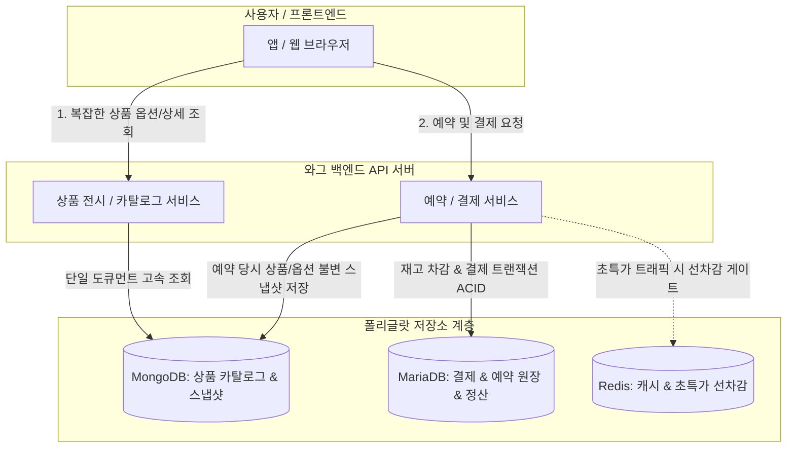

## MongoDB · 폴리글랏 저장소: 면접 준비

>**연습 방식:** 각 질문은 20 초 답변으로 핵심만 말하고, 더 물으면 60 초 답변으로 설명을 확장한다. 이어지는 꼬리 질문 두 개까지 소리 내어 연습한다.

### 먼저 구분할 것: 이력서 경험과 면접 대비 개념

- **실제 이력서 경험:** MariaDB/MySQL(VMMe Pro 인증 서버 다중 데이터소스 `oauth2`, `vm3s`), Oracle 저장 프로시저(Hi-Tech 점검 연동), SQLite(모바일 내부 저장소) 등 **관계형 데이터베이스(RDBMS) 중심의 설계·트랜잭션·ORM 연동 경험**을 보유하고 있습니다.
- **MongoDB 대비 개념:** MongoDB를 프로덕션에서 직접 운영해 본 경험은 없습니다. 하지만 와그처럼 **여행 상품의 다형적(Polymorphic) 메타데이터와 주문 스냅샷**을 다루는 이커머스에서 MongoDB가 왜 도입되는지, RDBMS와의 역할 분담(Polyglot Persistence) 및 도큐먼트 모델링 기준을 명확히 이해하고 설명합니다.

> "제 주력 데이터베이스 경험은 MariaDB, Oracle, SQLite 같은 관계형 DB입니다. MongoDB를 프로덕션에서 직접 대규모 운영해 보지는 않았지만, 여행 플랫폼에서 정형화하기 어려운 복잡한 투어·티켓 옵션 스키마와 예약 당시 스냅샷을 다룰 때 MongoDB의 도큐먼트 모델이 RDBMS의 정규화 한계를 어떻게 보완하는지, 그리고 두 저장소 간의 데이터 정합성을 어떻게 맞추는지 이해하고 있습니다."

---

### 먼저 잡을 큰 그림: 여행 플랫폼(와그)에서 무엇이 어디에 저장되는가

여행 액티비티 플랫폼의 데이터는 성격이 극단적으로 나뉩니다.

1. **정형적이고 무결성이 절대적인 원장:** 결제, 환불, 회원 계정, 재고 수량, 공급사 정산
2. **비정형적이고 상품마다 제각각인 전시/메타데이터:** 파리 디즈니랜드 티켓 vs 다낭 바나힐 픽업 투어 vs 일본 eSIM

| 구분 | MariaDB (RDBMS) | MongoDB (Document NoSQL) |
| :--- | :--- | :--- |
| **도메인 역할** | **결제·주문 원장, 정산, 잔여 재고 수량** | **상품 카탈로그(전시), 옵션 스펙, 주문 스냅샷, 리뷰** |
| **비유** | 인감도장이 찍힌 공식 회계 장부 | 다채로운 내용이 철해진 서류철 / 브로슈어 |
| **데이터 구조** | 엄격한 2차원 테이블 (행과 열, FK 관계) | 중첩 가능한 JSON/BSON 도큐먼트 |
| **핵심 가치** | ACID 트랜잭션, 외래키 무결성, 정규화 | 유연한 스키마(다형성), 단일 쿼리 고속 조회 |
| **확장 방식** | 수직 확장(Scale-up), 읽기 복제본(Read Replica) | 수평 확장(Scale-out, Sharding), 복제셋(Replica Set) |

---

### 개념을 비유로 이해하기

#### 1. RDB vs MongoDB: 엑셀 장부와 서류철
- **RDBMS (엑셀 표):** 모든 칸(컬럼)이 정해져 있습니다. 한 행에 없는 정보도 빈칸(NULL)으로 두어야 하고, 다른 정보는 다른 시트(테이블)에 적어두고 찾아가야(JOIN) 합니다. 데이터 정합성은 완벽하지만, 구조가 자주 바뀌거나 형태가 제각각이면 표가 엉망이 됩니다.
- **MongoDB (폴더형 서류철):** 고객이나 상품마다 종이에 필요한 항목을 마음대로 적어 클립으로 묶어둔 서류철입니다. 상품 A에는 `{ 픽업장소, 가이드언어 }`가 적혀 있고, 상품 B에는 `{ 입장시간, 바우처QR타입 }`이 적혀 있어도 아무 문제 없이 같은 캐비닛(컬렉션)에 보관할 수 있습니다.

#### 2. 왜 여행 상품에 MongoDB가 필요한가? (다형적 스키마: Polymorphic Schema)
여행 플랫폼의 상품은 공산품과 달리 옵션 구조가 천차만별입니다.
- **테마파크 티켓:** 날짜 지정 여부, 연령대(성인/소인/경로), 입장권 등급(일반/패스트패스).
- **현지 데이 투어:** 호텔 픽업 여부, 미팅 포인트, 가이드 언어, 식사 포함 여부, 최소 출발 인원.
- **렌터카 / 유심:** 차종, 면책 보험 옵션, 데이터 용량(GB), 대여 기간.

이를 RDB로 정규화하면 `product`, `product_options`, `option_items`, `option_details`, `attributes`, `attribute_values` 등 **테이블 조인이 8~10개 이상** 발생합니다. 조회가 느려지고 쿼리가 거대해집니다. 반면, MongoDB는 상품 도큐먼트 하나 안에 옵션 배열과 상세 정보를 **통째로 내장(Embedding)**하여 `db.products.findOne({ _id: productId })` 단 1회의 쿼리로 화면에 필요한 전체 데이터를 밀리초 단위로 가져옵니다.

#### 3. 모델링 기준: Embedding(내장) vs Referencing(참조)
MongoDB 모델링의 핵심은 "무엇을 한 문서에 넣고, 무엇을 다른 문서로 쪼갤 것인가"입니다.

| 구분 | Embedding (도큐먼트 안에 내장) | Referencing (ID로 분리 참조) |
| :--- | :--- | :--- |
| **개념** | 한 서류철 안에 첨부 서류를 함께 묶어둠 | 관련 서류의 문서 번호(ID)만 적어둠 |
| **적합한 관계** | **1 : Few (소수)**, 함께 조회되고 함께 수정됨 | **1 : Many (대량)**, 독립적으로 자주 수정·조회됨 |
| **장점** | 한 번의 I/O로 연관 데이터를 모두 읽음 (No JOIN) | 도큐먼트 크기(16MB 한도) 초과 방지, 데이터 중복 제거 |
| **단점** | 도큐먼트 크기 증가, 중복 데이터 수정 시 비용 발생 | 조회 시 여러 번 쿼리하거나 `$lookup`(JOIN) 필요 |
| **예시** | 상품 옵션, 다국어 텍스트, 주문 시점의 스냅샷 | 상품에 달리는 **수만 개의 리뷰**, 사용자의 전체 주문 내역 |

> ⚠️ **BSON 도큐먼트의 16MB 한계:** MongoDB의 단일 도큐먼트는 16MB를 넘을 수 없습니다. 상품에 달리는 리뷰를 상품 도큐먼트의 배열로 계속 넣다가는 16MB를 초과해 장애가 발생하므로, 리뷰는 반드시 별도 컬렉션으로 분리하고 상품 ID를 참조(Referencing)해야 합니다.

#### 4. 주문 스냅샷 (Immutable Order Snapshot)
사용자가 상품을 예약한 뒤, 나중에 공급사(가이드/파트너사)가 상품 설명이나 옵션 가격, 취소 수수료 규정을 변경할 수 있습니다. 만약 주문 내역이 상품 테이블을 실시간 외래키(FK)로 바라보고 있다면 과거의 주문 내역이나 바우처 내용까지 왜곡됩니다.
- 주문 시점의 상품 상세, 옵션 스펙, 약관 전문을 **수정 불가능한 JSON 도큐먼트 형태로 MongoDB 주문 스냅샷에 박제**해 두면, 원본 상품이 수정되거나 삭제되어도 당시 계약 내용이 완벽하게 보존됩니다.

#### 5. 인덱스와 ESR(Equality, Sort, Range) 규칙
MongoDB 쿼리 최적화의 황금률은 **ESR 규칙**입니다. 복합 인덱스를 만들 때 필드 순서를 다음과 같이 배치해야 불필요한 인덱스 스캔과 인메모리 정렬(In-Memory Sort)을 막을 수 있습니다.
1. **E (Equality, 동등 조건):** 정확히 일치하는 조건 (예: `status: "ACTIVE"`, `category: "TOUR"`)
2. **S (Sort, 정렬 조건):** 정렬하려는 필드 (예: `price: 1`, `created_at: -1`)
3. **R (Range, 범위 조건):** 부등호 조건 (예: `eventDate: { $gte: ISODate(...) }`)

#### 6. 복제셋(Replica Set)과 Write / Read Concern
MongoDB는 고가용성을 위해 기본적으로 1개의 Primary와 2개 이상의 Secondary 노드로 구성된 복제셋을 사용합니다.
- **Write Concern (`w`):** 쓰기 작업이 몇 개의 노드에 기록되어야 클라이언트에게 성공을 응답할 것인가?
  * `w: 1` (기본): Primary에만 쓰이면 즉시 응답. 빠르지만, 복제 전에 Primary가 다운되면 쓰기 유실 위험.
  * `w: "majority"`: 과반수 노드에 복제된 것을 확인한 뒤 응답. 네트워크 단절이나 장애 시에도 롤백되지 않는 데이터 안전성 보장.
- **Read Concern:**
  * `local`: 현재 노드의 최신 데이터를 즉시 반환 (롤백될 가능성 미량 존재).
  * `majority`: 과반수가 승인한 커밋된 데이터만 읽음 (더 안전함).
- **Read Preference:** 읽기 요청을 어디로 보낼지 결정 (`primary`, `secondaryPreferred` 등). 읽기 부하를 분산할 수 있지만, Secondary의 복제 지연(Replication Lag)으로 인해 방금 쓴 글이 안 보이는 현상(Stale Read)을 감수해야 합니다.

---

### 예상 질문과 3 단계 드릴다운

#### 1. 와그 같은 이커머스에서 MongoDB를 쓰는 이유는 무엇인가요?

**20 초 답변:** "여행 액티비티 상품은 투어, 티켓, 렌터카처럼 상품별 옵션 구조가 제각각인 다형적(Polymorphic) 특성을 갖습니다. RDB로 풀면 과도한 조인이나 빈 컬럼이 생기지만, MongoDB는 복잡한 옵션을 한 도큐먼트에 내장해 단일 쿼리로 빠르게 서빙할 수 있기 때문입니다."

**60 초 답변:** "관계형 DB는 엄격한 스키마 정규화에 강하지만, 여행 상품처럼 공급사나 상품 유형마다 옵션 필드(픽업 장소, 언어, 연령 구분, 시간대 등)가 완전히 다른 경우 테이블 조인이 수십 개로 늘어나거나 EAV 안티패턴에 빠집니다. MongoDB의 BSON 도큐먼트 모델을 쓰면 각 상품에 필요한 옵션 구조를 유연하게 담을 수 있고, 화면 렌더링에 필요한 모든 데이터를 한 번의 디스크 I/O로 읽어와 조회 응답 속도를 크게 높일 수 있습니다."

**경험 답변:** "실무 프로젝트에서는 MariaDB와 Oracle 같은 RDBMS를 주로 사용해 왔습니다. MongoDB를 프로덕션에서 직접 운영한 경험은 없지만, 여행 도메인의 복잡한 상품 메타데이터와 조회 최적화를 위해 NoSQL 도큐먼트 저장소가 도입되는 배경과 설계를 이해하고 있습니다."

**꼬리 질문 1 — 상품 옵션이 자주 바뀌면 RDB보다 MongoDB가 왜 유리한가요?**

**답변:** "RDB에서는 새 옵션 컬럼을 추가할 때마다 스키마 마이그레이션(DDL)이 필요하고 수백만 행의 테이블이 락에 걸릴 위험이 있습니다. MongoDB는 스키마리스(Schemaless)이므로 기존 데이터 마이그레이션 없이 새 도큐먼트에 새로운 필드를 바로 추가하고 애플리케이션 레벨에서 유연하게 다룰 수 있습니다."

**꼬리 질문 2 — 모든 데이터를 MongoDB에 넣으면 안 되나요?**

**답변:** "결제 승인, 회계 정산, 재고 수량 차감 같은 도메인은 외래키 무결성 제약과 완벽한 다중 테이블 ACID 트랜잭션이 보장되는 RDBMS가 필수적입니다. MongoDB는 카탈로그 전시나 스냅샷 같은 조회 중심 비정형 데이터에 특화하고, 결제 원장은 MariaDB에 두는 폴리글랏 구조가 가장 안정적입니다."

---

#### 2. 도큐먼트 모델링할 때 Embedding(내장)과 Referencing(참조)은 어떤 기준으로 나누나요?

**20 초 답변:** "함께 조회되고 데이터 증가량이 제한적인 '1 : Few' 관계는 도큐먼트 내에 Embedding하고, 데이터가 무한히 늘어나거나 독립적으로 수정되는 '1 : Many' 관계는 별도 컬렉션으로 분리해 Referencing합니다."

**60 초 답변:** "핵심 기준은 데이터의 카디널리티와 라이프사이클입니다. 상품의 옵션 항목이나 포함/불포함 내역, 다국어 설명은 개수가 수십 개 이내로 제한적이고 상품과 항상 함께 조회되므로 Embedding이 유리합니다. 반면 상품에 달리는 리뷰나 Q&A는 수만 건 이상 무한히 증가할 수 있어 16MB 도큐먼트 크기 제한을 초과할 위험이 있고, 작성자가 개별적으로 등록·수정하므로 별도 컬렉션으로 분리하고 상품 ID를 참조(Referencing)해야 합니다."

**경험 답변:** "RDB 정규화에 익숙하지만, NoSQL 모델링에서는 조인 비용을 줄이기 위해 데이터 중복을 일정 부분 허용하고 접근 패턴(Read/Write Pattern)을 기준으로 내장과 분리를 결정한다는 원칙을 공부했습니다."

**꼬리 질문 1 — 단일 도큐먼트 크기 제한은 얼마이고 초과하면 어떻게 되나요?**

**답변:** "MongoDB BSON 도큐먼트의 최대 크기는 16MB입니다. 이를 초과하는 쓰기나 업데이트는 오류를 반환하며 실패합니다. 대용량 파일이나 무한히 자라는 배열을 내장하지 않고 GridFS를 쓰거나 별도 컬렉션으로 분리해야 합니다."

**꼬리 질문 2 — Embedding 구조에서 내부 배열 요소를 수정하기 어렵지 않나요?**

**답변:** "배열 내부의 특정 요소를 수정할 때는 위치 연산자(`$`, `$[<identifier>]`)나 `$push`, `$pull` 같은 배열 업데이트 연산자를 사용해 원자적으로 수정할 수 있습니다. 다만 배열 크기가 너무 커지면 도큐먼트 재배치 비용이 커지므로 적절한 크기 유지가 중요합니다."

---

#### 3. 와그에서 MariaDB와 MongoDB를 함께 쓴다면 데이터 정합성은 어떻게 맞추나요?

**20 초 답변:** "원장 변경은 MariaDB 트랜잭션으로 확정하고, MongoDB 카탈로그나 캐시는 트랜잭셔널 아웃박스(Transactional Outbox) 패턴이나 비동기 메시지 큐(SNS/SQS, Kafka)를 통해 최종 일관성(Eventual Consistency)으로 동기화합니다."

**60 초 답변:** "두 저장소 간에 분산 2PC(2-Phase Commit) 트랜잭션을 거는 것은 성능과 가용성 저하로 인해 피해야 합니다. 대신 원본 데이터가 갱신될 때 MariaDB에 변경 이벤트를 아웃박스 테이블에 함께 커밋하고, CDC(Debezium 등)나 메시지 발행기가 이를 읽어 MongoDB에 비동기로 반영합니다. 일시적인 복제 지연이 발생할 수 있지만, 예약 확정 시점의 최종 검증은 MariaDB 원장에서 수행하므로 비즈니스 정합성을 지킬 수 있습니다."

**경험 답변:** "직접 CDC 파이프라인을 구축해 보진 않았지만, 인증 서버와 비즈니스 서비스 간의 경계 분리를 다루면서 분산 시스템에서 동기식 호출 대신 이벤트 기반의 최종 일관성 설계를 검토한 바 있습니다."

**꼬리 질문 1 — 비동기 동기화 도중 메시지가 유실되면 어떻게 하나요?**

**답변:** "아웃박스 패턴과 메시지 큐의 At-least-once 전달을 보장하고, 컨슈머 측에 멱등성(Idempotency)을 구현해 중복 처리를 방지합니다. 또한 주기적인 배치 대사(Reconciliation) 작업을 두어 MariaDB와 MongoDB 간의 누락 데이터를 검증하고 보정합니다."

**꼬리 질문 2 — 사용자가 방금 상품을 수정했는데 카탈로그 검색에 바로 안 나오면요?**

**답변:** "관리자 화면이나 즉시 조회가 필요한 경로는 일시적으로 Master(Primary)를 직접 조회하거나 캐시를 무효화하고, 일반 사용자 검색 화면은 수백 밀리초 수준의 최종 일관성 지연을 허용하는 비즈니스 타협을 둡니다."

---

#### 4. MongoDB는 트랜잭션(ACID)을 지원하지 않나요? 결제에 안 쓰는 이유는?

**20 초 답변:** "MongoDB도 4.0부터 다중 도큐먼트 ACID 트랜잭션을 지원합니다. 하지만 분산 코디네이터 오버헤드로 인해 RDB보다 지연 시간이 크고, 외래키 같은 정형화된 제약조건이 없어 결제·원장 시스템의 엄격한 데이터 보호에는 전통적인 RDBMS가 더 적합합니다."

**60 초 답변:** "MongoDB의 기본 철학은 '단일 도큐먼트 내에서의 원자성'입니다. 도큐먼트를 잘 모델링하면 트랜잭션 없이도 대부분의 비즈니스를 원자적으로 처리할 수 있습니다. 4.0 이후 유선 프로토콜 수준의 다중 문서 트랜잭션을 지원하지만, 스냅샷 격리와 락 획득 과정에서 성능 저하가 크고 샤딩 클러스터 환경에서는 2단계 커밋 비용이 듭니다. 반면 회계·결제 데이터는 테이블 간 관계가 엄격하고 정규화가 필수적이므로 MariaDB 같은 RDBMS를 사용하는 것이 훨씬 안전하고 효율적입니다."

**경험 답변:** "실무에서 결제나 인증 상태처럼 단 1건의 부정합도 허용되지 않는 도메인은 항상 관계형 DB의 격리 수준과 외래키 제약조건 위에서 트랜잭션을 관리해 왔습니다."

**꼬리 질문 1 — 단일 도큐먼트 수준에서는 어떻게 원자성이 보장되나요?**

**답변:** "MongoDB는 단일 도큐먼트에 대한 읽기·쓰기는 다중 필드 수정이나 내장 배열 갱신이라도 항상 원자적으로 수행합니다. `$inc`, `$set`, `$push` 등의 연산자를 사용하면 동시 요청이 와도 개별 도큐먼트 단위에서는 데이터 경합이 안전하게 보호됩니다."

**꼬리 질문 2 — Spring Data MongoDB에서 트랜잭션은 어떻게 거나요?**

**답변:** "`MongoTransactionManager` 빈을 등록하면 Spring의 `@Transactional` 어노테이션으로 트랜잭션 경계를 선언할 수 있습니다. 다만 복제셋(Replica Set) 환경에서만 동작하며 단일 Standalone 노드에서는 동작하지 않습니다."

---

#### 5. MongoDB 인덱스를 설계할 때 ESR 규칙이란 무엇인가요?

**20 초 답변:** "복합 인덱스 컬럼을 동등 일치(Equality), 정렬(Sort), 범위 조건(Range) 순서로 배치하는 규칙입니다. 인덱스 검색 효율을 극대화하고 메모리 내 정렬(In-Memory Sort) 부하를 방지합니다."

**60 초 답변:** "복합 인덱스는 B-Tree 구조이므로 선두 컬럼의 필터링 능력이 중요합니다. Equality 필드를 가장 앞에 두어 탐색 범위를 즉시 좁히고, Sort 필드를 Range 필드보다 앞에 두어야 인덱스 트리 순서를 그대로 활용해 정렬 연산을 건너뛸 수 있습니다. 만약 Range 조건이 Sort보다 앞에 오면, 범위 검색 후 반환된 도큐먼트들을 메모리에 올려 별도로 정렬(Sort Stage)해야 하므로 성능이 급격히 떨어집니다."

**경험 답변:** "RDBMS 복합 인덱스에서도 동등 조건 ➔ 정렬/범위 순서로 걸어야 인덱스가 풀리지 않는 원리와 완전히 동일한 B-Tree 최적화 개념으로 이해하고 있습니다."

**꼬리 질문 1 — Sort 필드가 왜 Range 필드보다 앞에 와야 하나요?**

**답변:** "Range 조건(예: `date > 2026-01-01`)을 먼저 만나면 인덱스 리프 노드의 정렬 순서가 흩어지므로, 그 뒤에 오는 Sort 필드로 추가 정렬을 할 때 인덱스를 타지 못하고 메모리 정렬(Blocking Sort)이 발생하기 때문입니다."

**꼬리 질문 2 — Slow Query는 어떻게 찾고 분석하나요?**

**답변:** "쿼리 뒤에 `.explain("executionStats")`를 붙여 실행 계획을 확인합니다. `totalDocsExamined`(스캔한 도큐먼트 수)와 `nReturned`(반환된 도큐먼트 수)의 비율이 1에 가까운지 보고, `IXSCAN`(인덱스 스캔)인지 `COLLSCAN`(풀 스캔)인지 확인합니다. 운영에서는 Database Profiler(`system.profile`)로 느린 쿼리를 수집합니다."

---

#### 6. Write Concern과 Read Concern은 무엇이고 왜 중요한가요?

**20 초 답변:** "Write Concern은 몇 개의 노드에 써져야 성공으로 볼 것인가, Read Concern은 어느 정도 확정된 데이터를 읽을 것인가를 정하는 일관성 정책입니다. 가용성과 데이터 유실 방지 사이의 트레이드오프입니다."

**60 초 답변:** "기본값인 `w: 1`은 Primary 노드에 쓰기만 하면 성공 응답을 주므로 빠르지만, 복제되기 전에 Primary가 다운되어 장애 조치(Failover)가 일어나면 쓰기가 롤백될 수 있습니다. `w: "majority"`를 설정하면 과반수 노드에 복제된 것을 확인하므로 데이터 유실을 완벽히 막을 수 있습니다. Read Concern 역시 `majority`를 쓰면 롤백될 수 없는 안전한 커밋 데이터만 읽게 됩니다."

**경험 답변:** "분산 환경에서 데이터 복제가 비동기로 일어날 때 생기는 유실 위험은 Redis 복제와 락을 학습하면서도 깊이 고민했던 주제입니다. 중요한 쓰기일수록 majority ACK가 필수적입니다."

**꼬리 질문 1 — Read Preference를 `secondary`로 주면 어떤 문제가 생기나요?**

**답변:** "Secondary 노드는 Primary의 oplog를 비동기로 복제하므로 약간의 지연(Replication Lag)이 발생합니다. 사용자가 글을 작성하고 즉시 조회했을 때 자신이 쓴 글이 보이지 않는 Stale Read(오래된 데이터 읽기) 문제가 생길 수 있습니다."

**꼬리 질문 2 — Write Concern을 `majority`로 높이면 쓰기 성능은 어떻게 되나요?**

**답변:** "과반수 노드들의 네트워크 RTT와 디스크 저널 반영을 대기해야 하므로 지연 시간(Latency)이 증가합니다. 모든 쓰기에 걸기보다는 결제 스냅샷이나 중요 상태 변경에 선별적으로 적용하는 것이 좋습니다."

---

### 면접 직전 요약

- **경험과 지식의 선 긋기:** MariaDB/Oracle 등 RDBMS 경험이 중심이며, MongoDB는 여행 플랫폼의 도메인 특성(비정형 상품 스펙, 스냅샷)과 폴리글랏 아키텍처 관점에서 깊이 있게 학습했음을 명확히 밝힌다.
- **도입 이유 (Polymorphic Schema):** 투어·티켓·패스마다 옵션 구조가 제각각인 여행 상품을 RDB로 정규화하면 조인이 과도해지므로, 중첩 JSON BSON 구조로 한 번에 조회하기 위해 MongoDB를 쓴다.
- **모델링 원칙:** 함께 조회되고 크기가 제한적인 '1 : Few'는 **Embedding**, 무한히 자라는 '1 : Many'(예: 리뷰)나 독립 수정 데이터는 16MB 한도 보호를 위해 **Referencing**한다.
- **주문 스냅샷:** 예약 당시의 상품 스펙, 옵션, 취소 규정을 불변 도큐먼트로 박제하여 공급사의 사후 수정으로부터 계약 내용을 영구 보존한다.
- **폴리글랏 역할 분담:** 결제·원장·재고 수량은 **MariaDB(ACID)**, 상품 전시·스냅샷은 **MongoDB(NoSQL)**, 초특가 트래픽 완충은 **Redis**에 맡긴다.
- **데이터 동기화:** 2PC 대신 **Transactional Outbox 패턴과 메시지 큐**를 통한 최종 일관성(Eventual Consistency)으로 동기화한다.
- **인덱스 ESR 규칙:** 복합 인덱스는 반드시 **Equality(동등) ➔ Sort(정렬) ➔ Range(범위)** 순서로 설계해 메모리 정렬을 방지한다.
- **복제셋과 안전성:** 고가용성은 1 Primary + 다수 Secondary 복제셋으로 유지하며, 유실 없는 쓰기는 `w: "majority"`, 쿼리 튜닝은 `.explain("executionStats")`로 `totalDocsExamined`를 확인한다.

---

### 공식 문서

- [MongoDB Data Modeling: Embedding vs Referencing](https://www.mongodb.com/docs/manual/core/data-modeling-introduction/) — 도큐먼트 관계 설계 가이드
- [MongoDB Equality, Sort, Range (ESR) Rule](https://www.mongodb.com/docs/manual/tutorial/equality-sort-range-rule/) — 복합 인덱스 설계 원칙
- [MongoDB Write Concern Reference](https://www.mongodb.com/docs/manual/reference/write-concern/) — `w: 1` vs `w: "majority"`
- [MongoDB Read Concern Reference](https://www.mongodb.com/docs/manual/reference/read-concern/) — 읽기 일관성 보장 수준
- [Spring Data MongoDB Reference](https://docs.spring.io/spring-data-mongodb/reference/) — Spring 연동 및 MongoTemplate/MongoRepository
