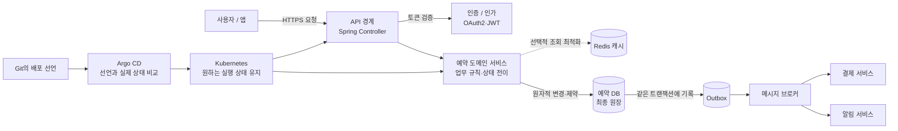
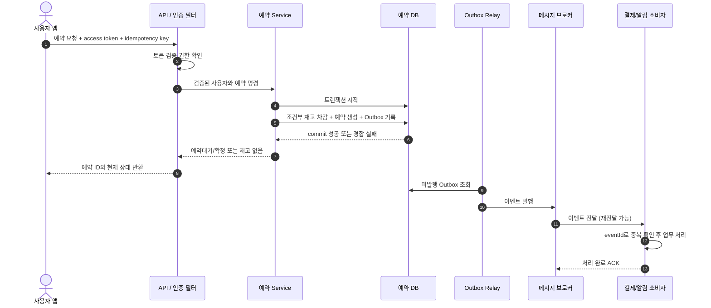
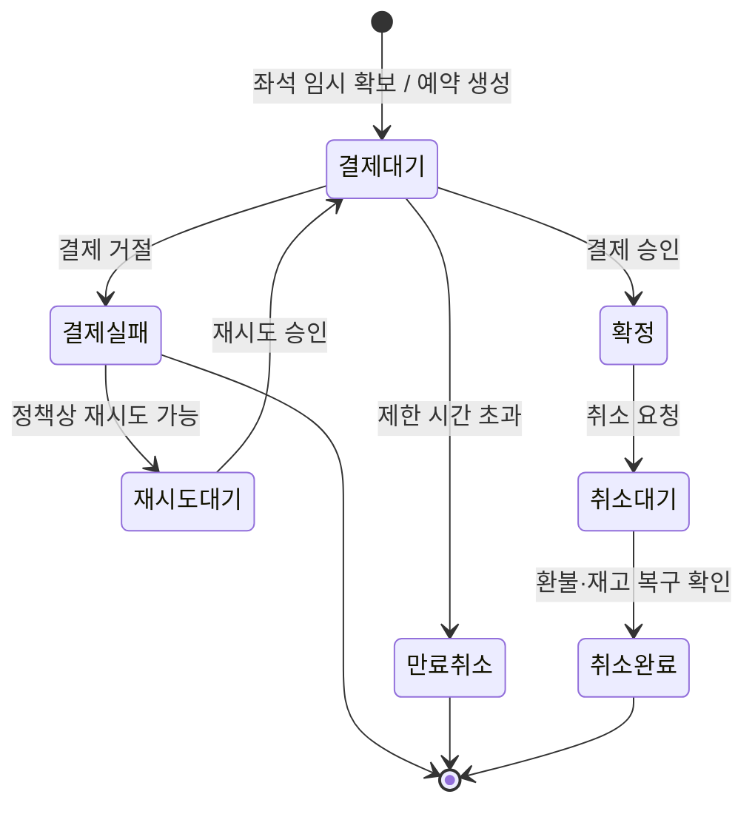
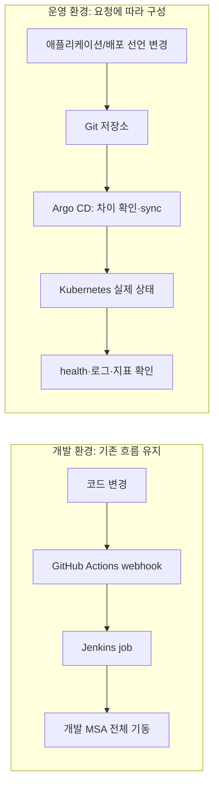
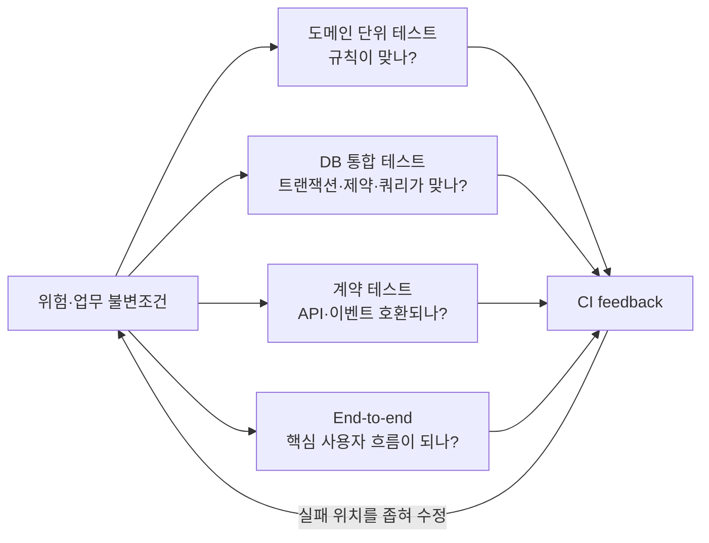

## 와그 백엔드 면접의 큰 그림: 예약 한 건을 끝까지 따라가기

이 문서는 세부 용어를 외우기 전에 백엔드 시스템 전체의 정신 모형(mental model)을 세웁니다. Redis, JPA, OAuth2, MQ, Kubernetes, Argo CD 를 따로 외우지 말고 **예약 요청이 들어와 정합성 있게 확정되고, 배포되어 운영되는 한 흐름**에 놓아 보세요.

핵심 질문은 이것입니다.

>**누가 요청했나? 어떤 규칙을 지켜야 하나? 진실은 어디에 기록하나? 중간 단계가 실패하면 어떻게 이어가나? 중복 실행은 어떻게 막나? 지금 상태를 어떻게 알 수 있나?**

이 여섯 질문은 기술 면접의 대부분을 관통합니다.

### 1. 하나의 여행 예약을 그리기

마지막 좌석 한 개를 두 고객이 동시에 예약한다고 상상하세요. 서버는 요청자를 확인하고, 예약 규칙을 검사하고, 한 요청만 좌석을 얻도록 해야 합니다. 결제·알림은 별도 서비스가 처리할 수 있고, 앱과 서비스는 컨테이너로 운영될 수 있습니다. 배포할 때는 원하는 버전을 선언하고 실제 환경에 반영합니다.

다이어그램의 중요한 점은 **각 기술이 서로 다른 문제를 푼다**는 것입니다. OAuth2 는 권한 위임 흐름, JWT 는 토큰 형식, Spring 은 애플리케이션 구성, JPA 는 객체와 관계형 DB 사이의 매핑, Redis 는 메모리 기반 자료 저장, MQ 는 비동기 전달, Kubernetes 는 컨테이너 실행과 복구, Argo CD 는 Git 선언 상태를 Kubernetes 에 반영합니다. 이 기술들은 서로 대체재가 아닙니다.

#### 예약 요청의 실제 왕복

아래 순서도를 기억하면 인증·업무 규칙·트랜잭션·이벤트를 한 답변에서 연결할 수 있습니다.

예약과 outbox 기록은 **같은 서비스 DB 트랜잭션**에 둡니다. 브로커 소비는 나중에 일어나며 재전달될 수 있습니다. 따라서 API 요청의 idempotency key 와 MQ 이벤트의 event ID 는 서로 다른 중복 경계에서 쓰입니다.

#### 예약은 상태 머신으로 기억

상태 머신은 "결제가 성공했는데 예약은 아직 대기", "같은 실패 이벤트가 두 번 도착", "결제 대기 중 좌석 hold 가 만료" 같은 질문을 구체적으로 만들게 합니다. 실제 서비스 상태와 정책은 회사마다 다르며 이 그림은 학습용 예입니다.

#### 이력서에 있는 두 배포 경로

이 다이어그램은 사용자의 실제 이력서와 설명에 나온 환경 분리만 그립니다. 실제로 Argo CD 가 Git 저장소의 어느 경로를 보았는지, 자동 sync 였는지, Jenkins 가 이미지 빌드까지 했는지 같은 구현 세부는 설정과 기억을 확인한 뒤 답해야 합니다.

### 2. 여섯 개 기억 고리

예약 흐름을 다음 순서로 머릿속에 고정하세요.

#### ① 요청: 누가 무엇을 원하는가?

앱은 HTTP API 에 예약 요청을 보냅니다. Controller 는 HTTP 입력·응답을 다루고, 인증 계층은 요청자의 신원을 확인하며, 인가 규칙은 이 사용자가 그 상품을 예약할 수 있는지 판단합니다. API 입력의 유효성, 권한, 중복 요청 식별자도 이 경계에서 다룹니다.

**회상 단어:** HTTP, REST, Controller, OAuth2, access token, validation, idempotency key.

#### ② 규칙: 무엇이 반드시 참이어야 하나?

예약 도메인은 "예약 확정 수량은 판매 가능 수량을 넘지 않는다", "결제 전에는 확정되지 않는다" 같은 불변조건(invariant)을 가집니다. MSA 에서는 그 규칙과 데이터의 소유자가 어느 서비스인지 정해야 합니다. 예약 서비스가 재고를 소유한다면 결제 서비스가 그 DB 테이블을 직접 고치게 하지 않고 명시된 API 나 이벤트로 협력합니다.

**회상 단어:** 도메인 모델, 서비스 경계, 데이터 소유권, 상태 머신, 비즈니스 규칙.

DDD 는 이 고리에서 업무 전문가와 개발자가 같은 언어를 쓰고, 어떤 규칙과 데이터를 한 경계 안에 둘지 정리하는 접근입니다. 테스트 전략은 이 규칙이 코드 변경 뒤에도 지켜지는지 알맞은 검증 수준에서 증명합니다.

#### ③ 원장: 무엇이 최종 진실인가?

남은 수량은 최종적으로 DB 에서 한 번만 줄어야 합니다. "읽고 나서 쓰기"는 두 요청이 모두 재고가 있다고 읽을 수 있습니다. 조건부 UPDATE, 트랜잭션, 유니크 제약, 낙관적/비관적 락으로 DB 가 불변조건을 지키게 해야 합니다. Spring 의 `@Transactional` 은 업무 단위의 DB 작업 경계를 만들고, JPA 는 영속성 컨텍스트로 엔티티 변경을 추적해 flush 시 SQL 을 내보낼 수 있습니다.

**회상 단어:** ACID, transaction, isolation, conditional update, unique constraint, JPA persistence context, flush.

>**핵심:** 예약 수량의 권위 있는 원장은 DB 입니다. Redis 캐시나 락의 존재만으로 예약이 확정되었다고 보면 안 됩니다.

#### ④ 전달: 무엇을 기다리고 무엇을 뒤로 미룰까?

사용자에게 즉시 결과가 필요한 일은 동기 HTTP 로 응답할 수 있습니다. 결제·알림·분석처럼 독립 후속 처리로 분리할 수 있는 일은 MQ 에 이벤트를 전달할 수 있습니다. 비동기 흐름은 빠른 응답과 완충 효과를 주지만, 결과가 나중에 도착하고 메시지가 재전달될 수 있습니다. 따라서 예약은 `결제대기 → 확정/실패/취소` 같은 상태를 노출하고, 소비자는 중복 이벤트에도 한 번만 효과가 나도록 멱등하게 만들어야 합니다.

DB 저장과 메시지 발행 사이에서 프로세스가 죽는 틈은 Transactional Outbox 로 줄일 수 있습니다. 예약 변경과 발행할 이벤트를 같은 DB 트랜잭션에 기록하고, 별도 릴레이가 브로커에 전달합니다. 이 또한 전달이 중복될 수 있으므로 소비자 멱등 처리가 필요합니다.

Redis 는 여기서도 목적을 분리해서 봅니다. 캐시는 자주 읽는 데이터를 빠르게 제공하고, TTL·무효화로 오래된 값의 시간을 제한합니다. 세션/폐기 목록은 인증 상태를 확인하는 임시 서버 측 상태일 수 있습니다. 분산락은 서버 사이의 경쟁을 조정하지만 락 만료, 네트워크 지연, 오래 멈췄다 깨어난 소유자 문제를 해결해야 합니다.

**회상 단어:** HTTP timeout, MQ, at-least-once, ACK, retry, DLQ, idempotency, outbox, Redis cache-aside, TTL, lock lease, fencing.

#### ⑤ 실행: 서비스는 어디서 어떻게 살아 있나?

Kubernetes 에 "이 이미지의 Pod 세 개를 실행하라"는 원하는 상태를 선언하면 컨트롤러가 실제 상태와 비교하며 차이를 줄입니다. Deployment 는 Pod 복제·교체를 관리하고, Service 는 바뀔 수 있는 Pod 주소 앞에 안정적인 네트워크 이름을 제공합니다. Readiness 는 트래픽을 받을 준비를, liveness 는 프로세스 재시작이 필요한 상태인지를 봅니다. HPA 로 복제 수를 늘릴 수 있지만 DB 나 외부 결제사가 병목이면 Pod 만 늘려서는 해결되지 않습니다.

**회상 단어:** container, Pod, Deployment, Service, Ingress, probes, resources, autoscaling, logs/metrics/traces.

#### ⑥ 배포와 복구: 선언과 실제 상태를 어떻게 맞추나?

CI 는 코드를 빌드하고 테스트하며 배포 가능한 artifact 를 만듭니다. CD 는 검증된 artifact 와 환경 설정을 실제 환경에 전달합니다. Jenkins 는 Pipeline 으로 작업을 실행할 수 있고, Argo CD 는 Git 의 Kubernetes 선언과 클러스터 상태를 비교·동기화하는 GitOps CD 도구입니다. `Synced`는 선언이 반영되었음을, `Healthy` 는 리소스 상태 평가를 의미하며 사용자 업무 성공을 보증하지 않습니다.

운영 중 문제가 나면 오류율·지연시간·로그와 배포 시점을 연결하고, 애플리케이션 버전·설정·DB 변경을 함께 확인합니다. GitOps 환경의 선언을 직접 클러스터에서만 고치면 Git 이 계속 원치 않는 상태를 다시 적용할 수 있으므로 긴급 조치 후 원인을 Git 에도 반영해야 합니다. 롤백은 이미지 버전만 되돌리면 되는지, DB 스키마와 외부 부작용도 호환되는지 확인해야 합니다.

**회상 단어:** CI, CD, artifact, image digest, GitOps, desired/live state, sync, health, rollback, observability.

### 3. 기술을 놓는 지도

| 면접 주제 | 전체 흐름에서 맡는 위치 | 기억할 한 문장 |
|---|---|---|
| OAuth2 | 요청자와 권한 경계 | 누가 누구를 대신해 어떤 자원에 접근할 권한을 받는지 정한다. |
| JWT | 인증 정보 전달 형식 | 서명된 claim 을 전달하지만, 발급 뒤 즉시 폐기하려면 서버 측 상태가 필요할 수 있다. |
| Spring | API 애플리케이션의 조립·요청 처리 | 의존성, 웹 요청, 트랜잭션 경계를 관리한다. |
| JPA | 객체와 관계형 DB 연결 | 영속성 컨텍스트가 엔티티 상태를 관리하고 SQL 반영 시점을 조율한다. |
| DB | 핵심 비즈니스 상태의 원장 | 제약과 트랜잭션으로 데이터 불변조건을 마지막까지 보호한다. |
| Redis 캐시 | 반복 조회의 지연·DB 부하 감소 | 원장 데이터의 복사본이므로 TTL 과 쓰기 무효화를 설계한다. |
| Redis 분산락 | 분산된 작업자의 경합 조율 | 임대가 만료될 수 있어 DB 의 최종 조건 검사와 함께 생각한다. |
| MQ | 서비스 사이의 비동기 전달 | 재전달과 지연을 정상 상황으로 보고 멱등·재처리를 설계한다. |
| MSA | 업무와 데이터 책임의 분리 | 서비스 경계를 나누는 만큼 네트워크·운영·정합성 책임이 늘어난다. |
| Kubernetes | 컨테이너 실행의 원하는 상태 유지 | 선언한 복제·버전·네트워크 상태에 실제 실행을 맞춘다. |
| Jenkins | CI/스크립트 실행 | 정의한 작업 순서를 실행하고 결과를 남긴다. |
| Argo CD | Git 선언과 Kubernetes 상태 동기화 | Git 을 기준으로 배포 차이를 감지하고 설정에 따라 동기화한다. |
| DDD | 업무 규칙과 모델의 경계 | 도메인 언어·경계 맥락·aggregate 로 규칙과 책임을 표현한다. |
| 테스트 전략 | 규칙이 깨졌는지 검증하는 증거 | 위험한 불변조건을 가장 적절하고 안정적인 테스트 수준에서 확인한다. |

#### 테스트는 어디에 붙는가?

테스트는 배포 직전에 한 번 돌리는 통과/실패 버튼이 아니라, 여섯 고리의 각 계약을 검증하는 안전망입니다. 도메인 단위 테스트는 규칙을 빠르게 검증하고, DB 통합 테스트는 실제 제약·트랜잭션·쿼리를 검증합니다. 서비스 계약 테스트는 HTTP/MQ 경계의 호환성을 보고, 소수의 end-to-end 테스트는 사용자의 중요한 흐름을 확인합니다.

테스트 수와 커버리지 비율만으로 품질을 단정하지 않습니다. 테스트가 중요한 실패를 잡고, 재현 가능하며, 실패 원인을 좁혀 주는지 평가합니다. 어떤 수준이 적합한지는 기능의 위험과 실제 의존성 동작 여부로 정합니다.

### 4. 면접 답변의 범용 프레임

낯선 설계 질문에는 기술 이름부터 꺼내지 말고 이 순서를 따르세요.

1. **불변조건을 확인한다.** "한 예약 ID 는 한 번만 확정되어야 하고 재고를 초과하면 안 됩니다."
2. **진실의 소유자를 정한다.** "재고의 최종 판단은 재고를 소유한 서비스의 DB 에서 합니다."
3. **원자적 경계를 정한다.** "조건부 갱신과 트랜잭션으로 예약 생성/수량 차감을 묶습니다."
4. **실패와 재전달을 모델링한다.** "메시지는 중복될 수 있으므로 event ID 로 멱등 처리하고, 미완료 상태를 재처리합니다."
5. **필요한 도구만 고른다.** "조회 부하는 캐시, 서비스 간 후속 처리는 MQ, 서버 실행은 Kubernetes, 배포 상태는 Argo CD 가 맡을 수 있습니다."
6. **운영에서 확인할 방법을 말한다.** "상태 전이·중복 수·DLQ·지연시간·오류율을 로그/메트릭으로 관측합니다."

#### 예시: 마지막 좌석 예약 질문

**질문:** "두 요청이 동시에 마지막 좌석을 예약하면 어떻게 하겠습니까?"

**구조를 갖춘 답변:** "먼저 한 좌석이 두 번 확정되면 안 된다는 불변조건을 세웁니다. 예약/재고를 소유한 DB 에서 `remaining > 0` 인 경우에만 감소시키는 원자적 UPDATE 를 하고, 영향 행이 한 건인 요청만 성공시키겠습니다. 예약 생성과 재고 차감은 같은 트랜잭션에 두고, 같은 클라이언트 요청의 재전송은 idempotency key 와 유니크 제약으로 처리하겠습니다. Redis 락은 이 조건을 대신하지 않으며, 다중 서버 경합을 줄일 필요가 확인된 경우에 추가 검토하겠습니다. 성공 뒤 결제·알림은 상태가 명확한 이벤트로 전달하고, 중복 전달에 대비해 소비자를 멱등하게 만들겠습니다."

**꼬리질문 1:** "그럼 분산락은 필요 없나요?"

**답변:** "문제에 따라 다릅니다. 한 행의 재고 차감처럼 DB 의 조건부 쓰기로 원자적으로 보장할 수 있다면 DB 가 더 직접적인 최종 방어선입니다. 여러 저장소나 외부 자원에 걸친 임계 구간을 직렬화해야 하거나 DB 부하를 줄이기 위해 앞단 경합 제어가 필요하면 락을 고려할 수 있지만, 만료된 락과 늦게 복귀한 소유자를 고려해야 합니다."

**꼬리질문 2:** "DB commit 은 됐는데 결제 이벤트 발행이 실패하면요?"

**답변:** "예약 row 와 발행 대기 outbox event 를 같은 로컬 트랜잭션에 넣겠습니다. 릴레이가 브로커 확인을 받아 전달 상태를 갱신하고, 소비자는 중복 이벤트를 멱등하게 처리합니다. 장시간 결제 대기는 모니터링해 재시도/취소/보상 경로로 복구하고, 사용자에게는 확정 전 상태를 보여줍니다."

### 5. 이력서 경험에 맞춘 설명 프레임

제출한 이력서에서 연결할 수 있는 것은 **Kotlin·Spring Boot 서버 API 공동 개발, Go API 의 JWT access/refresh 흐름과 Redis token ID 매핑, Oracle 프로시저 연동, 개발 MSA 전체 기동 자동화(Jenkins), 운영 Argo CD 배포**입니다. 각각을 같은 층의 기술로 말하지 말고 위 지도에 배치하세요.

| 이력서 경험 | 큰 그림에서의 연결 | 답변 경계 |
|---|---|---|
| Spring Boot API 공동 작성 | 요청→업무 로직 | 공동 작업과 직접 구현한 API·로직을 분리 |
| JWT·Redis token ID 매핑 | 인증 상태·세션 폐기 | Redis cache-aside/분산락 경험으로 바꾸어 말하지 않음 |
| Oracle 프로시저 | 기존 시스템의 데이터 처리 경계 | DB 내부 규칙과 애플리케이션 코드를 구분 |
| 개발 MSA 전체를 Jenkins 로 기동 | 개발 배포 자동화 | Kubernetes 클러스터 운영 경험을 뜻하지 않음 |
| 운영 Argo CD | Git 선언을 운영 환경에 전달 | 직접 구성한 범위와 팀의 플랫폼 설정을 확인 |
| JPA·MQ·Kubernetes 세부 | 면접에서 학습 설명할 기술 | 직접 운영하지 않았다면 원리·적용 접근으로 답함 |

**경험 설명 템플릿:** "제가 직접 한 일은 __ 였습니다. 이 선택의 목적은 __ 였고, 실제 흐름은 __ 였습니다. 이 방식의 제한은 __ 입니다. 지금 다시 설계한다면 __ 를 확인하고 __ 로 검증하겠습니다."

### 6. 절대 섞지 말아야 하는 쌍

| 서로 다른 것 | 기억 구분 |
|---|---|
| 인증(Authentication) / 인가(Authorization) | 신원 확인 / 권한 확인 |
| OAuth2 / JWT | 권한 위임 프레임워크 / 토큰 형식 |
| 캐시 / 원장 DB | 빠른 복사본 / 최종 데이터 진실 |
| 락 / 데이터 제약 | 동시 작업 조율 / 잘못된 상태를 거부하는 최종 규칙 |
| MSA / Kubernetes | 서비스 아키텍처 / 컨테이너 오케스트레이션 |
| 동기 HTTP / MQ | 요청에 대한 즉시 응답 / 나중에 처리할 메시지 전달 |
| CI / CD | 빌드·검증 / 배포 가능한 상태 준비 또는 실제 배포 |
| Kubernetes `Synced` / 애플리케이션 정상 | 선언 반영 / 사용자 업무 성공 |
| JPA `flush` / transaction `commit` | SQL 동기화 / 트랜잭션 확정 |
| DDD / Clean Architecture | 도메인 모델·경계 / 코드 의존성 방향·계층 구성 |
| 테스트 커버리지 / 테스트 효과 | 실행된 코드 비율 / 중요한 잘못된 동작을 실제로 잡는가 |

### 7. 빠른 회상 카드

면접 직전에는 아래 문장을 외우는 대신 빈칸을 채우며 말하세요.

- 요청 주체와 권한은 `________` 에서 확인한다.
- 비즈니스 불변조건의 최종 진실은 `________` 가 보장한다.
- 함께 성공·실패해야 하는 DB 변경은 `________` 경계에 둔다.
- 빠른 읽기는 `________` 로 보완하되, 원장과의 stale window 를 관리한다.
- 비동기 메시지는 중복·지연될 수 있으므로 `________` 와 재처리 경로를 둔다.
- 컨테이너 실행 상태는 `________` 가 선언한 상태에 맞춘다.
- Git 의 배포 선언과 Kubernetes 실제 상태는 `________` 가 비교·동기화한다.
- 시스템이 실패했을 때는 상태·로그·메트릭을 보고 `________` 할 수 있어야 한다.

**정답:** 인증 계층 / DB 제약·트랜잭션 / 로컬 DB 트랜잭션 / Redis 캐시 / 멱등 처리 / Kubernetes / Argo CD / 재시도·보상·롤백.

### 참고 자료

- [Spring Framework Reference](https://docs.spring.io/spring-framework/reference/)
- [Spring Data JPA Reference](https://docs.spring.io/spring-data/jpa/reference/)
- [Redis Documentation](https://redis.io/docs/latest/)
- [OAuth 2.0 Security Best Current Practice, RFC 9700](https://www.rfc-editor.org/rfc/rfc9700.html)
- [Kubernetes Concepts](https://kubernetes.io/docs/concepts/)
- [Argo CD Core Concepts](https://argo-cd.readthedocs.io/en/stable/core_concepts/)
- [RabbitMQ Reliability](https://www.rabbitmq.com/docs/reliability)
