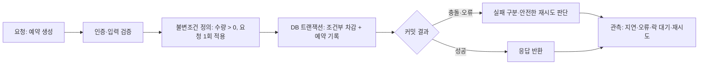
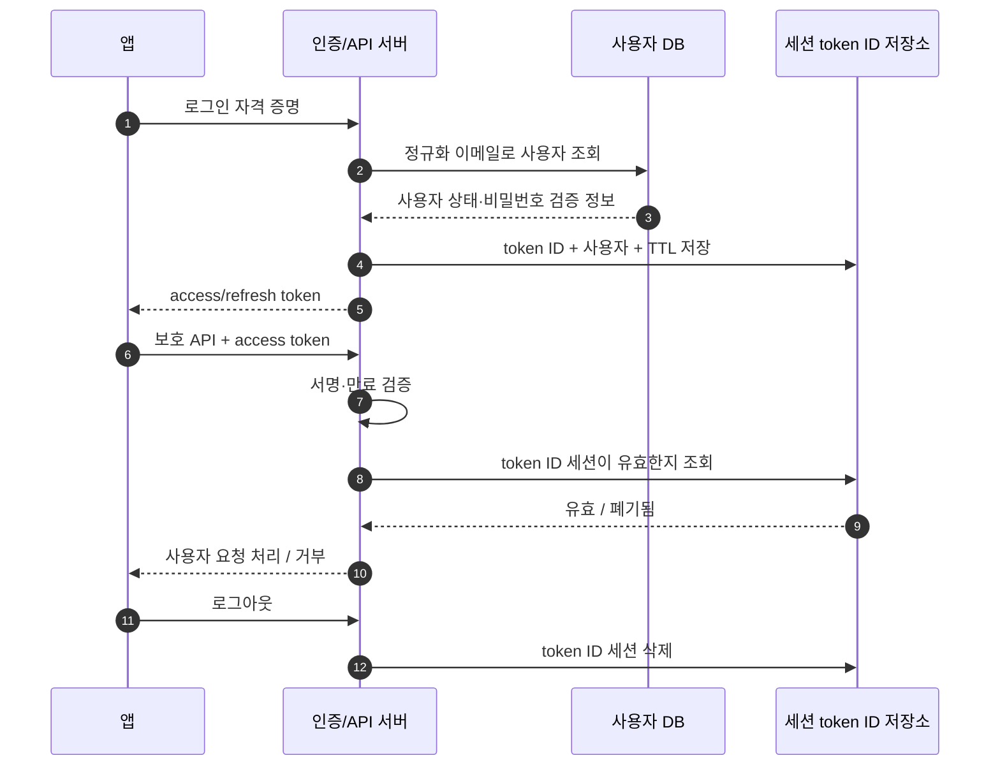
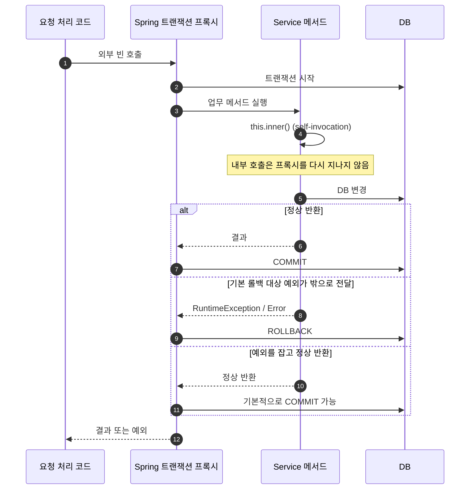
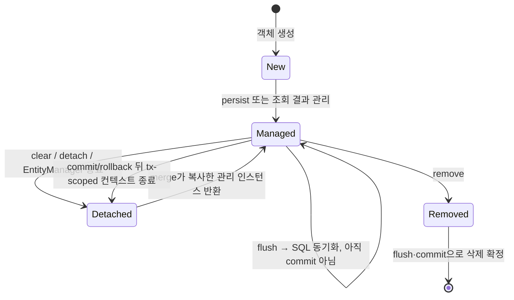
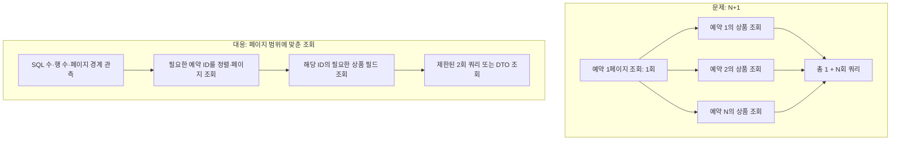

## DB · Spring · JPA: 면접 준비

이 문서는 **예약 하나를 생성하는 요청**을 처음부터 끝까지 따라가며 DB, Spring, JPA 의 역할을 연결합니다. 비유는 기억을 돕는 설명이고, 실제 답변은 기술 원리를 기준으로 하세요.

### 큰 그림: 서버 요청은 어떻게 안전하게 끝나는가

```text
HTTP 요청
  → 요청 검증·인증
  → 업무 규칙과 불변조건 확인
  → DB 트랜잭션 안에서 조건부 변경·제약 확인
  → 성공/실패 결과 확정
  → 타임아웃·재시도·중복 요청을 안전하게 처리
  → 로그·지표·실행 계획으로 관측
```

예를 들어 사용자가 상품을 예약하면 서버는 인증된 사용자인지 확인하고, **예약 수량은 0 보다 작아질 수 없다**, **요청 하나는 예약을 최대 한 번만 만든다** 같은 불변조건을 지켜야 합니다. DB 가 예약과 수량의 최종 기준(source of truth)입니다. 캐시가 있더라도 예약 확정은 DB 제약과 트랜잭션을 통해 결정해야 합니다. 클라이언트가 타임아웃 뒤 같은 요청을 다시 보낼 수 있으므로 중복 방지 키가 필요할 수 있습니다. 성공률만 보는 게 아니라 쿼리 지연, 오류, 재시도, DB 락 대기 등을 관측해야 합니다.



이 문서의 각 그림에서 **요청 → 불변조건 → DB 확정 → 실패/재시도 → 관측** 라벨은 이 공통 흐름 중 해당 개념의 위치를 나타냅니다.

| 큰 그림의 위치 | 이 문서에서 다루는 개념 |
|---|---|
| 입력과 요청 경로 | Spring 빈·DI, Controller-Service-Repository, 사용자 인증 데이터 조회 |
| 업무 규칙·불변조건 | PK/FK/UNIQUE/CHECK, 예약 재고 조건, 멱등성 |
| 최종 기준 데이터 | DB 테이블·인덱스·실행 계획, 트랜잭션 |
| 동시 요청 제어 | 격리 수준, 조건부 UPDATE, 낙관적/비관적 락 |
| DB 작업을 묶는 경계 | Spring `@Transactional`, 프록시, 롤백 규칙 |
| 객체와 DB 사이 | JPA 영속성 컨텍스트, 변경 감지, flush, 로딩, 페이징 |
| 실패 분석 | 실행 계획, SQL/쿼리 로그, 락 대기·재시도 관측 |

#### 경험과 학습 지식의 경계

이력서에서 근거를 들어 말할 수 있는 경험은 다음입니다.

- 백엔드 개발자와 Kotlin·Spring Boot 서버 API 와 서비스 로직을 함께 작성했습니다.
- Go API 에서 JWT access·refresh 발급·검증 흐름을 구현했고, Redis 에 token ID 와 사용자 연결 정보를 만료시간과 함께 저장했습니다. 로그아웃 때 폐기하고 refresh 때 토큰을 교체했습니다.
- Oracle 저장 프로시저로 기존 현장 시스템과 점검 데이터를 연동했습니다.
- Java·Node.js 등의 백엔드와 앱 연동 경험도 있습니다.

**이력서에는 JPA 를 직접 사용한 경험이 없습니다.** JPA 설명은 학습한 원리로 답하고, 실제 프로젝트에서 썼다고 말하지 마세요. Spring Boot 도 백엔드 개발자와 함께 작성한 범위와 본인이 맡은 일을 구분해 설명하세요.

쓸 수 있는 답변 틀: "제가 실제 구현한 것은 …입니다. JPA 는 직접 사용하지는 않았고, 원리는 …로 이해하고 있습니다. 이 요구사항이라면 …를 먼저 확인해 검증하겠습니다."

---

### 1. 관계형 DB: 데이터 규칙과 조회 경로

#### 표와 키, 제약조건

**큰 그림에서:** 업무 불변조건을 DB 에서도 지켜 데이터가 잘못 저장되는 경로를 막습니다.

관계형 DB 는 서로 연결된 표들의 모음입니다. `Product(id, remaining)`과 `Reservation(id, user_id, product_id, request_key, status)` 처럼 역할별로 표를 두고 키로 연결합니다.

- **PK(기본 키)**는 각 행의 고유 번호입니다. 한 예약을 확실히 가리킵니다.
- **FK(외래 키)**는 다른 표의 키를 참조합니다. 존재하지 않는 사용자나 상품을 예약이 가리키지 않도록 합니다. FK 를 쓰면 무결성이 강해지지만 삭제 순서와 대량 변경 등 운영 정책을 고려해야 합니다.
- **UNIQUE**는 값 또는 값 조합의 중복을 금지합니다. `(user_id, request_key)` 에 두면 사용자의 같은 멱등 요청이 중복 예약으로 생성되는 것을 DB 가 막도록 설계할 수 있습니다.
- **NOT NULL / CHECK**는 필수값이나 허용 범위를 제한합니다. DB 제품별 CHECK 지원·동작 차이는 확인해야 합니다.
- 앱에서 먼저 중복 여부를 조회하더라도, 동시 요청은 둘 다 "없음"을 읽을 수 있습니다. 최종 규칙은 가능한 한 DB 제약으로도 보장하고, 제약 위반은 의미 있는 응답으로 바꿉니다.

#### 사용자·인증 데이터 예시

**큰 그림에서:** 요청의 주체를 확인하고, 사용자 식별과 세션 폐기 규칙을 데이터 구조에 반영합니다.

관계형 DB 에서 `User(id, email, status)`의 `email`이 로그인 식별자라면 정규화한 이메일에 `UNIQUE` 제약을 둘지 검토합니다. 이메일 존재 여부를 먼저 조회하는 것만으로는 두 가입 요청의 경합을 막지 못하기 때문입니다. 대소문자·공백 정규화 방식과 이메일 변경 정책도 제약 설계에 포함합니다.

이력서의 실제 경험은 JWT access/refresh 흐름을 만들고 Redis 에 token ID 와 사용자 연결 정보 및 만료시간을 둔 것입니다. 따라서 이 사례를 DB/JPA 경험이라고 부르면 안 됩니다. 다만 동일한 원리는 인증 데이터에도 적용됩니다. 서버가 token ID 를 폐기 목록/세션으로 관리한다면 token ID 의 유일성, 만료 정리, 사용자별 세션 폐기 규칙을 생각하고, 검증 시 해당 레코드가 존재하고 유효한지 확인합니다. JWT 서명 검증과 Redis 조회는 서로 다른 검증 단계입니다. JWT 자체가 유효해도 서버 측 세션 레코드가 폐기되었다면 거부할 수 있습니다.

면접에서 "로그아웃 즉시 토큰을 무효화하려면?"을 받으면 이렇게 답할 수 있습니다: "제가 구현한 흐름은 Redis 에 token ID 와 사용자 연결 정보를 TTL 과 함께 저장하고, 로그아웃 시 해당 정보를 제거해 서버가 폐기 상태를 확인하도록 했습니다. 저장소 장애 시 허용/거부 정책, refresh 회전 중 이전 토큰 재사용, 여러 기기 세션 범위는 보안 요구와 장애 정책으로 별도 결정해야 합니다."



#### 인덱스와 쿼리 계획

**큰 그림에서:** 최종 기준인 DB 가 요청을 처리할 때 어떤 경로로 행을 찾는지, 느려진 원인이 무엇인지 판단합니다.

**비유:** 인덱스는 책의 찾아보기입니다. 원하는 항목을 빠르게 찾도록 도와주지만 찾아보기 자체를 만들고 갱신하는 비용이 있습니다. 실제 DB 인덱스는 보통 B-tree 계열 구조 등으로 키를 정렬해 탐색하게 합니다. 인덱스가 있다고 모든 쿼리가 빨라지지는 않습니다.

예를 들어 "사용자별 최근 예약" 조회는 다음 패턴입니다.

```sql
SELECT id, product_id, status, created_at
FROM reservation
WHERE user_id = :userId
ORDER BY created_at DESC
LIMIT :pageSize;
```

`(user_id, created_at)` 복합 인덱스를 후보로 볼 수 있지만, 방향·커버링 여부·데이터 분포 및 DB 엔진에 따라 계획이 달라집니다. 실행 계획을 통해 `user_id` 조건에서 몇 건을 읽는지, 정렬 작업이 추가되는지, 실제 읽은 행 수가 예상과 맞는지 확인합니다. 사용자 ID 마다 예약이 매우 많거나 페이지가 깊다면 인덱스만으로 충분하지 않을 수 있습니다.

- `WHERE`, `JOIN`, `ORDER BY` 에서 자주 쓰이고 선택성이 있는 컬럼에 후보가 됩니다.
- 복합 인덱스 `(user_id, created_at)` 는 보통 왼쪽 컬럼부터 활용하는 접근 패턴에 특히 유리합니다. 두 컬럼의 실제 조건 순서, 범위 조건, 정렬과 DB 엔진의 최적화 규칙을 함께 봅니다.
- 조건에 맞는 행이 대부분이면 인덱스를 따라가는 비용보다 테이블을 읽는 편이 나을 수 있습니다. 옵티마이저는 통계와 비용 추정으로 접근 경로를 고릅니다.
- 인덱스는 저장 공간을 차지하고 INSERT/UPDATE/DELETE 때 갱신 비용이 생깁니다. 검색 컬럼마다 만들면 쓰기 지연과 관리 비용이 커질 수 있습니다.

**쿼리 플랜(실행 계획)**은 DB 가 쿼리를 어떻게 실행할지 보여주는 계획입니다. 느린 요청에서 실제 SQL 과 바인딩 패턴을 확인하고, 계획의 접근 방식(전체 스캔/인덱스 탐색), 조인 방식, 예상 행 수, 정렬·임시 작업 등을 봅니다. 가능하면 실제 실행 통계와 비교해 예상치와 실제 행 수가 크게 다른지도 살핍니다. `EXPLAIN ANALYZE` 처럼 실제 실행하는 기능은 쿼리를 실행할 수 있으니 읽기 전용인지와 데이터 변경 여부를 확인하고 사용합니다. DB 별 용어와 출력은 다릅니다.

**사용 기준:** 먼저 실제 병목 쿼리와 지표를 잡고, 계획을 확인한 다음 인덱스나 쿼리 형태를 바꾸고 전후를 측정합니다. 계획만 보고 인덱스를 무조건 추가하지 않습니다.

##### 질문 답변 연습

**Q. 인덱스를 만들면 조회는 항상 빨라지나요?**

- **단답:** "아닙니다. 선택성, 데이터 분포, 읽어야 할 행 수에 따라 전체 스캔이 더 나을 수 있고, 인덱스는 쓰기 비용도 만듭니다."
- **상세:** "실제 쿼리와 계획을 확인해 옵티마이저가 선택한 접근 경로, 읽는 행 수, 조인·정렬 비용을 봅니다. 쿼리 패턴에 맞는 인덱스를 만들고 전후 성능과 쓰기 비용을 함께 측정합니다."
- **경험 연결:** "Oracle 저장 프로시저로 현장 데이터를 연동한 경험은 있지만 대규모 예약 DB 의 튜닝을 주도했다고 말할 수는 없습니다. 느린 쿼리를 재현하고 DBA·팀과 실행 계획과 인덱스 후보를 확인해 측정하겠습니다."

**꼬리질문 1:** "사용자 ID 와 생성 시각을 검색하면 `(created_at, user_id)` 로 만들어도 되나요?"

**답변:** "조건이 같아도 복합 인덱스의 선두 컬럼과 범위·정렬 패턴에 따라 효율이 다릅니다. 실제 쿼리 빈도와 필터 순서, 데이터 분포를 보고 두 후보의 계획을 비교하겠습니다."

**꼬리질문 2:** "실행 계획에서 인덱스를 탔으면 튜닝이 끝난 것 아닌가요?"

**답변:** "인덱스 사용 자체가 빠르다는 뜻은 아닙니다. 예상 행과 실제 읽은 행, 랜덤 접근량, 조인·정렬 비용과 전체 응답 시간을 함께 봐야 합니다. 계획과 실제 통계가 다르면 통계나 조건 형태도 조사하겠습니다."

**꼬리질문 3:** "실행 시간이 한 번 줄면 성공인가요?"

**답변:** "캐시 온도나 부하에 따라 달라질 수 있어 같은 조건에서 여러 번 비교하고 p95 지연, 읽은 행·페이지, 쓰기 영향도 보겠습니다. 쿼리 계획 변화와 운영 지표까지 확인해야 회귀를 놓치지 않습니다."

---

### 2. 트랜잭션과 격리 수준: 작업 묶음과 동시 실행

#### 트랜잭션이 보장하는 것

**큰 그림에서:** 업무 작업이 DB 에 반영되는 단위를 정하고, 동시 요청 사이에 어떤 상태가 보일지 정합니다.

**비유:** 송금 때 출금과 입금을 한 묶음으로 처리합니다. 한쪽만 반영되면 안 됩니다. 기술적으로 트랜잭션은 원자성, 일관성, 격리성, 지속성을 제공하도록 설계되지만 "트랜잭션을 썼다"는 사실만으로 모든 업무 규칙이 지켜지는 것은 아닙니다.

- **원자성:** 트랜잭션의 변경은 함께 커밋되거나 롤백됩니다.
- **일관성:** 애플리케이션과 DB 제약이 정의한 규칙을 만족하도록 합니다.
- **격리성:** 동시 작업의 읽기·쓰기 간섭을 제어합니다. 격리 수준에 따라 성능과 허용되는 이상 현상이 달라집니다.
- **지속성:** 커밋된 변경이 장애 이후에도 보존되도록 합니다.

업무 단위는 보통 Spring 서비스 메서드에서 정의하지만, HTTP 요청 전체를 무조건 하나의 긴 트랜잭션으로 묶는 것은 아닙니다. 외부 결제·메일 호출을 기다리는 동안 DB 트랜잭션과 락을 오래 유지하면 커넥션과 잠금이 점유됩니다. DB 에서 할 일을 짧게 커밋하고 외부 시스템의 결과·재시도는 별도 상태 전이로 다루는 편이 나을 수 있습니다.

#### 격리 이상 현상

아래 현상의 실제 발생 가능성은 DB 엔진, 기본 격리 수준, 잠금/MVCC 구현, 쿼리 방식에 따라 다릅니다. "격리 수준 이름만으로 모든 DB 의 동작이 같다"고 단정하지 말고 해당 DB 문서를 확인하세요.

- **Dirty read(더티 리드):** 아직 커밋되지 않은 다른 트랜잭션의 변경을 읽습니다. 상대 트랜잭션이 롤백하면 존재하지 않았던 값을 본 셈입니다.
- **Non-repeatable read(반복 불가능 읽기):** 같은 트랜잭션에서 같은 행을 다시 읽었는데, 그 사이 다른 트랜잭션이 커밋해 값이 바뀌었습니다.
- **Phantom read(팬텀 리드):** 같은 조건으로 행 집합을 다시 조회했더니, 다른 트랜잭션의 삽입·삭제로 결과 집합이 달라졌습니다.
- **Lost update(갱신 손실):** 두 트랜잭션이 같은 오래된 값을 읽어 각자 계산한 값을 덮어쓰면서 한 변경이 사라집니다. DB 별 격리·쓰기 잠금 동작이 다르고, 버전 확인이나 조건부 갱신으로 명시적으로 막을 수 있습니다.
- **Write skew(쓰기 편향):** 각 트랜잭션은 서로 다른 행을 수정하지만, 둘이 읽은 공통 조건을 함께 깨뜨릴 수 있습니다. 단순히 각 행의 충돌을 잠그는 것만으로 부족할 수 있어 더 강한 격리나 DB 제약·명시적 잠금이 필요할 수 있습니다.

#### 재고 경쟁: 조건부 UPDATE 와 락

두 요청이 남은 수량 1 을 읽고 둘 다 "예약 가능"으로 판단한 뒤 각각 예약을 만들면 초과 판매가 됩니다. 읽기와 쓰기를 별도 단계로 두었기 때문입니다.

**조건부 원자 갱신 예:**

```sql
UPDATE product_inventory
SET remaining = remaining - 1
WHERE product_id = :productId
  AND remaining > 0;
```

영향 행 수가 1 이면 차감 성공, 0 이면 재고가 없거나 경합에서 진 것입니다. 예약 행 생성과 차감은 같은 DB 트랜잭션으로 묶어 한쪽만 반영되지 않게 해야 합니다. 요청이 재전송될 수 있으면 idempotency key 에 UNIQUE 제약을 두어 같은 업무 요청이 중복 생성되지 않게 설계합니다.

#### 격리 수준 질문 답변

**Q. 격리 수준이 낮으면 어떤 문제가 생길 수 있나요?**

- **단답:** "더티 리드, 반복 불가능 읽기, 팬텀 등 동시 변경이 관찰될 수 있습니다. 정확한 동작은 DB 엔진과 격리 구현에 따라 확인해야 합니다."
- **상세:** "예를 들어 예약 가능 수량을 읽은 뒤 다른 트랜잭션이 그 행을 바꾸면 같은 트랜잭션의 재조회 결과가 달라질 수 있습니다. 더티 리드나 반복 읽기 변화처럼 어떤 이상 현상을 감수할지, DB 의 기본 격리 수준에서 어떤 잠금/MVCC 동작을 하는지 확인합니다. 격리를 올리는 것만으로 업무 규칙이 자동 보장되는 것은 아니므로 조건부 갱신이나 제약도 함께 둡니다."
- **경험 연결:** "제가 특정 예약 서비스에서 격리 수준을 운영 튜닝한 경험은 없습니다. Oracle 연동 경험을 바탕으로 실제 DB 의 기본 설정과 쿼리 동작을 확인한 뒤 필요한 수준을 선택하겠습니다."

**꼬리질문 1 — 반박:** "Serializable 로 하면 모든 문제가 끝나는 것 아닌가요?"

**답변:** "가장 강한 격리가 이상 현상을 줄일 수 있지만, 직렬화 실패나 대기·재시도가 늘 수 있고 구현별 동작도 확인해야 합니다. 필요한 불변조건을 제약이나 원자적 쓰기로 명시하는 것이 더 단순한 경우가 많습니다."

**꼬리질문 2:** "팬텀 리드는 재고 차감에서 생기나요?"

**답변:** "재고 한 행을 읽고 덮어쓰는 문제는 보통 갱신 손실이나 경쟁 쓰기로 설명하는 편이 정확합니다. 팬텀은 같은 조건의 행 집합을 다시 읽었을 때 다른 트랜잭션의 삽입·삭제로 집합이 달라지는 현상입니다. 현상 이름보다 실제 쿼리와 DB 잠금 방식을 기준으로 해결하겠습니다."

**꼬리질문 3:** "트랜잭션 격리만 높이면 조건부 UPDATE 가 필요 없나요?"

**답변:** "아닙니다. 격리 수준은 읽기와 쓰기 간섭의 규칙이고, `remaining > 0` 조건부 UPDATE 는 업무 불변조건을 쓰기에 직접 포함합니다. 둘은 서로 대체가 아니라 요구사항과 DB 동작에 따라 함께 쓰거나 역할을 나눕니다."

##### 낙관적 락

**비유:** 공동 문서에 버전 번호를 표시합니다. 내가 읽은 뒤 다른 사람이 수정했다면 저장 시 버전이 달라져 충돌을 알 수 있습니다.

JPA 의 `@Version` 같은 버전 필드를 사용하면 UPDATE 에 기존 버전을 조건으로 포함하고, 영향 행이 없을 때 충돌 예외를 냅니다. 충돌이 드물고 읽기가 많은 흐름에 고려할 수 있습니다. 충돌 시 재시도할지 사용자에게 실패를 알릴지 업무 특성으로 정합니다. 재시도해도 업무 규칙과 멱등성을 깨지 않아야 합니다.

**실패 모드:** 반복 충돌 시 재시도 폭주, 재시도할 때 외부 부작용 중복 발생, 충돌 예외를 놓쳐 잘못 성공 응답하는 문제입니다. 재시도 횟수 제한과 지연, 재시도 가능 작업의 범위, 멱등 처리를 함께 정합니다.

##### 비관적 락

**비유:** 창고의 재고 장부를 한 사람이 확인·수정하는 동안 다른 담당자는 차례를 기다립니다.

DB 에서 행을 잠그고 다른 트랜잭션의 충돌 작업을 기다리게 합니다. 충돌이 잦고 대기 비용을 감당할 수 있는 경우 검토합니다. 락은 트랜잭션 종료까지 유지될 수 있어 작업을 짧게 하고, 항상 같은 순서로 여러 행을 잠가 교착 가능성을 줄이며, 대기 시간 제한과 재시도 정책을 둡니다.

**실패 모드:** 긴 대기, deadlock, 처리량 저하, 락 범위를 잘못 이해해 예상보다 많은 행이 막히는 문제입니다. DB 엔진과 인덱스·격리 수준에 따라 잠금 범위가 달라질 수 있습니다.

##### 어떤 방식을 고를까?

- 단순 재고 차감은 먼저 조건부 UPDATE 로 원자화할 수 있는지 검토합니다.
- 충돌이 낮고 실패 후 재시도가 자연스러우면 낙관적 락이 후보입니다.
- 충돌이 높고 한 번에 순차 처리하는 편이 낫다면 비관적 락을 검토하되 대기와 교착을 측정합니다.
- 어떤 방식을 쓰더라도 최종 불변조건, 멱등성, 실패 응답은 DB 와 서비스 양쪽에서 확인합니다.
- 분산락은 DB 가 아닌 별도 조정 계층입니다. 먼저 DB 제약/원자적 연산으로 해결되는지 보고, 여러 자원이나 비 DB 작업의 조율 필요와 장애 모델을 확인한 뒤 선택합니다.

##### 질문 답변 연습

**Q. 마지막 재고 한 개를 두 명이 동시에 예약하면요?**

- **단답:** "확인과 차감을 DB 의 한 조건부 UPDATE 로 묶고 영향 행 수로 승자를 정하겠습니다."
- **상세:** "예약 생성과 수량 차감은 하나의 DB 트랜잭션으로 묶습니다. 중복 요청은 idempotency key 의 UNIQUE 제약으로 막습니다. 경합 특성에 따라 조건부 갱신, 낙관적 락, 비관적 락 중 선택합니다."
- **경험 연결:** "저는 Oracle 프로시저를 통한 현장 시스템 데이터 연동을 경험했지만, 예약 재고를 직접 설계·운영하지는 않았습니다. DB 가 최종 정합성을 보장해야 한다는 원리로 접근해 조건부 갱신부터 검토하겠습니다."

**꼬리질문 1 — 반박:** "DB 가 같은 행을 알아서 잠그니까 초과 예약은 불가능하지 않나요?"

**답변:** "DB 는 쓰기 충돌을 제어하지만, 애플리케이션이 먼저 읽은 수량이 계속 유효하다는 뜻은 아닙니다. 읽은 값을 그대로 덮어쓰지 않고 `remaining > 0` 조건을 UPDATE 에 넣어 실제 차감 결과를 확인하겠습니다."

**꼬리질문 2:** "요청이 타임아웃되어 같은 예약을 다시 보내면요?"

**답변:** "서버는 커밋했지만 응답만 유실됐을 수 있으므로 같은 요청을 새 예약으로 처리하면 안 됩니다. 요청 키를 저장하고 UNIQUE 제약으로 중복 처리를 차단한 뒤 기존 결과를 반환합니다. 결제 같은 외부 효과도 별도의 멱등 키가 필요합니다."

**꼬리질문 3:** "조건부 UPDATE 대신 Redis 분산락이면 충분하지 않나요?"

**답변:** "락 만료나 소유자 확인, 클라이언트 중단, 네트워크 지연 같은 문제가 있고 락만으로 DB 커밋과 원자적인 것은 아닙니다. DB 에서 재고 불변조건을 먼저 보장하고, 측정된 필요가 있을 때 분산락을 추가 조정 수단으로 검토하겠습니다."

**Q. 낙관적 락과 비관적 락 중 무엇을 고르나요?**

- **단답:** "충돌 빈도와 실패·대기 비용으로 고릅니다. 충돌이 드물면 낙관적, 잦고 직렬화가 필요하면 비관적 락이 후보입니다."
- **상세:** "낙관적 락은 버전 불일치를 감지해 실패시키므로 잠금 대기는 줄지만 재시도가 생깁니다. 비관적 락은 먼저 잠가 충돌 요청이 기다리므로 충돌이 잦을 때 유리할 수 있지만 락 대기·교착과 처리량 저하를 봐야 합니다."
- **경험 연결:** "제가 직접 JPA 락 옵션을 운영한 경험은 없습니다. Oracle 연동 경험과 DB 정합성 원리를 바탕으로, 먼저 충돌률과 재시도 안전성을 확인하고 실제 DB 에서 동작을 검증하겠습니다."

**꼬리질문 1 — 반박:** "낙관적 락 실패는 그냥 재시도하면 되죠?"

**답변:** "항상은 아닙니다. 예약 재고가 이미 0 이면 재시도해도 성공할 수 없고, 결제 호출 같은 부작용을 반복하면 중복 청구될 수 있습니다. 충돌 원인을 구분해 제한된 재시도와 사용자 실패 응답, 멱등 처리를 정하겠습니다."

**꼬리질문 2:** "비관적 락은 충돌을 완전히 없애나요?"

**답변:** "해당 잠금 범위의 충돌 작업을 대기시키지만 deadlock, timeout, 락 범위 오해는 남습니다. 여러 행을 같은 순서로 잠그고 트랜잭션을 짧게 유지하며 실제 DB 의 잠금 동작을 관측해야 합니다."

---

### 3. Spring: 요청 흐름, 의존성, 트랜잭션 프록시

#### 빈과 DI, 요청 경로

**큰 그림에서:** HTTP 요청을 업무 로직으로 전달하고, 업무 객체와 DB 접근 객체를 연결합니다.

Spring 컨테이너는 애플리케이션 객체(bean)를 만들고 생명주기를 관리하는 조립자입니다. `@Component`, `@Service`, `@Repository` 등으로 컴포넌트를 등록하고 생성자 주입으로 필요한 객체를 연결합니다. 생성자 주입은 필수 의존성을 드러내고 테스트에서 대역 객체로 교체하기 쉽게 합니다. DI 자체가 자동으로 좋은 설계를 보장하는 것은 아니며, 객체 책임과 경계는 개발자가 설계해야 합니다.

일반적인 MVC 경로는 다음과 같습니다.

```text
클라이언트 → Filter(인증·공통 처리) → DispatcherServlet
→ Controller(HTTP 입력/응답) → Service(업무 흐름)
→ Repository/외부 연동 → 응답 직렬화
```

실제 구조는 보안 필터, 인터셉터, 예외 처리기 등을 포함할 수 있습니다. Controller 는 HTTP DTO 와 상태 코드를 다루고, Service 는 업무 규칙·작업 조정, Repository 는 저장소 접근을 맡기는 것이 흔한 선택입니다.

**사용 기준과 실패 모드:** 작고 단순한 기능에 계층을 과도하게 만들면 추적이 어려워질 수 있고, 반대로 Controller 에 업무 규칙과 SQL 접근을 몰면 테스트·재사용이 어려워집니다. 프로젝트의 기존 경계와 변경 이유를 보고 나눕니다.

#### `@Transactional`: 프록시, 커밋, 롤백

**큰 그림에서:** 업무 규칙을 DB 변경으로 확정하는 범위를 정의합니다.

**비유:** 프록시는 실제 작업자 앞의 접수 창구입니다. 외부 호출이 프록시를 통과하면 트랜잭션을 시작하고, 메서드가 정상 종료하면 커밋, 롤백 대상 예외가 밖으로 나오면 롤백한 뒤 결과를 돌려줍니다.

Spring 의 일반적인 proxy mode 에서는 프록시를 통과한 호출에 트랜잭션 부가 동작이 적용됩니다. 같은 객체 안에서 `this.otherMethod()` 처럼 부르는 **self-invocation**은 프록시를 우회하므로, 내부 메서드에 붙인 트랜잭션 설정은 별도 적용되지 않을 수 있습니다. 호출을 다른 Spring 빈으로 옮기는 등 경계를 다시 설계할 수 있습니다. AspectJ 방식은 동작 방식이 다르므로 설정을 확인합니다.

기본 롤백 규칙에서는 `RuntimeException`과 `Error`가 롤백 대상이고, checked exception 은 기본적으로 롤백 대상이 아닙니다. `rollbackFor` 등 설정으로 달라질 수 있습니다. 최근 Spring 6.2 부터는 모든 예외를 롤백 대상으로 하는 전역 기본 정책을 설정할 수 있으므로, 실제 프로젝트 버전과 설정을 확인해야 합니다. 예외를 메서드 안에서 잡아 정상 반환하면 프록시가 실패를 관찰하지 못해 기본 규칙상 롤백되지 않을 수 있습니다. DB 커밋 이후 발생한 외부 부작용은 DB 롤백만으로 되돌아가지 않습니다.



**언제/왜:** 예약 생성과 재고 차감처럼 DB 에서 함께 성공해야 하는 변경에 짧은 서비스 트랜잭션을 둡니다. 외부 결제 호출까지 긴 트랜잭션으로 묶을지, 상태 전이·보상·outbox 등으로 나눌지는 장애와 중복 처리 방식에 따라 판단합니다.

##### 질문 답변 연습

**Q. 트랜잭션 경계는 어디에 둡니까?**

- **단답:** "함께 성공해야 하는 DB 작업을 서비스의 업무 단위로 묶습니다."
- **상세:** "예약 생성과 재고 차감처럼 한 불변조건을 함께 지키는 DB 변경은 하나의 트랜잭션으로 묶습니다. 결제 API 처럼 외부 호출은 지연·재시도와 롤백 불가를 고려해 DB 락을 오래 잡지 않도록 별도 흐름을 설계합니다."
- **경험 연결:** "Kotlin·Spring Boot API 와 서비스 로직을 백엔드 개발자와 함께 작성했습니다. 제가 직접 맡은 범위는 구현 내용을 구체적으로 말씀드리고, 운영한 트랜잭션 설계 범위를 넘는 부분은 실제 경험이 없다고 구분하겠습니다."

**꼬리질문 1 — 반박:** "Service 에 붙이면 모든 호출이 다 트랜잭션인가요?"

**답변:** "빈 메서드 호출이 프록시를 통과해야 하고, 내부 self-invocation 은 프록시를 우회할 수 있습니다. 또 실제 트랜잭션 매니저와 데이터 소스에 작업이 참여하는지도 확인해야 합니다."

**꼬리질문 2:** "예외를 catch 하고 오류 응답을 반환하면 롤백됩니까?"

**답변:** "예외가 밖으로 나오지 않으면 기본 프록시는 실패를 알지 못해 커밋할 수 있습니다. 예외를 다시 던질지, rollback-only 로 표시할지, 도메인 결과로 처리할지 의도적으로 정하고 테스트하겠습니다."

**꼬리질문 3:** "Checked exception 이면 롤백되지 않는다고요? 그럼 어떻게 하나요?"

**답변:** "Spring 의 기본 규칙에서는 checked exception 이 기본 롤백 대상이 아닙니다. 필요한 경우 `rollbackFor` 를 지정하고, 프로젝트의 Spring 설정과 예외 변환 흐름을 확인해 동작을 검증하겠습니다."

**Q. 의존성 주입을 왜 쓰나요?**

- **단답:** "객체 생성과 연결을 분리해 구현 교체와 테스트를 쉽게 합니다."
- **상세:** "생성자에 필수 협력 객체를 드러내면 객체가 필요한 조건을 명확히 하고, 컨테이너가 연결을 관리합니다. 테스트에서 Repository 나 외부 API 대역을 주입해 업무 로직을 검증할 수 있습니다."
- **경험 연결:** "제가 공동 개발한 Spring Boot 서비스 코드에서도 API 와 업무 로직의 책임을 나눠 작업했습니다. 구체적으로 직접 작성한 클래스와 역할을 기준으로 설명하겠습니다."

---

### 4. JPA: 엔티티 상태와 DB 동기화

#### 영속성 컨텍스트의 생명주기

**큰 그림에서:** 객체 변경을 SQL 로 바꾸는 객체 - 관계 매핑 계층이며, 업무 요청의 트랜잭션과 DB 사이에 위치합니다.

**비유:** 영속성 컨텍스트는 현재 작업에서 관리하는 엔티티의 메모장입니다. 같은 엔티티를 다시 찾을 때 작업 단위 안의 동일 객체를 돌려주고, 처음 상태와 바뀐 값을 추적합니다.

JPA 표준상 영속성 컨텍스트는 엔티티 인스턴스를 관리하며 1 차 캐시, 동일성 보장, 변경 감지 등을 제공합니다. Spring 애플리케이션에서 흔한 설정은 트랜잭션에 결합된 EntityManager/영속성 컨텍스트입니다. 단, **항상 트랜잭션과 수명이 정확히 같은 것은 아닙니다.** 컨테이너 설정, Open EntityManager in View, extended persistence context 등에 따라 경계가 달라집니다.

엔티티의 대표 상태는 다음과 같습니다.

- **New/Transient:** 새 객체이며 아직 영속성 컨텍스트가 관리하지 않습니다.
- **Managed/Persistent:** 컨텍스트가 관리합니다. 필드 변경은 변경 감지 대상입니다.
- **Detached:** 한때 관리됐지만 컨텍스트가 닫히거나 `clear`/`detach` 된 뒤에는 변경이 자동 추적되지 않습니다.
- **Removed:** 삭제 대상으로 표시되어 flush 때 DELETE 가 나갈 수 있습니다.

일반적인 트랜잭션 종료 뒤 EntityManager 가 닫히면 엔티티는 detached 상태가 될 수 있습니다. detached 엔티티의 필드를 바꿔도 그 자체만으로 DB 에 반영되지 않습니다. 다시 병합하거나 새로 조회해 수정하는 접근이 가능하지만, `merge` 는 기존 인스턴스를 다시 관리 상태로 바꾸는 마법이 아니라 상태를 복사한 managed 인스턴스를 반환할 수 있으므로 반환값과 덮어쓰기 범위를 이해해야 합니다.



#### 변경 감지, flush, commit

Managed 엔티티를 변경하면 JPA 제공자가 변경을 추적하고 flush 과정에서 SQL 을 DB 로 보냅니다. 매번 `save()`/`update()` 를 호출하지 않아도 될 수 있습니다.

- **flush 는 커밋이 아닙니다.** 영속성 컨텍스트 변경을 DB 에 동기화해 SQL 을 실행하는 단계입니다.
- 트랜잭션은 flush 이후에도 롤백될 수 있습니다. SQL 오류가 flush/commit 시점에 나타날 수 있습니다.
- `FlushModeType.AUTO` 등의 규칙에 따라 쿼리 전 자동 flush 가 일어날 수 있고, 정확한 동작은 설정·제공자에 따릅니다.
- 영속성 컨텍스트에 엔티티를 너무 많이 쌓으면 메모리와 dirty checking 비용이 커질 수 있습니다. 배치 처리에서는 적절한 flush/clear 를 고려하되 참조 관계와 트랜잭션 의미를 확인합니다.

**질문:** "조회한 엔티티 필드를 바꾸면 곧바로 DB 값이 바뀌나요?"

- **단답:** "Managed 상태라면 변경 감지 대상이지만 SQL 은 flush 시점에 실행되고 최종 확정은 commit 입니다."
- **상세:** "트랜잭션에서 조회한 managed 엔티티를 바꾸면 제공자가 변경을 추적합니다. flush 시 SQL 이 실행되고, 이후에도 rollback 될 수 있어 commit 전에는 최종 확정이라 할 수 없습니다."
- **경험 연결:** "JPA 실무 경험은 없습니다. 다만 Spring Boot 서비스와 Oracle 연동은 경험했습니다. JPA 기능을 맡으면 엔티티 상태와 트랜잭션 경계를 확인하고 SQL 로그로 flush 결과를 검증하겠습니다."

**꼬리질문 1 — 반박:** "flush 를 했으면 데이터가 저장된 거 아닌가요?"

**답변:** "SQL 은 DB 에 전달됐지만 트랜잭션 commit 전이면 최종 확정되지 않았습니다. 이후 롤백될 수 있고, SQL 제약 오류도 flush 시점에 발생할 수 있습니다."

**꼬리질문 2:** "트랜잭션이 끝난 엔티티를 수정하면요?"

**답변:** "EntityManager 가 닫혀 detached 상태라면 변경 감지가 일어나지 않습니다. 새 트랜잭션에서 다시 조회해 변경하는 방식이 보통 더 명확하고, merge 를 쓸 경우 반환된 managed 인스턴스와 복사되는 필드 범위를 이해해야 합니다."

#### 연관 로딩, N+1, 페이징

**큰 그림에서:** 필요한 데이터를 DB 에서 어떤 수와 형태의 쿼리로 가져올지 정해 응답 지연·메모리·DB 부하를 관리합니다.

- **Lazy(지연 로딩):** 연관 객체를 실제 접근할 때 조회합니다. 처음에 불필요한 데이터를 피할 수 있지만, 접근 위치에 따라 추가 쿼리가 많이 생기거나 EntityManager 종료 뒤 접근 시 오류가 날 수 있습니다.
- **Eager(즉시 로딩):** 연관 데이터를 즉시 로딩하도록 지정합니다. 반드시 하나의 JOIN SQL 로 가져온다는 뜻은 아닙니다. 예상하지 못한 추가 조회가 생길 수 있어 무조건 빠르다고 볼 수 없습니다.
- **N+1:** 예약 목록 한 번 조회 후 각 예약의 상품에 접근하면서 상품 쿼리가 N 번 추가되는 식의 문제입니다. Lazy 자체가 나쁜 것이 아니라, 목록 처리 패턴과 로딩 전략 조합이 원인입니다.

**대응 순서:** 실제 SQL 로그/통계로 재현하고 쿼리 수를 확인한 뒤, 화면이나 업무에 필요한 데이터에 맞춰 fetch join, EntityGraph, DTO projection, batch fetching 등을 고릅니다. 모든 연관을 무조건 한 번에 가져오지 않습니다.

**페이징의 함정:** 단일 연관에 대한 fetch join 은 상황에 따라 동작할 수 있지만, **컬렉션 fetch join 과 `LIMIT/OFFSET` 페이징을 함께 쓰면** 행 중복·페이지 크기 왜곡이 생기거나 ORM 이 메모리에서 페이징해 성능을 해칠 수 있습니다. 컬렉션을 여러 개 조인하면 카테시안 곱처럼 행 수가 크게 불어날 수 있습니다.

#### 목록 조회에서 N+1 과 해결 쿼리

아래 비교는 큰 그림의 **DB 조회 계획 → 관측 → 조회 전략 조정** 위치입니다. 왼쪽은 예약 목록 뒤에 각 상품을 따로 읽는 패턴, 오른쪽은 목록에 필요한 데이터를 한 쿼리 또는 제한된 쿼리로 읽는 패턴입니다.



가능한 대안은 다음과 같습니다.

1. 먼저 예약 ID 만 안정적인 정렬 조건과 함께 페이지 조회하고,
2. 그 페이지에 해당하는 ID 의 연관 데이터를 별도 조회(fetch join/DTO 등)한 다음,
3. 첫 조회의 순서를 보존해 결과를 조립합니다.

또는 DTO 조회, batch fetching, keyset pagination(깊은 offset 비용이 문제일 때)을 검토합니다. 총 개수 쿼리가 비싸면 count 전략도 별도로 고려합니다. 모든 경우에 쿼리 수, 반환 행 수, 정렬 안정성, 실제 실행 계획을 확인합니다.

##### 질문 답변 연습

**Q. N+1 은 어떻게 찾고 해결하나요?**

- **단답:** "목록 조회의 SQL 수가 결과 건수에 따라 늘어나는지 로그로 확인하고, 필요한 관계만 fetch 전략이나 DTO 조회로 조정합니다."
- **상세:** "예약 목록을 재현하고 실제 SQL 을 확인합니다. 각 예약의 상품을 읽을 때 쿼리가 반복된다면 필요한 필드만 DTO 로 조회하거나 적절한 fetch join/EntityGraph/batch fetching 을 적용합니다. 쿼리 수뿐 아니라 중복 행, 페이징, 반환량도 다시 확인합니다."
- **경험 연결:** "JPA 에서 N+1 을 직접 해결한 프로젝트 경험은 없습니다. 개념은 학습했습니다. 제가 익숙한 방식대로 현상을 재현하고 SQL 로그·쿼리 통계로 원인을 확인한 뒤 팀의 엔티티 관계와 화면 요구에 맞춰 검증하겠습니다."

**꼬리질문 1 — 반박:** "그럼 모든 연관을 EAGER 로 바꾸면 해결되나요?"

**답변:** "아닙니다. EAGER 는 한 번의 join 을 보장하지 않고, 조회 시점과 쿼리 형태에 따라 추가 조회나 과도한 데이터 로딩을 만들 수 있습니다. 화면별 필요한 데이터 집합을 조회 쿼리에서 명시하는 것이 낫습니다."

**꼬리질문 2:** "fetch join 을 했는데 페이지 결과가 이상해졌습니다. 왜죠?"

**답변:** "컬렉션 조인은 한 부모 행이 여러 결과 행으로 늘어납니다. DB 의 limit 이 부모 엔티티 수가 아니라 조인 행에 적용되거나 ORM 이 중복 제거·메모리 페이징을 할 수 있습니다. ID 페이지를 먼저 조회하고 해당 ID 의 연관 데이터를 가져오는 2 단계 조회나 DTO 를 검토하겠습니다."

**꼬리질문 3:** "두 쿼리 사이에 데이터가 바뀌면 페이지가 일관되지 않을 수 있지 않나요?"

**답변:** "맞습니다. 요구하는 일관성 수준과 격리 수준, 페이지 시점의 데이터 변경을 고려해야 합니다. 안정된 정렬 키와 트랜잭션/스냅샷 동작을 확인하고, 깊은 페이지 이동이 많으면 keyset pagination 처럼 경계 키 기반 방식을 검토하겠습니다."

---

### 면접 전 빠른 복습

1. 불변조건을 말합니다: "수량은 음수가 되지 않고 요청은 중복 적용되지 않아야 합니다."
2. DB 를 최종 기준으로 둡니다: 제약조건과 원자적 조건 갱신, 필요한 트랜잭션을 설명합니다.
3. 동시성 방식은 조건부 UPDATE 부터 검토하고, 충돌 특성에 따라 낙관적/비관적 락을 고릅니다.
4. Spring 트랜잭션은 프록시 호출·예외 전파·기본 롤백 규칙까지 확인합니다.
5. JPA 에서는 엔티티 상태, flush 와 commit 차이, N+1 과 컬렉션 페이징 함정을 구분합니다.
6. 본인 경험은 Spring Boot 공동 API 개발, Go/JWT/Redis, Oracle 프로시저 연동입니다. JPA 는 실무 경험이 없다고 밝힙니다.

### 공식 문서

- [Spring Framework: Dependency Injection](https://docs.spring.io/spring-framework/reference/core/beans/dependencies/factory-collaborators.html)
- [Spring Framework: Declarative Transaction Annotations](https://docs.spring.io/spring-framework/reference/data-access/transaction/declarative/annotations.html)
- [Spring Framework: AOP Proxies](https://docs.spring.io/spring-framework/reference/core/aop/proxying.html)
- [Jakarta Persistence: Specification](https://jakarta.ee/specifications/persistence/)
- [Hibernate ORM: User Guide](https://docs.jboss.org/hibernate/orm/current/userguide/html_single/Hibernate_User_Guide.html)
- [MariaDB: Transaction Isolation Levels](https://mariadb.com/kb/en/set-transaction/)
- [MariaDB: EXPLAIN](https://mariadb.com/kb/en/explain/)
- [MariaDB: InnoDB Lock Modes](https://mariadb.com/kb/en/innodb-lock-modes/)
