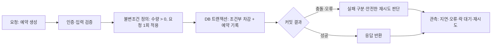
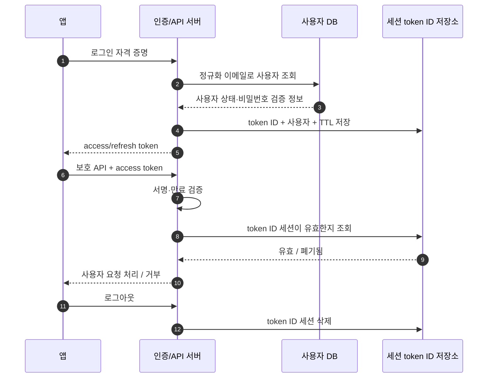
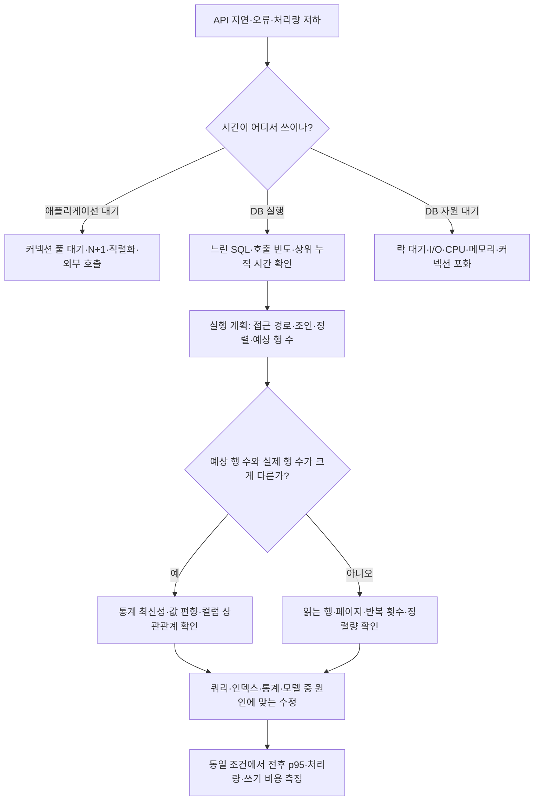
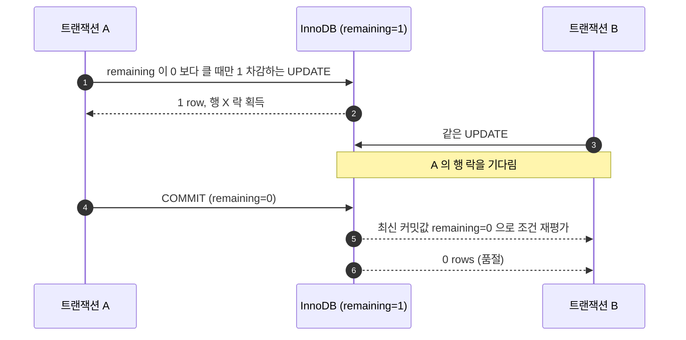
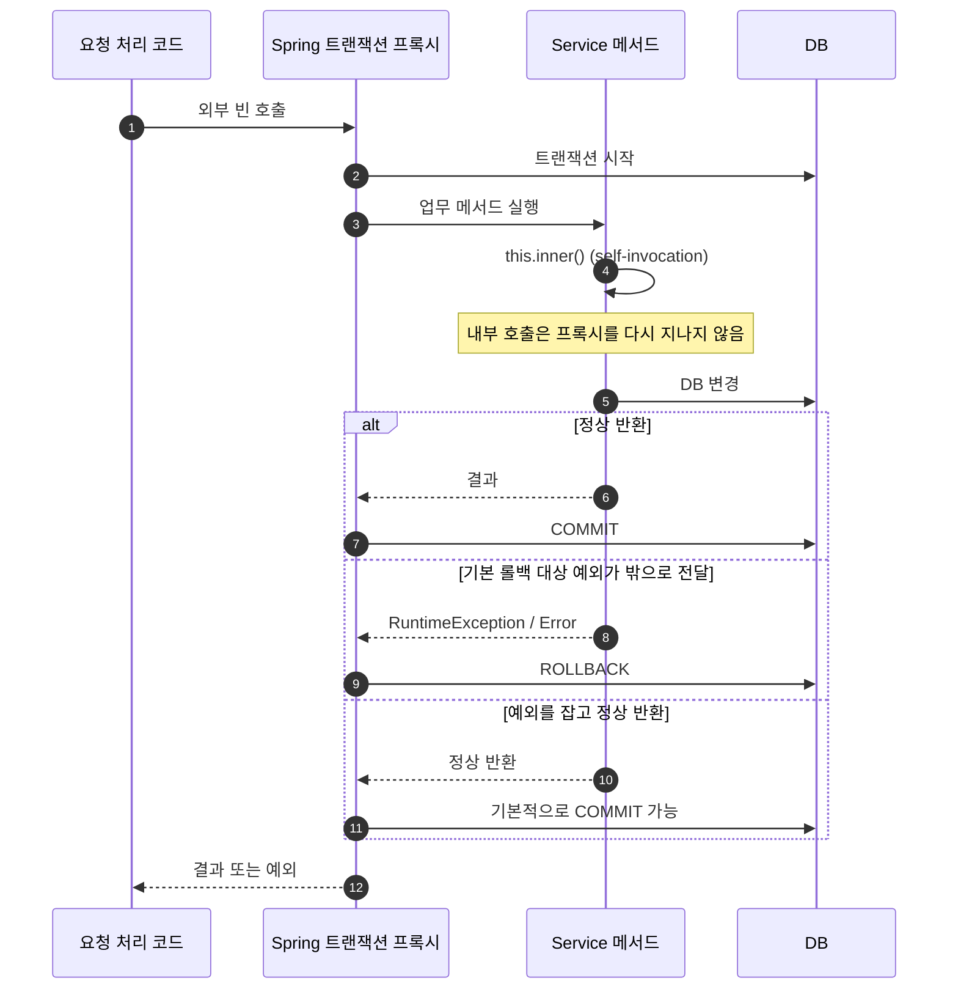
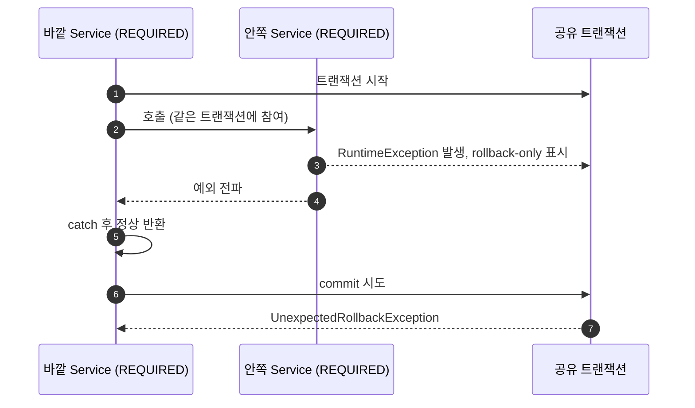
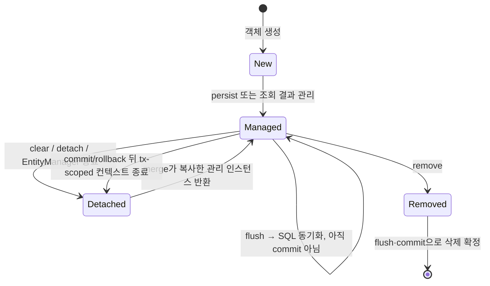
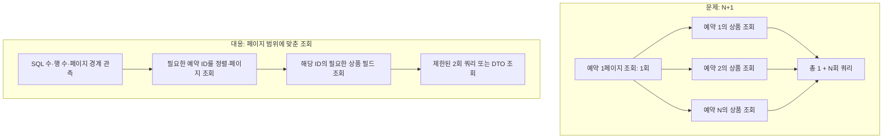

## DB · Spring · JPA: 면접 준비

이 문서는 **예약 하나를 생성하는 요청**을 처음부터 끝까지 따라가며 DB, Spring, JPA 의 역할을 연결합니다. 비유는 기억을 돕는 설명이고, 실제 답변은 기술 원리를 기준으로 하세요.

### 큰 그림: 서버 요청은 어떻게 안전하게 끝나는가

```text
HTTP 요청
  → 요청 검증·인증
  → 업무 규칙과 불변조건 확인
  → DB 트랜잭션 안에서 조건부 변경·제약 확인
  → 성공/실패 결과 확정
  → 타임아웃·재시도·중복 요청을 안전하게 처리
  → 로그·지표·실행 계획으로 관측
```

예를 들어 사용자가 상품을 예약하면 서버는 인증된 사용자인지 확인하고, **예약 수량은 0 보다 작아질 수 없다**, **요청 하나는 예약을 최대 한 번만 만든다** 같은 불변조건을 지켜야 합니다. DB 가 예약과 수량의 최종 기준(source of truth)입니다. 캐시가 있더라도 예약 확정은 DB 제약과 트랜잭션을 통해 결정해야 합니다. 클라이언트가 타임아웃 뒤 같은 요청을 다시 보낼 수 있으므로 중복 방지 키가 필요할 수 있습니다. 성공률만 보는 게 아니라 쿼리 지연, 오류, 재시도, DB 락 대기 등을 관측해야 합니다.



이 문서의 각 그림에서 **요청 → 불변조건 → DB 확정 → 실패/재시도 → 관측** 라벨은 이 공통 흐름 중 해당 개념의 위치를 나타냅니다.

| 큰 그림의 위치 | 이 문서에서 다루는 개념 |
|---|---|
| 입력과 요청 경로 | Spring 빈·DI, Controller-Service-Repository, 사용자 인증 데이터 조회 |
| 업무 규칙·불변조건 | PK/FK/UNIQUE/CHECK, 예약 재고 조건, 멱등성 |
| 최종 기준 데이터 | DB 테이블·인덱스·실행 계획, 트랜잭션 |
| 동시 요청 제어 | 격리 수준, 조건부 UPDATE, 낙관적/비관적 락 |
| DB 작업을 묶는 경계 | Spring `@Transactional`, 프록시, 롤백 규칙 |
| 객체와 DB 사이 | JPA 영속성 컨텍스트, 변경 감지, flush, 로딩, 페이징 |
| 실패 분석 | 실행 계획, SQL/쿼리 로그, 락 대기·재시도 관측 |

#### 경험과 학습 지식의 경계

이력서에서 근거를 들어 말할 수 있는 경험은 다음입니다.

- 백엔드 개발자와 Kotlin·Spring Boot 서버 API 와 서비스 로직을 함께 작성했습니다.
- Go API 에서 JWT access·refresh 발급·검증 흐름을 구현했고, Redis 에 token ID 와 사용자 연결 정보를 만료시간과 함께 저장했습니다. 로그아웃 때 폐기하고 refresh 때 토큰을 교체했습니다.
- Oracle 저장 프로시저로 기존 현장 시스템과 점검 데이터를 연동했습니다.
- Java·Node.js 등의 백엔드와 앱 연동 경험도 있습니다.

**이력서에는 JPA 를 직접 사용한 경험이 없습니다.** JPA 설명은 학습한 원리로 답하고, 실제 프로젝트에서 썼다고 말하지 마세요. Spring Boot 도 백엔드 개발자와 함께 작성한 범위와 본인이 맡은 일을 구분해 설명하세요.

쓸 수 있는 답변 틀: "제가 실제 구현한 것은 …입니다. JPA 는 직접 사용하지는 않았고, 원리는 …로 이해하고 있습니다. 이 요구사항이라면 …를 먼저 확인해 검증하겠습니다."

---

### 1. 관계형 DB: 데이터 규칙과 조회 경로

#### 표와 키, 제약조건

**큰 그림에서:** 업무 불변조건을 DB 에서도 지켜 데이터가 잘못 저장되는 경로를 막습니다.

관계형 DB 는 서로 연결된 표들의 모음입니다. `Product(id, remaining)`과 `Reservation(id, user_id, product_id, request_key, status)` 처럼 역할별로 표를 두고 키로 연결합니다.

- **PK(기본 키)**는 각 행의 고유 번호입니다. 한 예약을 확실히 가리킵니다.
- **FK(외래 키)**는 다른 표의 키를 참조합니다. 존재하지 않는 사용자나 상품을 예약이 가리키지 않도록 합니다. FK 를 쓰면 무결성이 강해지지만 삭제 순서와 대량 변경 등 운영 정책을 고려해야 합니다.
- **UNIQUE**는 값 또는 값 조합의 중복을 금지합니다. `(user_id, request_key)` 에 두면 사용자의 같은 멱등 요청이 중복 예약으로 생성되는 것을 DB 가 막도록 설계할 수 있습니다.
- **NOT NULL / CHECK**는 필수값이나 허용 범위를 제한합니다. DB 제품별 CHECK 지원·동작 차이는 확인해야 합니다.
- 앱에서 먼저 중복 여부를 조회하더라도, 동시 요청은 둘 다 "없음"을 읽을 수 있습니다. 최종 규칙은 가능한 한 DB 제약으로도 보장하고, 제약 위반은 의미 있는 응답으로 바꿉니다.

#### 사용자·인증 데이터 예시

**큰 그림에서:** 요청의 주체를 확인하고, 사용자 식별과 세션 폐기 규칙을 데이터 구조에 반영합니다.

관계형 DB 에서 `User(id, email, status)`의 `email`이 로그인 식별자라면 정규화한 이메일에 `UNIQUE` 제약을 둘지 검토합니다. 이메일 존재 여부를 먼저 조회하는 것만으로는 두 가입 요청의 경합을 막지 못하기 때문입니다. 대소문자·공백 정규화 방식과 이메일 변경 정책도 제약 설계에 포함합니다.

이력서의 실제 경험은 JWT access/refresh 흐름을 만들고 Redis 에 token ID 와 사용자 연결 정보 및 만료시간을 둔 것입니다. 따라서 이 사례를 DB/JPA 경험이라고 부르면 안 됩니다. 다만 동일한 원리는 인증 데이터에도 적용됩니다. 서버가 token ID 를 폐기 목록/세션으로 관리한다면 token ID 의 유일성, 만료 정리, 사용자별 세션 폐기 규칙을 생각하고, 검증 시 해당 레코드가 존재하고 유효한지 확인합니다. JWT 서명 검증과 Redis 조회는 서로 다른 검증 단계입니다. JWT 자체가 유효해도 서버 측 세션 레코드가 폐기되었다면 거부할 수 있습니다.

면접에서 "로그아웃 즉시 토큰을 무효화하려면?"을 받으면 이렇게 답할 수 있습니다: "제가 구현한 흐름은 Redis 에 token ID 와 사용자 연결 정보를 TTL 과 함께 저장하고, 로그아웃 시 해당 정보를 제거해 서버가 폐기 상태를 확인하도록 했습니다. 저장소 장애 시 허용/거부 정책, refresh 회전 중 이전 토큰 재사용, 여러 기기 세션 범위는 보안 요구와 장애 정책으로 별도 결정해야 합니다."



#### 인덱스와 쿼리 계획

**큰 그림에서:** 최종 기준인 DB 가 요청을 처리할 때 어떤 경로로 행을 찾는지, 느려진 원인이 무엇인지 판단합니다.

**비유:** 인덱스는 책의 찾아보기입니다. 원하는 항목을 빠르게 찾도록 도와주지만 찾아보기 자체를 만들고 갱신하는 비용이 있습니다. 실제 DB 인덱스는 보통 B-tree 계열 구조 등으로 키를 정렬해 탐색하게 합니다. 인덱스가 있다고 모든 쿼리가 빨라지지는 않습니다.

예를 들어 "사용자별 최근 예약" 조회는 다음 패턴입니다.

```sql
SELECT id, product_id, status, created_at
FROM reservation
WHERE user_id = :userId
ORDER BY created_at DESC
LIMIT :pageSize;
```

`(user_id, created_at)` 복합 인덱스를 후보로 볼 수 있지만, 방향·커버링 여부·데이터 분포 및 DB 엔진에 따라 계획이 달라집니다. 실행 계획을 통해 `user_id` 조건에서 몇 건을 읽는지, 정렬 작업이 추가되는지, 실제 읽은 행 수가 예상과 맞는지 확인합니다. 사용자 ID 마다 예약이 매우 많거나 페이지가 깊다면 인덱스만으로 충분하지 않을 수 있습니다.

- `WHERE`, `JOIN`, `ORDER BY` 에서 자주 쓰이고 선택성이 있는 컬럼에 후보가 됩니다.
- 복합 인덱스 `(user_id, created_at)` 는 보통 왼쪽 컬럼부터 활용하는 접근 패턴에 특히 유리합니다. 두 컬럼의 실제 조건 순서, 범위 조건, 정렬과 DB 엔진의 최적화 규칙을 함께 봅니다.
- 조건에 맞는 행이 대부분이면 인덱스를 따라가는 비용보다 테이블을 읽는 편이 나을 수 있습니다. 옵티마이저는 통계와 비용 추정으로 접근 경로를 고릅니다.
- 인덱스는 저장 공간을 차지하고 INSERT/UPDATE/DELETE 때 갱신 비용이 생깁니다. 검색 컬럼마다 만들면 쓰기 지연과 관리 비용이 커질 수 있습니다.

**쿼리 플랜(실행 계획)**은 DB 가 쿼리를 어떻게 실행할지 보여주는 계획입니다. 느린 요청에서 실제 SQL 과 바인딩 패턴을 확인하고, 계획의 접근 방식(전체 스캔/인덱스 탐색), 조인 방식, 예상 행 수, 정렬·임시 작업 등을 봅니다. 가능하면 실제 실행 통계와 비교해 예상치와 실제 행 수가 크게 다른지도 살핍니다. `EXPLAIN ANALYZE` 처럼 실제 실행하는 기능은 쿼리를 실행할 수 있으니 읽기 전용인지와 데이터 변경 여부를 확인하고 사용합니다. DB 별 용어와 출력은 다릅니다.

**사용 기준:** 먼저 실제 병목 쿼리와 지표를 잡고, 계획을 확인한 다음 인덱스나 쿼리 형태를 바꾸고 전후를 측정합니다. 계획만 보고 인덱스를 무조건 추가하지 않습니다.

#### DB 병목을 찾는 순서: 증상에서 원인까지

**비유:** 병원에서 열이 난다고 해열제부터 주지 않듯, API 지연이 보인다고 인덱스부터 추가하지 않습니다. 먼저 병목이 DB 에 있는지 확인하고, 어느 쿼리의 어떤 실행 단계가 시간을 쓰는지 좁힙니다.



1. API p95 지연, 오류율, DB 커넥션 사용량과 대기 시간을 보고 DB 병목인지 확인합니다. 애플리케이션의 커넥션 풀 대기와 실제 SQL 실행 시간을 구분합니다.
2. 느린 SQL 로그나 관측 지표에서 **한 번의 지연**뿐 아니라 호출 횟수×실행 시간을 기준으로 누적 비용이 큰 쿼리를 찾습니다. 짧은 쿼리도 N+1 로 수백 번 호출되면 병목이 됩니다.
3. 실제 파라미터와 데이터 분포를 반영해 실행 계획을 읽습니다. 인덱스/테이블 접근, 조인 순서와 방식, 예상 행 수, 실제 행 수, 반복 횟수, 정렬/임시 작업, 읽은 블록/페이지와 대기 이벤트를 봅니다.
4. 예상 행과 실제 행이 크게 다르면 통계가 오래됐는지, 데이터가 한 값에 몰렸는지, 컬럼 사이 상관관계가 있는지 확인합니다. 계획이 맞아도 실제로 읽는 행이 지나치게 많으면 쿼리 조건·페이지 방식·인덱스 설계를 다시 봅니다.
5. 한 번에 한 원인만 바꾸고 같은 데이터 규모·파라미터·부하 조건에서 비교합니다. p95/p99, 처리량, CPU/I/O, 읽은 행 또는 buffer, 락 대기, 쓰기 지연과 인덱스 유지 비용을 함께 확인합니다.

>`EXPLAIN ANALYZE` 등 실제 실행을 포함하는 도구는 SELECT 라도 비용이 큰 쿼리를 실제로 수행할 수 있고, DML 은 데이터를 바꿀 수 있습니다. 운영에서 실행할 때는 부하와 트랜잭션/롤백 가능성을 먼저 검토합니다. DB 별 `EXPLAIN`, 실제 실행 통계, buffer 용어는 서로 다릅니다.

#### Cardinality 와 selectivity: 같은 단어가 가리키는 것 구분하기

면접에서 cardinality 는 문맥에 따라 적어도 두 뜻으로 쓰입니다.

- **컬럼/인덱스 cardinality:** 그 컬럼(또는 인덱스 키)에 있는 서로 다른 값의 수입니다. `status`가 `PENDING/CONFIRMED/CANCELLED` 라면 NDV(number of distinct values)는 3 입니다. 복합 인덱스에서는 각 컬럼 하나의 NDV 와 키 조합의 NDV 가 다릅니다.
- **쿼리 결과 cardinality:** 옵티마이저가 조건 또는 plan node 에서 반환할 것으로 **예상하는 행 수**를 말할 때가 많습니다. 실행 계획의 estimated rows 와 actual rows 를 비교합니다.
- **Selectivity(선택도):** 조건을 적용한 뒤 남는 행의 비율입니다. 대략 `조건을 만족하는 행 수 / 전체 행 수` 입니다. 선택도가 낮을수록 더 적은 행이 남아 보통 필터링에 유리합니다. "선택성이 높다"를 "남는 행이 많다"로 잘못 뒤집어 말하지 않도록 주의합니다.

**예시:** 예약 1 천만 건에서 `status='CONFIRMED'`가 800 만 건이면 status 단일 조건은 많은 행을 남겨 인덱스가 덜 매력적일 수 있습니다. 하지만 `status='CONFIRMED' AND user_id=42`처럼 사용자가 극소수 행만 갖는 조건이면 복합 인덱스 후보가 될 수 있습니다. 반대로 `status='CANCELLED'` 가 0.1% 라면 낮은 NDV 컬럼이어도 그 값의 분포에 따라 유용할 수 있습니다. 따라서 "카디널리티 낮은 컬럼은 인덱스 금지"는 틀린 규칙입니다.

옵티마이저는 통계로 행 수와 비용을 추정합니다. 값이 심하게 편향되거나 테이블 데이터가 크게 바뀌어 통계가 낡으면, 인덱스가 있어도 잘못된 계획이 선택될 수 있습니다. 통계 갱신은 진단 후 DB 별 운영 방침에 따라 검토합니다. PostgreSQL 은 `ANALYZE`로 통계를 수집하고, MySQL 은 `ANALYZE TABLE`로 키 분포/통계를 갱신할 수 있습니다. 이력서에는 Oracle 경험이 있으므로 실제 Oracle 에서는 통계 수집 정책과 `DBMS_XPLAN` 등 실행 계획 도구를 DBA 와 확인한다고 답하는 것이 자연스럽습니다.

#### 인덱스 후보를 고르는 실전 규칙

이 규칙은 출발점이지 자동 생성 공식이 아닙니다. 실제 쿼리와 데이터로 계획을 검증합니다.

1. **실제 workload 부터 본다.** `WHERE`, `JOIN`, `ORDER BY`, `GROUP BY` 에 자주 등장하는 쿼리와 읽기/쓰기 비중, 호출 빈도, p95 를 확인합니다. 사용되지 않는 인덱스도 비용이므로 컬럼만 보고 먼저 만들지 않습니다.
2. **조건 조합에 맞춰 복합 인덱스를 설계한다.** B-tree 계열에서 `(a,b,c)`는 보통 선두 컬럼 `a`와 그 왼쪽 prefix 가 중요한 접근 경로입니다. `WHERE user_id=? ORDER BY created_at DESC`는 `(user_id, created_at)` 후보가 됩니다. `user_id` 가 빠진 조회에서 같은 인덱스가 효율적일 거라고 가정하지 않습니다.
3. **동등 조건·범위 조건·정렬을 함께 본다.** 흔한 후보 설계는 자주 함께 고정되는 동등 조건을 앞에 두고 범위/정렬 컬럼을 뒤에 두는 것입니다. 다만 조건 조합, 선택도, 정렬 방향, DB 엔진과 인덱스 구현에 따라 달라집니다. 범위 조건 뒤 컬럼이 탐색 범위를 얼마나 줄이는지는 엔진별 계획으로 확인합니다.
4. **낮은 NDV 만으로 배제하지 않는다.** 단일 컬럼의 distinct 값이 적어도 특정 값이 매우 드물거나, 복합 인덱스의 후속 조건과 결합해 많은 행을 줄일 수 있습니다. 중요한 것은 해당 파라미터에서 실제로 몇 행이 남는지와 비용입니다.
5. **SARGable 조건을 유지한다.** 인덱스 컬럼에 함수를 씌우거나, 컬럼과 다른 타입을 비교해 암묵적 형 변환을 만들거나, 문자열 앞에 와일드카드가 있는 조건은 일반 인덱스 탐색을 방해할 수 있습니다. 정규화된 저장값/범위 조건으로 표현하거나 DB 가 지원하는 함수 기반 인덱스 등 대안을 검토합니다. `LIKE 'abc%'`와 `LIKE '%abc'` 는 접근 특성이 다릅니다.
6. **읽기와 쓰기의 총비용을 잰다.** 인덱스는 디스크/메모리를 쓰고 INSERT·UPDATE·DELETE 때마다 유지됩니다. 쓰기 빈도가 높은 테이블에 넓고 중복된 인덱스를 많이 두면 쓰기 지연과 저장 공간, 캐시 효율이 나빠질 수 있습니다.
7. **플랜의 인덱스 사용 여부만으로 합격시키지 않는다.** 인덱스가 사용돼도 많은 행을 읽거나 테이블로 랜덤 접근을 반복하면 느릴 수 있습니다. 예상/실제 행 수, 루프 수, 페이지/버퍼, 정렬·조인, 응답 분포까지 확인합니다. 작은 테이블이나 조건이 대부분의 행을 반환하는 쿼리는 전체 스캔이 더 쌀 수 있습니다.
8. **인덱스 추가 전후를 같은 조건으로 비교한다.** 대표 값뿐 아니라 데이터 편향의 양 끝, 페이지 크기, 동시 부하를 확인합니다. 평균 한 번의 실행시간만으로 p95 악화나 쓰기 회귀를 놓치지 않습니다.

#### Covering index: 테이블 행을 다시 읽지 않아도 되는 인덱스

**비유:** 책의 색인에 제목과 페이지 번호만 있으면 본문을 다시 찾아 펼쳐야 하지만, 필요한 요약까지 색인에 적혀 있으면 색인만 보고 답을 얻을 수 있습니다.

쿼리가 필터링·조인·정렬에 쓰는 컬럼과 결과로 반환하는 컬럼을 인덱스가 모두 제공하면, 해당 쿼리는 그 인덱스만으로 결과를 만들 수 있는 **covering query**가 될 수 있습니다. 이때 테이블의 실제 행을 다시 읽는 접근(table lookup/heap fetch)을 줄일 수 있습니다. 다만 엔진이 이를 `covering index`, `index-only scan` 등으로 표현하는 방식과 실제 heap 접근을 생략할 조건은 다릅니다. 예를 들어 PostgreSQL 의 index-only scan 은 필요한 컬럼이 인덱스에 있어도 visibility map 상태에 따라 heap 확인이 발생할 수 있습니다.

앞의 사용자 예약 조회가 아래처럼 일부 컬럼만 반환한다고 가정합니다.

```sql
SELECT id, status, created_at
FROM reservation
WHERE user_id = :user_id
ORDER BY created_at DESC
LIMIT :page_size;
```

`(user_id, created_at)`만으로는 `id`, `status` 를 얻기 위해 테이블 행을 추가 조회할 수 있습니다. 일부 DB 에서는 아래처럼 결과 컬럼을 인덱스에 포함해 covering 접근을 유도할 수 있습니다.

```sql
-- 문법은 DB별로 다릅니다. INCLUDE 지원 여부와 동작을 확인하세요.
CREATE INDEX idx_reservation_user_created
    ON reservation (user_id, created_at DESC)
    INCLUDE (id, status);
```

여기서 `user_id`와 `created_at`은 탐색·정렬에 쓰는 key column 이고, `id`, `status`는 결과를 인덱스에서 제공하기 위해 덧붙인 payload/include column 입니다. 모든 DB 가 `INCLUDE` 문법을 지원하는 것은 아닙니다. 지원하지 않으면 일반 복합 인덱스에 컬럼을 추가하는 방법을 검토하되, 그 컬럼도 인덱스 키의 크기와 정렬 구조에 들어갈 수 있습니다.

**선택 규칙:**

- 이 쿼리가 빈번하고 지연 기여도가 크며, 추가 컬럼으로 인덱스가 과도하게 커지지 않을 때 후보가 됩니다.
- `SELECT *` 를 덮으려고 테이블의 모든 컬럼을 인덱스에 복제하지 않습니다. 인덱스가 커지면 메모리 캐시 효율, 저장 공간, 쓰기 성능이 악화됩니다.
- 업데이트가 잦은 payload 컬럼은 인덱스 갱신을 늘릴 수 있습니다. 읽기 성능 개선만 보지 말고 INSERT/UPDATE 지연과 인덱스 크기도 비교합니다.
- 인덱스에 컬럼이 들어 있다는 사실만으로 index-only 실행이 보장되지는 않습니다. 실제 실행 계획에서 테이블/heap fetch 가 줄었는지와 buffer 읽기를 확인합니다.
- 복합 인덱스의 leftmost prefix 규칙과 covering 은 서로 다른 성질입니다. 선두 컬럼은 탐색 범위에 영향을 주고, 포함 컬럼은 결과를 인덱스만으로 제공할 가능성을 높입니다.

**질문: covering index 가 무엇이고 무조건 만들면 좋은가요?**

- **짧은 답:** "쿼리에 필요한 조건·정렬·반환 컬럼을 인덱스가 모두 제공해 테이블 재조회 비용을 줄일 수 있는 인덱스입니다. 인덱스 크기와 쓰기 비용이 증가하므로 자주 실행되는 병목 쿼리에 한해 계획과 전후 측정으로 판단합니다."
- **경험형 답:** "예를 들어 사용자 예약 목록이 `user_id`로 찾고 `created_at` 순으로 정렬하며 `id/status`만 반환한다면 `(user_id, created_at)` 에 반환 컬럼을 포함하는 후보를 검토합니다. 실제 DB 가 index-only/covering 접근을 선택했는지, 테이블 fetch 와 buffer 가 줄었는지, 쓰기 지연이 늘지 않았는지를 비교하겠습니다."

**꼬리질문:** 반환 컬럼을 전부 인덱스 키에 넣으면 되나요?

**답변:** "그렇게 하면 인덱스가 커지고 쓰기마다 많은 데이터를 갱신해 총비용이 커질 수 있습니다. DB 가 지원한다면 탐색 키와 단순 반환용 include 컬럼을 나눌 수 있지만, 그 경우에도 실제 크기와 변경 빈도를 확인해야 합니다. 정말 자주 실행되는 제한된 조회만 대상으로 삼겠습니다."

**복합 인덱스 예시**

```sql
-- 내 예약을 최신순으로 페이지 조회하는 패턴
SELECT id, status, created_at
FROM reservation
WHERE user_id = :user_id
  AND created_at >= :from_time
ORDER BY created_at DESC
LIMIT :page_size;

-- 후보: 동일 user_id 안에서 시각 범위를 찾고 정렬하는 접근
CREATE INDEX idx_reservation_user_created
    ON reservation (user_id, created_at);
```

이 인덱스가 최선이라고 단정할 수 없습니다. 테이블/엔진, 정렬 요구, 동률 정렬 기준, selectivity, 반환 컬럼, 페이지 깊이와 데이터 분포를 넣어 실제 실행 계획과 쓰기 비용을 검증합니다. 안정적인 페이지네이션에는 정렬 기준이 유일하도록 `id` 같은 tie-breaker 를 포함하는 keyset 설계도 고려합니다. 깊은 `OFFSET` 은 앞의 행을 건너뛰는 비용이 커질 수 있습니다.

#### 면접 문답: 병목과 인덱스 튜닝

**Q1. DB 가 느리다고 하면 무엇부터 확인하나요?**

- **짧게:** "DB 가 실제 병목인지 먼저 확인하고, 지연 기여도가 큰 SQL 과 실행 계획, 실제 행 수·대기를 봅니다. 원인을 고친 뒤 같은 조건에서 전후를 측정합니다."
- **상세:** "API p95 와 DB 커넥션 대기, SQL 별 호출 횟수·누적 시간으로 범위를 좁힙니다. 실행 계획의 접근 경로, 조인·정렬, 예상과 실제 행 수, buffer/읽기량을 보고 락·I/O·CPU 대기도 확인합니다. N+1 인지, 잘못된 선택도 추정인지, 실제로 많은 행을 읽는 쿼리인지 구분해서 쿼리·인덱스·통계 중 원인에 맞는 조치를 하고 부작용도 측정합니다."

**꼬리질문:** SQL 실행 계획은 좋은데 API 가 느리다면요?

**답변:** "SQL 외의 시간을 보겠습니다. 커넥션 풀에서 기다리는지, N+1 로 SQL 을 반복하는지, 락이나 외부 API, 애플리케이션 처리와 직렬화가 지연되는지 trace 와 지표로 나눕니다. 데이터베이스 쿼리 하나의 실행시간만으로 요청 전체 지연을 설명할 수 없습니다."

**Q2. cardinality 가 높은 컬럼에 인덱스를 걸면 되나요?**

- **짧게:** "높은 NDV 는 후보를 평가하는 한 요소일 뿐 규칙은 아닙니다. 쿼리의 조건 조합과 실제로 줄어드는 행 수를 봅니다."
- **상세:** "Cardinality 가 컬럼의 distinct 값 수인지 실행 계획의 예상 결과 행 수인지 문맥을 먼저 구분하겠습니다. 인덱스 선택은 NDV 뿐 아니라 값 분포와 편향, 복합 조건, 반환 비율, 쿼리 빈도, 쓰기 비용에 좌우됩니다. NDV 가 낮은 상태 컬럼도 특정 값이 드물거나 user_id 와 묶이면 유효할 수 있고, NDV 가 높은 컬럼도 거의 모든 행을 반환하는 범위 검색이면 이득이 작을 수 있습니다."

**꼬리질문:** 단일 컬럼 인덱스 두 개와 복합 인덱스 중 무엇을 고르나요?

**답변:** "대표 쿼리 패턴을 기준으로 비교합니다. 복합 인덱스는 선두 prefix 를 사용하는 여러 쿼리를 지원하고 조건과 정렬을 한 경로로 처리할 수 있지만 크고 쓰기 비용이 듭니다. 단일 인덱스 조합은 옵티마이저가 결합할 수 있어도 정렬/커버링까지 해결한다는 보장은 없습니다. 실제 바인드 값과 계획, 인덱스 사용률 및 쓰기 부하로 선택합니다."

**Q3. 예상 행 수와 실제 행 수가 크게 다르면 무엇을 의심하나요?**

**답변:** "통계의 최신성, 값 편향, 컬럼 간 상관관계, 파라미터별 데이터 분포를 먼저 봅니다. 옵티마이저는 통계로 비용을 추정하므로 추정이 틀리면 조인 순서와 인덱스 선택이 달라질 수 있습니다. 통계를 무작정 갱신하거나 힌트를 박기 전에, 해당 DB 의 통계와 실제 실행 자료를 확인합니다."

**꼬리질문:** 카디널리티가 낮은 status 컬럼 인덱스는 만들지 말아야 하나요?

**답변:** "항상 그렇지는 않습니다. 전체 행의 1% 만 특정 status 라면 해당 값 조회에 이득일 수 있고, status 와 다른 조건을 결합한 복합 인덱스도 후보입니다. 반대로 해당 status 가 전체의 90% 를 차지하면 테이블 스캔이 더 쌀 수 있습니다. 빈도와 분포를 확인합니다."

**Q4. 이력서의 Oracle 경험과 인덱스 튜닝 경험은 어떻게 구분하나요?**

**답변:** "Oracle 프로시저 연동과 데이터 흐름을 다룬 경험은 있지만 대규모 예약 DB 의 인덱스 튜닝을 주도했다고 말하지 않겠습니다. 원리는 이해하고 있으며, 실제 업무에서는 쿼리와 바인드 값, 실행 계획, 통계, 읽기/쓰기 지표를 확인하고 DBA 와 함께 변경을 검증하겠습니다."

##### 질문 답변 연습

**Q. 인덱스를 만들면 조회는 항상 빨라지나요?**

- **단답:** "아닙니다. 선택성, 데이터 분포, 읽어야 할 행 수에 따라 전체 스캔이 더 나을 수 있고, 인덱스는 쓰기 비용도 만듭니다."
- **상세:** "실제 쿼리와 계획을 확인해 옵티마이저가 선택한 접근 경로, 읽는 행 수, 조인·정렬 비용을 봅니다. 쿼리 패턴에 맞는 인덱스를 만들고 전후 성능과 쓰기 비용을 함께 측정합니다."
- **경험 연결:** "Oracle 저장 프로시저로 현장 데이터를 연동한 경험은 있지만 대규모 예약 DB 의 튜닝을 주도했다고 말할 수는 없습니다. 느린 쿼리를 재현하고 DBA·팀과 실행 계획과 인덱스 후보를 확인해 측정하겠습니다."

**꼬리질문 1:** "사용자 ID 와 생성 시각을 검색하면 `(created_at, user_id)` 로 만들어도 되나요?"

**답변:** "조건이 같아도 복합 인덱스의 선두 컬럼과 범위·정렬 패턴에 따라 효율이 다릅니다. 실제 쿼리 빈도와 필터 순서, 데이터 분포를 보고 두 후보의 계획을 비교하겠습니다."

**꼬리질문 2:** "실행 계획에서 인덱스를 탔으면 튜닝이 끝난 것 아닌가요?"

**답변:** "인덱스 사용 자체가 빠르다는 뜻은 아닙니다. 예상 행과 실제 읽은 행, 랜덤 접근량, 조인·정렬 비용과 전체 응답 시간을 함께 봐야 합니다. 계획과 실제 통계가 다르면 통계나 조건 형태도 조사하겠습니다."

**꼬리질문 3:** "실행 시간이 한 번 줄면 성공인가요?"

**답변:** "캐시 온도나 부하에 따라 달라질 수 있어 같은 조건에서 여러 번 비교하고 p95 지연, 읽은 행·페이지, 쓰기 영향도 보겠습니다. 쿼리 계획 변화와 운영 지표까지 확인해야 회귀를 놓치지 않습니다."

---

### 2. 트랜잭션과 격리 수준: 작업 묶음과 동시 실행

#### 트랜잭션이 보장하는 것

**큰 그림에서:** 업무 작업이 DB 에 반영되는 단위를 정하고, 동시 요청 사이에 어떤 상태가 보일지 정합니다.

**비유:** 송금 때 출금과 입금을 한 묶음으로 처리합니다. 한쪽만 반영되면 안 됩니다. 기술적으로 트랜잭션은 원자성, 일관성, 격리성, 지속성을 제공하도록 설계되지만 "트랜잭션을 썼다"는 사실만으로 모든 업무 규칙이 지켜지는 것은 아닙니다.

- **원자성:** 트랜잭션의 변경은 함께 커밋되거나 롤백됩니다.
- **일관성:** 애플리케이션과 DB 제약이 정의한 규칙을 만족하도록 합니다.
- **격리성:** 동시 작업의 읽기·쓰기 간섭을 제어합니다. 격리 수준에 따라 성능과 허용되는 이상 현상이 달라집니다.
- **지속성:** 커밋된 변경이 장애 이후에도 보존되도록 합니다.

업무 단위는 보통 Spring 서비스 메서드에서 정의하지만, HTTP 요청 전체를 무조건 하나의 긴 트랜잭션으로 묶는 것은 아닙니다. 외부 결제·메일 호출을 기다리는 동안 DB 트랜잭션과 락을 오래 유지하면 커넥션과 잠금이 점유됩니다. DB 에서 할 일을 짧게 커밋하고 외부 시스템의 결과·재시도는 별도 상태 전이로 다루는 편이 나을 수 있습니다.

#### 격리 이상 현상

아래 현상의 실제 발생 가능성은 DB 엔진, 기본 격리 수준, 잠금/MVCC 구현, 쿼리 방식에 따라 다릅니다. "격리 수준 이름만으로 모든 DB 의 동작이 같다"고 단정하지 말고 해당 DB 문서를 확인하세요.

- **Dirty read(더티 리드):** 아직 커밋되지 않은 다른 트랜잭션의 변경을 읽습니다. 상대 트랜잭션이 롤백하면 존재하지 않았던 값을 본 셈입니다.
- **Non-repeatable read(반복 불가능 읽기):** 같은 트랜잭션에서 같은 행을 다시 읽었는데, 그 사이 다른 트랜잭션이 커밋해 값이 바뀌었습니다.
- **Phantom read(팬텀 리드):** 같은 조건으로 행 집합을 다시 조회했더니, 다른 트랜잭션의 삽입·삭제로 결과 집합이 달라졌습니다.
- **Lost update(갱신 손실):** 두 트랜잭션이 같은 오래된 값을 읽어 각자 계산한 값을 덮어쓰면서 한 변경이 사라집니다. DB 별 격리·쓰기 잠금 동작이 다르고, 버전 확인이나 조건부 갱신으로 명시적으로 막을 수 있습니다.
- **Write skew(쓰기 편향):** 각 트랜잭션은 서로 다른 행을 수정하지만, 둘이 읽은 공통 조건을 함께 깨뜨릴 수 있습니다. 단순히 각 행의 충돌을 잠그는 것만으로 부족할 수 있어 더 강한 격리나 DB 제약·명시적 잠금이 필요할 수 있습니다.

#### 표준 격리 수준 4 단계

**큰 그림에서:** 동시에 실행되는 트랜잭션이 서로의 변경을 어디까지 볼 수 있는지 정하는 규칙입니다. 격리 수준이 높을수록 이상 현상은 줄지만 대기·재시도·처리량 비용이 커집니다.

SQL 표준은 어떤 이상 현상을 **허용하는지**로 네 단계를 정의합니다.

| 격리 수준 | Dirty read | Non-repeatable read | Phantom read | 한 줄 요약 |
|---|---|---|---|---|
| READ UNCOMMITTED | 발생 가능 | 발생 가능 | 발생 가능 | 커밋 안 된 값까지 보임. 실무에서 거의 쓰지 않음 |
| READ COMMITTED | 방지 | 발생 가능 | 발생 가능 | 커밋된 값만 보지만, 다시 읽으면 바뀔 수 있음 |
| REPEATABLE READ | 방지 | 방지 | 표준상 발생 가능 | 한 번 읽은 행은 트랜잭션 동안 같게 보임 |
| SERIALIZABLE | 방지 | 방지 | 방지 | 트랜잭션을 하나씩 차례로 실행한 것과 같은 결과를 보장 |

**DB 별 기본값과 차이**(면접에서 자주 확인합니다):

- **MySQL·MariaDB InnoDB:** 기본 `REPEATABLE READ`. MVCC 스냅샷과 next-key lock 덕분에 표준이 허용하는 팬텀도 대부분 막습니다.
- **PostgreSQL:** 기본 `READ COMMITTED`. `READ UNCOMMITTED` 를 요청해도 `READ COMMITTED` 로 동작합니다. `REPEATABLE READ` 는 스냅샷 격리라 팬텀이 보이지 않고, 같은 행을 동시에 갱신하면 뒤 트랜잭션이 직렬화 오류로 실패합니다.
- **Oracle:** 기본 `READ COMMITTED`. `READ COMMITTED` 와 `SERIALIZABLE`(및 read-only)만 제공합니다.

표의 "방지"는 표준의 최소 요구입니다. 실제 동작은 엔진 구현(잠금 기반인지 MVCC 기반인지)에 따라 다르므로 "MySQL 에서는", "PostgreSQL 에서는"처럼 엔진을 붙여 말합니다.

#### MySQL InnoDB: MVCC, 일관된 읽기와 잠금 읽기

**비유:** 일반 조회는 트랜잭션 초반에 찍어 둔 **사진(스냅샷)**을 보는 것이고, 잠금 읽기와 UPDATE 는 **지금 창고에 있는 실물**을 확인하며 손을 얹어 두는 것입니다.

- **MVCC(Multi-Version Concurrency Control):** 행의 이전 버전을 undo log 로 보관해, 읽기가 쓰기를 기다리지 않고 자기 시점의 버전을 읽게 합니다.
- **일관된 읽기(consistent nonlocking read):** 일반 `SELECT` 입니다. `REPEATABLE READ` 에서는 트랜잭션의 첫 읽기 때 만든 스냅샷을 끝까지 쓰고, `READ COMMITTED` 에서는 문장마다 새 스냅샷을 씁니다. 락을 잡지 않습니다.
- **잠금 읽기(locking read):** `SELECT ... FOR UPDATE`(배타), `SELECT ... FOR SHARE`(공유)입니다. 스냅샷이 아니라 **가장 최근에 커밋된 행**을 읽고 락을 겁니다. `UPDATE`·`DELETE` 도 같은 방식으로 최신 행을 읽고 락을 겁니다.
- **Record lock / gap lock / next-key lock:** record lock 은 인덱스 레코드 하나, gap lock 은 레코드 사이의 빈 구간, next-key lock 은 레코드와 그 앞 구간을 함께 잠급니다. `REPEATABLE READ` 에서 범위 조건의 잠금 읽기는 next-key lock 으로 다른 트랜잭션의 삽입을 막아 팬텀을 방지합니다. `READ COMMITTED` 는 gap lock 을 대부분 쓰지 않아 동시성은 좋아지지만 팬텀이 생길 수 있습니다.
- **인덱스가 락 범위를 정합니다.** InnoDB 는 스캔한 인덱스 레코드에 락을 걸기 때문에, 조건 컬럼에 맞는 인덱스가 없으면 훨씬 많은 행(최악의 경우 사실상 테이블 전체)이 잠길 수 있습니다.
- **Deadlock 과 락 대기:** InnoDB 는 교착을 자동으로 감지해 한 트랜잭션을 롤백시킵니다(오류 1213). 락 대기가 길면 `innodb_lock_wait_timeout`(기본 50 초) 뒤 오류(1205)가 납니다. 애플리케이션은 이 두 오류를 재시도 가능한 실패로 다룰지 정해야 합니다.

**이 원리가 재고 차감에 주는 결론:**



- 조건부 UPDATE 는 스냅샷이 아니라 최신 커밋값으로 조건을 평가하므로, `REPEATABLE READ` 에서도 마지막 재고를 한 번만 차감합니다.
- 반대로 **일반 `SELECT` 로 수량을 읽고 애플리케이션에서 계산한 값을 `SET remaining = :계산값` 으로 쓰면** InnoDB `REPEATABLE READ` 에서도 lost update 가 생깁니다. 스냅샷으로 읽은 값에는 다른 트랜잭션의 커밋이 반영되지 않기 때문입니다. PostgreSQL `REPEATABLE READ` 는 이 경우 직렬화 오류로 실패시킨다는 점이 다릅니다.
- 읽은 값을 바탕으로 여러 규칙을 판단해야 하면 `SELECT ... FOR UPDATE` 로 처음부터 최신 행을 잠그고 읽습니다.

##### 질문 답변 연습

**Q. 트랜잭션 격리 수준 네 가지를 설명해 주세요.**

- **단답:** "READ UNCOMMITTED 는 커밋 안 된 데이터까지 읽고, READ COMMITTED 는 커밋된 것만 읽지만 다시 읽으면 값이 바뀔 수 있습니다. REPEATABLE READ 는 한 번 읽은 행이 트랜잭션 동안 같게 보이고, SERIALIZABLE 은 차례로 실행한 것과 같은 결과를 보장합니다. MySQL InnoDB 기본은 REPEATABLE READ, PostgreSQL 과 Oracle 기본은 READ COMMITTED 입니다."
- **상세:** "표준은 dirty read, non-repeatable read, phantom 중 무엇을 허용하는지로 단계를 나눕니다. 실제 동작은 엔진마다 다릅니다. InnoDB 는 MVCC 로 일반 SELECT 를 스냅샷에서 읽고, 잠금 읽기와 UPDATE 는 최신 커밋값을 읽으며 next-key lock 으로 범위 삽입을 막습니다. 그래서 재고처럼 정합성이 중요한 쓰기는 격리 수준만 올리기보다 조건부 UPDATE 나 SELECT FOR UPDATE 로 쓰기 지점에서 보장합니다."

**꼬리질문 1:** "MySQL 은 REPEATABLE READ 인데 왜 팬텀이 거의 안 생기죠?"

**답변:** "일반 SELECT 는 트랜잭션의 첫 읽기 때 만든 스냅샷을 계속 보기 때문에 다른 트랜잭션이 삽입한 행이 보이지 않습니다. 잠금 읽기는 next-key lock 으로 조건 범위의 빈 구간까지 잠가 삽입 자체를 막습니다. 다만 스냅샷 읽기와 잠금 읽기·DML 을 섞으면 최신 행이 보일 수 있어서 '완전히 없다'고 단정하지는 않습니다."

**꼬리질문 2:** "READ COMMITTED 로 낮추면 무엇이 좋아지고 무엇을 조심하나요?"

**답변:** "gap lock 이 대부분 빠져 락 범위와 교착이 줄고, 문장마다 최신 커밋값을 보므로 긴 트랜잭션의 스냅샷 유지 부담도 줄어듭니다. 대신 같은 트랜잭션 안에서 재조회 값이 바뀌고 팬텀이 생길 수 있습니다. 정합성이 필요한 지점은 조건부 UPDATE, 유니크 제약, 잠금 읽기로 명시적으로 보호합니다."

**꼬리질문 3 — 반박:** "SELECT 로 재고를 읽고 UPDATE 로 계산값을 쓰면 REPEATABLE READ 니까 안전하지 않나요?"

**답변:** "InnoDB 에서는 안전하지 않습니다. 일반 SELECT 는 스냅샷이라 다른 트랜잭션이 이미 커밋한 차감을 보지 못하고, 계산한 값으로 덮어쓰면 그 차감이 사라집니다. `remaining = remaining - 1` 처럼 DB 가 최신 값으로 계산하게 하거나, 처음부터 SELECT FOR UPDATE 로 읽어야 합니다."

#### 재고 경쟁: 조건부 UPDATE 와 락

두 요청이 남은 수량 1 을 읽고 둘 다 "예약 가능"으로 판단한 뒤 각각 예약을 만들면 초과 판매가 됩니다. 읽기와 쓰기를 별도 단계로 두었기 때문입니다.

**조건부 원자 갱신 예:**

```sql
UPDATE product_inventory
SET remaining = remaining - 1
WHERE product_id = :productId
  AND remaining > 0;
```

영향 행 수가 1 이면 차감 성공, 0 이면 재고가 없거나 경합에서 진 것입니다. 예약 행 생성과 차감은 같은 DB 트랜잭션으로 묶어 한쪽만 반영되지 않게 해야 합니다. 요청이 재전송될 수 있으면 idempotency key 에 UNIQUE 제약을 두어 같은 업무 요청이 중복 생성되지 않게 설계합니다.

#### 격리 수준 질문 답변

**Q. 격리 수준이 낮으면 어떤 문제가 생길 수 있나요?**

- **단답:** "더티 리드, 반복 불가능 읽기, 팬텀 등 동시 변경이 관찰될 수 있습니다. 정확한 동작은 DB 엔진과 격리 구현에 따라 확인해야 합니다."
- **상세:** "예를 들어 예약 가능 수량을 읽은 뒤 다른 트랜잭션이 그 행을 바꾸면 같은 트랜잭션의 재조회 결과가 달라질 수 있습니다. 더티 리드나 반복 읽기 변화처럼 어떤 이상 현상을 감수할지, DB 의 기본 격리 수준에서 어떤 잠금/MVCC 동작을 하는지 확인합니다. 격리를 올리는 것만으로 업무 규칙이 자동 보장되는 것은 아니므로 조건부 갱신이나 제약도 함께 둡니다."
- **경험 연결:** "제가 특정 예약 서비스에서 격리 수준을 운영 튜닝한 경험은 없습니다. Oracle 연동 경험을 바탕으로 실제 DB 의 기본 설정과 쿼리 동작을 확인한 뒤 필요한 수준을 선택하겠습니다."

**꼬리질문 1 — 반박:** "Serializable 로 하면 모든 문제가 끝나는 것 아닌가요?"

**답변:** "가장 강한 격리가 이상 현상을 줄일 수 있지만, 직렬화 실패나 대기·재시도가 늘 수 있고 구현별 동작도 확인해야 합니다. 필요한 불변조건을 제약이나 원자적 쓰기로 명시하는 것이 더 단순한 경우가 많습니다."

**꼬리질문 2:** "팬텀 리드는 재고 차감에서 생기나요?"

**답변:** "재고 한 행을 읽고 덮어쓰는 문제는 보통 갱신 손실이나 경쟁 쓰기로 설명하는 편이 정확합니다. 팬텀은 같은 조건의 행 집합을 다시 읽었을 때 다른 트랜잭션의 삽입·삭제로 집합이 달라지는 현상입니다. 현상 이름보다 실제 쿼리와 DB 잠금 방식을 기준으로 해결하겠습니다."

**꼬리질문 3:** "트랜잭션 격리만 높이면 조건부 UPDATE 가 필요 없나요?"

**답변:** "아닙니다. 격리 수준은 읽기와 쓰기 간섭의 규칙이고, `remaining > 0` 조건부 UPDATE 는 업무 불변조건을 쓰기에 직접 포함합니다. 둘은 서로 대체가 아니라 요구사항과 DB 동작에 따라 함께 쓰거나 역할을 나눕니다."

##### 낙관적 락

**비유:** 공동 문서에 버전 번호를 표시합니다. 내가 읽은 뒤 다른 사람이 수정했다면 저장 시 버전이 달라져 충돌을 알 수 있습니다.

JPA 의 `@Version` 같은 버전 필드를 사용하면 UPDATE 에 기존 버전을 조건으로 포함하고, 영향 행이 없을 때 충돌 예외를 냅니다. 충돌이 드물고 읽기가 많은 흐름에 고려할 수 있습니다. 충돌 시 재시도할지 사용자에게 실패를 알릴지 업무 특성으로 정합니다. 재시도해도 업무 규칙과 멱등성을 깨지 않아야 합니다.

**실패 모드:** 반복 충돌 시 재시도 폭주, 재시도할 때 외부 부작용 중복 발생, 충돌 예외를 놓쳐 잘못 성공 응답하는 문제입니다. 재시도 횟수 제한과 지연, 재시도 가능 작업의 범위, 멱등 처리를 함께 정합니다.

##### 비관적 락

**비유:** 창고의 재고 장부를 한 사람이 확인·수정하는 동안 다른 담당자는 차례를 기다립니다.

DB 에서 행을 잠그고 다른 트랜잭션의 충돌 작업을 기다리게 합니다. 충돌이 잦고 대기 비용을 감당할 수 있는 경우 검토합니다. 락은 트랜잭션 종료까지 유지될 수 있어 작업을 짧게 하고, 항상 같은 순서로 여러 행을 잠가 교착 가능성을 줄이며, 대기 시간 제한과 재시도 정책을 둡니다.

**실패 모드:** 긴 대기, deadlock, 처리량 저하, 락 범위를 잘못 이해해 예상보다 많은 행이 막히는 문제입니다. DB 엔진과 인덱스·격리 수준에 따라 잠금 범위가 달라질 수 있습니다.

##### 어떤 방식을 고를까?

- 단순 재고 차감은 먼저 조건부 UPDATE 로 원자화할 수 있는지 검토합니다.
- 충돌이 낮고 실패 후 재시도가 자연스러우면 낙관적 락이 후보입니다.
- 충돌이 높고 한 번에 순차 처리하는 편이 낫다면 비관적 락을 검토하되 대기와 교착을 측정합니다.
- 어떤 방식을 쓰더라도 최종 불변조건, 멱등성, 실패 응답은 DB 와 서비스 양쪽에서 확인합니다.
- 분산락은 DB 가 아닌 별도 조정 계층입니다. 먼저 DB 제약/원자적 연산으로 해결되는지 보고, 여러 자원이나 비 DB 작업의 조율 필요와 장애 모델을 확인한 뒤 선택합니다.

##### 질문 답변 연습

**Q. 마지막 재고 한 개를 두 명이 동시에 예약하면요?**

- **단답:** "확인과 차감을 DB 의 한 조건부 UPDATE 로 묶고 영향 행 수로 승자를 정하겠습니다."
- **상세:** "예약 생성과 수량 차감은 하나의 DB 트랜잭션으로 묶습니다. 중복 요청은 idempotency key 의 UNIQUE 제약으로 막습니다. 경합 특성에 따라 조건부 갱신, 낙관적 락, 비관적 락 중 선택합니다."
- **경험 연결:** "저는 Oracle 프로시저를 통한 현장 시스템 데이터 연동을 경험했지만, 예약 재고를 직접 설계·운영하지는 않았습니다. DB 가 최종 정합성을 보장해야 한다는 원리로 접근해 조건부 갱신부터 검토하겠습니다."

**꼬리질문 1 — 반박:** "DB 가 같은 행을 알아서 잠그니까 초과 예약은 불가능하지 않나요?"

**답변:** "DB 는 쓰기 충돌을 제어하지만, 애플리케이션이 먼저 읽은 수량이 계속 유효하다는 뜻은 아닙니다. 읽은 값을 그대로 덮어쓰지 않고 `remaining > 0` 조건을 UPDATE 에 넣어 실제 차감 결과를 확인하겠습니다."

**꼬리질문 2:** "요청이 타임아웃되어 같은 예약을 다시 보내면요?"

**답변:** "서버는 커밋했지만 응답만 유실됐을 수 있으므로 같은 요청을 새 예약으로 처리하면 안 됩니다. 요청 키를 저장하고 UNIQUE 제약으로 중복 처리를 차단한 뒤 기존 결과를 반환합니다. 결제 같은 외부 효과도 별도의 멱등 키가 필요합니다."

**꼬리질문 3:** "조건부 UPDATE 대신 Redis 분산락이면 충분하지 않나요?"

**답변:** "락 만료나 소유자 확인, 클라이언트 중단, 네트워크 지연 같은 문제가 있고 락만으로 DB 커밋과 원자적인 것은 아닙니다. DB 에서 재고 불변조건을 먼저 보장하고, 측정된 필요가 있을 때 분산락을 추가 조정 수단으로 검토하겠습니다."

**Q. 낙관적 락과 비관적 락 중 무엇을 고르나요?**

- **단답:** "충돌 빈도와 실패·대기 비용으로 고릅니다. 충돌이 드물면 낙관적, 잦고 직렬화가 필요하면 비관적 락이 후보입니다."
- **상세:** "낙관적 락은 버전 불일치를 감지해 실패시키므로 잠금 대기는 줄지만 재시도가 생깁니다. 비관적 락은 먼저 잠가 충돌 요청이 기다리므로 충돌이 잦을 때 유리할 수 있지만 락 대기·교착과 처리량 저하를 봐야 합니다."
- **경험 연결:** "제가 직접 JPA 락 옵션을 운영한 경험은 없습니다. Oracle 연동 경험과 DB 정합성 원리를 바탕으로, 먼저 충돌률과 재시도 안전성을 확인하고 실제 DB 에서 동작을 검증하겠습니다."

**꼬리질문 1 — 반박:** "낙관적 락 실패는 그냥 재시도하면 되죠?"

**답변:** "항상은 아닙니다. 예약 재고가 이미 0 이면 재시도해도 성공할 수 없고, 결제 호출 같은 부작용을 반복하면 중복 청구될 수 있습니다. 충돌 원인을 구분해 제한된 재시도와 사용자 실패 응답, 멱등 처리를 정하겠습니다."

**꼬리질문 2:** "비관적 락은 충돌을 완전히 없애나요?"

**답변:** "해당 잠금 범위의 충돌 작업을 대기시키지만 deadlock, timeout, 락 범위 오해는 남습니다. 여러 행을 같은 순서로 잠그고 트랜잭션을 짧게 유지하며 실제 DB 의 잠금 동작을 관측해야 합니다."

---

### 3. Spring: 요청 흐름, 의존성, 트랜잭션 프록시

#### 빈과 DI, 요청 경로

**큰 그림에서:** HTTP 요청을 업무 로직으로 전달하고, 업무 객체와 DB 접근 객체를 연결합니다.

Spring 컨테이너는 애플리케이션 객체(bean)를 만들고 생명주기를 관리하는 조립자입니다. `@Component`, `@Service`, `@Repository` 등으로 컴포넌트를 등록하고 생성자 주입으로 필요한 객체를 연결합니다. 생성자 주입은 필수 의존성을 드러내고 테스트에서 대역 객체로 교체하기 쉽게 합니다. DI 자체가 자동으로 좋은 설계를 보장하는 것은 아니며, 객체 책임과 경계는 개발자가 설계해야 합니다.

일반적인 MVC 경로는 다음과 같습니다.

```text
클라이언트 → Filter(인증·공통 처리) → DispatcherServlet
→ Controller(HTTP 입력/응답) → Service(업무 흐름)
→ Repository/외부 연동 → 응답 직렬화
```

실제 구조는 보안 필터, 인터셉터, 예외 처리기 등을 포함할 수 있습니다. Controller 는 HTTP DTO 와 상태 코드를 다루고, Service 는 업무 규칙·작업 조정, Repository 는 저장소 접근을 맡기는 것이 흔한 선택입니다.

**사용 기준과 실패 모드:** 작고 단순한 기능에 계층을 과도하게 만들면 추적이 어려워질 수 있고, 반대로 Controller 에 업무 규칙과 SQL 접근을 몰면 테스트·재사용이 어려워집니다. 프로젝트의 기존 경계와 변경 이유를 보고 나눕니다.

#### `@Transactional`: 프록시, 커밋, 롤백

**큰 그림에서:** 업무 규칙을 DB 변경으로 확정하는 범위를 정의합니다.

**비유:** 프록시는 실제 작업자 앞의 접수 창구입니다. 외부 호출이 프록시를 통과하면 트랜잭션을 시작하고, 메서드가 정상 종료하면 커밋, 롤백 대상 예외가 밖으로 나오면 롤백한 뒤 결과를 돌려줍니다.

Spring 의 일반적인 proxy mode 에서는 프록시를 통과한 호출에 트랜잭션 부가 동작이 적용됩니다. 같은 객체 안에서 `this.otherMethod()` 처럼 부르는 **self-invocation**은 프록시를 우회하므로, 내부 메서드에 붙인 트랜잭션 설정은 별도 적용되지 않을 수 있습니다. 호출을 다른 Spring 빈으로 옮기는 등 경계를 다시 설계할 수 있습니다. AspectJ 방식은 동작 방식이 다르므로 설정을 확인합니다.

기본 롤백 규칙에서는 `RuntimeException`과 `Error`가 롤백 대상이고, checked exception 은 기본적으로 롤백 대상이 아닙니다. `rollbackFor` 등 설정으로 달라질 수 있습니다. 최근 Spring 6.2 부터는 모든 예외를 롤백 대상으로 하는 전역 기본 정책을 설정할 수 있으므로, 실제 프로젝트 버전과 설정을 확인해야 합니다. 예외를 메서드 안에서 잡아 정상 반환하면 프록시가 실패를 관찰하지 못해 기본 규칙상 롤백되지 않을 수 있습니다. DB 커밋 이후 발생한 외부 부작용은 DB 롤백만으로 되돌아가지 않습니다.



**언제/왜:** 예약 생성과 재고 차감처럼 DB 에서 함께 성공해야 하는 변경에 짧은 서비스 트랜잭션을 둡니다. 외부 결제 호출까지 긴 트랜잭션으로 묶을지, 상태 전이·보상·outbox 등으로 나눌지는 장애와 중복 처리 방식에 따라 판단합니다.

##### 질문 답변 연습

**Q. 트랜잭션 경계는 어디에 둡니까?**

- **단답:** "함께 성공해야 하는 DB 작업을 서비스의 업무 단위로 묶습니다."
- **상세:** "예약 생성과 재고 차감처럼 한 불변조건을 함께 지키는 DB 변경은 하나의 트랜잭션으로 묶습니다. 결제 API 처럼 외부 호출은 지연·재시도와 롤백 불가를 고려해 DB 락을 오래 잡지 않도록 별도 흐름을 설계합니다."
- **경험 연결:** "Kotlin·Spring Boot API 와 서비스 로직을 백엔드 개발자와 함께 작성했습니다. 제가 직접 맡은 범위는 구현 내용을 구체적으로 말씀드리고, 운영한 트랜잭션 설계 범위를 넘는 부분은 실제 경험이 없다고 구분하겠습니다."

**꼬리질문 1 — 반박:** "Service 에 붙이면 모든 호출이 다 트랜잭션인가요?"

**답변:** "빈 메서드 호출이 프록시를 통과해야 하고, 내부 self-invocation 은 프록시를 우회할 수 있습니다. 또 실제 트랜잭션 매니저와 데이터 소스에 작업이 참여하는지도 확인해야 합니다."

**꼬리질문 2:** "예외를 catch 하고 오류 응답을 반환하면 롤백됩니까?"

**답변:** "예외가 밖으로 나오지 않으면 기본 프록시는 실패를 알지 못해 커밋할 수 있습니다. 예외를 다시 던질지, rollback-only 로 표시할지, 도메인 결과로 처리할지 의도적으로 정하고 테스트하겠습니다."

**꼬리질문 3:** "Checked exception 이면 롤백되지 않는다고요? 그럼 어떻게 하나요?"

**답변:** "Spring 의 기본 규칙에서는 checked exception 이 기본 롤백 대상이 아닙니다. 필요한 경우 `rollbackFor` 를 지정하고, 프로젝트의 Spring 설정과 예외 변환 흐름을 확인해 동작을 검증하겠습니다."

**Q. 의존성 주입을 왜 쓰나요?**

- **단답:** "객체 생성과 연결을 분리해 구현 교체와 테스트를 쉽게 합니다."
- **상세:** "생성자에 필수 협력 객체를 드러내면 객체가 필요한 조건을 명확히 하고, 컨테이너가 연결을 관리합니다. 테스트에서 Repository 나 외부 API 대역을 주입해 업무 로직을 검증할 수 있습니다."
- **경험 연결:** "제가 공동 개발한 Spring Boot 서비스 코드에서도 API 와 업무 로직의 책임을 나눠 작업했습니다. 구체적으로 직접 작성한 클래스와 역할을 기준으로 설명하겠습니다."

#### 전파 속성(propagation): 이미 트랜잭션이 있을 때 어떻게 할까

**큰 그림에서:** 트랜잭션이 걸린 서비스 메서드가 다른 트랜잭션 메서드를 부를 때, 같은 DB 작업 묶음에 참여할지 따로 확정할지를 정합니다.

**비유:** 이미 진행 중인 결재 서류철이 있을 때, 같은 서류철에 끼워 넣을지(`REQUIRED`), 별도 서류철로 따로 결재받을지(`REQUIRES_NEW`), 같은 서류철에 책갈피를 꽂아 그 부분만 되돌릴 수 있게 할지(`NESTED`)를 정하는 것입니다.

| 속성 | 기존 트랜잭션이 있을 때 | 없을 때 | 대표 용도 |
|---|---|---|---|
| `REQUIRED` (기본) | 참여 | 새로 시작 | 대부분의 업무 메서드 |
| `REQUIRES_NEW` | 기존 것을 잠시 중단하고 **독립된 새 트랜잭션** 시작 | 새로 시작 | 본 작업이 롤백돼도 남겨야 하는 감사 로그·실패 기록 |
| `NESTED` | 같은 물리 트랜잭션 안에 savepoint 를 두고 실행 | 새로 시작 | 일부만 되돌리고 나머지는 계속할 때 |
| `SUPPORTS` | 참여 | 트랜잭션 없이 실행 | 있어도 없어도 되는 조회 |
| `MANDATORY` | 참여 | 예외 | 반드시 바깥 트랜잭션 안에서만 호출돼야 하는 메서드 |
| `NOT_SUPPORTED` | 기존 것을 중단하고 트랜잭션 없이 실행 | 트랜잭션 없이 실행 | 트랜잭션이 필요 없는 긴 작업 |
| `NEVER` | 예외 | 트랜잭션 없이 실행 | 트랜잭션 안에서 호출되면 안 되는 작업 |

**알아 둘 함정:**

- **`REQUIRED` 안쪽 예외는 바깥까지 롤백시킵니다.** 안쪽 메서드가 런타임 예외를 던지면 공유 중인 트랜잭션 전체에 rollback-only 표시가 붙습니다. 바깥 메서드가 그 예외를 catch 하고 정상 반환해도 커밋 시점에 `UnexpectedRollbackException`("Transaction silently rolled back because it has been marked as rollback-only")이 납니다. 일부 실패를 삼키고 계속하려면 안쪽을 `REQUIRES_NEW`/`NESTED` 로 분리하거나, 예외 대신 결과 값으로 실패를 표현합니다.
- **`REQUIRES_NEW` 는 커넥션을 하나 더 씁니다.** 바깥 트랜잭션이 커넥션을 쥔 채 안쪽이 새 커넥션을 요청하므로, 동시 요청이 많으면 커넥션 풀이 고갈돼 서로 기다릴 수 있습니다. 또 안쪽이 먼저 커밋되므로 바깥이 롤백돼도 안쪽 변경은 남습니다. 이 성질이 꼭 필요할 때만 씁니다.
- **`NESTED` 는 JDBC savepoint 를 씁니다.** `DataSourceTransactionManager` 에서는 자연스럽지만, `JpaTransactionManager` 에서는 savepoint 가 JDBC 커넥션에만 적용되고 영속성 컨텍스트의 엔티티 상태는 되돌리지 않기 때문에 기본으로 허용되지 않습니다.
- 전파 속성도 프록시를 통과한 호출에만 적용됩니다. 같은 클래스 안에서 self-invocation 으로 `REQUIRES_NEW` 메서드를 부르면 새 트랜잭션이 생기지 않습니다.



#### `readOnly`, `timeout`, 프록시가 적용되지 않는 메서드

- **`@Transactional(readOnly = true)`:** 조회 전용이라는 힌트입니다. Spring 과 Hibernate 조합에서는 flush 를 하지 않고 변경 감지용 스냅샷을 만들지 않아 메모리와 CPU 를 아낄 수 있습니다. 드라이버·DB 에 따라 커넥션의 읽기 전용 설정이 전달되기도 하고, 읽기 전용 트랜잭션을 replica 로 보내는 라우팅에 쓰이기도 합니다. 다만 모든 환경에서 DB 가 쓰기를 막아 준다고 가정하지 않습니다.
- **`timeout`:** 트랜잭션 제한 시간(초)입니다. 실제로 쿼리를 어떻게 끊는지는 트랜잭션 매니저와 드라이버에 따라 다르므로, DB 쿼리 타임아웃·락 대기 타임아웃·HTTP 타임아웃과 함께 설계합니다.
- **적용되지 않는 경우:** `private` 메서드, self-invocation, Spring 빈이 아닌 객체, 그리고 Kotlin 에서 `final` 로 남은 클래스·메서드는 프록시가 가로채지 못합니다.

#### Kotlin 으로 Spring·JPA 를 쓸 때의 함정

Kotlin 으로 Spring Boot 서버를 작성했다면 면접관이 바로 확인할 수 있는 지점입니다.

- **Kotlin 클래스와 메서드는 기본이 `final` 입니다.** Spring 의 클래스 기반(CGLIB) 프록시는 하위 클래스를 만들어 메서드를 가로채므로, `final` 이면 `@Transactional`·`@Cacheable`·`@Async` 가 적용되지 않거나, 의존성이 비어 있는 프록시 인스턴스에서 메서드가 실행돼 NPE 가 날 수 있습니다. 그래서 `kotlin("plugin.spring")`(all-open 플러그인의 Spring 프리셋)이 `@Component`·`@Transactional` 등이 붙은 클래스를 자동으로 `open` 으로 만듭니다. start.spring.io 로 만든 Kotlin 프로젝트에는 기본으로 들어 있습니다.
- **JPA 엔티티에는 인자 없는 생성자가 필요합니다.** `kotlin("plugin.jpa")`(no-arg 플러그인의 JPA 프리셋)가 `@Entity`·`@Embeddable`·`@MappedSuperclass` 에 생성자를 만들어 줍니다.
- **엔티티도 `open` 이어야 지연 로딩 프록시가 동작합니다.** `plugin.spring` 은 엔티티를 열어 주지 않으므로 `allOpen { annotation("jakarta.persistence.Entity") ... }` 설정을 추가합니다. 열지 않으면 Hibernate 가 `LAZY` 연관의 프록시를 만들지 못해 의도와 다르게 로딩될 수 있습니다.
- **`data class` 를 엔티티로 쓰지 않습니다.** 모든 프로퍼티로 만든 `equals`/`hashCode`/`toString` 이 지연 연관을 건드려 추가 쿼리나 양방향 연관의 무한 재귀를 만들고, 값이 바뀌면 `Set` 안에서 같은 엔티티를 찾지 못합니다. 일반 클래스에 ID 기반 동등성을 직접 정의하는 편이 안전합니다.
- **Kotlin 에는 checked exception 이 없지만 Spring 롤백 규칙은 예외 타입으로 판단합니다.** 업무 예외가 `RuntimeException` 이 아닌 `Exception` 을 상속하거나 `IOException` 을 그대로 던지면, Kotlin 컴파일러는 아무 경고도 하지 않지만 **기본 설정에서는 커밋됩니다.** 업무 예외는 `RuntimeException` 을 상속하게 하거나, `rollbackFor` 를 지정하거나, Spring 6.2 이상에서 `@EnableTransactionManagement(rollbackOn = RollbackOn.ALL_EXCEPTIONS)` 로 전역 정책을 바꿉니다.
- **코루틴과 섞을 때 주의합니다.** JDBC·JPA 트랜잭션은 스레드(ThreadLocal)에 묶이므로, 트랜잭션 안에서 디스패처를 바꿔 다른 스레드에서 쿼리를 실행하면 그 쿼리는 트랜잭션 밖에서 실행될 수 있습니다.

```kotlin
// 기본 설정에서 롤백되지 않음: Exception 상속
class SoldOutCheckedException(productId: Long) : Exception("sold out: $productId")

// 의도대로 롤백됨: RuntimeException 상속
class SoldOutException(productId: Long) : RuntimeException("sold out: $productId")
```

##### 질문 답변 연습

**Q. `@Transactional` 전파 속성 REQUIRED 와 REQUIRES_NEW 는 어떻게 다른가요?**

- **단답:** "REQUIRED 는 기존 트랜잭션이 있으면 참여하고 없으면 새로 만듭니다. REQUIRES_NEW 는 기존 트랜잭션을 잠시 멈추고 독립된 새 트랜잭션을 만들어 따로 커밋·롤백합니다."
- **상세:** "REQUIRED 로 참여한 안쪽 메서드가 예외를 던지면 공유 트랜잭션이 rollback-only 가 되어, 바깥에서 예외를 잡아도 결국 UnexpectedRollbackException 과 함께 롤백됩니다. REQUIRES_NEW 는 실패 기록처럼 본 작업이 롤백돼도 남겨야 하는 작업에 쓰지만, 커넥션을 하나 더 쓰고 안쪽 커밋이 바깥 롤백과 상관없이 남는다는 점을 감수해야 합니다."

**꼬리질문 1 — 반박:** "안쪽 예외를 try-catch 로 잡았는데 왜 롤백되나요?"

**답변:** "안쪽 메서드도 트랜잭션 프록시를 거쳤기 때문에, 예외가 안쪽 프록시를 통과하는 순간 공유 트랜잭션에 rollback-only 가 표시됩니다. 바깥의 catch 는 그 표시를 지우지 못합니다. 안쪽 실패를 무시하고 진행해야 한다면 안쪽을 REQUIRES_NEW 로 분리하거나 예외 대신 결과 값으로 실패를 돌려주도록 바꿉니다."

**꼬리질문 2:** "실패 로그를 REQUIRES_NEW 로 남기면 문제는 없나요?"

**답변:** "바깥 트랜잭션이 커넥션을 쥔 채로 하나를 더 요청하므로, 부하가 몰리면 풀 고갈로 서로 기다릴 수 있습니다. 풀 크기와 동시성을 고려하고, 꼭 같은 요청 안에서 남길 필요가 없다면 커밋 후 이벤트나 비동기 기록으로 옮기는 방법도 검토합니다."

**Q. Kotlin 으로 Spring 을 쓸 때 `@Transactional` 이 적용되지 않는 경우가 있나요?**

- **단답:** "Kotlin 클래스는 기본이 final 이라 CGLIB 프록시가 메서드를 가로채지 못할 수 있습니다. 그래서 kotlin-spring 플러그인으로 Spring 애너테이션이 붙은 클래스를 open 으로 만들고, 엔티티는 kotlin-jpa 와 allOpen 설정으로 기본 생성자와 open 을 맞춥니다."
- **상세:** "프록시 문제 외에 롤백 규칙도 조심합니다. Kotlin 에는 checked exception 이 없지만 Spring 은 RuntimeException 과 Error 만 기본 롤백 대상으로 보기 때문에, Exception 을 상속한 업무 예외를 던지면 조용히 커밋됩니다. 업무 예외는 RuntimeException 을 상속하게 하고, 필요하면 rollbackFor 나 Spring 6.2 의 전역 rollbackOn 설정을 씁니다."

**꼬리질문 1:** "엔티티를 data class 로 만들면 안 되나요?"

**답변:** "권장하지 않습니다. 자동 생성되는 equals·hashCode·toString 이 모든 프로퍼티를 쓰므로 지연 연관을 초기화해 쿼리가 늘거나 양방향 연관에서 무한 재귀가 날 수 있고, 값이 바뀌면 Set 안에서 같은 엔티티를 찾지 못합니다. 일반 클래스에 식별자 기반 동등성을 정의합니다."

**꼬리질문 2:** "readOnly = true 는 왜 붙이나요?"

**답변:** "조회 전용임을 알리면 Hibernate 가 flush 와 변경 감지 스냅샷을 생략해 비용을 아낄 수 있고, 구성에 따라 읽기 전용 커넥션이나 replica 라우팅에도 활용됩니다. DB 가 쓰기를 항상 막아 준다는 보장은 아니므로, 쓰기 메서드와 조회 메서드를 분명히 나누는 용도로 씁니다."

---

### 4. JPA: 엔티티 상태와 DB 동기화

#### 영속성 컨텍스트의 생명주기

**큰 그림에서:** 객체 변경을 SQL 로 바꾸는 객체 - 관계 매핑 계층이며, 업무 요청의 트랜잭션과 DB 사이에 위치합니다.

**비유:** 영속성 컨텍스트는 현재 작업에서 관리하는 엔티티의 메모장입니다. 같은 엔티티를 다시 찾을 때 작업 단위 안의 동일 객체를 돌려주고, 처음 상태와 바뀐 값을 추적합니다.

JPA 표준상 영속성 컨텍스트는 엔티티 인스턴스를 관리하며 1 차 캐시, 동일성 보장, 변경 감지 등을 제공합니다. Spring 애플리케이션에서 흔한 설정은 트랜잭션에 결합된 EntityManager/영속성 컨텍스트입니다. 단, **항상 트랜잭션과 수명이 정확히 같은 것은 아닙니다.** 컨테이너 설정, Open EntityManager in View, extended persistence context 등에 따라 경계가 달라집니다.

엔티티의 대표 상태는 다음과 같습니다.

- **New/Transient:** 새 객체이며 아직 영속성 컨텍스트가 관리하지 않습니다.
- **Managed/Persistent:** 컨텍스트가 관리합니다. 필드 변경은 변경 감지 대상입니다.
- **Detached:** 한때 관리됐지만 컨텍스트가 닫히거나 `clear`/`detach` 된 뒤에는 변경이 자동 추적되지 않습니다.
- **Removed:** 삭제 대상으로 표시되어 flush 때 DELETE 가 나갈 수 있습니다.

일반적인 트랜잭션 종료 뒤 EntityManager 가 닫히면 엔티티는 detached 상태가 될 수 있습니다. detached 엔티티의 필드를 바꿔도 그 자체만으로 DB 에 반영되지 않습니다. 다시 병합하거나 새로 조회해 수정하는 접근이 가능하지만, `merge` 는 기존 인스턴스를 다시 관리 상태로 바꾸는 마법이 아니라 상태를 복사한 managed 인스턴스를 반환할 수 있으므로 반환값과 덮어쓰기 범위를 이해해야 합니다.



#### 변경 감지, flush, commit

Managed 엔티티를 변경하면 JPA 제공자가 변경을 추적하고 flush 과정에서 SQL 을 DB 로 보냅니다. 매번 `save()`/`update()` 를 호출하지 않아도 될 수 있습니다.

- **flush 는 커밋이 아닙니다.** 영속성 컨텍스트 변경을 DB 에 동기화해 SQL 을 실행하는 단계입니다.
- 트랜잭션은 flush 이후에도 롤백될 수 있습니다. SQL 오류가 flush/commit 시점에 나타날 수 있습니다.
- `FlushModeType.AUTO` 등의 규칙에 따라 쿼리 전 자동 flush 가 일어날 수 있고, 정확한 동작은 설정·제공자에 따릅니다.
- 영속성 컨텍스트에 엔티티를 너무 많이 쌓으면 메모리와 dirty checking 비용이 커질 수 있습니다. 배치 처리에서는 적절한 flush/clear 를 고려하되 참조 관계와 트랜잭션 의미를 확인합니다.

**질문:** "조회한 엔티티 필드를 바꾸면 곧바로 DB 값이 바뀌나요?"

- **단답:** "Managed 상태라면 변경 감지 대상이지만 SQL 은 flush 시점에 실행되고 최종 확정은 commit 입니다."
- **상세:** "트랜잭션에서 조회한 managed 엔티티를 바꾸면 제공자가 변경을 추적합니다. flush 시 SQL 이 실행되고, 이후에도 rollback 될 수 있어 commit 전에는 최종 확정이라 할 수 없습니다."
- **경험 연결:** "JPA 실무 경험은 없습니다. 다만 Spring Boot 서비스와 Oracle 연동은 경험했습니다. JPA 기능을 맡으면 엔티티 상태와 트랜잭션 경계를 확인하고 SQL 로그로 flush 결과를 검증하겠습니다."

**꼬리질문 1 — 반박:** "flush 를 했으면 데이터가 저장된 거 아닌가요?"

**답변:** "SQL 은 DB 에 전달됐지만 트랜잭션 commit 전이면 최종 확정되지 않았습니다. 이후 롤백될 수 있고, SQL 제약 오류도 flush 시점에 발생할 수 있습니다."

**꼬리질문 2:** "트랜잭션이 끝난 엔티티를 수정하면요?"

**답변:** "EntityManager 가 닫혀 detached 상태라면 변경 감지가 일어나지 않습니다. 새 트랜잭션에서 다시 조회해 변경하는 방식이 보통 더 명확하고, merge 를 쓸 경우 반환된 managed 인스턴스와 복사되는 필드 범위를 이해해야 합니다."

#### 연관 로딩, N+1, 페이징

**큰 그림에서:** 필요한 데이터를 DB 에서 어떤 수와 형태의 쿼리로 가져올지 정해 응답 지연·메모리·DB 부하를 관리합니다.

- **Lazy(지연 로딩):** 연관 객체를 실제 접근할 때 조회합니다. 처음에 불필요한 데이터를 피할 수 있지만, 접근 위치에 따라 추가 쿼리가 많이 생기거나 EntityManager 종료 뒤 접근 시 오류가 날 수 있습니다.
- **Eager(즉시 로딩):** 연관 데이터를 즉시 로딩하도록 지정합니다. 반드시 하나의 JOIN SQL 로 가져온다는 뜻은 아닙니다. 예상하지 못한 추가 조회가 생길 수 있어 무조건 빠르다고 볼 수 없습니다.
- **N+1:** 예약 목록 한 번 조회 후 각 예약의 상품에 접근하면서 상품 쿼리가 N 번 추가되는 식의 문제입니다. Lazy 자체가 나쁜 것이 아니라, 목록 처리 패턴과 로딩 전략 조합이 원인입니다.

**대응 순서:** 실제 SQL 로그/통계로 재현하고 쿼리 수를 확인한 뒤, 화면이나 업무에 필요한 데이터에 맞춰 fetch join, EntityGraph, DTO projection, batch fetching 등을 고릅니다. 모든 연관을 무조건 한 번에 가져오지 않습니다.

**페이징의 함정:** 단일 연관에 대한 fetch join 은 상황에 따라 동작할 수 있지만, **컬렉션 fetch join 과 `LIMIT/OFFSET` 페이징을 함께 쓰면** 행 중복·페이지 크기 왜곡이 생기거나 ORM 이 메모리에서 페이징해 성능을 해칠 수 있습니다. 컬렉션을 여러 개 조인하면 카테시안 곱처럼 행 수가 크게 불어날 수 있습니다.

#### 목록 조회에서 N+1 과 해결 쿼리

아래 비교는 큰 그림의 **DB 조회 계획 → 관측 → 조회 전략 조정** 위치입니다. 왼쪽은 예약 목록 뒤에 각 상품을 따로 읽는 패턴, 오른쪽은 목록에 필요한 데이터를 한 쿼리 또는 제한된 쿼리로 읽는 패턴입니다.



가능한 대안은 다음과 같습니다.

1. 먼저 예약 ID 만 안정적인 정렬 조건과 함께 페이지 조회하고,
2. 그 페이지에 해당하는 ID 의 연관 데이터를 별도 조회(fetch join/DTO 등)한 다음,
3. 첫 조회의 순서를 보존해 결과를 조립합니다.

또는 DTO 조회, batch fetching, keyset pagination(깊은 offset 비용이 문제일 때)을 검토합니다. 총 개수 쿼리가 비싸면 count 전략도 별도로 고려합니다. 모든 경우에 쿼리 수, 반환 행 수, 정렬 안정성, 실제 실행 계획을 확인합니다.

##### 질문 답변 연습

**Q. N+1 은 어떻게 찾고 해결하나요?**

- **단답:** "목록 조회의 SQL 수가 결과 건수에 따라 늘어나는지 로그로 확인하고, 필요한 관계만 fetch 전략이나 DTO 조회로 조정합니다."
- **상세:** "예약 목록을 재현하고 실제 SQL 을 확인합니다. 각 예약의 상품을 읽을 때 쿼리가 반복된다면 필요한 필드만 DTO 로 조회하거나 적절한 fetch join/EntityGraph/batch fetching 을 적용합니다. 쿼리 수뿐 아니라 중복 행, 페이징, 반환량도 다시 확인합니다."
- **경험 연결:** "JPA 에서 N+1 을 직접 해결한 프로젝트 경험은 없습니다. 개념은 학습했습니다. 제가 익숙한 방식대로 현상을 재현하고 SQL 로그·쿼리 통계로 원인을 확인한 뒤 팀의 엔티티 관계와 화면 요구에 맞춰 검증하겠습니다."

**꼬리질문 1 — 반박:** "그럼 모든 연관을 EAGER 로 바꾸면 해결되나요?"

**답변:** "아닙니다. EAGER 는 한 번의 join 을 보장하지 않고, 조회 시점과 쿼리 형태에 따라 추가 조회나 과도한 데이터 로딩을 만들 수 있습니다. 화면별 필요한 데이터 집합을 조회 쿼리에서 명시하는 것이 낫습니다."

**꼬리질문 2:** "fetch join 을 했는데 페이지 결과가 이상해졌습니다. 왜죠?"

**답변:** "컬렉션 조인은 한 부모 행이 여러 결과 행으로 늘어납니다. DB 의 limit 이 부모 엔티티 수가 아니라 조인 행에 적용되거나 ORM 이 중복 제거·메모리 페이징을 할 수 있습니다. ID 페이지를 먼저 조회하고 해당 ID 의 연관 데이터를 가져오는 2 단계 조회나 DTO 를 검토하겠습니다."

**꼬리질문 3:** "두 쿼리 사이에 데이터가 바뀌면 페이지가 일관되지 않을 수 있지 않나요?"

**답변:** "맞습니다. 요구하는 일관성 수준과 격리 수준, 페이지 시점의 데이터 변경을 고려해야 합니다. 안정된 정렬 키와 트랜잭션/스냅샷 동작을 확인하고, 깊은 페이지 이동이 많으면 keyset pagination 처럼 경계 키 기반 방식을 검토하겠습니다."

#### 동시성 제어를 JPA 코드로 옮기기

**큰 그림에서:** 앞에서 정한 "DB 가 쓰기 지점에서 불변조건을 지킨다"는 원칙을 Spring Data JPA 코드로 표현합니다.

##### ① 조건부 UPDATE: `@Modifying` + JPQL 벌크 연산

```kotlin
interface InventoryRepository : JpaRepository<Inventory, Long> {
    @Modifying(flushAutomatically = true, clearAutomatically = true)
    @Query(
        """
        update Inventory i
           set i.remaining = i.remaining - 1
         where i.productId = :productId
           and i.remaining > 0
        """
    )
    fun decreaseIfAvailable(@Param("productId") productId: Long): Int
}

@Service
class ReservationService(
    private val inventoryRepository: InventoryRepository,
    private val reservationRepository: ReservationRepository,
) {
    @Transactional
    fun reserve(command: ReserveCommand): Long {
        // 같은 요청의 재시도면 기존 결과를 돌려준다
        reservationRepository.findByUserIdAndRequestKey(command.userId, command.requestKey)
            ?.let { return it.id }

        val updated = inventoryRepository.decreaseIfAvailable(command.productId)
        if (updated == 0) throw SoldOutException(command.productId) // RuntimeException 상속

        // (user_id, request_key) UNIQUE 위반을 이 메서드 안에서 확인하려고 즉시 flush
        return reservationRepository.saveAndFlush(Reservation.pending(command)).id
    }
}
```

- 반환값 `Int` 가 영향받은 행 수입니다. 0 이면 품절이거나 경합에서 진 것입니다.
- JPQL `update`/`delete` 는 **영속성 컨텍스트를 거치지 않고 DB 에 바로 실행**됩니다. 이미 조회해 둔 `Inventory` 엔티티는 옛 값을 가진 채 남으므로 `clearAutomatically = true` 로 실행 후 컨텍스트를 비우고, `flushAutomatically = true` 로 실행 전에 쌓인 변경을 먼저 내보냅니다.
- 벌크 연산은 트랜잭션 안에서 실행해야 하고, `@Version` 값을 자동으로 올리지 않습니다. 낙관적 락과 섞어 쓴다면 쿼리에서 버전도 함께 올립니다.
- 유니크 제약 위반은 INSERT 가 실제로 실행될 때 납니다. ID 생성 전략에 따라 INSERT 가 커밋 시점으로 미뤄질 수 있으므로, 메서드 안에서 위반을 잡아 의미 있는 응답으로 바꾸려면 `saveAndFlush` 로 바로 실행합니다.

##### ② 비관적 락: `@Lock(PESSIMISTIC_WRITE)`

```kotlin
interface InventoryRepository : JpaRepository<Inventory, Long> {
    @Lock(LockModeType.PESSIMISTIC_WRITE)
    @Query("select i from Inventory i where i.productId = :productId")
    fun findForUpdate(@Param("productId") productId: Long): Inventory?
}
```

- MySQL·PostgreSQL·Oracle 에서 `SELECT ... FOR UPDATE` 로 실행되어, 트랜잭션이 끝날 때까지 다른 트랜잭션의 잠금 읽기와 수정이 기다립니다. 읽은 값을 바탕으로 여러 규칙을 검사한 뒤 바꿔야 할 때 씁니다.
- 반드시 `@Transactional` 안에서 호출합니다. 트랜잭션 밖에서 호출하면 예외가 나거나 락이 바로 풀려 의미가 없습니다.
- 대기 제한은 DB 별로 다릅니다. JPA 의 `jakarta.persistence.lock.timeout` 힌트를 지원하는 정도가 DB·dialect 마다 다르고, MySQL 은 `innodb_lock_wait_timeout`(초 단위 세션 값)과 `NOWAIT`/`SKIP LOCKED` 를 씁니다. 실제로 생성된 SQL 을 로그로 확인합니다.

##### ③ 낙관적 락: `@Version` 과 재시도 위치

```kotlin
@Entity
class Inventory(
    @Id val productId: Long,
    var remaining: Int,
) {
    @Version
    var version: Long = 0
}
```

- 수정 시 `update inventory set remaining=?, version=? where product_id=? and version=?`(새 버전, 읽었을 때의 버전)가 실행되고, 영향 행이 0 이면 Spring 은 `ObjectOptimisticLockingFailureException` 으로 알려 줍니다.
- **재시도는 트랜잭션 바깥에서 합니다.** 충돌한 트랜잭션은 이미 롤백 대상이고 영속성 컨텍스트의 값도 낡았으므로, 같은 트랜잭션 안에서 다시 시도해도 성공할 수 없습니다. 재시도 로직(예: Spring Retry 의 `@Retryable`)이 트랜잭션 프록시를 **감싸도록** 두어, 시도마다 새 트랜잭션과 새 조회로 시작합니다.
- 재고처럼 경합이 잦은 행에 쓰면 대부분 요청이 충돌하고 재시도해 오히려 느려집니다. 상품 설명 편집처럼 충돌이 드문 수정에 어울립니다.

분산락을 함께 쓸 때 락과 트랜잭션의 순서는 [Redis 문서](04_Redis_캐시_분산락.md)의 "분산락과 `@Transactional` 의 순서"를 참고합니다.

#### 연관의 기본 fetch 전략과 OSIV

- **JPA 기본값:** `@ManyToOne`·`@OneToOne` 은 기본 `EAGER`, `@OneToMany`·`@ManyToMany` 는 기본 `LAZY` 입니다. `EAGER` 인 `@ManyToOne` 은 JPQL 로 목록을 조회할 때 연관 엔티티를 행마다 추가로 조회해 N+1 을 만들기 쉽습니다. 그래서 **모든 연관을 `LAZY` 로 명시**하고, 필요한 화면에서 fetch join·EntityGraph·DTO 조회로 가져오는 것이 일반적인 원칙입니다.
- **OSIV(Open Session/EntityManager In View):** HTTP 요청이 끝날 때까지 영속성 컨텍스트를 열어 두어, 서비스 트랜잭션이 끝난 뒤 Controller 나 JSON 직렬화 단계에서도 지연 로딩이 되게 하는 방식입니다. Spring Boot 는 `spring.jpa.open-in-view` 기본값이 `true` 이고, 켜져 있으면 시작할 때 경고 로그를 남깁니다.
  - **장점:** `LazyInitializationException` 없이 편하게 연관을 탐색합니다.
  - **비용:** 요청이 끝날 때까지 DB 커넥션을 붙잡을 수 있어, 느린 외부 호출이나 큰 응답 직렬화가 있으면 커넥션 풀이 빨리 고갈됩니다. 트랜잭션이 끝난 뒤의 지연 로딩 쿼리는 트랜잭션 밖에서 하나씩 실행되고, 어디서 쿼리가 나가는지 추적하기도 어려워집니다.
  - **API 서버의 흔한 선택:** `open-in-view: false` 로 끄고, 응답에 필요한 데이터는 서비스 트랜잭션 안에서 DTO 로 만들어 반환합니다. 끄면 트랜잭션 밖 지연 로딩이 `LazyInitializationException` 으로 드러나므로 조회 범위를 명시하게 됩니다.

##### 질문 답변 연습

**Q. 앞에서 말한 조건부 UPDATE 를 JPA 로는 어떻게 구현하나요?**

- **단답:** "Spring Data JPA 에서 `@Modifying` 과 `@Query` 로 `remaining > 0` 조건을 건 JPQL update 를 실행하고, 반환된 영향 행 수가 1 이면 성공, 0 이면 품절로 처리합니다."
- **상세:** "벌크 update 는 영속성 컨텍스트를 거치지 않으므로 clearAutomatically 와 flushAutomatically 로 컨텍스트의 낡은 엔티티와 아직 반영하지 않은 변경을 정리합니다. 예약 저장과 같은 @Transactional 안에서 실행하고, 품절 예외는 RuntimeException 으로 던져 함께 롤백되게 합니다. 중복 요청은 (user_id, request_key) 유니크 제약으로 막고, saveAndFlush 로 위반을 메서드 안에서 확인합니다."

**꼬리질문 1 — 반박:** "엔티티를 조회해서 `remaining--` 하고 변경 감지로 저장하면 안 되나요?"

**답변:** "일반 조회는 락 없이 읽기 때문에 두 요청이 같은 값을 읽고 각자 계산한 값을 쓰면 lost update 가 됩니다. 그 방식을 쓰려면 @Lock(PESSIMISTIC_WRITE) 로 잠그고 읽거나 @Version 으로 충돌을 감지해야 합니다. 단순 차감이라면 조건부 update 한 문장이 락을 가장 짧게 잡고 끝납니다."

**꼬리질문 2:** "낙관적 락 예외가 나면 @Transactional 메서드 안에서 다시 시도하면 되죠?"

**답변:** "안 됩니다. 충돌한 트랜잭션은 이미 롤백 대상이고 컨텍스트의 값도 낡았습니다. 재시도는 트랜잭션 프록시 바깥에서 감싸 매번 새 트랜잭션으로 다시 조회하게 하고, 횟수와 간격을 제한합니다. 재고가 0 이 된 경우처럼 재시도해도 성공할 수 없는 실패는 바로 사용자에게 돌려줍니다."

**Q. OSIV 는 무엇이고, 켜 두는 게 좋은가요?**

- **단답:** "요청이 끝날 때까지 영속성 컨텍스트를 열어 두어 Controller 나 직렬화 단계에서도 지연 로딩을 허용하는 설정입니다. Spring Boot 는 기본으로 켜져 있지만, API 서버에서는 커넥션을 오래 붙잡는 비용 때문에 끄는 경우가 많습니다."
- **상세:** "켜 두면 요청 전체 동안 커넥션을 쥘 수 있어 외부 호출이 느릴 때 풀이 고갈되고, 트랜잭션 밖에서 실행되는 지연 로딩 쿼리 때문에 N+1 을 찾기 어려워집니다. 끄면 서비스 트랜잭션 안에서 필요한 연관을 fetch join 이나 DTO 로 명시적으로 조회해야 하고, 빠뜨리면 LazyInitializationException 이 나서 문제를 일찍 발견할 수 있습니다."

**꼬리질문:** "@ManyToOne 의 기본 fetch 전략은 무엇인가요?"

**답변:** "JPA 기본은 EAGER 입니다. 목록을 JPQL 로 조회하면 연관을 행마다 추가로 조회해 N+1 이 생기기 쉬우므로, 모든 연관을 LAZY 로 명시하고 필요한 곳에서만 fetch join 이나 DTO 로 가져옵니다."

---

### 면접 전 빠른 복습

1. 불변조건을 말합니다: "수량은 음수가 되지 않고 요청은 중복 적용되지 않아야 합니다."
2. DB 를 최종 기준으로 둡니다: 제약조건과 원자적 조건 갱신, 필요한 트랜잭션을 설명합니다.
3. 동시성 방식은 조건부 UPDATE 부터 검토하고, 충돌 특성에 따라 낙관적/비관적 락을 고릅니다.
4. Spring 트랜잭션은 프록시 호출·예외 전파·기본 롤백 규칙까지 확인합니다.
5. JPA 에서는 엔티티 상태, flush 와 commit 차이, N+1 과 컬렉션 페이징 함정을 구분합니다.
6. 본인 경험은 Spring Boot 공동 API 개발, Go/JWT/Redis, Oracle 프로시저 연동입니다. JPA 는 실무 경험이 없다고 밝힙니다.
7. DB 병목은 SQL 시간·호출 횟수·대기와 실행 계획으로 좁힙니다. Cardinality 의 두 뜻(NDV 와 예상 행 수), 선택도, 통계 편향을 구분합니다.
8. 인덱스는 쿼리 패턴에 맞춰 설계합니다. 복합 인덱스의 leftmost prefix, 동등/범위/정렬 조건, SARGable 조건, 읽기 이득과 쓰기 비용을 실행 계획과 지표로 검증합니다.
9. 격리 수준 4 단계와 막는 이상 현상을 말합니다. MySQL InnoDB 기본은 REPEATABLE READ, PostgreSQL·Oracle 은 READ COMMITTED 입니다. InnoDB 의 일반 SELECT 는 스냅샷, 잠금 읽기와 UPDATE 는 최신 커밋값을 읽습니다.
10. 전파 속성: REQUIRED 안쪽 예외는 rollback-only 로 바깥까지 롤백시키고(`UnexpectedRollbackException`), REQUIRES_NEW 는 커넥션을 하나 더 쓰는 독립 트랜잭션입니다.
11. Kotlin: final 기본값 때문에 kotlin-spring·kotlin-jpa·allOpen 이 필요하고, `Exception` 을 상속한 업무 예외는 기본 설정에서 롤백되지 않습니다. 엔티티는 data class 로 만들지 않습니다.
12. JPA 동시성 코드: 조건부 UPDATE 는 `@Modifying @Query`(영속성 컨텍스트 우회), 비관적 락은 `@Lock(PESSIMISTIC_WRITE)`, 낙관적 락은 `@Version` + 트랜잭션 바깥 재시도입니다. `@ManyToOne` 기본은 EAGER 이므로 LAZY 로 명시하고, OSIV 의 커넥션 점유 비용을 설명합니다.

### 공식 문서

- [Spring Framework: Dependency Injection](https://docs.spring.io/spring-framework/reference/core/beans/dependencies/factory-collaborators.html)
- [Spring Framework: Declarative Transaction Annotations](https://docs.spring.io/spring-framework/reference/data-access/transaction/declarative/annotations.html)
- [Spring Framework: AOP Proxies](https://docs.spring.io/spring-framework/reference/core/aop/proxying.html)
- [Jakarta Persistence: Specification](https://jakarta.ee/specifications/persistence/)
- [Hibernate ORM: User Guide](https://docs.jboss.org/hibernate/orm/current/userguide/html_single/Hibernate_User_Guide.html)
- [MariaDB: Transaction Isolation Levels](https://mariadb.com/kb/en/set-transaction/)
- [MariaDB: EXPLAIN](https://mariadb.com/kb/en/explain/)
- [MariaDB: InnoDB Lock Modes](https://mariadb.com/kb/en/innodb-lock-modes/)
- [MySQL: How indexes are used](https://dev.mysql.com/doc/refman/8.4/en/mysql-indexes.html)
- [MySQL: EXPLAIN](https://dev.mysql.com/doc/refman/8.4/en/explain.html)
- [MySQL: ANALYZE TABLE](https://dev.mysql.com/doc/refman/8.4/en/analyze-table.html)
- [PostgreSQL: Multicolumn indexes](https://www.postgresql.org/docs/current/indexes-multicolumn.html)
- [PostgreSQL: Index-only scans and covering indexes](https://www.postgresql.org/docs/current/indexes-index-only-scans.html)
- [PostgreSQL: EXPLAIN](https://www.postgresql.org/docs/current/sql-explain.html)
- [PostgreSQL: Planner statistics](https://www.postgresql.org/docs/current/planner-stats.html)
- [MySQL: Optimizing InnoDB queries, including covering indexes](https://dev.mysql.com/doc/refman/8.4/en/optimizing-innodb-queries.html)
- [Oracle: SQL Tuning Guide](https://docs.oracle.com/en/database/oracle/oracle-database/23/tgsql/sql-tuning-guide.pdf)
- [MySQL: Transaction Isolation Levels](https://dev.mysql.com/doc/refman/8.4/en/innodb-transaction-isolation-levels.html)
- [MySQL: Consistent Nonlocking Reads](https://dev.mysql.com/doc/refman/8.4/en/innodb-consistent-read.html)
- [MySQL: Locking Reads](https://dev.mysql.com/doc/refman/8.4/en/innodb-locking-reads.html)
- [MySQL: InnoDB Locking (record·gap·next-key lock)](https://dev.mysql.com/doc/refman/8.4/en/innodb-locking.html)
- [PostgreSQL: Transaction Isolation](https://www.postgresql.org/docs/current/transaction-iso.html)
- [Spring Framework: Transaction Propagation](https://docs.spring.io/spring-framework/reference/data-access/transaction/declarative/tx-propagation.html)
- [Spring Boot: Kotlin Support](https://docs.spring.io/spring-boot/reference/features/kotlin.html)
- [Kotlin: All-open compiler plugin](https://kotlinlang.org/docs/all-open-plugin.html), [No-arg compiler plugin](https://kotlinlang.org/docs/no-arg-plugin.html)
- [Spring Data JPA: Modifying Queries](https://docs.spring.io/spring-data/jpa/reference/jpa/modifying-queries.html)
- [Spring Data JPA: Locking](https://docs.spring.io/spring-data/jpa/reference/jpa/locking.html)
- [Spring Boot: SQL Databases (Open EntityManager in View 포함)](https://docs.spring.io/spring-boot/reference/data/sql.html)
