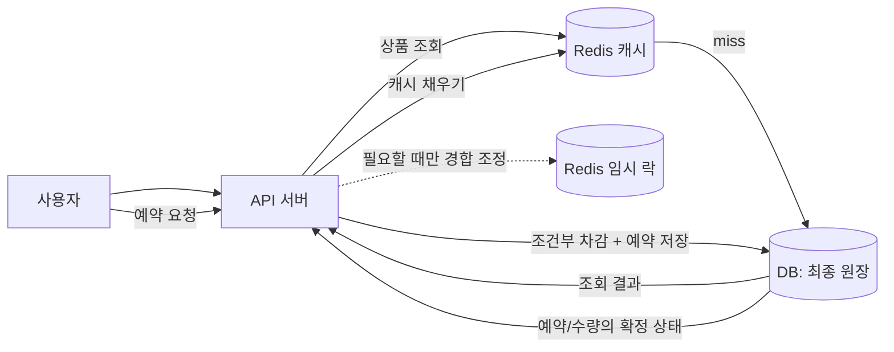
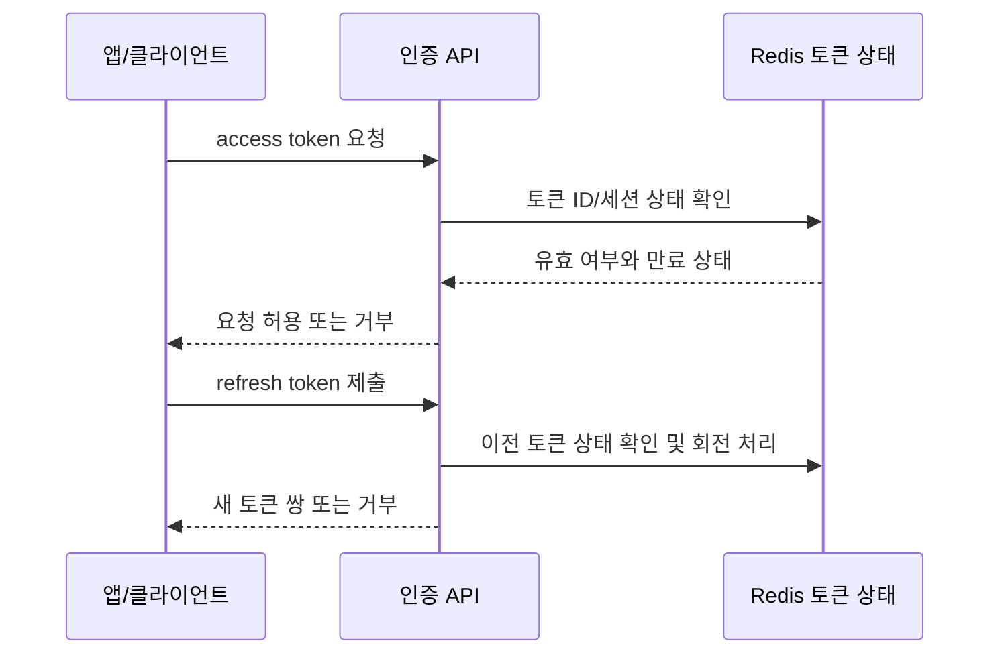
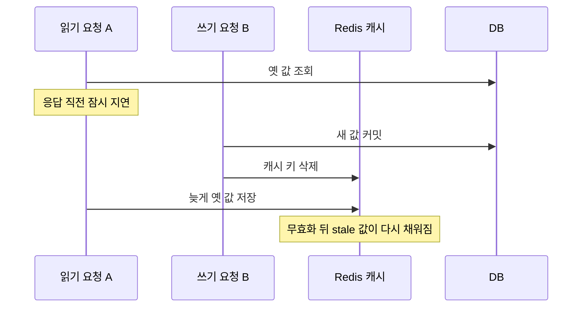
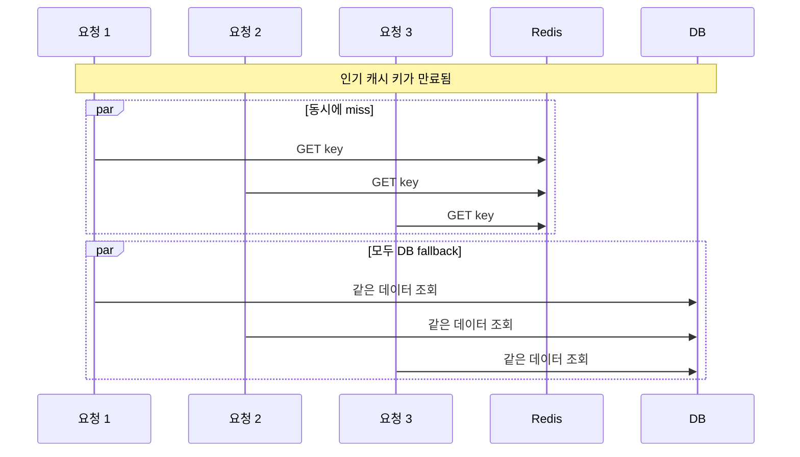
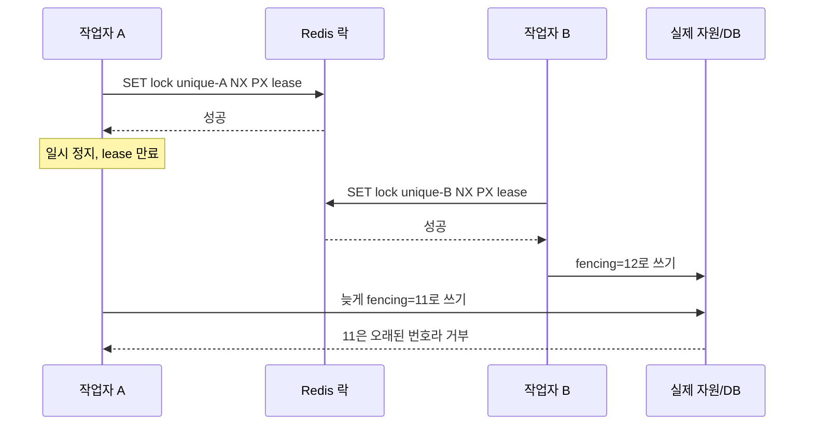
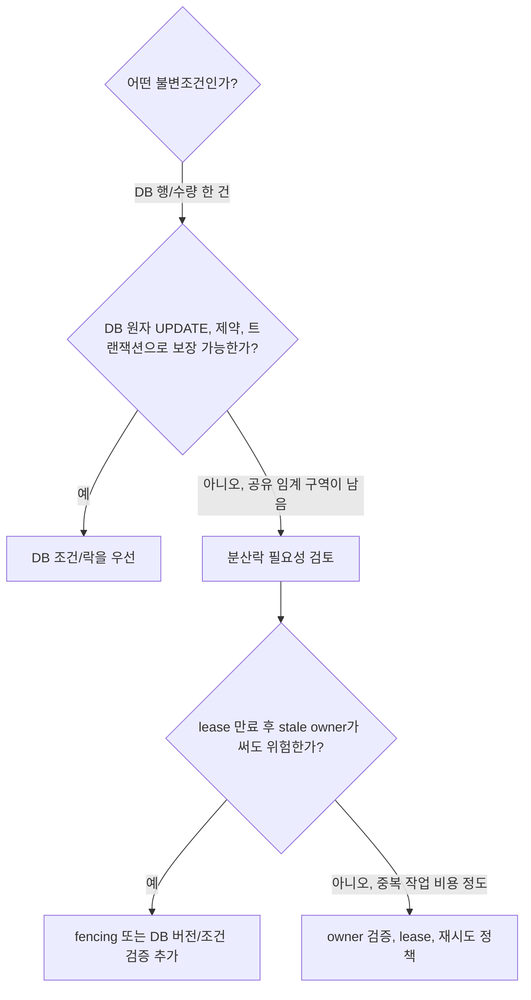
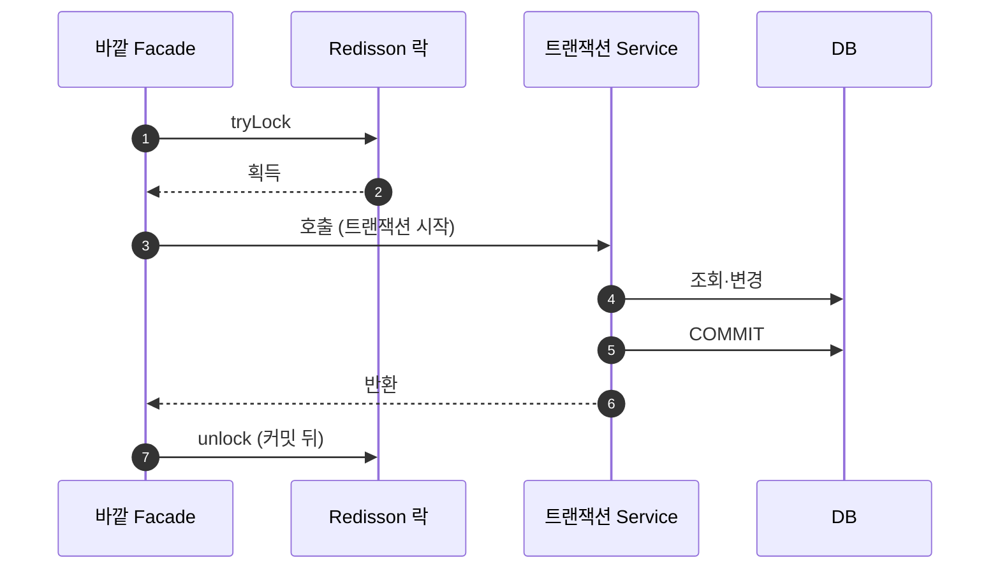
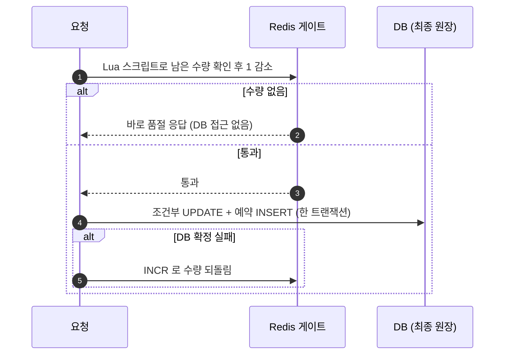

## Redis: 토큰 관리, 캐시, 분산락 면접 준비

>**연습 방식:** 각 질문은 20 초 답변으로 핵심만 말하고, 더 물으면 60 초 답변으로 설명을 확장한다. 이어지는 꼬리 질문 두 개까지 소리 내어 연습한다.

### 먼저 구분할 것: 이력서 경험과 면접 대비 개념

이력서에 기재된 Redis 경험은 **토큰 ID 와 사용자 정보를 연결해 만료시간과 함께 저장하고, 로그아웃·토큰 폐기 및 refresh rotation 흐름에 활용한 것**이다. 이는 Redis 를 상품 캐시나 분산락으로 사용한 경험과는 다른 쓰임이다. 아래 답변 중 `[실제로 구현한 부분]` 은 본인의 구현 범위에 맞게 구체화한다. 확인되지 않은 저장 형태나 운영 경험을 덧붙이지 않는다.

면접에서 경계를 묻거나 경험을 과장하지 않도록 답변의 출발점을 준비한다.

>"제가 Redis 를 사용한 경험은 토큰 ID 와 사용자 매핑을 만료시간과 함께 저장해 로그아웃이나 토큰 폐기, refresh 재발급 흐름에 활용한 것입니다. 상품 데이터 캐시나 분산락을 운영한 경험은 없습니다. 캐시와 분산락은 별도 개념으로 학습했고, 어떤 정합성 문제를 해결하는지 구분해서 설명드릴 수 있습니다."

### 먼저 잡을 큰 그림: 예약 시스템에서 무엇이 진짜인가

가령 여행 상품의 마지막 예약 가능 좌석을 판매한다고 하자. API 서버는 요청을 받고, Redis 와 DB 를 함께 사용할 수 있다. 역할을 먼저 분리한다.

| 구성요소 | 역할 | 비유 |
| --- | --- | --- |
| 관계형 DB | 예약·수량의 최종 원장. 트랜잭션과 제약조건으로 확정 상태를 기록 | 서명된 공식 장부 |
| Redis 캐시 | 자주 조회하는 상품 설명·가격 표시 등을 빠르게 제공 | 프런트 데스크의 참고 카드 |
| Redis 임시 상태/조정 | 토큰 폐기 상태·세션 만료 저장, 필요하면 짧은 경쟁 조율 | 출입 정지 명단 또는 공용 열쇠함 |



사용자가 상품을 볼 때 Redis 캐시가 있으면 빠르게 보여줄 수 있다. 하지만 예약 버튼을 누르는 순간 캐시의 `remaining=1` 은 이미 오래됐을 수 있고, 두 요청이 같은 값을 동시에 읽었을 수도 있다. 예약 성공 여부는 DB 에서 수량 조건을 검사하고 트랜잭션으로 확정한다. Redis 락은 요청을 정렬하는 보조 수단이지 DB 원장의 대체물이 아니다.

이력서의 실제 경험은 이 그림에서 **토큰 세션/폐기 상태를 Redis 에 둔 것**이다. 이는 상품 캐시나 예약 분산락 운영 경험과 다르다. 기술 선택은 불변조건 → 원본 데이터 → Redis 가 줄이는 비용/조정하는 경합 → Redis 장애 시 최종 보장을 맡는 계층의 순서로 설명한다.



### 개념을 비유로 이해하기

#### Redis 와 Key-Value

Redis 는 메모리에서 빠르게 읽고 쓸 수 있는 자료 저장소다. 간단히는 **사물함 보관소**와 같다. 사물함 번호(key)를 알면 안에 넣은 값(value)을 찾는다. 예를 들어 `session:token-abc` 키에 `user-42` 를 넣으면 토큰 ID 로 사용자를 찾을 수 있다. 문자열 외에도 hash, list, set, sorted set 등의 자료구조가 있다.

#### TTL

TTL(Time To Live)은 사물함에 붙인 **자동 폐기 시각**이다. `EX`는 초, `PX` 는 밀리초 단위로 만료시간을 설정한다. 토큰 수명에 맞춰 데이터를 자동 만료시키면 만료된 상태가 계속 남는 일을 줄인다. TTL 은 별도의 정확한 청소 작업이라기보다 그 시간이 지나면 키를 유효한 데이터로 취급하지 않도록 하는 만료 설정이다.

#### 토큰 ID 매핑과 refresh rotation

토큰 자체를 Redis 에 넣는지, 토큰 ID(JTI)와 사용자 ID 만 저장하는지는 실제 구현에 따라 다르다. 토큰이 JWT 서명 검증을 통과하더라도 Redis 의 세션 상태나 폐기 목록을 확인해 사용을 막을 수 있다. **출입증 서명은 유효해도 안내 데스크의 최신 출입 정지 명단에 있으면 입장을 막는 것**과 비슷하다. 단점은 인증 요청마다 Redis 조회가 추가되고, Redis 장애 때 인증을 허용할지 거부할지 정책이 필요하다는 점이다.

Refresh token rotation 은 refresh token 을 사용할 때마다 새 토큰을 발급하고 이전 토큰을 다시 쓰지 못하게 하는 방식이다. Redis 에 토큰 식별자나 세션 상태를 두면 이전 토큰의 폐기 여부나 재사용을 확인하는 데 활용할 수 있다. 실제 저장 데이터와 재사용 탐지 정책은 본인이 구현한 범위를 확인해 답한다.

#### Cache-Aside, 무효화, Stampede

캐시는 **자주 보는 서류 사본을 책상 위에 두는 것**이다. 원본은 DB, 자주 조회하는 복사본은 Redis 에 둔다. Cache-aside 는 Redis 를 먼저 조회하고, miss 면 DB 에서 읽은 결과를 TTL 과 함께 Redis 에 저장하는 방식이다. DB 를 수정하면 관련 캐시를 지우거나 갱신한다.

원본 DB 는 바뀌었는데 Redis 값이 남아 사용자에게 오래된 값을 주는 현상이 stale data 다. TTL 은 오래된 값이 남는 최대 구간을 제한하고, 쓰기 시 캐시 무효화는 더 빨리 최신 값을 다시 읽게 한다. 두 저장소가 원자적으로 함께 바뀐다고 가정해서는 안 된다.



**Stale refill race:** A 가 DB 에서 옛 값을 읽고 멈춰 있는 동안 B 가 DB 를 갱신하고 캐시를 지운다. 이후 A 가 옛 값을 캐시에 쓰면 방금 지운 키가 stale 값으로 다시 채워진다. 간단한 서비스는 TTL 과 허용 가능한 stale 시간을 두고, 더 강한 최신성이 필요하면 캐시 버전 검사, 재시도 가능한 무효화 이벤트/outbox, 읽기 시 원본 검증 등을 검토한다.

인기 키가 만료될 때 많은 요청이 한꺼번에 DB 로 몰리는 현상은 cache stampede 다. **식당의 인기 메뉴 예약이 풀리는 순간 모두가 동시에 전화하는 상황**과 비슷하다. 만료시간 분산(jitter), 만료 전 갱신, 한 요청만 캐시를 재생성하게 하는 짧은 단일 갱신 락으로 줄일 수 있다. 이것은 DB 의 예약 정합성을 지키는 락과 다른 목적이다.



#### 캐시 운영에서 추가로 볼 네 가지

**TTL 과 일관성:** TTL 이 짧으면 stale 창은 짧지만 cache hit 가 줄어 DB 부하가 증가한다. TTL 이 길면 hit 율은 높아지지만 변경된 값이 더 오래 남을 수 있다. 데이터별로 허용 가능한 stale 시간부터 정하고 쓰기 무효화와 TTL 을 함께 둔다.

**메모리와 eviction:** Redis 메모리는 무한하지 않다. `maxmemory` 초과 시 LRU/LFU 등 설정한 정책에 따라 키를 제거할 수 있다. 캐시 값은 제거되면 miss 로 DB 에서 다시 채울 수 있지만, 세션·토큰 상태나 락을 캐시와 같은 인스턴스에 두면 eviction 이 인증/조정 동작에 영향을 줄 수 있다. 메모리 한도, 정책, 키 TTL, 상태별 격리와 eviction 지표를 확인한다.

**Hot key:** 한 인기 키에 요청이 집중되는 문제다. TTL jitter 는 만료 시점 집중을 완화하지만 한 키의 지속적인 트래픽 집중은 해결하지 않는다. 로컬 캐시나 읽기 복제 등을 고려할 수 있지만 로컬 캐시는 인스턴스 간 무효화가 더 어렵다.

**Redis 장애:** 캐시 장애 시 모든 요청을 무제한으로 DB fallback 하면 DB 까지 장애가 날 수 있다. timeout, 동시 fallback 제한, circuit breaker, 잠시 오래된 값 반환 여부를 정한다. 토큰 상태 저장은 단순 캐시보다 중요한 의존성이므로 Redis 장애 때 인증을 허용할지 거부할지(fail-open/fail-closed) 별도 정책이 필요하다.

#### 분산락과 제한 수량

분산락은 여러 서버가 같은 자원을 동시에 수정하지 않게 공용 저장소에서 임시 소유권을 얻는 방법이다. **여러 지점이 공유하는 열쇠를 한 사람만 들고 들어가는 것**에 비유할 수 있다. 단일 Redis 에서 간단히 획득하는 형태는 다음과 같다.

```text
SET lock:reservation:123 <고유한-소유자값> NX PX 10000
```

`NX`는 키가 없을 때만 만들고, `PX`는 임대시간(lease)을 둔다. 매번 고유한 owner 값을 저장해 누가 락을 얻었는지 확인한다. 해제 시 무조건 `DEL` 하면 안 된다. 락이 만료된 뒤 다른 요청이 새 락을 얻었는데 늦게 끝난 첫 요청이 새 락까지 지울 수 있기 때문이다. 현재 값이 내 owner 값과 같을 때만 원자적으로 삭제한다.

서버가 죽으면 TTL 이 영구 점유를 막아 주지만, 작업이 lease 보다 길면 락이 풀린 뒤 다른 요청이 시작될 수 있다. 첫 작업이 멈췄다가 살아나 늦게 쓰면 두 작업이 겹칠 수 있다. 중요한 작업에는 세대 번호인 fencing token 으로 오래된 쓰기를 거부하거나 DB 의 조건부 갱신, 버전 검사로 마지막 방어선을 둔다.



#### 분산락을 고르는 기준과 Redlock

분산락은 기본값이 아니다. 예약 수량처럼 DB 조건부 UPDATE(`remaining > 0` 일 때만 감소)나 unique 제약으로 불변조건을 직접 지킬 수 있다면 DB 원자 연산을 먼저 고려한다. 여러 단계의 작업이나 DB 바깥의 공유 자원까지 직렬화해야 한다면 분산락의 이점을 따진다. 락은 장애 시 재시도·lease·owner 검증을 요구하고 병목이 될 수 있다.

Redlock 은 단일 인스턴스 락과 다른 Redis 공식 문서의 알고리즘 제안이다. 여러 독립 Redis 노드의 과반수에서 제한 시간 안에 락을 얻고, 획득에 걸린 시간과 시계 오차를 고려해 남은 유효시간 안에서만 락을 인정하려 한다. 과반수 획득에 실패하면 부분 획득한 락을 빨리 해제한다. 그러나 노드를 여러 개 두었다고 모든 장애에서 완벽한 직렬화가 자동으로 보장되는 것은 아니다. 프로세스 pause, 네트워크 지연, lease 만료 뒤 stale owner 의 재개, 실제 자원이 소유권을 확인하지 못하는 문제는 여전히 설계 대상이다.

면접에서는 "Redlock 이 무조건 필요하다" 또는 "단일 Redis 락이 강한 일관성을 보장한다"고 단정하지 않는다. 장애 모델과 필요한 보장 수준을 정하고, 중요한 DB 쓰기라면 fencing token 이나 조건부 UPDATE/버전 검사처럼 실제 자원이 오래된 작업을 거부하게 한다. DB 트랜잭션과 제약으로 충분한 문제에 분산락을 추가하지 않는다.



잔여 수량이 1 개인 예약은 DB 가 최종적으로 한 건만 성공시키도록 하는 것이 기본이다. 예를 들어 `remaining > 0` 일 때만 수량을 감소시키는 조건부 UPDATE 를 하고, 변경 행이 1 개인 경우만 예약한다. Redis 락은 여러 인스턴스에서 특정 구간을 직렬화해야 할 때 추가 검토할 수 있다. 멱등성 키나 고유 제약으로 중복 요청도 막는다. 캐시는 조회 부하 감소, 락은 경쟁 조율, DB 제약·트랜잭션은 최종 정합성을 맡는다.

### Redis 기본기: 꼬리질문에서 자주 확인하는 것

#### 왜 빠르고, 무엇이 원자적인가

Redis 가 빠른 이유는 크게 세 가지다.

1. **데이터가 메모리에 있다.** 디스크 탐색 없이 읽고 쓴다.
2. **명령 실행이 한 스레드에서 차례로 일어난다.** 락 경쟁과 컨텍스트 전환이 없고, 덕분에 **명령 하나는 원자적**이다. `INCR`, `DECR`, `SET NX` 가 동시 요청에서도 안전한 이유다.
3. **이벤트 루프와 I/O 다중화(epoll/kqueue)** 로 한 스레드가 많은 연결을 처리한다. Redis 6 부터 네트워크 읽기·쓰기를 별도 I/O 스레드에 맡길 수 있지만, 명령 실행 자체는 여전히 메인 스레드에서 차례로 일어난다.

**비유:** 창구 직원이 한 명뿐인 은행이다. 한 명이라 서로 부딪힐 일이 없고 업무 하나하나가 끝까지 처리되지만, 한 손님이 오래 걸리는 업무를 맡기면 뒤의 모든 손님이 기다린다.

그래서 **오래 걸리는 명령 하나가 전체를 멈춘다.** 운영에서 `KEYS *`, 큰 컬렉션 전체 조회(`HGETALL`, `SMEMBERS`), 큰 키의 `DEL`, 긴 Lua 스크립트는 피한다. `SCAN` 계열로 나눠 읽고, 큰 키는 백그라운드에서 지우는 `UNLINK` 로 삭제한다. 느린 명령은 `SLOWLOG` 로 찾는다.

여러 명령을 묶을 때는 방법마다 보장이 다르다.

| 방법 | 보장 | 주의 |
|---|---|---|
| Pipelining | 왕복 횟수만 줄임 | 원자성 없음. 중간에 다른 클라이언트 명령이 끼어들 수 있음 |
| `MULTI`/`EXEC` | 묶은 명령을 끼어들기 없이 차례로 실행 | 실행 중 한 명령이 실패해도 **롤백하지 않음**. 앞 명령 결과로 분기할 수 없음 |
| `WATCH` + `MULTI`/`EXEC` | 감시한 키가 바뀌면 `EXEC` 가 실패 | 낙관적 CAS. 실패하면 재시도해야 함 |
| Lua 스크립트(`EVAL`)·Functions | 스크립트 전체가 원자적으로 실행되고, 중간 결과로 분기 가능 | 실행 중 다른 명령이 모두 멈추므로 짧게 유지 |

TTL 이 지난 키는 접근할 때 지우는 방식(lazy)과 주기적으로 일부를 표본 검사해 지우는 방식(active)으로 정리된다. 만료된 키가 메모리에서 그 순간 바로 사라진다고 가정하지 않는다.

#### 영속화와 고가용성: RDB·AOF·복제·Sentinel·Cluster

- **RDB:** 특정 시점의 스냅샷을 파일로 저장한다. 파일이 작고 재시작이 빠르지만, 마지막 스냅샷 이후의 쓰기는 잃을 수 있다.
- **AOF(Append Only File):** 쓰기 명령을 로그로 남긴다. `appendfsync everysec`(기본)이면 장애 때 약 1 초 분량을 잃을 수 있고, `always` 는 더 안전하지만 느리다. 로그가 커지면 rewrite 로 압축한다. RDB 와 함께 쓸 수 있다.
- **복제(replication):** primary 의 쓰기를 replica 로 **비동기** 복사한다. primary 가 쓰기에 응답한 뒤 복제 전에 죽으면, failover 후 그 쓰기는 사라질 수 있다.
- **Sentinel:** 샤딩 없는 primary/replica 구성을 감시하고, primary 장애 때 replica 를 승격하며, 클라이언트에게 현재 primary 주소를 알려 준다.
- **Cluster:** 키를 16384 개의 hash slot(`CRC16(key) mod 16384`)으로 나눠 여러 primary 에 분산하고, 샤드마다 replica 를 둬 자동 failover 한다. 여러 키를 함께 다루는 명령·트랜잭션·Lua 는 키들이 같은 slot 에 있어야 하므로 `{user:42}:cart` 처럼 hash tag 로 같은 slot 에 모은다.

**면접 포인트:** 캐시는 사라져도 원본에서 다시 채울 수 있지만, 토큰 폐기 상태·락·재고 카운터처럼 **Redis 에만 있는 상태**는 비동기 복제와 failover 때 유실될 수 있다는 점을 설계에 넣는다. 예를 들어 primary 가 락 획득에 응답한 직후 복제 전에 죽고 replica 가 승격되면, 다른 클라이언트가 같은 락을 다시 얻을 수 있다. Redlock 과 fencing token 은 이 문제에서 나온다.

#### 캐시 전략의 종류

| 전략 | 읽기/쓰기 흐름 | 장점 | 비용·위험 |
|---|---|---|---|
| Cache-aside (lazy loading) | 앱이 캐시를 먼저 읽고, miss 면 DB 를 읽어 캐시에 넣음. 쓰기는 DB 갱신 후 캐시 삭제 | 필요한 데이터만 캐시. 캐시 장애 때 DB 로 우회 가능 | 첫 요청 miss, stale refill race, 무효화 누락 |
| Read-through | 앱은 캐시에만 묻고, **캐시 계층**이 miss 때 DB 를 읽어 채움 | 로딩 로직이 한곳에 모임 | 캐시 계층이 DB 를 알아야 함 |
| Write-through | 쓰기를 캐시와 DB 에 **동기로** 함께 반영 | 방금 쓴 데이터의 캐시가 항상 최신 | 쓰기 지연 증가, 읽히지 않을 데이터도 캐시됨 |
| Write-behind (write-back) | 캐시에 먼저 쓰고 DB 반영은 **나중에 비동기로** 모아서 | 쓰기가 매우 빠르고 DB 쓰기를 묶을 수 있음 | 반영 전 캐시 장애 시 **데이터 유실**, 순서·정합성 관리가 어려움 |
| Write-around | 쓰기는 DB 에만, 캐시는 읽을 때 채움 | 잘 안 읽는 데이터로 캐시를 채우지 않음 | 쓴 직후 읽기는 miss |
| Refresh-ahead | 만료 전에 미리 다시 읽어 갱신 | 인기 키의 miss·stampede 감소 | 읽히지 않을 키까지 갱신하는 낭비 |

예약·결제처럼 **유실되면 안 되는 원장 데이터에는 write-behind 를 쓰지 않는다.** 상품 상세·목록처럼 읽기가 많고 잠깐 오래된 값을 허용하는 데이터는 cache-aside 가 가장 흔한 출발점이다.

#### Spring 에서 쓰기: `@Cacheable`, Lettuce, Redisson

**Spring Cache 추상화:** `@EnableCaching` 후 `@Cacheable`(조회 결과 캐시), `@CachePut`(항상 실행하고 결과로 캐시 갱신), `@CacheEvict`(삭제)를 메서드에 붙인다. Redis 를 쓰면 `RedisCacheManager` 에서 캐시별 TTL(`entryTtl`)과 직렬화 방식을 정한다. 주의점은 다음과 같다.

- `@Transactional` 처럼 **프록시 기반**이라 self-invocation 에서는 동작하지 않는다.
- 기본 JDK 직렬화는 클래스 구조가 바뀌면 역직렬화가 깨지고 사람이 읽기 어렵다. JSON 직렬화와 캐시 키 버전(예: `product:v2:{id}`)을 고려한다.
- `@CacheEvict` 가 트랜잭션 커밋 **전에** 실행되면, 커밋 전에 다른 요청이 옛 값을 다시 캐시에 채울 수 있다. `RedisCacheManager` 의 `transactionAware()` 처럼 커밋 뒤에 put/evict 를 실행하도록 설정한다.
- `@Cacheable(sync = true)` 는 같은 키의 동시 miss 를 줄이는 힌트지만, 보장 범위는 캐시 구현에 따르며 여러 인스턴스 사이의 stampede 까지 막는다고 가정하지 않는다.

**Lettuce 와 Redisson:**

- **Lettuce** 는 Spring Boot 의 기본 Redis 클라이언트다. Netty 기반 비동기 클라이언트로, 연결 하나를 여러 스레드가 안전하게 공유한다. 락 기능은 없으므로 `SET NX PX` 와 owner 비교 해제 Lua 를 직접 구현해야 하고, 락을 기다릴 때 **반복 조회(spin)** 하면 Redis 부하와 지연이 커진다.
- **Redisson** 은 락·세마포어·rate limiter 같은 분산 객체를 제공하는 클라이언트다. `RLock` 은 Lua 로 획득·해제를 원자 처리하고, 같은 스레드의 재진입을 지원하며, 락이 풀릴 때 **pub/sub 알림**으로 대기자를 깨우므로 spin 보다 효율적이다.
  - `tryLock(waitTime, leaseTime, unit)`: 최대 `waitTime` 만큼 기다리고, 얻으면 `leaseTime` 뒤 자동 만료된다.
  - **watchdog:** `leaseTime` 을 지정하지 않으면, 락을 쥔 클라이언트가 살아 있는 동안 만료 시간을 주기적으로 연장한다(기본 30 초 lease 를 그 1/3 주기로 갱신). 프로세스가 죽으면 연장이 멈춰 결국 풀린다. 대신 스레드가 외부 호출에 걸려 오래 멈춰도 프로세스가 살아 있으면 락이 계속 연장되므로, 임계 구역 안의 작업에 시간 제한을 둬야 한다.
  - `RLock` 은 획득한 **스레드**가 해제해야 한다. 코루틴·비동기 코드에서 다른 스레드가 `unlock()` 하면 예외가 날 수 있다.

**분산락과 `@Transactional` 의 순서:** 락은 트랜잭션보다 **바깥**에 있어야 한다. 순서는 `락 획득 → 트랜잭션 시작 → 커밋 → 락 해제` 다. 락을 `@Transactional` 메서드 안에서 해제하면, 커밋 전에 다음 요청이 락을 얻어 아직 커밋되지 않은 이전 상태를 읽고 같은 판단을 반복할 수 있다. 그래서 락을 거는 코드는 트랜잭션 메서드를 호출하는 바깥 빈(Facade 등)에 둔다.



#### 트래픽이 한 재고에 몰릴 때: Redis 선차감 게이트

**문제:** 오픈 특가처럼 수많은 요청이 한 상품의 재고 행 하나에 몰리면, 조건부 UPDATE 는 정합성은 지키지만 모든 요청이 **같은 행 락을 차례로 기다린다.** 대부분은 어차피 품절로 실패할 요청인데도 DB 커넥션과 락 대기를 점유해 다른 API 까지 느려진다.

**패턴:** Redis 를 **입구의 번호표 발급기**로 쓰고, DB 는 여전히 **최종 장부**로 둔다.

1. 판매 시작 전에 `stock:{productId}` 에 판매 가능 수량을 넣는다.
2. 요청마다 Lua 스크립트로 "남은 수량이 0 보다 크면 1 감소"를 원자적으로 실행한다. 사용자별 중복 참여 확인(`SADD` 결과 등)도 같은 스크립트에 넣을 수 있다.
3. 실패한 요청은 **DB 에 가지 않고 바로 품절 응답**한다.
4. 통과한 요청만 DB 트랜잭션에서 조건부 UPDATE·유니크 제약으로 예약을 확정한다.
5. DB 확정이 실패하거나 결제 기한이 지나 취소되면 Redis 수량을 `INCR` 로 되돌리는 보상을 한다.
6. 주기적인 대사(reconciliation) 작업이 DB 기준 판매 수량과 Redis 카운터를 비교해 어긋남을 고친다.

```lua
-- KEYS[1] = stock:{productId}
local stock = tonumber(redis.call('GET', KEYS[1]))
if stock == nil or stock <= 0 then
  return -1
end
return redis.call('DECR', KEYS[1])
```

`DECR` 만 쓰면 키가 없을 때 `-1` 로 새 키가 생기고 음수로 내려가므로, 초기화 여부와 0 이하 검사를 스크립트 안에서 함께 한다.



**이 패턴이 보장하지 않는 것:**

- Redis 는 원장이 아니다. 비동기 복제 중 failover 로 감소가 유실되면 Redis 가 실제보다 많이 통과시킬 수 있다. **DB 조건부 UPDATE 가 남아 있어야 초과 판매를 막는다.**
- Redis 감소 뒤 DB 저장 전에 프로세스가 죽으면 번호표 하나가 사라져 덜 팔릴 수 있다. 대사 작업이나 hold 만료 처리로 회수한다.
- Redis 장애 때의 정책이 필요하다. DB 경로로 우회하되 동시 요청 수를 제한할지, 판매를 잠시 멈출지 비즈니스와 정한다.
- 대안으로 요청을 큐에 넣고 소비자가 차례로 처리하는 방식, 대기열(waiting room), 재고를 여러 행으로 나눈 sharded counter 도 있다.

### 예상 질문과 3 단계 드릴다운

#### 1. Redis 를 이력서에서 어떻게 사용했나요?

**20 초 답변:** "토큰 ID 와 사용자 정보를 만료시간과 함께 저장해 로그아웃·토큰 폐기와 refresh 재발급 흐름에 활용했습니다. 제가 구현한 세부 범위는 실제 코드에 근거해 말씀드리겠습니다. 상품 캐시나 분산락 운영 경험은 없습니다."

**60 초 답변:** "인증 토큰이 발급된 뒤에도 로그아웃이나 폐기를 반영할 수 있도록 토큰 식별 정보와 사용자 매핑을 Redis 에 두고 만료시간을 적용했습니다. refresh 과정에서는 이전 토큰이 다시 유효한지 확인하는 흐름과 연결했습니다. Redis 를 사용해 상태를 빠르게 조회한다는 점이 목적이었습니다. 제가 직접 만든 부분은 `[실제로 구현한 로직]` 이고, 대규모 트래픽 캐시나 분산락은 맡아 운영하지 않았습니다."

**경험 답변:** "실제로 설명할 수 있는 경험은 토큰 ID 와 사용자 매핑을 만료시간과 함께 다뤄 로그아웃/폐기 및 refresh 흐름에 연결한 것입니다. 토큰 원문인지 ID 인지와 구체적인 rotation 동작은 코드를 확인해 정확히 답하겠습니다. 상품 캐시와 분산락은 제 운영 경험이 아닙니다."

**꼬리 질문 1 — 어떤 키와 값을 저장했나요?**

**답변:** "정확한 구현에서는 `[실제 key 형식]`을 키로 두고 `[실제 저장 값]` 을 저장했습니다. 면접 전에 코드를 확인해 토큰 원문인지 JTI 인지, 사용자 ID 매핑인지 정확히 구분해서 설명하겠습니다."

**꼬리 질문 2 — 토큰 원문과 토큰 ID 저장은 어떤 차이가 있나요?**

**답변:** "토큰 원문 저장은 유출 시 위험이 커질 수 있으므로 최소한의 식별 정보만 두는 편이 바람직합니다. JTI 같은 식별자를 두면 특정 토큰의 폐기 상태를 확인할 수 있습니다. 실제 선택은 당시 구현을 확인해 말씀드리고, 개선한다면 저장 데이터 최소화와 접근 제어, 만료 정책을 함께 보겠습니다."

#### 2. 왜 토큰 상태를 Redis 에 저장하나요? JWT 는 무상태 아닌가요?

**20 초 답변:** "JWT 자체는 서명과 만료시간으로 검증할 수 있지만, 발급 뒤 즉시 로그아웃시키려면 서버가 폐기 상태를 알아야 합니다. Redis 에 토큰 ID 나 세션 상태를 두면 이를 확인할 수 있지만 요청마다 조회 비용과 Redis 가용성 고려가 추가됩니다."

**60 초 답변:** "JWT 의 서명 검증만으로는 토큰 만료 전 폐기를 바로 반영하기 어렵습니다. 서버 측 상태를 Redis 에 두면 로그아웃이나 폐기 목록을 확인할 수 있고, TTL 로 토큰 수명 이후 데이터를 정리할 수 있습니다. 대가로 인증 경로에 Redis 의존성이 생깁니다. Redis 가 응답하지 않을 때 인증 요청을 허용할지 거부할지는 보안 요구와 가용성 요구를 보고 정해야 합니다."

**경험 답변:** "제가 실제로 다룬 것은 토큰 관련 상태를 Redis 에서 확인하는 흐름입니다. 장애 때 fail-open/fail-closed 를 어떤 방식으로 처리했는지는 구현을 확인해 답하겠습니다. 캐시와 달리 인증에 필요한 상태라 Redis 가용성이 사용자 인증에 영향을 줄 수 있다는 점을 알고 있습니다."

**꼬리 질문 1 — Redis 가 장애 나면 인증을 허용하나요, 거부하나요?**

**답변:** "보안 우선이면 상태 확인이 안 될 때 거부하는 fail-closed 가 안전하지만 가용성이 낮아질 수 있습니다. 시스템의 위협 모델과 서비스 요구로 결정해야 합니다. 제가 경험한 시스템의 실제 동작은 구현을 확인해 답하겠습니다."

**꼬리 질문 2 — Redis 조회가 매번 들어가면 JWT 의 장점이 사라지지 않나요?**

**답변:** "완전한 무상태 검증이라는 장점은 줄어듭니다. 즉시 폐기 기능과 요청당 조회 비용의 트레이드오프입니다. 폐기가 꼭 필요한 토큰만 상태 조회하거나 짧은 만료시간과 refresh 흐름을 조합하는 등 요구사항에 맞춰 선택할 수 있습니다."

#### 3. Redis 캐시는 어떻게 동작하나요?

**20 초 답변:** "Cache-aside 에서는 먼저 Redis 를 읽고 miss 면 DB 에서 가져와 TTL 과 함께 저장합니다. 쓰기 때 관련 캐시를 무효화하거나 갱신합니다. 원본은 DB 로 두고, 오래된 값 허용 범위를 기준으로 캐시할 데이터를 고릅니다."

**60 초 답변:** "상품 상세처럼 읽기가 많고 잠시 오래된 값을 허용할 수 있는 데이터에 적용할 수 있습니다. 요청은 Redis 를 확인하고, miss 면 DB 를 조회해 결과를 TTL 과 함께 채웁니다. 데이터 변경 시 키를 삭제해 다음 요청이 DB 에서 최신 값을 가져오게 합니다. 조회 부하는 줄지만 캐시 무효화와 오래된 값 문제, 만료 시 동시 miss 를 고려해야 합니다. 제가 이 방식의 캐시를 운영해 본 경험은 없고 개념적으로 설명드리는 것입니다."

**경험 답변:** "이력서의 Redis 경험은 인증 토큰 상태 저장이며 상품 조회 cache-aside 를 운영한 경험은 없습니다. 여기서는 캐시 -aside 의 일반적인 흐름과 trade-off 를 설계 관점에서 설명드리고 있습니다."

**꼬리 질문 1 — 모든 DB 데이터를 캐시에 넣으면 더 빠르지 않나요?**

**답변:** "메모리는 제한돼 있고 캐시 갱신 복잡도가 늘어납니다. 반복 조회가 많고 저장 비용을 줄일 효과가 있는 데이터부터 측정해서 선택하겠습니다. 드물게 조회되거나 최신성이 중요한 데이터는 캐시가 오히려 복잡성만 더할 수 있습니다."

**꼬리 질문 2 — Redis 에 값이 없을 때는 어떻게 하나요?**

**답변:** "캐시 miss 로 보고 DB 에서 읽은 뒤 Redis 에 저장합니다. 값이 실제로 없는 경우 매번 DB 를 읽는 문제가 생길 수 있어, 필요하면 짧은 시간 '없음' 결과를 캐싱하는 negative caching 을 검토합니다. 단, 데이터 생성 후 무효화와 TTL 을 함께 설계해야 합니다."

#### 4. 캐시 값과 DB 값이 달라지면 어떻게 하나요?

**20 초 답변:** "쓰기 때 관련 캐시를 무효화하거나 갱신하고 TTL 로 오래된 값의 지속시간을 제한합니다. 두 저장소 업데이트 사이에 실패가 생길 수 있으므로 예약 확정 같은 중요한 쓰기의 최종 판단은 DB 에서 하겠습니다."

**60 초 답변:** "흔한 cache-aside 에서는 먼저 DB 를 갱신하고 관련 캐시 키를 삭제합니다. 다음 조회가 DB 에서 최신 값을 다시 채우게 됩니다. 하지만 DB 커밋과 캐시 삭제 사이에 프로세스가 죽거나 경합하면 불일치가 남을 수 있습니다. TTL 은 그 상태를 제한하고, 매우 최신성이 중요한 데이터는 조회 경로에서 DB 를 사용하거나 이벤트·outbox 같은 더 강한 동기화 방식을 검토하겠습니다. 허용 가능한 지연은 데이터별로 정해야 합니다."

**경험 답변:** "캐시 invalidation 을 직접 운영해 본 경험은 없습니다. TTL 경험은 토큰 상태 수명 관리에 해당하며, DB 캐시 무효화 경합은 별도 개념으로 학습했습니다. 적용 시 stale 허용 범위와 실패 후 재시도 경로를 먼저 정의하겠습니다."

**꼬리 질문 1 — DB 쓰기 뒤 캐시 삭제 전에 서버가 죽으면요?**

**답변:** "삭제가 누락되어 TTL 까지 stale 값이 남을 수 있습니다. 데이터 최신성이 중요하면 재시도 가능한 이벤트/outbox 처리나 짧은 TTL, 버전 비교 같은 보완책을 고려합니다. 어떤 정책이 필요한지는 오래된 값을 보여줘도 되는 시간에 따라 다릅니다."

**꼬리 질문 2 — DB 갱신보다 캐시 삭제를 먼저 하면 안 되나요?**

**답변:** "삭제 직후 다른 요청이 DB 의 옛 값을 읽어 캐시를 다시 채우면 stale 값이 생길 수 있습니다. 순서만으로 모든 경합을 없앨 수는 없어서, 쓰기/읽기 경합과 최신성 요구를 보고 무효화 방식과 버전 정책을 설계해야 합니다."

#### 5. Cache stampede 는 무엇이고 어떻게 줄이나요?

**20 초 답변:** "인기 캐시 키가 만료되는 순간 많은 요청이 동시에 miss 가 되어 DB 로 몰리는 현상입니다. TTL jitter, 만료 전 갱신, 키별 한 요청만 재생성하는 짧은 락으로 완화할 수 있습니다."

**60 초 답변:** "같은 만료시각을 가진 인기 키가 동시에 사라지면 여러 애플리케이션 인스턴스가 각자 DB 를 조회해 부하가 급증합니다. 만료시간에 작은 무작위 지연을 넣어 만료를 분산하거나 만료 전 백그라운드 갱신을 할 수 있습니다. 특정 키를 한 요청만 채우고 나머지는 잠시 기다리게 하는 single-flight 방식도 가능합니다. 이 락은 중복 DB 조회를 줄이는 성능 대책이지, 예약 수량의 정합성을 보장하는 수단은 아닙니다."

**경험 답변:** "stampede 를 운영에서 겪은 경험은 없습니다. 여러 요청의 동시 miss 가 DB 부하로 증폭되는 상황을 설명하고 있으며, jitter 와 single-flight 는 가능한 완화책으로 말씀드리는 것입니다."

**꼬리 질문 1 — 락을 얻지 못한 요청은 무엇을 하나요?**

**답변:** "짧게 기다린 뒤 캐시를 다시 확인하거나, stale 값을 잠시 반환하거나, 제한된 재시도를 합니다. 서비스가 허용하는 지연과 오래된 값 허용 여부로 정하고, 기다리는 요청이 계속 늘지 않도록 timeout 을 둡니다."

**꼬리 질문 2 — TTL 을 길게 하면 stampede 가 없어지나요?**

**답변:** "빈도는 낮아질 수 있지만 없어지지는 않고 stale 값이 오래 남을 수 있습니다. TTL 을 데이터의 최신성 요구에 맞추고, 만료 시 부하를 분산하거나 갱신하는 대책을 같이 씁니다."

#### 6. Redis 분산락은 어떻게 얻고 안전하게 해제하나요?

**20 초 답변:** "`SET key unique-owner NX PX lease` 로 키가 없을 때만 만료시간을 두고 얻습니다. 해제는 무조건 삭제하지 않고 현재 값이 내 owner 값일 때만 원자적으로 지웁니다. 그렇지 않으면 다른 요청이 얻은 새 락을 지울 수 있습니다."

**60 초 답변:** "락 키를 자원 단위로 정하고 요청마다 충분히 고유한 owner 값을 생성합니다. `NX`로 동시 획득을 막고 `PX` 로 장애 시 락이 영원히 남지 않도록 임대를 둡니다. 작업이 성공한 소유자만 임계 구역을 수행합니다. 해제는 Lua 등 원자 연산으로 키 값과 owner 를 비교한 뒤 일치할 때만 삭제합니다. 이 단일 인스턴스 패턴도 장애 조합에 따른 한계가 있으므로 분산 환경의 보장 범위를 확인해야 합니다."

**경험 답변:** "분산락을 직접 구현하거나 운영하지 않았습니다. `SET NX PX` 와 owner 비교 해제는 공식 패턴을 학습한 설계 답변이며, 실제 적용 전에는 클라이언트 라이브러리의 원자 해제와 장애 시나리오를 검증하겠습니다."

**꼬리 질문 1 — 왜 `DEL` 만 하면 안 되나요?**

**답변:** "내 락이 lease 만료로 사라진 후 다른 요청이 새 락을 얻을 수 있습니다. 그 뒤 이전 작업이 늦게 끝나 무조건 `DEL` 하면 새 소유자의 락을 지우게 됩니다. 그래서 owner 비교와 삭제를 한 번의 원자 작업으로 해야 합니다."

**꼬리 질문 2 — `SETNX` 만으로 충분한가요?**

**답변:** "소유권 획득만 있고 만료가 없으면 락을 가진 서버가 죽었을 때 영구 점유될 수 있습니다. `SET` 의 NX 와 PX 를 함께 사용해 원자적으로 획득과 만료를 설정하고, 고유 owner 값으로 안전하게 해제해야 합니다."

#### 7. 락 보유 중 서버가 멈추거나 작업이 lease 보다 길어지면요?

**20 초 답변:** "TTL 은 죽은 서버의 락을 풀지만 작업이 더 오래 걸리면 락 만료 후 두 작업이 겹칠 수 있습니다. lease 를 업무 시간에 맞추고, 중요한 쓰기는 fencing token 이나 DB 조건부 갱신으로 늦은 쓰기를 막겠습니다."

**60 초 답변:** "임대시간은 장애 복구와 작업시간 사이의 절충입니다. 너무 길면 장애 후 대기가 길고, 너무 짧으면 정상 작업 중 만료될 수 있습니다. 연장 기능만 믿어서는 안 되고 네트워크 단절이나 프로세스 정지 후 재개도 생각해야 합니다. fencing token 을 매 획득마다 증가시켜 DB 같은 실제 자원에 전달하고, 더 오래된 번호의 쓰기를 거부하게 할 수 있습니다. 그리고 예약 수량은 DB 조건이나 버전 검사로 마지막 방어선을 둡니다."

**경험 답변:** "lease 만료나 fencing token 을 운영에서 다뤄 본 경험은 없습니다. 락을 설계할 때 프로세스가 멈췄다가 살아나는 경우까지 고려해야 한다는 원리 설명입니다. 중요한 데이터 변경은 DB 조건이나 버전으로 오래된 작업을 거부하도록 하겠습니다."

**꼬리 질문 1 — fencing token 없이 Redis 락만으로 충분한가요?**

**답변:** "작업이 짧고 실패 시 영향이 제한적이면 단순한 락으로 충분할 수 있지만, 락 만료 뒤 오래 멈춘 프로세스가 재개되는 상황까지 막지는 못합니다. 부정확한 결과의 비용이 큰 자원이라면 fencing token 이나 DB 낙관적 버전/조건부 쓰기가 필요합니다."

**꼬리 질문 2 — 락 획득 후 외부 결제 API 를 호출해도 되나요?**

**답변:** "외부 호출 시간은 예측하기 어렵고 락을 오래 잡아 병목과 만료 위험을 키웁니다. 가능하면 DB 상태 전이, 멱등성 키, 비동기 작업과 재시도 등으로 흐름을 설계하고 외부 호출을 임계 구역 안에 오래 두지 않겠습니다."

#### 8. 잔여 수량이 1 개일 때 예약 요청 두 개가 동시에 오면요?

**20 초 답변:** "DB 에서 한 요청만 성공하도록 하겠습니다. 수량이 0 보다 클 때만 감소시키는 조건부 UPDATE 를 하고 변경 행이 1 개인 요청만 성공 처리합니다. 중복 요청은 멱등성 키나 고유 제약으로 막고, 필요한 경우에만 Redis 락을 추가합니다."

**60 초 답변:** "Redis 캐시의 잔여 수량을 보고 확정하면 두 요청이 같은 값을 읽을 수 있어 위험합니다. DB 에서 `remaining > 0` 조건을 포함한 원자적 감소를 하거나, 트랜잭션 행 잠금/버전 기반 낙관적 락을 사용해 한 건만 확정합니다. 예약 생성과 수량 차감이 같이 성공하거나 실패하도록 트랜잭션에 넣고, 재전송은 멱등성 키나 고유 제약으로 방어합니다. Redis 분산락은 여러 인스턴스의 경합을 줄이는 추가 수단일 수 있지만 최종 판정은 DB 에 둡니다."

**경험 답변:** "대규모 예약 수량 경합을 직접 운영한 경험은 없습니다. DB 가 최종 원장이라는 원칙에 따라 조건부 갱신, 트랜잭션, 멱등성을 조합하는 설계를 설명드리는 것입니다. Spring/JPA 로 구현한다면 갱신 행 수와 optimistic lock 예외 처리를 확인하겠습니다."

**꼬리 질문 1 — Redis 분산락을 추가하면 더 안전하지 않나요?**

**답변:** "경합을 줄일 수 있지만 Redis 장애, lease 만료, 작업 지연 문제가 생깁니다. DB 조건부 갱신이나 제약은 실제 데이터 변경 지점에서 불변조건을 지킵니다. 두 가지를 함께 써도 DB 방어를 제거하지 않겠습니다."

**꼬리 질문 2 — 예약 요청이 재시도되어 같은 사용자의 요청이 두 번 오면요?**

**답변:** "요청마다 멱등성 키를 받고 DB unique 제약으로 같은 키의 중복 처리를 막을 수 있습니다. 기존 처리 결과를 반환해 클라이언트가 응답을 못 받은 뒤 재시도해도 예약이 중복 생성되지 않게 합니다. 키 보관 기간과 사용자/요청 범위도 정합니다."

#### 9. 모든 쓰기에 Redis 락을 걸면 안전하지 않나요?

**20 초 답변:** "락은 경쟁을 조율하지만 병목과 장애 처리 복잡성을 추가합니다. DB 조건부 갱신이나 unique 제약으로 해결되는 문제라면 그 방법을 우선하고, 여러 인스턴스의 특정 자원을 직렬화해야 할 때만 좁은 범위로 씁니다."

**60 초 답변:** "락마다 Redis 왕복, 획득 실패 처리, 재시도, timeout, 만료 후 동작을 설계해야 합니다. 락 범위가 크면 처리량이 제한되고 Redis 장애가 쓰기 경로 전체에 영향을 줄 수 있습니다. 먼저 불변조건을 정의하고 DB 원자 갱신·제약·트랜잭션으로 보장 가능한지 봅니다. 별도 시스템 간 임계 구간을 직렬화해야 한다면 그때 분산락의 운영 비용을 감수할 가치가 있는지 측정합니다."

**경험 답변:** "분산락 운영 경험이나 수치 기반 성능 개선 경험은 없습니다. 이력서의 Redis 사용은 토큰 상태 목적이었고, 예약 락을 당연한 해법처럼 주장하지 않습니다. 이 문제에서는 먼저 DB 조건부 갱신으로 불변조건을 지킬 수 있는지 보겠습니다."

**꼬리 질문 1 — DB row lock 도 락인데 왜 그걸 우선하나요?**

**답변:** "DB row lock 은 데이터 변경과 같은 트랜잭션 경계에서 적용되어 실제 원본을 보호합니다. 애플리케이션 락과 DB 상태 변경이 어긋날 수 있는 문제를 줄입니다. 다만 트랜잭션을 오래 잡으면 DB 병목이 되므로 짧은 범위로 써야 합니다."

**꼬리 질문 2 — 한 대의 서버 안에서만 경쟁하면 Redis 락이 필요하나요?**

**답변:** "한 프로세스 안의 동시성만 제어한다면 프로세스 내 락이 더 간단할 수 있습니다. 다중 인스턴스나 여러 작업자가 같은 자원을 공유할 때 분산락이 필요합니다. 인스턴스 수와 공유 상태 경계를 먼저 확인하겠습니다."

#### 10. Redlock 은 무엇이고 언제 필요한가요?

**20 초 답변:** "Redlock 은 여러 독립 Redis 노드의 과반수에서 제한 시간 내 락을 얻고 남은 lease 동안만 소유권을 인정하려는 알고리즘입니다. 단일 Redis 락과 다른 가용성/장애 모델을 가정합니다. 노드를 늘리는 것만으로 강한 정합성이 자동 보장되는 것은 아니므로 실제 DB 자원은 fencing 이나 조건 검사로 보호해야 합니다."

**60 초 답변:** "단일 Redis 인스턴스의 `SET NX PX` 는 간단하지만 failover 나 네트워크 장애 모델에 따라 락 보장에 한계가 있습니다. Redlock 은 여러 독립 노드 중 과반수에 제한 시간 안에 락을 설정하고, 획득에 걸린 시간과 시계 오차를 감안한 남은 유효시간 내에서만 락을 사용하려 합니다. 과반수에 실패하면 부분 획득분도 빨리 해제합니다. 다만 프로세스가 멈췄다가 lease 만료 뒤 재개하는 stale owner 문제는 보호 대상 DB 가 소유권을 검증하지 않는 한 남습니다. 그래서 필요한 일관성 수준과 장애 모델을 정의하고, 중요한 쓰기는 fencing token 이나 DB 조건/버전으로 마지막 방어선을 둡니다."

**경험 답변:** "Redlock 을 직접 도입하거나 운영하지 않았습니다. 공식 문서의 알고리즘과 한계를 공부해 설명드리는 것입니다. 실제 도입은 단일 Redis 로 충분한지, DB 원자 갱신으로 해결되는지, 장애 때 필요한 보장 수준이 무엇인지 먼저 확인하겠습니다."

**꼬리 질문 1 — Redis 노드 과반수를 얻었으면 왜 stale owner 를 걱정하나요?**

**답변:** "락 서버가 새 소유자에게 lease 를 줘도, 이전 프로세스가 네트워크 단절이나 pause 뒤 다시 실행될 수 있습니다. 락은 이전 프로세스의 CPU 실행을 중단시키지 않습니다. 보호 대상 자원이 세대 번호를 확인하고 오래된 요청을 거부하는 fencing 이 별도로 필요한 이유입니다."

**꼬리 질문 2 — 이 예약 문제에 Redlock 을 바로 쓰겠습니까?**

**답변:** "우선 DB 조건부 UPDATE 나 트랜잭션/제약으로 한 건만 확정할 수 있는지 봅니다. 그 방법으로 해결되지 않는 별도 공유 임계 구역이 있고, 장애 모델과 운영 복잡도를 감수할 이유가 확인될 때만 Redlock 을 검토하겠습니다."

#### 11. Redis 메모리가 꽉 차거나 장애가 나면 어떻게 하나요?

**20 초 답변:** "캐시용 인스턴스라면 maxmemory 와 eviction 정책을 설정하고 eviction·hit 율·DB fallback 을 모니터링합니다. Redis 장애 때 DB 로 무제한 fallback 하면 DB 가 과부하될 수 있어 timeout 과 fallback 제한을 둡니다. 세션/토큰 상태는 캐시처럼 단순히 다시 채울 수 없으므로 별도 장애 정책이 필요합니다."

**60 초 답변:** "Redis 는 메모리 한도에 도달하면 설정한 정책에 따라 키를 제거하거나, noeviction 정책이면 새 쓰기를 오류로 돌려보낼 수 있습니다. 캐시라면 제거된 키를 miss 로 처리해 DB 에서 채울 수 있지만 순간 fallback 부하가 커질 수 있습니다. maxmemory, 정책, 캐시 hit/miss, eviction 수, 메모리 사용률과 DB 부하를 같이 봅니다. hot key 나 장애가 생겼을 때 timeout, 제한된 fallback, circuit breaker, 필요하면 stale 값 반환을 고려합니다. 인증 토큰 상태는 miss 가 단순 cache miss 가 아니므로 fail-open/closed 정책 및 데이터 지속성/격리를 별도로 정해야 합니다."

**경험 답변:** "Redis 클러스터 메모리 튜닝이나 장애 대응을 운영한 경험은 없습니다. 제가 해 본 것은 토큰 관련 상태 저장입니다. 캐시의 eviction 정책과 장애 시 fallback 은 이력서 경험으로 주장하지 않고, 운영한다면 데이터 종류에 맞는 eviction 과 인증 정책을 우선 확인하겠습니다."

**꼬리 질문 1 — 캐시 Redis 의 eviction 으로 토큰 상태 키가 사라지면요?**

**답변:** "토큰 상태 저장과 휘발 가능한 조회 캐시를 같은 eviction 도메인에 둘 때 생길 수 있는 위험입니다. 별도 인스턴스/정책으로 격리하거나 상태 데이터에 맞는 메모리·지속성·실패 정책을 선택합니다. 토큰 키가 사라졌을 때 유효한 것으로 볼지 폐기된 것으로 볼지는 보안 기준으로 정해야 합니다."

**꼬리 질문 2 — Redis 장애 때 무조건 DB 로 보내면 되지 않나요?**

**답변:** "캐시 miss 가 갑자기 전체 요청으로 바뀌면 DB 가 감당하지 못할 수 있습니다. 제한된 동시 fallback, 짧은 timeout, circuit breaker, 오래된 응답 허용 여부를 정해 연쇄 장애를 막습니다. DB 용량을 포함한 장애 시나리오를 검토해야 합니다."

>아래 12~16 번은 개념 질문이다. 경험 범위는 1 번 질문에서 이미 밝혔으므로 여기서는 반복하지 않고 바로 답한다.

#### 12. Redis 는 싱글 스레드인데 어떻게 빠른가요?

**20 초 답변:** "데이터가 메모리에 있고, 명령을 한 스레드에서 차례로 실행해 락 경쟁이 없으며, I/O 다중화로 한 스레드가 많은 연결을 처리하기 때문입니다. 한 스레드에서 실행되므로 명령 하나하나가 원자적이라는 장점도 있습니다."

**60 초 답변:** "메모리 접근, 단일 스레드 명령 실행, 이벤트 루프 기반 I/O 다중화가 핵심입니다. INCR 이나 SET NX 가 동시 요청에서도 안전한 이유가 단일 스레드 실행 덕분입니다. 대신 오래 걸리는 명령 하나가 모든 요청을 멈추므로 운영에서는 KEYS, 큰 컬렉션 전체 조회, 큰 키 DEL 을 피하고 SCAN 과 UNLINK 를 씁니다. Redis 6 부터 네트워크 I/O 는 별도 스레드를 쓸 수 있지만 명령 실행은 여전히 단일 스레드입니다."

**꼬리 질문 1 — 운영에서 `KEYS *` 를 쓰면 어떻게 되나요?**

**답변:** "모든 키를 한 번에 훑는 O(N) 명령이라 실행되는 동안 다른 모든 명령이 기다립니다. 키가 많으면 수 초 동안 사실상 장애가 납니다. SCAN 커서로 나눠 읽고, 키 목록이 자주 필요하면 별도 set 이나 인덱스로 관리합니다."

**꼬리 질문 2 — `MULTI`/`EXEC` 는 DB 트랜잭션처럼 롤백되나요?**

**답변:** "아닙니다. 묶은 명령이 끼어들기 없이 차례로 실행되는 것만 보장하고, 실행 중 한 명령이 실패해도 앞 명령의 결과는 남습니다. 앞 결과로 분기해야 하면 WATCH 로 낙관적 CAS 를 하거나 Lua 스크립트로 원자 실행합니다. Pipelining 은 왕복만 줄일 뿐 원자성은 없습니다."

#### 13. Redis 가 재시작되면 데이터가 사라지나요? 고가용성은 어떻게 하나요?

**20 초 답변:** "영속화 설정에 따라 다릅니다. RDB 는 주기적 스냅샷, AOF 는 쓰기 로그로 복구하며, 둘 다 마지막 일부 쓰기는 잃을 수 있습니다. 가용성은 복제와 Sentinel 의 자동 failover, 또는 샤딩까지 하는 Cluster 로 확보합니다."

**60 초 답변:** "RDB 는 파일이 작고 재시작이 빠르지만 스냅샷 사이 쓰기를 잃고, AOF everysec 는 약 1 초 분량을 잃을 수 있습니다. 복제는 비동기라서 primary 가 응답한 쓰기가 복제 전에 유실된 채 replica 가 승격될 수 있습니다. 캐시는 다시 채우면 되지만 토큰 폐기 상태, 락, 재고 카운터처럼 Redis 에만 있는 상태는 이 유실을 전제로 설계합니다."

**꼬리 질문 1 — Sentinel 과 Cluster 는 어떻게 다른가요?**

**답변:** "Sentinel 은 샤딩 없는 한 primary 구성을 감시하고 장애 때 replica 를 승격하며 현재 primary 주소를 알려 줍니다. Cluster 는 데이터를 16384 개 hash slot 으로 나눠 여러 primary 에 분산하고 샤드별로 failover 합니다. 데이터와 처리량이 한 대로 충분하면 Sentinel, 수평 확장이 필요하면 Cluster 를 씁니다. Cluster 에서 여러 키를 함께 다루려면 hash tag 로 같은 slot 에 모아야 합니다."

**꼬리 질문 2 — replica 가 있으면 Redis 락은 안전한가요?**

**답변:** "아닙니다. 복제가 비동기라 primary 가 락 획득에 응답한 직후 복제 전에 죽으면, 승격된 replica 에는 락이 없어 다른 클라이언트가 같은 락을 얻을 수 있습니다. 그래서 중요한 쓰기는 fencing token 이나 DB 조건부 갱신으로 마지막 방어선을 둡니다."

#### 14. 캐시 전략에는 어떤 것이 있나요?

**20 초 답변:** "cache-aside, read-through, write-through, write-behind 가 대표적입니다. 가장 흔한 cache-aside 는 앱이 miss 때 DB 를 읽어 캐시를 채우고 쓰기 때 캐시를 지웁니다. write-through 는 쓰기 때 캐시와 DB 를 동기로 함께 갱신하고, write-behind 는 캐시에 먼저 쓰고 DB 에는 나중에 비동기로 반영합니다."

**60 초 답변:** "read-through 는 캐시 계층이 miss 를 처리한다는 점이 cache-aside 와 다릅니다. write-through 는 쓴 데이터의 캐시가 최신이지만 쓰기가 느려지고, write-behind 는 쓰기가 빠르지만 DB 반영 전에 캐시가 죽으면 데이터를 잃습니다. 그래서 상품 상세처럼 읽기가 많고 잠깐의 stale 을 허용하는 데이터는 cache-aside 와 TTL 로 시작하고, 예약·결제 같은 원장 데이터는 DB 에 먼저 커밋합니다."

**꼬리 질문 1 — 예약 데이터를 write-behind 로 쓰면 빠르지 않나요?**

**답변:** "빠르지만 DB 반영 전에 Redis 가 죽으면 확정된 예약이 사라지고, DB 제약과 트랜잭션으로 지키던 불변조건 검사도 뒤로 밀립니다. 원장 데이터는 DB 에 먼저 커밋하고, 캐시는 조회 최적화에만 씁니다."

**꼬리 질문 2 — Spring `@Cacheable` 을 쓸 때 주의할 점은?**

**답변:** "프록시 기반이라 self-invocation 에서는 동작하지 않고, 캐시별 TTL 을 따로 정해야 합니다. 기본 JDK 직렬화는 클래스가 바뀌면 깨지므로 JSON 직렬화나 키 버전을 둡니다. @CacheEvict 가 커밋 전에 실행되면 stale 값이 다시 채워질 수 있어 transactionAware 설정으로 커밋 뒤에 지웁니다."

#### 15. Lettuce 와 Redisson 의 차이, 분산락은 어떻게 구현하나요?

**20 초 답변:** "Lettuce 는 Spring Boot 기본 클라이언트로 락 기능이 없어서 SET NX PX 와 해제 Lua, 대기 로직을 직접 구현해야 합니다. Redisson 의 RLock 은 원자적인 획득·해제, 재진입, pub/sub 기반 대기, watchdog 자동 연장을 제공합니다."

**60 초 답변:** "Lettuce 로 직접 만들면 락을 기다리는 동안 반복 조회(spin)를 하게 되어 Redis 부하가 커집니다. Redisson 은 락이 풀릴 때 pub/sub 로 대기자를 깨우고, tryLock(waitTime, leaseTime) 으로 대기 시간과 만료 시간을 정합니다. leaseTime 을 주지 않으면 watchdog 이 락을 연장합니다. 어느 쪽이든 락은 트랜잭션 바깥에서 잡고 커밋 뒤에 풀어야 합니다."

**꼬리 질문 1 — watchdog 이 무엇이고, leaseTime 을 직접 주는 게 낫나요?**

**답변:** "leaseTime 없이 락을 얻으면 클라이언트가 살아 있는 동안 기본 30 초 lease 를 주기적으로 연장합니다. 작업이 lease 보다 길어져 락이 먼저 풀리는 문제를 줄이지만, 스레드가 외부 호출에 묶여 멈춰도 프로세스가 살아 있으면 계속 연장됩니다. leaseTime 을 지정하면 watchdog 없이 그 시간에 무조건 만료되므로 작업 시간 상한이 분명할 때 씁니다. 어느 쪽이든 임계 구역 작업에 timeout 을 두고, 중요한 쓰기는 DB 조건으로 보호합니다."

**꼬리 질문 2 — 분산락과 `@Transactional` 은 어떤 순서여야 하나요?**

**답변:** "락 획득, 트랜잭션 시작, 커밋, 락 해제 순서입니다. 트랜잭션 메서드 안에서 락을 풀면 커밋 전에 다음 요청이 락을 얻어 커밋되지 않은 이전 상태를 읽고 같은 판단을 반복할 수 있습니다. 그래서 락은 트랜잭션 메서드를 호출하는 바깥 Facade 에서 잡습니다."

#### 16. 선착순 특가로 요청이 한 재고에 몰려 DB 조건부 UPDATE 가 병목이면요?

**20 초 답변:** "조건부 UPDATE 는 정합성은 지키지만 모든 요청이 같은 행 락을 기다립니다. Redis 에 수량 카운터를 두고 Lua 로 원자적으로 감소시켜 품절 요청은 DB 에 가기 전에 돌려보내고, 통과한 요청만 DB 조건부 UPDATE 로 최종 확정합니다."

**60 초 답변:** "판매 전에 Redis 에 수량을 넣고, 요청마다 Lua 스크립트로 남은 수량을 확인하고 감소시킵니다. 실패한 요청은 바로 품절 응답을 받아 DB 커넥션과 락을 쓰지 않습니다. 통과한 요청은 DB 트랜잭션에서 조건부 UPDATE 와 유니크 제약으로 확정하고, 실패하거나 결제 기한이 지나면 Redis 수량을 되돌립니다. Redis 는 게이트일 뿐 원장이 아니므로 대사 작업으로 DB 와 카운터를 주기적으로 맞춥니다."

**꼬리 질문 1 — Redis 는 감소됐는데 DB 저장이 실패하면요?**

**답변:** "실패 경로에서 INCR 로 수량을 되돌립니다. 프로세스가 죽어 보상을 못 한 경우를 위해 대사 작업이 DB 에 확정된 수량을 기준으로 카운터를 맞춥니다. 이 경우는 덜 팔리는 쪽의 오차라서, hold 만료와 대사 주기를 정해 회수합니다."

**꼬리 질문 2 — 그럼 DB 조건부 UPDATE 는 빼도 되지 않나요?**

**답변:** "빼면 안 됩니다. Redis 복제는 비동기라 failover 때 감소가 유실되어 실제보다 많이 통과시킬 수 있고, 운영 실수로 카운터가 틀어질 수도 있습니다. 초과 판매를 막는 최종 방어선은 DB 입니다."

### 면접 직전 요약

- Redis 는 key 로 value 를 찾는 빠른 메모리 자료 저장소다.
- TTL 은 키의 유효 기간을 제한한다. `EX`는 초, `PX` 는 밀리초다.
- 이력서의 토큰 ID/사용자 매핑과 만료 경험은 캐시나 분산락 경험과 다르다.
- Cache-aside 는 Redis miss 때 DB 를 조회해 결과를 TTL 과 함께 저장한다.
- 캐시 무효화는 stale data 문제, stampede 대책은 만료 순간 DB 집중 문제를 다룬다.
- 분산락 획득은 `SET key unique-owner NX PX lease`; 해제는 owner 확인과 원자 삭제다.
- lease 만료는 영구 점유를 막지만 늦게 살아난 작업을 막지 못한다. 중요한 쓰기는 fencing 이나 DB 조건으로 보호한다.
- 예약 최종 정합성은 DB 조건·트랜잭션·제약으로 지킨다. Redis 락은 필요할 때만 추가한다.
- 메모리 eviction 과 Redis 장애는 캐시 miss/DB 부하뿐 아니라 토큰 상태 저장의 신뢰성에도 영향을 줄 수 있다.
- 빠른 이유는 메모리, 단일 스레드 명령 실행, I/O 다중화다. 명령 하나는 원자적이지만 긴 명령 하나가 전체를 멈춘다(`KEYS` 대신 `SCAN`, `DEL` 대신 `UNLINK`).
- `MULTI`/`EXEC` 는 롤백이 없고, 분기가 필요한 원자 작업은 Lua 로 한다. Pipelining 은 원자적이지 않다.
- RDB 는 스냅샷, AOF 는 쓰기 로그다. 복제는 비동기라 failover 때 쓰기(락 포함)가 유실될 수 있다. Sentinel 은 failover, Cluster 는 16384 slot 샤딩까지 한다.
- 캐시 전략: cache-aside, read-through, write-through, write-behind. 원장 데이터에 write-behind 는 쓰지 않는다.
- Redisson `RLock` 은 pub/sub 대기와 watchdog 연장을 제공한다. 락은 트랜잭션 바깥에서 잡고 커밋 뒤에 푼다.
- 한 재고에 요청이 몰리면 Redis Lua 선차감으로 품절 요청을 먼저 걸러내고, DB 조건부 UPDATE 로 최종 확정하며, 실패 보상과 대사 작업을 둔다.

### 공식 문서

- [Redis SET 명령](https://redis.io/docs/latest/commands/set/) — `NX`, `EX`/`PX` 옵션
- [Redis Cache-Aside 가이드](https://redis.io/docs/latest/develop/use-cases/cache-aside/) — TTL, 무효화, stampede
- [Redis 분산락 패턴](https://redis.io/docs/latest/develop/clients/patterns/distributed-locks/) — 락 획득·해제와 장애 고려사항
- [Redis Key Eviction 문서](https://redis.io/docs/latest/develop/reference/eviction/) — `maxmemory` 와 LRU/LFU 등 메모리 초과 정책
- [Redis Persistence](https://redis.io/docs/latest/operate/oss_and_stack/management/persistence/) — RDB 와 AOF
- [Redis Replication](https://redis.io/docs/latest/operate/oss_and_stack/management/replication/) — 비동기 복제
- [Redis Cluster Specification](https://redis.io/docs/latest/operate/oss_and_stack/reference/cluster-spec/) — hash slot 과 hash tag
- [Redis Transactions](https://redis.io/docs/latest/develop/interact/transactions/) — `MULTI`/`EXEC`/`WATCH`
- [Spring Framework Cache Abstraction](https://docs.spring.io/spring-framework/reference/integration/cache.html) — `@Cacheable`, `@CacheEvict`
- [Spring Data Redis: Redis Cache](https://docs.spring.io/spring-data/redis/reference/redis/redis-cache.html) — `RedisCacheManager`, TTL, transaction-aware
- [Redisson: Locks and Synchronizers](https://redisson.org/docs/data-and-services/locks-and-synchronizers/) — `RLock`, watchdog
