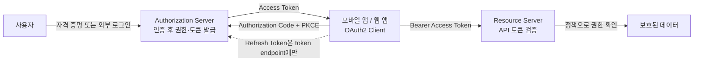
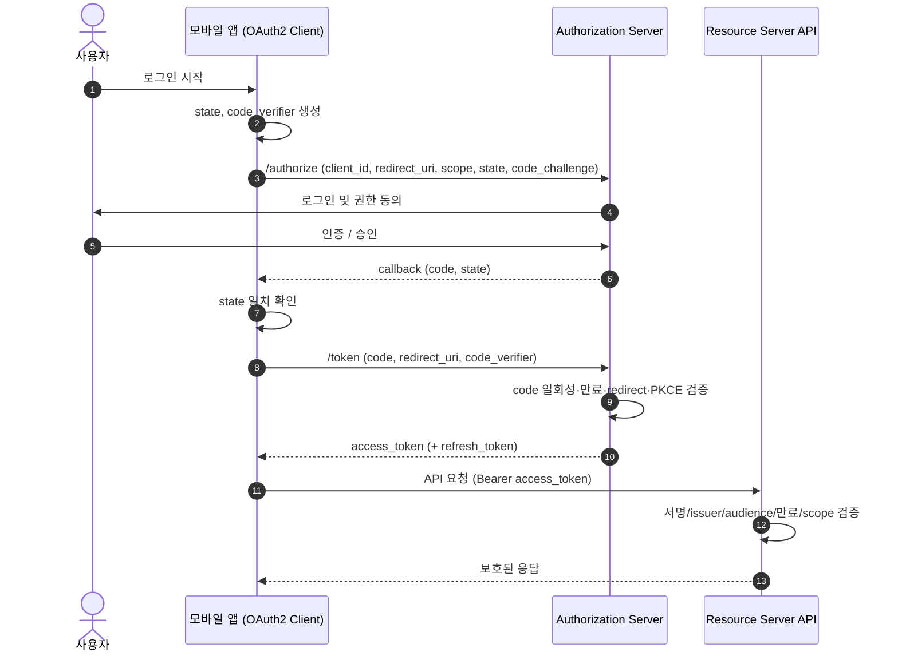
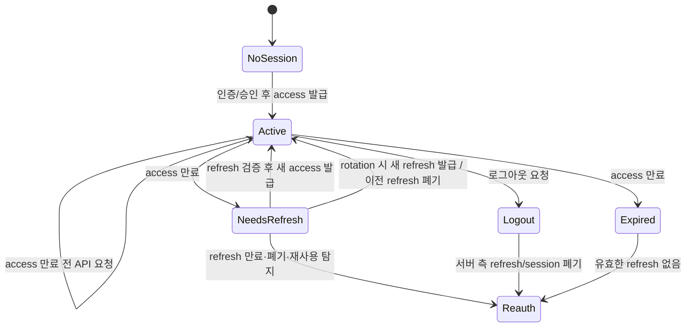
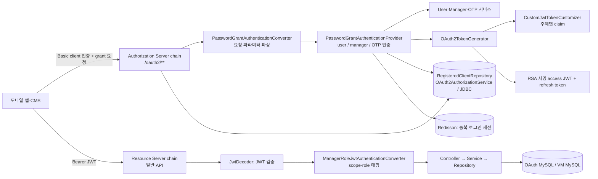

## OAuth2 와 Spring 인증 면접 준비

이 문서는 이력서의 두 경험을 구분해서 설명하도록 돕습니다.

- **Hi-Tech (Go, Oracle, Redis):** JWT access·refresh 발급과 검증, Redis 에 token ID 와 사용자 연결 정보 및 만료시간 저장, 로그아웃 시 삭제, refresh 시 토큰 교체, 최종 로그인은 Oracle 프로시저 연동
- **VMMe Pro (Kotlin, Spring Boot):** 백엔드 개발자와 Spring Authorization Server 기반 인증 서버를 만들었고, 본인은 커스텀 grant 처리·claim 구성 같은 토큰 발급 코드 일부를 직접 작성. 로그인은 표준 Authorization Code 가 아니라 커스텀 Password Grant 이고, 서비스 간 호출은 client_credentials, access token 은 RSA 서명 JWT (구조는 5.1 절)

Hi-Tech 는 자체 로그인 API 의 JWT 발급이라 OAuth2 흐름이 아닙니다. OAuth2 경험은 VMMe Pro 인증 서버로 설명하고, 그 서버도 Authorization Code + PKCE 를 구현한 것은 아니라는 점을 분명히 합니다.

### 0. 큰 그림부터: identity boundary 에서 API 권한까지

인증 시스템을 이해할 때는 "토큰을 만들었다"에서 시작하지 말고, **누가 사용자의 신원을 확인하고(identity boundary), 누가 어떤 권한을 발급하며, 누가 그 권한을 검사하는가**를 따라가면 됩니다.



읽는 순서는 다음과 같습니다.

1. **Identity boundary:** 사용자가 누구인지 확인하는 지점입니다. 자체 로그인이라면 사용자 저장소/인증 API 가, 외부 로그인이면 외부 Identity Provider 가 확인할 수 있습니다. OAuth2 자체는 사용자 비밀번호 검증 방식을 정하지 않습니다.
2. **권한 발급 경계:** Authorization Server 는 client 와 요청된 권한을 확인하고 access token 을 발급합니다. 토큰은 "누구인지"만이 아니라 "어느 client 가 어떤 자원에 어느 범위로 접근할 수 있는지"를 표현합니다.
3. **자원 경계:** Resource Server 는 요청마다 토큰의 진위·유효기간·발급자·대상·scope/role 을 검증하고, 그 다음 자체 비즈니스 권한 규칙을 적용합니다. 인증된 사용자여도 모든 자원에 접근할 수 있는 것은 아닙니다.
4. **세션 연장/종료:** Refresh token 은 새 access token 을 받기 위한 장기 자격증명입니다. 로그아웃은 서버가 추적하는 세션/refresh 상태를 끝낼 수 있지만, 이미 발급된 자체 완결 JWT 가 API 에서 즉시 차단되는지는 resource server 의 폐기 확인 방식에 달려 있습니다.

**공연장 비유를 전체 흐름으로 연결하면:** 매표소가 신원을 확인하고(인증), 티켓 창구가 특정 공연·좌석에 쓸 수 있는 티켓을 발급하며(인가 위임), 입구 직원이 티켓의 진위와 유효 구역을 확인합니다(API 토큰 검증). 팔찌(JWT)는 티켓 정보를 적는 한 형식이지, 매표 절차(OAuth2) 그 자체가 아닙니다. 팔찌를 취소 목록과 대조하지 않으면 발급 후 회수 사실을 입구 직원이 모를 수도 있습니다.

#### 이력서 경험을 큰 그림에 놓기

- **Hi-Tech:** 확인된 이력서 내용은 Go API 에서 JWT access·refresh 발급·검증, Redis 에 token ID- 사용자 연결 및 만료 저장, 로그아웃 시 토큰 정보 삭제, refresh 시 교체, 최종 로그인 경로의 Oracle 프로시저 연동입니다. 이는 토큰 기반 인증 및 세션 폐기 설계 경험을 보여줍니다. OAuth2 표준 흐름은 아닙니다.
- **VMMe Pro:** 위 그림의 **authorization server 와 resource server 상자**에 해당합니다. 한 Spring Boot 서비스 안에 Spring Authorization Server 의 토큰 발급 체인과 Resource Server 의 API 검증 체인이 함께 있고, 본인은 토큰 발급 체인의 코드 일부(커스텀 grant 처리, claim 구성 등)를 직접 작성했습니다. identity boundary 는 같은 서버의 회원·관리자·OTP 인증 서비스가 맡습니다.

따라서 답변의 순서는 **큰 그림에서 맡은 경계 → 직접 만든 동작 → 프레임워크/협업자가 맡은 동작 → 한계**가 좋습니다. CV 문구를 먼저 부정하거나 과장이라고 인정할 필요는 없습니다. 문구의 근거로 실제 구조, 직접 작성한 코드, 협업 범위를 구체적으로 말하고, 표준 Authorization Code + PKCE 가 아니었다는 한계는 먼저 밝힙니다. Hi-Tech Go 구현을 VMMe Pro Spring OAuth2 경험으로 합쳐 말하지 않습니다.

### 1. 먼저 구분하기: 인증, 인가, OAuth2, OIDC, JWT

#### 비유

공연장에 들어가는 상황으로 생각하면 쉽습니다.

- **인증(Authentication):** 입장권의 사진과 본인이 같은 사람인지 확인합니다. "누구인가?"에 답합니다.
- **인가(Authorization):** 확인된 사람이 VIP 구역이나 backstage 에 들어갈 권한이 있는지 확인합니다. "무엇을 할 수 있는가?"에 답합니다.
- **OAuth2:** 사용자가 비밀번호를 다른 앱에 넘기지 않고, 특정 서비스가 제한된 권한으로 다른 서비스에 접근하도록 위임하는 절차입니다. 출입 권한을 위임하는 규칙에 가깝습니다.
- **OpenID Connect (OIDC):** OAuth2 위에 로그인과 사용자 신원 확인 규칙을 추가한 표준입니다. OAuth2 가 권한 위임이라면 OIDC 는 "로그인한 사용자가 누구인지" 확인하는 약속까지 더합니다.
- **JWT:** 정보를 서명해 담을 수 있는 토큰 형식입니다. JWT 는 OAuth2 자체가 아니며, OAuth2 access token 이 반드시 JWT 여야 하는 것도 아닙니다.

OAuth2 는 원래 권한 위임 프레임워크입니다. "OAuth2 로그인을 했다"고 표현하더라도 실제로 사용자 로그인과 ID 토큰을 제공하는 구조라면 OIDC 사용 여부도 살펴봐야 합니다. [RFC 6749](https://www.rfc-editor.org/rfc/rfc6749.html), [OpenID Connect Core](https://openid.net/specs/openid-connect-core-1_0.html), [RFC 7519 (JWT)](https://www.rfc-editor.org/rfc/rfc7519.html)

### 1.1. 세션과 토큰, JWT 구조, 서명 알고리즘, 토큰 저장 위치

#### 세션 기반 인증과 토큰 기반 인증

**비유:** 세션은 **물품 보관증**입니다. 손님은 번호표(세션 ID)만 들고, 실제 정보는 보관소(서버)가 갖고 있습니다. 토큰(JWT)은 **도장 찍힌 신분증**입니다. 정보가 신분증에 적혀 있어 입구에서 도장만 확인하면 보관소에 물어볼 필요가 없지만, 한 번 발급한 신분증은 회수하기 어렵습니다.

| 기준 | 세션 기반 | 자체 완결형 토큰(JWT) 기반 |
|---|---|---|
| 상태 위치 | 서버(메모리·Redis·DB)에 세션 저장, 클라이언트는 세션 ID 쿠키 | 클라이언트가 서명된 토큰 보관, 서버는 서명·만료만 검증 |
| 즉시 폐기 | 서버에서 세션을 지우면 바로 가능 | 만료 전 폐기가 어려움. denylist·짧은 수명·refresh 폐기가 필요 |
| 확장성 | 여러 서버가 세션 저장소를 공유하거나 sticky session 필요 | 공개키만 있으면 어느 서버든 검증 가능 |
| 요청 비용 | 요청마다 세션 저장소 조회 | 요청마다 서명 검증(저장소 조회 없음) |
| 주된 위협 | 쿠키 자동 전송에 따른 CSRF, 세션 고정 | 토큰 탈취 후 만료 전 재사용, 오래된 권한 claim |
| 잘 맞는 곳 | 같은 도메인의 웹 앱, 즉시 로그아웃이 중요한 서비스 | 모바일 앱, 여러 API·서비스가 같은 토큰을 검증하는 구조 |

실무에서는 둘을 섞는 경우가 많습니다. **짧은 수명의 access JWT 는 stateless 로 검증하고, 긴 수명의 refresh token 은 서버가 상태를 추적해 폐기**합니다. 이력서의 Hi-Tech 설계(JWT + Redis token ID)도 이 혼합형의 한 예입니다.

#### JWT 구조: 서명은 위조 방지이지 암호화가 아니다

JWT 는 `header.payload.signature` 세 부분을 점으로 이은 문자열입니다.

```text
eyJhbGciOiJSUzI1NiIsImtpZCI6ImtleS0yMDI2In0   ← header  (base64url)
.eyJpc3MiOiJodHRwczovL2F1dGguZXhhbXBsZSIs...   ← payload (base64url)
.Q3x9...                                       ← signature
```

- **header:** 서명 알고리즘(`alg`), 키 식별자(`kid`), 타입(`typ`).
- **payload(claims):** 표준 claim 인 `iss`(발급자), `sub`(주체), `aud`(대상), `exp`(만료), `nbf`(이 시각 전에는 무효), `iat`(발급 시각), `jti`(토큰 ID)와 서비스별 claim(scope, role 등).
- **signature:** `base64url(header) + "." + base64url(payload)` 를 서명한 값입니다. 내용이 한 글자라도 바뀌면 검증이 실패합니다.

**base64url 은 인코딩일 뿐 암호화가 아닙니다.** 누구나 payload 를 디코딩해 읽을 수 있으므로 비밀번호, 개인정보, 내부 비밀값을 넣지 않습니다. 서명된 JWT(JWS)는 **무결성과 발급자 확인**을 주고, 내용을 숨기려면 JWE 같은 암호화가 따로 필요합니다.

검증할 때는 `alg` 를 토큰이 주는 대로 믿지 않고 서버가 허용한 알고리즘으로 고정합니다. `alg: none` 을 받아들이거나, RS256 공개키를 HS256 비밀키처럼 쓰게 만드는 알고리즘 혼동 공격이 알려져 있습니다([RFC 8725](https://www.rfc-editor.org/rfc/rfc8725.html)).

#### HS256 과 RS256·ES256: 누가 서명하고 누가 검증하나

| 알고리즘 | 키 | 서명 | 검증 | 특징 |
|---|---|---|---|---|
| HS256 (HMAC-SHA256) | 대칭 비밀키 하나 | 비밀키 | **같은 비밀키** | 빠르고 단순. 검증하는 모든 서비스가 비밀키를 가지므로 검증자도 토큰을 위조할 수 있고, 키 유출 지점이 늘어남 |
| RS256 (RSA-SHA256) | 개인키/공개키 | 개인키(인증 서버만) | 공개키 | 검증 서비스는 공개키만 있으면 됨. 토큰과 서명이 큼 |
| ES256 (ECDSA P-256) | 개인키/공개키 | 개인키 | 공개키 | RSA 보다 키와 서명이 짧음 |

비대칭 알고리즘에서는 인증 서버가 공개키 묶음을 **JWKS(JSON Web Key Set)** endpoint 로 공개하고, resource server 는 토큰 header 의 `kid` 로 맞는 공개키를 골라 검증합니다. 키를 교체할 때는 새 키를 JWKS 에 먼저 추가하고 옛 키도 일정 기간 함께 노출해, 이미 발급된 토큰이 만료될 때까지 검증되게 합니다.

**면접 포인트:** 인증 서버와 API 서버가 분리되거나 서비스가 여러 개인 MSA 에서는 개인키를 인증 서버 한곳에만 두고 나머지는 공개키로 검증하는 비대칭 서명이 자연스럽습니다. 5.1 절의 인증 서버도 RSA 로 access JWT 를 서명하고, resource server 체인이 `JwtDecoder` 로 검증하는 구조입니다.

#### 클라이언트는 토큰을 어디에 저장하나

| 클라이언트 | 저장 위치 | 위험과 대응 |
|---|---|---|
| 브라우저 `localStorage`/`sessionStorage` | JS 로 읽고 씀 | XSS 가 생기면 스크립트가 토큰을 그대로 가져감 |
| 브라우저 `HttpOnly` + `Secure` + `SameSite` 쿠키 | JS 가 읽을 수 없음 | XSS 로 토큰 자체를 빼가기는 어렵지만, 쿠키가 자동 전송되므로 CSRF 대비(SameSite, CSRF 토큰)가 필요 |
| 브라우저 메모리 + refresh 는 HttpOnly 쿠키 | 새로고침하면 refresh 로 재발급 | SPA 에서 흔한 절충. 더 강하게는 토큰을 서버 쪽에 두는 BFF(Backend for Frontend) 패턴 |
| 모바일 앱 | iOS Keychain, Android Keystore 로 보호한 저장소 | 일반 설정 파일·로그·URL 에 토큰을 남기지 않음. 루팅·탈옥 기기와 백업 포함 여부도 고려 |

어디에 저장하든 **access token 은 짧게, refresh token 은 회전·폐기 가능하게** 두어 탈취됐을 때의 피해 시간을 줄입니다.

### 2. OAuth2 의 역할

| 역할 | 하는 일 | 공연장 비유 |
|---|---|---|
| Resource Owner | 보호된 데이터의 주인. 보통 사용자 | 관객 |
| Client | 사용자를 대신해 보호된 자원에 접근하려는 앱 | 티켓을 요청하는 앱 |
| Authorization Server | 사용자/클라이언트를 확인하고 토큰을 발급 | 권한 창구 |
| Resource Server | 토큰을 확인하고 보호된 API 를 제공 | 입장권을 검사하는 구역 |

한 제품에서 authorization server 와 resource server 가 같은 애플리케이션에 들어갈 수는 있지만, 논리적인 책임은 다릅니다. 로그인 API 가 있다는 사실만으로 해당 시스템이 OAuth2 authorization server 라고 단정할 수는 없습니다. 표준 흐름에서 클라이언트 등록, 인가 요청·응답, authorization code 교환, 토큰 발급 같은 역할을 실제로 맡는지 확인해야 합니다.

### 3. Authorization Code 흐름과 PKCE

#### 흐름을 한 문장으로

사용자가 authorization server 에서 로그인과 동의를 마치면, 앱은 짧게 쓰는 authorization code 를 받고 이를 토큰으로 교환합니다. 비밀번호를 앱에 전달하지 않는 구조입니다.

#### 단계

1. Client 가 사용자를 authorization server 의 authorization endpoint 로 보냅니다. 보통 `client_id`, `redirect_uri`, 요청 권한(scope), `state` 가 포함됩니다.
2. 사용자가 authorization server 에서 인증하고 권한을 승인합니다.
3. Authorization server 는 등록된 redirect URI 로 일회성 authorization code 를 전달합니다.
4. Client 는 token endpoint 에 code 를 보내 access token 을 교환합니다.
5. Client 는 access token 을 resource server 에 보내 API 를 호출하고, resource server 는 토큰과 권한을 검증합니다.

#### 요청을 실제로 따라가기

1. Client 는 요청마다 높은 난수의 `state`를 만들고, Authorization Code + PKCE 에서는 `code_verifier` 도 생성합니다. 앱은 verifier 와 state 를 현재 로그인 시도에 안전하게 묶습니다.
2. Client 는 `code_verifier`의 해시(`code_challenge`)를 계산해 authorization endpoint 로 보냅니다. 보통 `response_type=code`, `client_id`, 등록된 `redirect_uri`, `scope`, `state`, `code_challenge`, `code_challenge_method=S256` 이 포함됩니다.
3. Authorization Server 는 client ID 와 redirect URI 를 등록 정보와 정확히 대조하고, 요청을 거절하거나 사용자 인증 화면을 제공합니다. 사용자가 로그인했다고 해서 요청된 모든 scope 가 자동 승인되는 것은 아닙니다.
4. 인증 및 동의가 끝나면 Authorization Server 는 짧고 일회용인 code 를 `redirect_uri` 로 돌려보내며 state 를 함께 반환합니다. Client 는 callback 의 state 가 원래 저장한 값과 같은지 비교합니다. 불일치면 callback 을 처리하지 않습니다.
5. Client 는 token endpoint 에 code, 동일한 redirect URI, PKCE verifier 를 보냅니다. confidential client 라면 별도의 client authentication 도 할 수 있습니다. Authorization Server 는 code 가 발급 기록과 맞고, 미사용·미만료이며, redirect URI 및 PKCE 검증이 맞는지 확인한 뒤 token 을 발급합니다.
6. Client 는 access token 을 보호된 API 에 bearer token 으로 보냅니다. Resource Server 는 허용한 서명 키/알고리즘 또는 introspection 결과, `iss`, `aud`, 만료시간, scope 등 자신의 정책에 필요한 조건을 검증하고 API 권한을 판단합니다.
7. Access token 이 만료되면 client 는 refresh token 이 발급된 경우 token endpoint 에만 보냅니다. Authorization Server 가 이를 검증하고 새 access token 및 필요 시 새 refresh token 을 발급합니다.

`state`와 PKCE 는 서로 대체하지 않습니다. state 는 authorization 요청과 callback 의 상관관계를 확인해 CSRF/응답 주입 위험을 줄이고, PKCE 는 가로챈 authorization code 의 교환을 방어합니다. OIDC 에서는 `nonce` 가 ID token 재생/요청 상관관계 검증에 쓰일 수 있습니다. [RFC 6749](https://www.rfc-editor.org/rfc/rfc6749.html), [RFC 7636](https://www.rfc-editor.org/rfc/rfc7636.html), [RFC 9700](https://www.rfc-editor.org/rfc/rfc9700.html)

#### Sequence diagram: Code + PKCE



그림에서 중요한 경계는 사용자 인증이 Authorization Server 에서 끝나고, API 요청 권한은 Resource Server 가 다시 검사한다는 점입니다. Client 는 토큰을 운반하지만 사용자 비밀번호를 받아 API 에 전달하는 역할은 하지 않습니다.

Authorization Code 는 짧은 시간만 유효하고 한 번만 교환되도록 합니다. `state`는 요청과 callback 을 연결해 위조된 callback 을 막는 데 사용합니다. OAuth2 의 표준 역할과 흐름은 [RFC 6749](https://www.rfc-editor.org/rfc/rfc6749.html) 에 정의돼 있습니다.

#### PKCE 는 왜 필요한가?

모바일 앱이나 브라우저 앱은 client secret 을 안전하게 감출 수 없는 public client 입니다. PKCE("픽시"라고 읽음)는 앱이 매번 임의의 `code_verifier`를 만들고 그 요약인 `code_challenge` 를 authorization 요청에 보냅니다. 토큰 교환 때 verifier 도 제출해야 하므로, 중간에서 authorization code 만 훔친 공격자는 토큰으로 바꾸기 어렵습니다.

비유하면 코드 교환표를 발급받을 때 미리 봉투의 지문(code challenge)을 등록하고, 실제 교환 때 원래 표식(code verifier)을 보여줘야 하는 방식입니다. PKCE 는 client secret 을 대체하는 비밀 값이라기보다, authorization code 가로채기 공격을 줄이는 방어입니다. [RFC 7636](https://www.rfc-editor.org/rfc/rfc7636.html), [OAuth 2.0 Security Best Current Practice, RFC 9700](https://www.rfc-editor.org/rfc/rfc9700.html)

>모바일 앱은 public client 이므로 client secret 을 앱에 넣어 안전하다고 간주할 수 없습니다. Authorization Code + PKCE 를 사용하고, callback 의 `state` 도 검증해야 합니다.

### 4. Access token, refresh token, 로그아웃·폐기

- **Access token:** Resource server 에 보호된 API 접근 권한을 제시하는 짧은 수명 자격증명입니다.
- **Refresh token:** 새 access token 을 얻는 데 사용하는 더 민감한 장기 자격증명입니다. API 호출에 일반적으로 보내지 않고 token endpoint 에만 사용하며, 저장과 유출 방어를 더 신중하게 해야 합니다.
- **Refresh rotation:** refresh 요청마다 새 refresh token 을 주고 이전 토큰을 폐기하는 방식입니다. 이미 사용한 토큰이 다시 제출되면 탈취 가능성을 탐지하고 해당 토큰 계열을 폐기할 수 있습니다.
- **폐기와 로그아웃:** 서버가 refresh token 이나 세션 정보를 삭제하면 이후 재발급을 막을 수 있습니다. 이미 발급된 자체 완결형 JWT access token 은 만료 전까지 검증될 수 있으므로, 즉시 무효화를 원하면 서버 측 denylist/session 상태 확인, 짧은 만료시간 등의 설계가 필요합니다.

Hi-Tech 이력서의 Redis 저장은 token ID 와 사용자 연결 정보를 서버가 추적해 로그아웃 시 해당 토큰 정보를 삭제할 수 있었다는 설명과 잘 맞습니다. 다만 정확한 무효화 보장은 구현에 달려 있습니다. Resource server 가 매 요청마다 Redis 상태를 확인했는지, refresh 만 확인했는지, access JWT 자체의 만료 전 차단도 했는지 구분해서 말하세요. [RFC 6749, section 1.5](https://www.rfc-editor.org/rfc/rfc6749.html#section-1.5), [RFC 9700](https://www.rfc-editor.org/rfc/rfc9700.html)

#### Lifecycle diagram: 발급, 갱신, 폐기



JWT access token 이 자체 검증형이면 `Logout`에서 서버 측 refresh/session 을 없애도 access token 은 resource server 가 별도 폐기 상태를 확인하지 않는 한 `Expired` 까지 통과할 수 있습니다. 반면 opaque token 을 introspection 하거나 매 요청에 denylist/session 상태를 확인하면 즉시 차단을 강화할 수 있지만, 네트워크/저장소 의존성과 지연이 생깁니다. 설계는 "즉시 폐기 요구"와 "API 요청의 stateless 검증" 사이에서 결정합니다.

### 5. Spring Security 와 Spring Authorization Server

Spring 면접에서는 아래 구성요소의 역할을 구분해 말할 수 있어야 합니다.

- **Spring Security:** 애플리케이션의 인증·인가 기반 기능을 제공합니다. 로그인 방식, 요청별 접근 규칙, 인증 객체와 보안 필터 체인 등을 구성합니다.
- **OAuth2 Resource Server 지원:** API 서버에서 bearer token 을 읽고 검증해 접근을 통제합니다. JWT 검증 또는 opaque token introspection 방식을 사용할 수 있습니다.
- **Spring Authorization Server:** OAuth2 authorization server 를 만들기 위한 별도 프로젝트입니다. OAuth2 프로토콜 엔드포인트와 authorization/token 처리 등을 구성하는 기반을 제공합니다. Spring Security 자체와 같은 이름의 기능이 아닙니다.
- **Spring Boot:** 자동 구성과 애플리케이션 구동 편의를 제공합니다. Boot 를 썼다고 OAuth2 서버가 자동으로 완성되는 것은 아닙니다.

#### Spring Security 의 요청 처리 mental model

Servlet 애플리케이션에서는 요청이 `FilterChainProxy`를 거쳐 적절한 `SecurityFilterChain`으로 들어갑니다. 인증 필터는 자격증명을 `AuthenticationManager`에 넘기고, 적절한 `AuthenticationProvider`가 검증합니다. 성공한 인증은 `SecurityContext` 에 반영되고, 이후 authorization 단계에서 URL/메서드 정책을 검사합니다. Resource Server 의 bearer token 필터도 이 보안 체인 안에서 token 을 읽고 JWT decoder 또는 opaque token introspection 을 통해 검증합니다. 컨트롤러까지 도달한 뒤 별도 도메인 규칙(예: 이 사용자가 이 예약을 수정할 수 있는가)도 확인해야 합니다. [Spring Security Servlet Architecture](https://docs.spring.io/spring-security/reference/servlet/architecture.html), [Authentication Architecture](https://docs.spring.io/spring-security/reference/servlet/authentication/architecture.html)

```mermaid
flowchart LR
  R[HTTP Request] --> F[FilterChainProxy]
  F --> SC[선택된 SecurityFilterChain]
  SC --> BT[BearerTokenAuthenticationFilter]
  BT --> AM[AuthenticationManager]
  AM --> P[JwtAuthenticationProvider]
  P --> V[JwtDecoder / 검증기\n서명·iss·aud·exp]
  V --> CTX[SecurityContext에 인증 반영]
  CTX --> AUTH[Authorization 단계\nURL·메서드 권한]
  AUTH --> CTRL[Controller / Service]
  CTRL --> DOMAIN[도메인 권한·자원 소유권 확인]
```



실제 체인에는 CORS, CSRF, 예외 처리 등 다른 필터가 구성에 따라 들어갑니다. 다이어그램은 Resource Server 의 bearer JWT 요청을 단순화했습니다. 인증 성공과 비즈니스 권한 허용은 별개이며, `SecurityContext` 가 만들어졌다는 이유만으로 Controller 의 모든 동작이 허용되는 것은 아닙니다.

#### Spring Authorization Server 의 책임 모델

Authorization Server 설정은 "JWT 를 만드는 클래스 하나"가 아니라 OAuth2 protocol endpoint 와 상태/정책을 연결합니다. 공식 구성 모델에는 authorization/token endpoints, client 등록 저장소, authorization 저장소, token generator, issuer 및 signing key 같은 책임이 있습니다. 기본 구성은 여러 OAuth2 endpoint 를 설정할 수 있지만, 실제 앱에서 켠 기능·버전·사용자 정의는 별도입니다. OIDC endpoint 는 별도 설정이 필요할 수 있습니다. 이 설명은 프레임워크의 구조를 설명하는 것이며, VMMe Pro 에서 이를 사용했다는 주장은 아닙니다. [Spring Authorization Server Configuration Model](https://docs.spring.io/spring-authorization-server/reference/configuration-model.html), [Core Model / Components](https://docs.spring.io/spring-authorization-server/reference/core-model-components.html)

면접 전에 VMMe Pro 에서 실제로 사용한 라이브러리·버전을 확인하세요. Spring Authorization Server 를 썼다면 의존성, `SecurityFilterChain`, 등록한 `RegisteredClient`, issuer/키 설정, grant 와 endpoint 중 직접 설정·구현한 범위를 설명합니다. 일반 Spring Security 설정이나 JWT 발급 API 를 직접 작성했다면 그 사실대로 표현하고, 표준 OAuth2 authorization server 전체를 구현했다고 부풀리지 않습니다. [Spring Security Reference](https://docs.spring.io/spring-security/reference/), [Spring Authorization Server Reference](https://docs.spring.io/spring-authorization-server/reference/)

### 5.1. VMMe Pro 저장소에서 확인한 실제 구조

분석 기준 저장소: [`mybenefit/authorization-server`, main, `adad707`](https://github.com/mybenefit/authorization-server/tree/adad7071d1f814b95a684f7ac39d83c2dcab3601). 아래는 해당 commit 의 코드 구조 설명입니다. 이 서버는 백엔드 개발자와 함께 만들었고, 본인은 토큰 발급 체인의 코드 일부를 직접 작성했습니다.

>직접 작성한 클래스 2~3 개(예: `PasswordGrantAuthenticationProvider`, `CustomJwtTokenCustomizer`, `SecurityConfiguration` 중 실제로 쓴 것)를 이름과 역할로 말할 수 있게 준비하면, "어디까지 직접 했나요?"라는 질문에 가장 강하게 답할 수 있습니다.

#### 한눈에 보는 구성

이 앱은 **Authorization Server 기능과 Resource Server 기능을 한 Spring Boot 서비스 안에서 함께 수행**합니다. OAuth2 protocol endpoint 를 제공하는 체인과 일반 API 가 Bearer JWT 를 검증하는 체인을 분리했습니다.



계층은 Controller → Service → Repository 방향입니다. README 설계에 따르면 domain model 은 JPA entity 와 분리했고, persistence adapter 가 entity 변환과 MySQL 저장을 담당합니다. OAuth 관련 `RegisteredClient`와 authorization 상태도 JDBC 기반 저장소에 연결합니다. 두 MySQL datasource(`oauth2`, `vm3s`)와 Redis(Redisson)를 사용합니다.

#### 코드에서 읽히는 로그인·토큰 흐름

1. `/oauth2/**` 요청은 우선순위가 가장 높은 authorization-server filter chain 으로 갑니다. Token endpoint 에 등록된 converter 는 `grant_type=password` 요청을 커스텀 Authentication token 으로 바꿉니다.
2. 커스텀 provider 는 `user_type`에 따라 회원 비밀번호(`user`), 센터 관리자(`manager`), OTP(`user_otp`) 경로를 분기합니다. 회원 로그인의 `serial_num`이 있으면 Redisson에 저장된 사용자별 기기 세션으로 중복 로그인을 확인합니다.
3. provider 는 OAuth2 token generator 에 access token 과 refresh token 생성을 요청합니다. access token 은 RSA 기반 JWT 이며, customizer 가 회원·관리자·기기·client 주체에 따라 별도 metadata claim 을 추가합니다. Authorization 은 JDBC 저장소에 저장됩니다.
4. 일반 API 요청은 다른 filter chain 의 Resource Server 설정을 거칩니다. `JwtDecoder`가 서명 등 토큰 검증을 수행하고 `ManagerRoleJwtAuthenticationConverter`가 `scope`를 `SCOPE_...` authority 로, 관리자 claim 을 role 로 매핑합니다. 서비스 client 토큰은 `ROLE_CLIENT`로 분리해 일반 API 를 기본 차단하고, 필요한 API 에서 명시적인 scope 를 요구합니다.
5. 별도 `/service/token` 경로는 CMS/기기용 `client_credentials` 서비스 토큰을 발급합니다. 등록된 client 자격증명, client name allowlist, 허용 scope 를 검사하고, `/service/token/revoke`로 해당 서비스 토큰 저장 기록을 지울 수 있습니다.

사용자 세션용 Redis 와 OAuth authorization 저장소는 역할이 다릅니다. Redis 항목은 코드에서 `{profile}:session:{userId}`와 180초 TTL 로 중복 로그인 여부를 저장합니다. OAuth2 access/refresh authorization 기록은 JDBC OAuth authorization 저장소에 둡니다. 이 둘을 “모든 JWT 를 Redis 에 저장해 검증한다”라고 합쳐 말하면 정확하지 않습니다.

#### 이 저장소를 설명하는 답변 버전

**20초 버전**

> “인증 서버는 Kotlin·Spring Boot 기반 계층형 서비스이고, Spring Authorization Server 의 토큰 발급 체인과 Spring Security Resource Server 의 일반 API 검증 체인을 분리했습니다. 커스텀 Password Grant 요청에서 회원·관리자·OTP 인증을 처리하고 RSA JWT 에 주체별 claim 을 넣습니다. 저는 백엔드 개발자와 함께 이 서버를 만들며 커스텀 grant 처리와 claim 구성 같은 토큰 발급 코드 일부를 직접 작성했습니다.”

**60초 버전**

> “인증 서버라고 부르는 하나의 서비스 안에 토큰을 발급하는 authorization-server chain과 bearer JWT로 일반 API를 보호하는 resource-server chain이 있습니다. `/oauth2/token`은 Spring Authorization Server의 token endpoint에 커스텀 converter/provider를 연결해 기존 클라이언트의 Password Grant 요청을 파싱하고, 회원·센터 관리자·OTP 인증으로 분기합니다. 인증이 되면 token generator가 RSA 서명 JWT와 refresh token을 생성하고, customizer가 user·manager·device metadata를 붙이며 authorization 저장소에 상태를 저장합니다. 다른 API 체인은 JWT를 검증한 뒤 scope와 사용자 유형을 권한으로 변환합니다. CMS/기기용 client credentials도 별도 경로로 분리해 allowlist와 scope로 제한합니다. 서버 전체를 혼자 만든 것은 아니고, 저는 이 중 토큰 발급 체인의 코드 일부를 맡았습니다.”

**저장소 흐름을 코드 단위로 설명하라는 꼬리질문**

> “`SecurityConfiguration`에서 `/oauth2/**` 체인에 커스텀 converter와 provider를 연결합니다. converter는 폼 파라미터와 client 인증 문맥을 Authentication 객체로 바꾸고, provider가 실제 사용자 인증과 토큰 생성을 담당합니다. JWT customizer가 claim 을 조립합니다. 그 다음 authorization-server 체인은 발급 기록을 저장하고, 일반 API 체인은 별도의 decoder와 authentication converter로 토큰을 검증·권한화합니다.”

### 5.2. 이 구현의 중요한 한계: Password Grant

저장소의 `RegisteredClientEntity.create()`는 `password`, `client_credentials`, `refresh_token` grant 를 등록하고, 커스텀 provider 가 Password Grant 를 처리합니다. 코드 기준으로 Authorization Code + PKCE 흐름을 이 앱의 실제 로그인 흐름이라고 설명할 근거는 없습니다. Password Grant 를 선택한 배경은 코드만으로 확정할 수 없으니, 기존 클라이언트 계약을 유지하기 위한 것이었는지 당시 요구사항으로 확인하세요. 따라서 이력서의 “OAuth2 인증 서버”는 실제 구현을 설명하되 “최신 권장 로그인 흐름을 새로 설계했다”라고 말하지 않습니다.

Resource Owner Password Credentials(ROPC/Password Grant)는 OAuth 2.0 Security Best Current Practice인 RFC 9700에서 사용해서는 안 되는 grant 로 규정합니다. 사용자의 비밀번호를 client 가 직접 다루게 해 자격증명 노출 범위를 넓히고, 다단계 인증과 상호작용형 인증에 맞지 않기 때문입니다. 레거시 앱과의 호환 때문에 유지된 코드라면 그렇게 설명하고, 새 모바일 클라이언트는 Authorization Code + PKCE 로 전환하는 계획을 제시합니다. 서버 간 호출은 필요한 scope를 제한한 Client Credentials가 적절한지 별도로 판단합니다. [RFC 9700 §2.4](https://www.rfc-editor.org/rfc/rfc9700.html#section-2.4)

> Password Grant 를 쓴 이유는 당시 팀에서 실제로 논의한 이유로 말합니다. 기억나지 않으면 "기존 앱 호환" 같은 이유를 지어내지 말고, "팀에서 정한 구조였다"고 말한 뒤 한계와 전환 계획으로 넘어갑니다.

**질문: Password Grant 를 썼는데, OAuth2를 안전하게 구현했다고 할 수 있나요?**

- **짧은 답:** “저희 인증 서버는 Spring Authorization Server 가 기본 제공하지 않는 Password Grant 를 커스텀 converter/provider 로 처리합니다. RFC 9700 에서 쓰지 말라고 규정한 grant 라서, 이것을 최신 권장 흐름이라고 말하지는 않습니다. 새로 설계한다면 Authorization Code + PKCE 로 바꾸겠습니다.”
- **설명형 답:** “token endpoint 가 Password Grant 요청을 받아 회원·관리자·OTP 인증으로 분기하고, RSA JWT 와 refresh token 을 발급합니다. Password Grant는 client가 사용자 비밀번호를 다루게 되고 다단계·브라우저 기반 인증과 맞지 않아 RFC 9700에서 MUST NOT으로 규정합니다. 신규 모바일 로그인은 Authorization Code + PKCE로 전환하고, 기존 앱은 클라이언트별 사용량과 호환성을 확인해 단계적으로 폐기하는 게 맞습니다.”

**꼬리질문 1: 지금 다시 설계한다면 어떻게 바꾸겠어요?**

**답변:** “모바일 앱은 public client라 client secret을 앱에 숨겨 넣을 수 없으므로, 브라우저를 통한 Authorization Code + PKCE를 사용하겠습니다. state와 redirect URI를 검증하고, access token은 짧게, refresh token은 회전과 재사용 탐지 정책을 적용합니다. 서버 간 서비스 호출은 사용자 로그인과 분리해 최소 scope의 client credentials로 다룹니다. 기존 앱과 서버를 함께 바꿔야 하므로 client 버전·로그인 성공률·전환 기간을 관리하며 점진적으로 폐기하겠습니다.”

**꼬리질문 2: 기존 Password Grant 코드를 본인이 설계한 건가요?**

**답변:** “Password Grant 구조는 팀에서 정한 것이고, 저는 그 안에서 커스텀 grant 처리와 claim 구성 같은 토큰 발급 코드 일부를 직접 작성했습니다. 서버 전체를 혼자 설계한 것은 아니지만, 왜 이 구조로 동작하는지와 어떤 한계가 있는지는 코드 수준에서 설명드릴 수 있습니다.”

#### 토큰 폐기와 키 관리에서 보수적으로 말할 부분

- 코드에 `/oauth2/revoke`와 authorization DB 기록이 있어도, 일반 API 요청에서 매번 DB의 revoked 상태까지 확인한다고 단정하면 안 됩니다. Resource Server 설정은 JWT decoder 기반입니다. JWT access token의 즉시 폐기 보장은 별도 denylist/introspection/세션 확인이 있는지 확인해야 합니다.
- `RegisteredClientEntity.create()`의 생성 기본값은 access token 5분, refresh token 14일이며 refresh 재사용을 끄도록 설정합니다(`reuseRefreshTokens(false)`). 즉 refresh 할 때마다 새 refresh token 을 발급하는 **rotation 이 켜진 상태**입니다. README는 서비스 토큰 만료를 100년이라고 설명하지만 `ServiceTokenService`는 `RegisteredClient`의 token generator 설정으로 토큰을 만들고, 코드 경로에서 별도의 100년 TTL을 지정하지 않습니다. 실제 client row의 `token_settings`와 발급 응답 `expires_in`을 확인하기 전에는 서비스 토큰 TTL을 단정하지 마세요.
- 저장소는 JWKS용 public key와 서명용 private key 파일 경로를 코드에서 직접 읽습니다. **비공개 저장소이지만 `secrets/` 아래 개인키 파일(`private_key.pem` 등)과 자격증명처럼 보이는 설정값이 Git 에 추적되고 있습니다.** 비공개여도 저장소 접근 권한이 있는 사람과 CI 가 모두 서명 키를 갖게 되고, Git 이력에 남아 지우기 어렵습니다. 운영 키라면 secret manager/KMS 로 옮기고 키·비밀번호를 회전하는 것이 맞습니다. 면접에서 먼저 꺼낼 필요는 없지만, "다시 만든다면 무엇을 개선하겠나요?"라는 질문에는 이 내용을 말할 수 있습니다. 실제 값은 절대 말하지 않고, 이 구조를 안전한 key management 의 모범 사례라고 설명하지 않습니다.

### 5.3. 저장소 기준으로 업데이트할 사실 확인 질문

1. 본인이 직접 작성·수정한 클래스는 무엇인가요? `SecurityConfiguration`, `PasswordGrantAuthentication`, `CustomJwtTokenCustomizer`, service/controller 중 각자 맡은 경계를 말할 수 있나요?
2. user, manager, OTP의 인증 분기 중 본인이 구현한 것은 무엇이고, 테스트로 검증한 예외는 무엇인가요?
3. refresh token grant의 재사용 방지와 rotation 동작을 표준 provider에 맡겼나요? 저장·재발급 결과를 어떻게 확인했나요?
4. client credentials의 `/service/token`은 표준 `/oauth2/token`과 왜 분리했고, scope 및 client allowlist를 어디서 검사하나요?
5. JWT revoke endpoint가 DB 레코드를 지운 뒤에도 Resource Server에서 이미 발급된 JWT가 언제까지 허용될 수 있나요?
6. RSA signing key는 어디에서 로드되고, 환경별 분리·권한·회전·JWKS key ID 변경을 어떻게 관리하나요?
7. 저장소에 추적된 key/config 값은 샘플인가요, 과거/현재 실제 자격증명인가요? 노출 여부와 회전 상태를 확인했나요?

### 6. 이력서에서 사실 확인이 필요한 지점

**확인된 답 (5.1 절 기준)**

1. **endpoint:** Spring Authorization Server 의 `/oauth2/token`(커스텀 Password Grant converter/provider 연결), JWKS, `/oauth2/revoke`, 그리고 CMS·기기용 서비스 토큰을 위한 별도 `/service/token`·`/service/token/revoke` 가 있습니다.
2. **grant:** `password`(커스텀), `client_credentials`, `refresh_token`. Authorization Code + PKCE 는 쓰지 않았습니다.
3. **역할 분담:** OAuth2 프로토콜 처리와 저장소는 Spring Authorization Server 가 맡고, 본인은 커스텀 grant 처리·claim 구성 같은 토큰 발급 코드 일부를 직접 작성했습니다.
4. **두 프로젝트의 경계:** VMMe Pro(Spring Authorization Server, OAuth2)와 Hi-Tech(Go 자체 로그인 API, JWT + Redis)는 서로 다른 프로젝트입니다.

**기억으로 채울 것 (Hi-Tech)**

5. JWT 의 서명 알고리즘과 key 관리, claim, 만료시간, refresh token 저장 방식
6. Redis 에 access 와 refresh 중 무엇의 ID 를 저장했는지, TTL 을 토큰 만료와 어떻게 맞췄는지
7. 로그아웃 때 폐기한 토큰의 종류
8. "최종 로그인 경로는 Oracle 프로시저 연동"이 프로시저가 사용자 자격을 검증하고 Go 서버가 토큰을 발급했다는 뜻인지, 데이터 흐름

Hi-Tech 세부가 기억나지 않으면 이력서 수준(token ID 와 사용자 연결을 만료시간과 함께 저장, 로그아웃 삭제, refresh 교체)으로 말하고 원리로 이어갑니다. 구현하지 않은 Authorization Code + PKCE 를 본인 경험으로 말하지 않습니다.

### 7. 예상 질문과 면접 답변 예시

#### Q1. OAuth2 와 JWT 는 어떤 관계인가요?

**답변 예시:** OAuth2 는 클라이언트가 사용자 대신 제한된 권한으로 자원에 접근하도록 하는 권한 위임 프레임워크입니다. JWT 는 claim 을 담고 서명할 수 있는 토큰 형식입니다. OAuth2 access token 으로 JWT 를 쓸 수 있지만 opaque token 도 가능하고, JWT 를 쓴다고 OAuth2 가 되는 것도 아닙니다. 로그인에서 사용자 신원 정보까지 표준화하려면 OIDC 가 함께 쓰일 수 있습니다.

#### Q2. 이력서에 OAuth2 인증 서버를 구현했다고 했는데, 어디까지 직접 했나요?

**답변 예시:** VMMe Pro 에서 백엔드 개발자와 함께 Spring Authorization Server 기반 인증 서버를 만들었습니다. OAuth2 프로토콜 처리와 client·authorization 저장소는 Spring Authorization Server 가 맡고, 저는 그 위에서 커스텀 Password Grant 처리와 회원·관리자·기기별 claim 구성 같은 토큰 발급 코드 일부를 직접 작성했습니다. 이 서버는 토큰 발급 체인과 일반 API 를 보호하는 resource server 체인을 한 애플리케이션 안에 분리해 두었습니다. Hi-Tech 에서는 별도로 Go API 에서 JWT access·refresh 발급·검증, Redis 의 token ID- 사용자 매핑과 만료 관리, 로그아웃 삭제와 refresh 교체를 구현했습니다.

직접 작성한 클래스 이름 2~3 개를 넣어 말하면 더 구체적입니다. "OAuth2 표준 서버를 처음부터 혼자 구현했다"고는 말하지 않습니다.

#### Q3. OAuth2 authorization code 흐름을 설명해 보세요

**답변 예시:** Client 가 사용자를 authorization server 로 보내고 사용자가 인증·동의하면, redirect URI 로 일회성 authorization code 가 돌아옵니다. Client 는 그 code 를 token endpoint 에서 access token 으로 교환하고, resource server API 요청에 bearer token 을 보냅니다. 모바일처럼 secret 을 숨길 수 없는 public client 는 PKCE 를 적용하고 callback 의 state 를 검증하겠습니다.

#### Q4. PKCE 가 client secret 을 대신하나요?

**답변 예시:** 안전한 client secret 으로 앱을 인증하는 용도와 완전히 같다고 보지는 않습니다. 모바일 앱은 패키지에 넣은 secret 을 추출할 수 있어 confidential client 처럼 취급하기 어렵습니다. PKCE 는 verifier 와 challenge 를 연결해 authorization code 를 가로챈 공격자가 토큰을 교환하지 못하게 돕습니다. 앱에는 실제 비밀값을 넣지 않고 Authorization Code + PKCE 를 사용하겠습니다.

#### Q5. Redis 에 토큰 정보를 저장한 이유는 무엇인가요?

**답변 예시:** 자체 완결형 JWT 만 쓰면 서버가 발급 뒤 세션 상태를 모를 수 있어, 만료 전 로그아웃이나 강제 폐기가 어려워집니다. 당시에는 Redis 에 token ID 와 사용자 연결 정보를 TTL 과 함께 저장해 유효 토큰을 추적하고, 로그아웃 때 서버 측 상태를 삭제하도록 했습니다. 요청마다 서명·만료를 검증한 뒤 Redis 에 그 token ID 가 있는지 확인했기 때문에, 로그아웃하면 access token 도 만료 전에 바로 거부됩니다. 반대로 Redis 를 조회하지 않는 서버라면 저장만으로는 이미 발급된 JWT 가 폐기되지 않습니다.

#### Q6. Refresh token 을 rotation 하는 이유와 재사용 대응은?

**답변 예시:** refresh token 은 access token 보다 수명이 길고 재발급 권한이 있어 유출 영향이 큽니다. 새 토큰을 발급할 때 기존 refresh token 을 폐기하면 탈취된 이전 토큰의 재사용 기회를 줄일 수 있습니다. Hi-Tech 에서는 refresh 때 이전 token ID 항목을 지우고 새 항목을 저장했기 때문에 이미 쓴 refresh token 은 거부됩니다. VMMe Pro 인증 서버도 `reuseRefreshTokens(false)` 로 refresh 마다 새 refresh token 을 발급합니다. 이미 쓴 토큰이 다시 들어오면 탈취 신호로 보고 그 세션이나 토큰 계열 전체를 폐기하는 재사용 탐지는 그 위에 더할 수 있는 정책입니다.

#### Q7. JWT access token 을 로그아웃 즉시 무효화할 수 있나요?

**답변 예시:** JWT 서명과 만료만 검증하는 stateless 구조라면 발급 서버가 로그아웃 사실을 각 resource server 에 알지 못하므로 만료 전까지 유효할 수 있습니다. 즉시 차단이 필요하면 요청마다 서버 측 세션 또는 denylist 를 확인하거나, 짧은 access token 수명과 폐기 가능한 refresh token 을 조합합니다. 어떤 방식을 택할지는 보안 요구와 매 요청의 저장소 조회 비용을 함께 고려하겠습니다.

#### Q8. Spring Security 와 Spring Authorization Server 는 어떻게 다른가요?

**답변 예시:** Spring Security 는 앱의 인증·인가와 보안 필터 체인 같은 기반을 제공합니다. Resource Server 구성으로 API 가 bearer token 을 검증할 수도 있습니다. Spring Authorization Server 는 OAuth2 authorization server 를 구축하는 별도 프로젝트입니다. Spring Boot 는 설정과 실행을 돕지만 OAuth2 서버 역할을 자동으로 구현해 주는 것은 아닙니다. VMMe Pro 인증 서버는 Spring Authorization Server 로 `/oauth2/**` 토큰 발급 체인을, Spring Security Resource Server 로 일반 API 체인을 구성해 두 SecurityFilterChain 을 분리했습니다.

#### Q9. OAuth2 와 OIDC 는 어떻게 다른가요?

**답변 예시:** OAuth2 의 핵심은 권한 위임이고, OAuth2 만으로 표준화된 로그인 신원 정보를 정의하지는 않습니다. OIDC 는 OAuth2 위에 ID token 과 사용자 인증 관련 규칙을 더해 로그인 신원을 확인하게 합니다. 그래서 사용자의 로그인 결과와 profile 표준이 필요하면 OIDC 를 사용하고, API 접근 위임만 필요하면 OAuth2 관점으로 설명합니다.

#### Q10. 직접 운영해 보지 않은 흐름이나 설정을 물으면 어떻게 답하나요?

**답변 예시 (Authorization Code + PKCE 를 물었을 때):** 그 흐름은 직접 운영해 보지 않았습니다. 저희 인증 서버는 Password Grant 였고, 저는 그 token endpoint 의 커스텀 grant 처리와 claim 구성 일부를 작성했습니다. Authorization Code + PKCE 는 앱이 브라우저로 로그인한 뒤 일회용 code 와 verifier 로 토큰을 교환하는 흐름으로 이해하고 있습니다. 전환한다면 redirect URI·state 검증, 토큰 수명과 rotation, 기존 앱의 단계적 전환을 함께 설계하겠습니다.

같은 틀로 답합니다: **직접 운영하지 않았다는 사실 → 실제로 한 가장 가까운 일 → 원리 → 적용한다면 할 일.**

### 8. 빠른 복습 체크리스트

- [ ] 인증과 인가를 예시로 구분해 말한다.
- [ ] OAuth2, OIDC, JWT 가 서로 다른 층위의 개념임을 설명한다.
- [ ] Resource Owner, Client, Authorization Server, Resource Server 역할을 말한다.
- [ ] Authorization Code + PKCE 의 code, challenge/verifier, state 를 설명한다.
- [ ] access token 과 refresh token 의 쓰임·수명·보호 차이를 설명한다.
- [ ] JWT 로그아웃과 서버 측 폐기 상태의 관계를 설명한다.
- [ ] Spring Security, Resource Server, Spring Authorization Server 의 차이를 설명한다.
- [ ] CV 문구에 대해 본인이 직접 한 일과 협업자/라이브러리가 맡은 일을 구분한다.
- [ ] Hi-Tech Go 인증 경험과 VMMe Pro Spring 인증 경험을 섞지 않는다.
- [ ] 세션 기반과 토큰 기반 인증의 차이(상태 위치, 즉시 폐기, 확장성, 위협)를 말한다.
- [ ] JWT 의 header·payload·signature 구조를 말하고, base64url 은 암호화가 아니라고 설명한다.
- [ ] HS256 과 RS256 의 차이, JWKS 와 kid 로 키를 배포·교체하는 방법을 설명한다.
- [ ] 웹(localStorage vs HttpOnly 쿠키, XSS vs CSRF)과 모바일(Keychain/Keystore)의 토큰 저장 위치를 말한다.

### 8.1. 보안 공격·실패 상황별 사고법

아래는 설계 질문에서 "무엇이 위험한가 → 어느 경계에서 막는가 → 실패하면 무엇을 하는가"로 답하기 위한 항목입니다. 이 목록은 면접 대비용 설계 지식이며, CV 에 적힌 구현으로 추정하면 안 됩니다.

| 공격/실패 | 위험과 방어 | 면접에서 짚을 판단 |
|---|---|---|
| Redirect URI 조작·open redirect | 공격자가 code 를 자기 endpoint 로 빼돌릴 수 있습니다. redirect URI 는 등록된 값과 정확히 일치시켜 검증하고 임의 wildcard/사용자 입력 redirect 를 피합니다. | callback 검증은 authorization server 의 책임이며 client 의 사후 검사만 믿지 않습니다. |
| Callback CSRF / 응답 주입 | 공격자가 다른 로그인 시도에서 얻은 응답을 피해자 앱에 주입할 수 있습니다. 요청별 `state` 를 저장하고 callback 에서 동일성을 확인합니다. | state 를 재사용하거나 검증하지 않는다면 callback 을 처리하지 않습니다. |
| Authorization code 가로채기 | 모바일 custom scheme 나 브라우저 callback 에서 code 가 노출될 수 있습니다. PKCE 를 강제하고 code 를 일회용·짧은 수명으로 둡니다. | PKCE 는 code 교환을 묶으며, TLS 와 안전한 redirect 설정도 여전히 필요합니다. |
| Login CSRF / authorization server mix-up | 사용자가 공격자 계정으로 로그인되거나 잘못된 issuer 와 code 가 연결될 수 있습니다. state, issuer 식별, 정확한 redirect 및 issuer 검증을 사용합니다. | 멀티 issuer/여러 authorization server 연동 시 응답의 issuer 와 요청 대상을 연결합니다. |
| Bearer token 유출 | bearer token 을 가진 쪽은 소유자로 취급될 수 있습니다. TLS 를 쓰고, 토큰을 URL·로그·분석 이벤트에 남기지 않으며, client 의 안전한 저장소를 사용합니다. | access token 을 제한된 scope/audience 와 짧은 수명으로 발급하고, 민감도에 따라 sender-constrained token 을 검토합니다. |
| JWT 검증 혼동 | `alg` 를 무비판적으로 허용하거나 `iss`, `aud`, 만료를 놓치면 다른 용도의 토큰을 받아들일 수 있습니다. 신뢰된 key 와 알고리즘을 고정하고 필수 claim 과 용도를 검증합니다. | 서명 검증 성공은 권한 결정의 전부가 아닙니다. scope, role, 리소스 소유권을 별도로 확인합니다. [RFC 8725](https://www.rfc-editor.org/rfc/rfc8725.html) |
| Refresh token 탈취·재사용 | 장기 재발급 권한이 탈취될 수 있습니다. rotation 또는 sender-constraining, 저장 보호, 재사용 탐지, 세션 단위 폐기를 고려합니다. | 동시 refresh 요청의 원자성 및 재사용 시 폐기 범위를 설명합니다. |
| Redis 장애·데이터 유실 | 폐기 목록/세션 상태를 읽을 수 없거나 사라지면 폐기 토큰 허용 여부에 영향을 줍니다. | fail-open/fail-closed 정책의 보안·가용성 trade-off, TTL 정합성, 장애 감지와 복구를 말합니다. |
| Key 회전·미확인 `kid` | 새 서명 키 배포 시 resource server 가 key 를 갱신하기 전 검증 실패가 날 수 있습니다. JWK Set 배포, key overlap, 캐시 갱신/알 수 없는 `kid` 처리 정책을 설계합니다. | 알 수 없는 key 일 때 무조건 토큰을 허용하거나 무제한 재요청하는 동작은 피합니다. |
| Access token 만료와 서버 시각 차이 | 시계 차이로 유효 토큰이 조기 거절되거나 만료 토큰을 더 받게 될 수 있습니다. 동기화된 시각과 제한적인 clock skew 를 적용합니다. | 허용 skew 가 과도하면 만료 경계가 느슨해짐을 설명합니다. |
| Scope/role 과다 발급 | 사용자가 원한 기능보다 넓은 접근 권한이 유출 피해를 키웁니다. 필요한 최소 scope 를 요청·동의·검증하고 서버가 audience 를 제한합니다. | token claim 만으로 객체 단위 권한을 추정하지 말고 도메인 소유권을 확인합니다. |

RFC 9700 은 최신 OAuth2 보안 모범 관행으로 PKCE, redirect 처리, refresh token replay 방어 등 여러 위협을 다룹니다. JWT 검증의 구체 권고는 [RFC 8725](https://www.rfc-editor.org/rfc/rfc8725.html) 를 참고하세요.

#### 보안 질문 1 — "state 와 PKCE 를 쓰면 로그인 흐름은 안전하다고 볼 수 있나요?"

**짧은 답변:** 둘 다 필요하지만 전체 보안을 보장하지 않습니다. Redirect URI, TLS, token 저장과 유출 방지, issuer·audience 검증까지 경계별로 확인해야 합니다.

**경험 중심 답변:** VMMe Pro 인증 서버는 Password Grant 라 state 와 PKCE 를 쓰는 흐름이 아니었습니다. 일반적으로 state 는 요청과 callback 을 묶고 PKCE 는 code 교환을 보호합니다. 여기에 등록된 redirect URI, HTTPS, token 의 안전한 보관, resource server 의 iss·aud·만료·scope 검증이 함께 필요합니다.

**꼬리질문 1 — "PKCE 가 있으니 state 는 빼도 되지 않나요?"**

**답변:** 둘은 서로 다른 문제를 다룹니다. PKCE 는 가로챈 code 의 교환을 방어하고 state 는 callback 이 내가 시작한 로그인 요청에 대응하는지 확인합니다. 최신 보안 권고에서 PKCE 가 일부 CSRF 방어를 제공할 수 있어도, 구현의 안전한 상관관계 검증과 OIDC 의 nonce 등 다른 요구를 함께 판단해야 합니다. 적용 프로토콜과 라이브러리 권고를 따르겠습니다.

**꼬리질문 2 — "state 를 검증하지 않아도 redirect URI 가 등록돼 있으면 충분하지 않나요?"**

**답변:** 아닙니다. redirect URI 검증은 code 가 승인된 callback 으로 전달되는지를 제한하고, state 는 해당 callback 응답이 특정 사용자의 시작한 인증 시도와 연결되는지 확인합니다. 한 검증이 다른 검증을 대체하지 않습니다. callback 에 state 가 없거나 일치하지 않으면 해당 응답을 거부합니다.

#### 보안 질문 2 — "JWT 서명이 맞으면 API 접근을 허용해도 되나요?"

**짧은 답변:** 아닙니다. 서명 외에도 신뢰한 issuer, audience, 유효기간, 허용 알고리즘을 확인하고 scope 와 도메인 권한도 검사해야 합니다.

**경험 중심 답변:** VMMe Pro 인증 서버는 RSA 로 access JWT 를 서명하고, 일반 API 체인은 `JwtDecoder` 로 서명을 검증한 뒤 `ManagerRoleJwtAuthenticationConverter` 로 scope 와 관리자 claim 을 권한으로 바꿉니다. 서비스 client 토큰은 `ROLE_CLIENT` 로 분리해 일반 API 를 기본 차단하고, 필요한 API 에서만 명시한 scope 를 요구합니다. 일반적인 API 에서는 서명이 유효해도 다른 서비스용 토큰일 수 있으므로 `iss`, `aud`, `exp` 등을 확인하고, 요청 사용자가 대상 데이터에 접근할 수 있는지는 별도 권한 규칙으로 확인합니다.

**꼬리질문 1 — "JWT 의 role 이 `ADMIN` 이면 바로 허용하면 안 되나요?"**

**답변:** 그 claim 이 신뢰된 issuer 가 서명한 올바른 대상용 토큰에 들어 있는지 먼저 검증합니다. 그 뒤에도 요청 대상의 tenant/소유권, 현재 권한 정책, 필요한 최소 역할을 확인해야 합니다. 오래된 role claim 이 즉시 반영되지 않는 문제도 토큰 수명·폐기 설계로 고려합니다.

**꼬리질문 2 — "공개키 서명 검증이 통과했는데 audience 검증은 왜 따로 하죠?"**

**답변:** 공개키는 issuer 가 서명한 토큰인지 검증할 뿐, 그 토큰이 현재 API 를 위해 발급된 것인지는 보장하지 않습니다. 다른 서비스용으로 발급된 유효 JWT 가 잘못 받아들여지지 않도록 audience 를 확인합니다. 토큰의 발급자, 대상, 용도는 모두 정책의 일부입니다.

### 9. 3 단계 면접 연습: 기본 답변과 꼬리질문

각 주제는 **첫 답변 → 꼬리질문 1 → 꼬리질문 2** 순서로 연습하세요. 짧은 답변은 20~30 초, 경험 중심 답변은 45~75 초 정도가 적당합니다. 뒤의 꼬리질문은 답변을 검증하거나 반례를 묻는 면접관의 압박을 포함합니다. VMMe Pro 인증 서버는 5.1 절의 확인된 구조를 기준으로 답하고, 기억나지 않는 Hi-Tech 세부는 만들어 넣지 않습니다.

#### A. OAuth2, OIDC, JWT 의 차이

**짧은 답변:** OAuth2 는 권한 위임 절차, OIDC 는 그 위에 로그인 신원 확인을 더한 규격, JWT 는 claim 을 담을 수 있는 토큰 형식입니다. 서로 대체어가 아닙니다.

**경험 중심 답변:** Hi-Tech 에서는 자체 로그인 API 에서 JWT access·refresh token 을 발급·검증하고 Redis 로 token ID 상태를 관리했습니다. 이것은 OAuth2 흐름이 아니라 JWT 기반 세션 관리였습니다. OAuth2 경험은 VMMe Pro 에서 Spring Authorization Server 로 만든 인증 서버이고, 그 서버도 OIDC 가 아니라 access·refresh token 을 발급하는 구조입니다.

**꼬리질문 1 — "JWT 를 썼으니 OAuth2 구현 경험 아닌가요?"**

**답변:** JWT 는 토큰의 표현 형식이고 OAuth2 는 토큰을 발급·전달하고 권한을 위임하는 규칙입니다. JWT 를 자체 로그인 API 에서 발급해도 OAuth2 흐름이 포함되지 않을 수 있습니다. Hi-Tech 의 흐름은 JWT 기반 인증·세션 관리였고, OAuth2 경험은 VMMe Pro 인증 서버로 따로 말씀드릴 수 있습니다.

**꼬리질문 2 — "그렇다면 이력서에 OAuth2 인증 서버라고 쓴 건 과장 아닌가요?"**

**답변:** 과장은 아니라고 생각합니다. VMMe Pro 인증 서버는 Spring Authorization Server 로 token endpoint, JDBC 기반 client 등록과 발급 기록, RSA JWT 서명과 JWKS, refresh rotation, revoke 를 갖춘 OAuth2 authorization server 입니다. 저는 백엔드 개발자와 함께 이 서버를 만들며 커스텀 grant 처리와 claim 구성 같은 토큰 발급 코드 일부를 작성했습니다. 다만 로그인 흐름이 표준 Authorization Code + PKCE 가 아니라 커스텀 Password Grant 였다는 점과, 그 grant 가 RFC 9700 에서 권장되지 않는다는 한계는 분명히 말씀드립니다.

#### B. Authorization Code 흐름

**짧은 답변:** 사용자는 authorization server 에서 인증하고 동의합니다. Client 는 redirect 로 받은 일회성 code 를 token endpoint 에서 access token 으로 교환해 resource server API 를 호출합니다.

**경험 중심 답변:** VMMe Pro 는 Authorization Code 가 아니라, 앱이 아이디·비밀번호를 token endpoint 에 직접 보내는 Password Grant 였습니다. 그래서 둘의 차이를 분명히 설명할 수 있습니다. Authorization Code 에서는 앱이 사용자 비밀번호를 받지 않고, authorization server 가 로그인 화면과 동의를 맡은 뒤 일회용 code 만 앱에 돌려줍니다. 앱은 그 code 를 token endpoint 에서 토큰으로 바꾸고, resource server 가 API 요청의 토큰을 검증합니다.

**꼬리질문 1 — "왜 access token 을 redirect URL 로 바로 보내지 않나요?"**

**답변:** URL 이나 브라우저 기록, 중간 경로에 노출될 위험을 줄이고 code 를 token endpoint 에서 교환하도록 하기 위해서입니다. Code 는 짧게 유효하고 한 번만 사용되며, public client 에서는 PKCE 도 함께 적용합니다.

**꼬리질문 2 — "code 가 탈취되면 결국 토큰을 얻을 수 있지 않나요?"**

**답변:** code 만으로 교환하기 어렵도록 PKCE verifier 를 요구합니다. 또한 redirect URI 를 정확히 등록·검증하고, code 를 짧은 시간만 유효하게 한 번 사용하도록 처리하며, 요청과 callback 은 state 로 연결합니다. 저희 서버는 code 를 쓰지 않는 Password Grant 라 이 방어가 해당되지 않았고, Authorization Code 로 전환한다면 세 가지를 모두 적용하겠습니다.

#### C. PKCE 와 public client

**짧은 답변:** 모바일 앱은 client secret 을 안전하게 숨길 수 없는 public client 입니다. PKCE 는 매 요청에 만든 verifier 와 challenge 를 연결해 authorization code 만 탈취한 공격자의 토큰 교환을 막습니다.

**경험 중심 답변:** VMMe Pro 앱은 Password Grant 로 로그인해 PKCE 를 쓰지 않았고, token endpoint 를 호출할 때 client 인증 정보를 Basic 인증으로 보냅니다. 앱에 들어간 client secret 은 추출할 수 있으므로 진짜 비밀로 볼 수 없고, 어느 앱인지 구분하는 정도의 의미입니다. 다시 설계한다면 앱을 public client 로 등록하고 Authorization Code + PKCE 를 쓰겠습니다. PKCE 는 code 가로채기를 막는 방어이며, 앱에 비밀값을 안전하게 넣어 주는 기능은 아닙니다.

**꼬리질문 1 — "PKCE verifier 를 앱에 두면 그것도 탈취되는 것 아닌가요?"**

**답변:** verifier 는 장기 client secret 이 아니라 authorization 요청마다 생성해 해당 로그인 트랜잭션 동안 보관하는 값입니다. 외부에 노출되지 않도록 저장·전달을 제한하고, 토큰 교환 뒤 폐기합니다. verifier 가 유출되면 보호가 약해지므로 PKCE 만으로 모든 모바일 보안 문제가 해결된다고 말하지 않겠습니다.

**꼬리질문 2 — "그러면 client authentication 은 전혀 필요 없나요?"**

**답변:** PKCE 와 client authentication 은 목적이 다릅니다. Public client 는 비밀을 안전하게 보유할 수 없으므로 PKCE 로 authorization code 탈취를 방어합니다. confidential client 는 서버 쪽에 안전하게 보관한 자격증명으로 client 인증을 추가할 수 있습니다. 실제 적용은 client 종류와 provider 요구사항을 기준으로 정합니다.

#### D. 이력서의 "OAuth2 인증 서버 구현·설계" 주장

**짧은 답변:** 백엔드 개발자와 함께 Spring Authorization Server 기반 인증 서버를 만들었고, 저는 커스텀 Password Grant 처리와 claim 구성 같은 토큰 발급 코드 일부를 작성했습니다. 프로토콜 endpoint 와 저장소는 Spring Authorization Server 가 제공하고, 저희는 그 위에 회원·관리자·OTP 인증 분기와 주체별 claim 을 붙였습니다.

**경험 중심 답변:** 토큰 요청이 들어오면 커스텀 converter 가 password grant 파라미터를 인증 객체로 바꾸고, provider 가 `user_type` 에 따라 회원·센터 관리자·OTP 인증을 처리한 뒤 token generator 로 RSA JWT 와 refresh token 을 만듭니다. customizer 는 회원·관리자·기기·client 에 따라 다른 claim 을 붙입니다. 저는 이 토큰 발급 체인의 코드 일부를 직접 작성했고, OAuth2 프로토콜 처리 자체는 Spring Authorization Server 가 맡습니다. Hi-Tech 에서는 별도로 Go 로 JWT access·refresh 발급·검증, Redis token 상태, 로그아웃 삭제와 refresh 교체를 구현했습니다.

**꼬리질문 1 — "구체적으로 authorization endpoint 와 token endpoint 를 직접 만들었나요?"**

**답변:** endpoint 자체는 Spring Authorization Server 가 제공합니다. 저희는 `/oauth2/token` endpoint 에 커스텀 converter 와 provider 를 연결해 password grant 를 처리하게 했고, CMS·기기용 서비스 토큰은 별도 `/service/token` 경로로 분리했습니다. 로그인이 Password Grant 라서 authorization endpoint(`/oauth2/authorize`)를 쓰는 흐름은 아니었습니다.

**꼬리질문 2 — "그럼 인증 서버를 구현했다고 쓰면 면접관이 오해하지 않겠어요?"**

**답변:** 그래서 범위를 구체적으로 말씀드립니다. 인증 서버는 백엔드 개발자와 함께 만들었고, 저는 그중 토큰 발급 체인의 코드 일부를 작성했습니다. 서버 전체를 혼자 설계했다는 뜻이 아니라, 이 서버의 구조와 토큰 흐름을 코드 수준에서 설명할 수 있을 만큼 직접 다뤘다는 뜻입니다.

#### E. Redis token 상태, 로그아웃, JWT 즉시 폐기

**짧은 답변:** JWT 는 서명과 만료만 검사하면 서버 측 세션 상태를 모를 수 있습니다. Hi-Tech 에서는 Redis 에 token ID- 사용자 연결과 만료를 저장하고 로그아웃 때 관련 상태를 삭제했습니다. 매 요청에서 그 상태를 검사했는지에 따라 access token 의 즉시 무효화 여부가 달라집니다.

**경험 중심 답변:** Hi-Tech 에서는 Redis 에 token ID 와 사용자 연결 정보를 만료시간과 함께 저장하고, 요청마다 서명·만료 검증 뒤 그 token ID 가 Redis 에 있는지 확인했습니다. 그래서 로그아웃으로 항목을 지우면 access token 도 만료 전에 바로 거부됐습니다. 반면 VMMe Pro 인증 서버의 일반 API 는 `JwtDecoder` 로 서명만 검증하므로, revoke 해도 이미 발급된 access token 은 만료까지 통과합니다. 대신 access 수명이 5 분으로 짧아 그 창이 작습니다.

**꼬리질문 1 — "Redis 에서 지웠는데 왜 토큰이 계속 동작할 수 있나요?"**

**답변:** Resource server 가 JWT 서명과 만료만 확인하고 Redis 상태를 확인하지 않으면, Redis 에서 삭제한 사실을 알 수 없습니다. 이미 발급된 토큰은 만료 전까지 받아들여질 수 있습니다. 즉시 차단하려면 매 요청에 상태를 확인하거나 별도 폐기 목록을 검사해야 합니다.

**꼬리질문 2 — "매 요청 Redis 조회는 성능과 가용성 문제 아닌가요?"**

**답변:** 맞습니다. 강한 즉시 폐기 보장과 완전한 stateless 검증 사이에는 비용 차이가 있습니다. 위험도에 따라 짧은 access token 수명과 refresh 폐기만으로 충분한지, Redis 확인을 둘지 선택합니다. Redis 장애 시 fail-open 은 무효 토큰을 통과시킬 수 있고 fail-closed 는 인증 요청이 실패합니다. 인증 상태라면 기본은 fail-closed 로 두고, Redis 를 replica 와 failover 로 이중화해 장애 확률을 낮추겠습니다.

#### F. Refresh token rotation

**짧은 답변:** refresh token 은 재발급 권한이 있어 보호가 중요합니다. rotation 은 refresh 때 새 토큰을 발급하고 이전 토큰을 폐기해 이전 토큰의 반복 사용을 막습니다.

**경험 중심 답변:** Hi-Tech 에서는 refresh 때 이전 token ID 항목을 지우고 새 항목을 저장해, 이미 쓴 refresh token 은 거부되게 했습니다. VMMe Pro 인증 서버도 `reuseRefreshTokens(false)` 로 refresh 마다 새 refresh token 을 발급합니다. 재사용을 탈취 신호로 보고 세션 계열 전체를 폐기하는 탐지는 그 위에 더할 수 있는 정책입니다. 새 토큰 저장, 이전 토큰 폐기, TTL 설정이 함께 맞아야 rotation 이 의미가 있습니다.

**꼬리질문 1 — "두 요청이 거의 동시에 같은 refresh token 으로 들어오면요?"**

**답변:** 둘 다 성공하면 두 개의 유효한 후속 토큰이 생길 수 있습니다. 원자적으로 한 요청만 토큰을 교체하도록 처리하고, 이미 소비된 토큰의 재사용을 감지해야 합니다. Redis 라면 이전 항목 삭제와 새 항목 저장을 Lua script 하나로 묶어 원자적으로 처리하고, 데이터베이스라면 트랜잭션 안에서 "아직 사용되지 않은 토큰일 때만" 갱신하는 조건부 UPDATE 를 씁니다.

**꼬리질문 2 — "재사용 탐지가 오탐이면 정상 사용자를 로그아웃시키지 않나요?"**

**답변:** 네트워크 재시도나 여러 기기 동시 사용 정책 때문에 중복 요청이 생길 수 있습니다. 토큰을 사용자 단위로 공유할지 기기별 세션으로 분리할지 정하고, rotation 을 원자적으로 처리하며, 탐지 시 해당 기기 세션 또는 token family 만 폐기하도록 범위를 설계해야 합니다. 로그와 재인증 절차도 함께 고려합니다.

#### G. Spring Security 와 Spring Authorization Server

**짧은 답변:** Spring Security 는 애플리케이션의 인증·인가 기반이고, Spring Authorization Server 는 OAuth2 authorization server 를 구축하기 위한 별도 프로젝트입니다. Resource Server 기능은 bearer token 을 검증해 API 를 보호합니다.

**경험 중심 답변:** VMMe Pro 인증 서버는 한 애플리케이션에 SecurityFilterChain 을 두 개 둡니다. 우선순위가 가장 높은 `/oauth2/**` 체인은 Spring Authorization Server 가 토큰 발급을 맡고, 나머지 일반 API 체인은 Resource Server 설정으로 bearer JWT 를 검증합니다. 프로토콜 처리는 프레임워크가, 커스텀 grant 처리와 claim 구성은 저희 코드가 맡는 구조입니다.

**꼬리질문 1 — "Spring Security 에 JWT 설정만 넣으면 OAuth2 서버 아닌가요?"**

**답변:** 아닙니다. Resource Server 로 bearer JWT 를 검증하는 설정은 보호된 API 서버 역할입니다. Authorization Server 는 client, authorization request, grant, token 발급과 관련된 프로토콜 역할을 합니다. 한 애플리케이션이 둘 다 할 수 있지만 설정과 책임은 구분해야 합니다.

**꼬리질문 2 — "Spring Authorization Server 를 썼다면 어떤 설정이 핵심인가요?"**

**답변:** 저희 서버 기준으로 다섯 가지입니다. 첫째, `RegisteredClient` 에 허용 grant(password·client_credentials·refresh_token)와 토큰 수명(access 5 분, refresh 14 일, refresh 재사용 끔)을 정하고 JDBC 로 저장합니다. 둘째, `OAuth2AuthorizationService` 로 발급 기록을 JDBC 에 남깁니다. 셋째, RSA 키 쌍으로 access token 을 서명하고 공개키를 JWKS 로 공개합니다. 넷째, JWT customizer 로 회원·관리자·기기·client 별 claim 을 넣습니다. 다섯째, token endpoint 에 커스텀 converter 와 provider 를 연결해 password grant 를 처리합니다. 표준 Authorization Code 를 쓴다면 여기에 redirect URI 등록과 PKCE 요구가 더해집니다.

#### H. OIDC 로그인과 ID token

**짧은 답변:** OAuth2 는 권한 위임이 중심이고, OIDC 는 로그인한 사용자 신원을 표준 방식으로 확인하도록 ID token 과 관련 규칙을 추가합니다. ID token 과 access token 은 목적이 다릅니다.

**경험 중심 답변:** VMMe Pro 인증 서버는 Password Grant 로 access·refresh token 만 발급하는 구조라, OIDC ID token 을 쓰는 로그인은 아니었습니다. 사용자 구분 정보는 access token 의 claim 에 담았습니다. Hi-Tech 의 JWT 도 자체 로그인 토큰이라 OIDC 와는 다릅니다.

**꼬리질문 1 — "ID token 을 API 에 보내면 안 되나요?"**

**답변:** ID token 은 client 에게 인증 결과와 사용자 신원을 전달하기 위한 것이고, access token 은 resource server 의 API 접근 권한을 나타냅니다. API 는 자신을 대상으로 발급된 access token 을 검증해야 합니다. ID token 을 API access token 처럼 쓰면 목적과 대상(audience) 검증이 어긋날 수 있습니다.

**꼬리질문 2 — "ID token 의 서명만 맞으면 신뢰해도 되나요?"**

**답변:** 서명만으로 충분하지 않습니다. issuer, audience, 만료시간과 nonce 등 프로토콜 요구사항을 검증해야 합니다. 실제 OIDC 를 사용한다면 discovery metadata 와 JWKS 를 통한 키 검증 등 라이브러리의 검증 절차를 확인하고, 직접 검증을 임의로 생략하지 않겠습니다.

#### I. 세션 기반 인증과 토큰 기반 인증의 차이

**짧은 답변:** 세션은 서버가 상태를 저장하고 클라이언트는 세션 ID 만 갖습니다. 토큰은 서명된 토큰 자체에 정보가 있어 서버가 저장소 조회 없이 검증합니다. 세션은 즉시 폐기가 쉽고, 토큰은 여러 서버·서비스로 확장하기 쉽지만 만료 전 폐기가 어렵습니다.

**상세 답변:** 세션은 로그아웃이나 강제 만료를 서버에서 바로 반영할 수 있지만 모든 요청이 세션 저장소에 의존합니다. JWT 는 공개키만 있으면 어느 서비스든 검증할 수 있어 모바일 앱과 MSA 에 잘 맞지만, 발급된 토큰은 만료까지 유효하고 claim 의 권한 정보도 그동안 바뀌지 않습니다. 그래서 짧은 access JWT 와 서버가 추적하는 refresh token 을 섞는 구성이 흔하고, Hi-Tech 에서 Redis 에 token ID 를 둔 설계도 이 절충의 한 형태입니다.

**꼬리질문 1 — "세션도 Redis 에 두면 확장 문제는 없지 않나요?"**

**답변:** 맞습니다. 공유 세션 저장소를 두면 sticky session 없이 서버를 늘릴 수 있습니다. 대신 모든 요청이 그 저장소에 의존하므로 지연과 장애 지점이 생깁니다. 토큰의 차이는 여러 서비스가 저장소 없이 각자 검증할 수 있다는 점이고, 결국 즉시 폐기 요구와 요청당 검증 비용 사이의 선택입니다.

**꼬리질문 2 — "JWT 에 role 을 넣었는데 관리자 권한을 회수하면 어떻게 되나요?"**

**답변:** 이미 발급된 토큰은 만료될 때까지 옛 role 을 가집니다. access token 수명을 짧게 두고 refresh 때 최신 권한으로 재발급하며, 권한 변경이 바로 반영돼야 하는 민감한 작업은 서버에서 현재 권한을 다시 확인하거나 denylist 로 해당 토큰을 막습니다.

#### J. JWT 구조와 "암호화" 오해

**짧은 답변:** header, payload, signature 를 각각 base64url 로 인코딩해 점으로 이은 것입니다. 서명은 위조를 막을 뿐 내용을 숨기지 않으므로 payload 에 민감 정보를 넣지 않습니다.

**상세 답변:** header 에는 알고리즘과 키 ID, payload 에는 iss·sub·aud·exp·iat·jti 같은 표준 claim 과 scope·role 이 들어가고, signature 는 앞 두 부분을 서명한 값입니다. 내용을 숨겨야 하면 JWE 같은 암호화가 따로 필요하고, 전송 구간은 TLS 로 보호합니다. 검증할 때는 서버가 허용한 알고리즘으로 고정해 alg none 이나 알고리즘 혼동 공격을 막습니다.

**꼬리질문 1 — "JWT 는 암호화돼 있으니 안전한 것 아닌가요?"**

**답변:** 아닙니다. base64url 은 누구나 디코딩할 수 있는 인코딩입니다. 서명은 내용이 바뀌지 않았고 신뢰한 발급자가 만들었다는 것만 보장합니다. 개인정보나 비밀값은 넣지 않고, 꼭 필요하면 암호화된 JWE 를 쓰거나 서버에서 조회합니다.

**꼬리질문 2 — "JWT 를 검증할 때 무엇을 확인하나요?"**

**답변:** 허용한 알고리즘과 kid 에 맞는 키로 서명을 확인하고, iss 가 신뢰한 발급자인지, aud 가 이 API 인지, exp·nbf 가 유효한지 작은 clock skew 안에서 봅니다. 폐기 확인이 필요한 구조라면 jti 의 폐기 여부를 보고, 그 다음 scope·role 과 리소스 소유권을 별도로 판단합니다.

#### K. HS256 과 RS256, 왜 비대칭 서명을 쓰나요?

**짧은 답변:** HS256 은 같은 비밀키로 서명과 검증을 하는 대칭 방식이라 검증하는 서비스도 토큰을 만들 수 있습니다. RS256 은 인증 서버만 개인키로 서명하고 다른 서비스는 공개키로 검증하므로, 검증하는 서비스가 많을수록 키 관리가 안전합니다.

**경험 중심 답변:** VMMe Pro 인증 서버는 RSA 개인키로 access JWT 를 서명하고, 일반 API 체인은 `JwtDecoder` 로 공개키 검증을 하는 구조입니다. 인증 서버와 API 가 분리되거나 서비스가 늘어나도 개인키는 인증 서버 한곳에만 두면 되고, 다른 서비스에는 공개키만 배포하면 된다는 점이 비대칭 서명의 장점입니다.

**꼬리질문 1 — "공개키는 어떻게 배포하고 교체하나요?"**

**답변:** 인증 서버가 JWKS endpoint 로 공개키 묶음을 공개하고, resource server 는 토큰 header 의 kid 로 맞는 키를 골라 검증합니다. 교체할 때는 새 키를 먼저 JWKS 에 추가하고 옛 키를 기존 토큰의 최대 수명 동안 함께 노출한 뒤 제거합니다. resource server 는 JWKS 를 캐시하되, 모르는 kid 가 오면 제한된 횟수로만 다시 받아옵니다.

**꼬리질문 2 — "RS256 이 HS256 보다 항상 좋은가요?"**

**답변:** 그렇지는 않습니다. 발급과 검증을 한 서비스가 모두 한다면 HS256 이 단순하고 빠릅니다. 비대칭 서명은 토큰이 커지고 서명 비용이 큽니다. 검증하는 주체가 몇 개인지, 키가 유출되면 영향이 어디까지인지를 보고 고릅니다.

#### L. 토큰은 클라이언트의 어디에 저장하나요?

**짧은 답변:** 웹이면 localStorage 보다 HttpOnly·Secure·SameSite 쿠키나 메모리 보관을 선호하고, 모바일이면 iOS Keychain 이나 Android Keystore 로 보호한 저장소에 둡니다. 어디에 두든 access token 은 짧게, refresh token 은 회전·폐기할 수 있게 둡니다.

**상세 답변:** localStorage 는 XSS 가 생기면 스크립트가 토큰을 그대로 가져갑니다. HttpOnly 쿠키는 JS 가 읽을 수 없어 탈취는 어렵지만 브라우저가 자동으로 붙여 보내므로 CSRF 대비가 필요합니다. SPA 에서는 access 를 메모리에, refresh 를 HttpOnly 쿠키에 두는 절충이 흔하고, 더 강하게는 토큰을 서버에 두는 BFF 패턴을 씁니다. 모바일 앱은 OS 보안 저장소를 쓰고, 토큰을 로그·URL·분석 이벤트에 남기지 않습니다.

**꼬리질문 1 — "HttpOnly 쿠키면 XSS 에 안전한가요?"**

**답변:** 토큰을 직접 읽어 가는 것은 막지만, XSS 가 있으면 공격 스크립트가 피해자 브라우저에서 쿠키가 자동으로 붙는 요청을 보낼 수 있습니다. XSS 자체를 막는 출력 인코딩과 CSP 가 먼저이고, HttpOnly 쿠키는 피해 범위를 줄이는 수단입니다.

**꼬리질문 2 — "쿠키를 쓰면 CSRF 는 어떻게 막나요?"**

**답변:** SameSite=Lax 나 Strict 로 교차 사이트 요청에 쿠키가 붙지 않게 하고, 상태를 바꾸는 요청에는 CSRF 토큰이나 커스텀 헤더를 확인합니다. 모바일 앱처럼 Authorization 헤더로 토큰을 보내는 방식은 브라우저 자동 전송이 없어 CSRF 영향이 작습니다.

### 공식 참고 자료

- [OAuth 2.0 Authorization Framework — RFC 6749](https://www.rfc-editor.org/rfc/rfc6749.html)
- [Proof Key for Code Exchange (PKCE) — RFC 7636](https://www.rfc-editor.org/rfc/rfc7636.html)
- [OAuth 2.0 Security Best Current Practice — RFC 9700](https://www.rfc-editor.org/rfc/rfc9700.html)
- [JSON Web Token (JWT) — RFC 7519](https://www.rfc-editor.org/rfc/rfc7519.html)
- [JSON Web Token Best Current Practices — RFC 8725](https://www.rfc-editor.org/rfc/rfc8725.html)
- [JSON Web Signature (JWS) — RFC 7515](https://www.rfc-editor.org/rfc/rfc7515.html)
- [JSON Web Key (JWK) — RFC 7517](https://www.rfc-editor.org/rfc/rfc7517.html)
- [OWASP Session Management Cheat Sheet](https://cheatsheetseries.owasp.org/cheatsheets/Session_Management_Cheat_Sheet.html)
- [OWASP Cross-Site Request Forgery Prevention Cheat Sheet](https://cheatsheetseries.owasp.org/cheatsheets/Cross-Site_Request_Forgery_Prevention_Cheat_Sheet.html)
- [OAuth 2.0 for Browser-Based Applications (IETF draft)](https://datatracker.ietf.org/doc/draft-ietf-oauth-browser-based-apps/)
- [OpenID Connect Core 1.0](https://openid.net/specs/openid-connect-core-1_0.html)
- [Spring Security Reference](https://docs.spring.io/spring-security/reference/)
- [Spring Authorization Server Reference](https://docs.spring.io/spring-authorization-server/reference/)
- [VMMe Pro authorization-server README, analyzed commit](https://github.com/mybenefit/authorization-server/blob/adad7071d1f814b95a684f7ac39d83c2dcab3601/README.md)
- [SecurityConfiguration.kt](https://github.com/mybenefit/authorization-server/blob/adad7071d1f814b95a684f7ac39d83c2dcab3601/src/main/kotlin/com/mybenefit/oauth2/configuration/security/SecurityConfiguration.kt)
- [PasswordGrantAuthentication.kt](https://github.com/mybenefit/authorization-server/blob/adad7071d1f814b95a684f7ac39d83c2dcab3601/src/main/kotlin/com/mybenefit/oauth2/configuration/security/PasswordGrantAuthentication.kt)
- [CustomJwtTokenCustomizer.kt](https://github.com/mybenefit/authorization-server/blob/adad7071d1f814b95a684f7ac39d83c2dcab3601/src/main/kotlin/com/mybenefit/oauth2/configuration/security/CustomJwtTokenCustomizer.kt)
- [ManagerRoleJwtAuthenticationConverter.kt](https://github.com/mybenefit/authorization-server/blob/adad7071d1f814b95a684f7ac39d83c2dcab3601/src/main/kotlin/com/mybenefit/oauth2/configuration/security/ManagerRoleJwtAuthenticationConverter.kt)
- [ServiceTokenService.kt](https://github.com/mybenefit/authorization-server/blob/adad7071d1f814b95a684f7ac39d83c2dcab3601/src/main/kotlin/com/mybenefit/oauth2/service/client/ServiceTokenService.kt)
- [RegisteredClientEntity.kt](https://github.com/mybenefit/authorization-server/blob/adad7071d1f814b95a684f7ac39d83c2dcab3601/src/main/kotlin/com/mybenefit/oauth2/infrastructure/persistence/oauth/entity/authorization/RegisteredClientEntity.kt)
