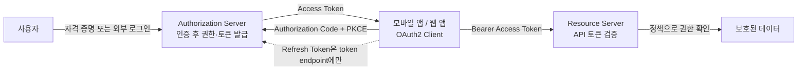
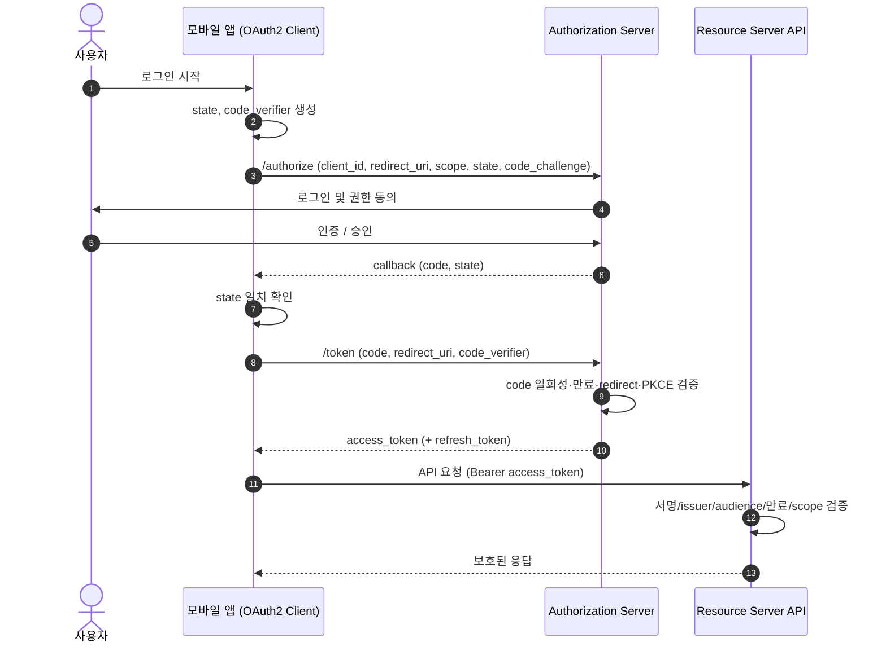
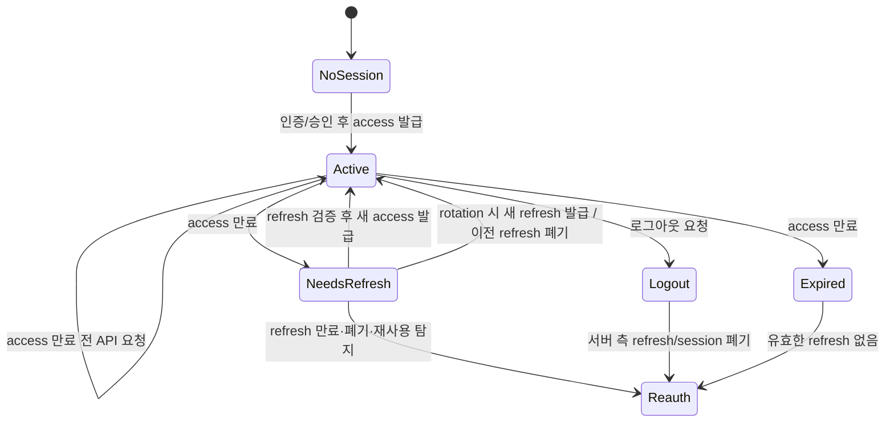

## OAuth2 와 Spring 인증 면접 준비

이 문서는 이력서의 두 경험을 구분해서 설명하도록 돕습니다.

- **Hi-Tech (Go, Oracle, Redis):** JWT access·refresh 발급과 검증, Redis 에 token ID 와 사용자 연결 정보 및 만료시간 저장, 로그아웃 시 삭제, refresh 시 토큰 교체, 최종 로그인은 Oracle 프로시저 연동
- **VMMe Pro (Kotlin, Spring Boot):** 백엔드 개발자와 API·서비스 로직을 함께 작성했고, 이력서에는 "OAuth2 인증 서버와 인증 API 도 구현·설계"했다고 기재

앞의 Go 경험만으로 OAuth2 표준의 Authorization Code 흐름이나 Spring Authorization Server 를 구현했다고 결론 내릴 수는 없습니다. VMMe Pro 에서 실제로 만든 엔드포인트, 토큰 발급 주체, OAuth2 grant, 사용한 라이브러리와 본인의 기여 범위를 확인해 답변하세요.

### 0. 큰 그림부터: identity boundary 에서 API 권한까지

인증 시스템을 이해할 때는 "토큰을 만들었다"에서 시작하지 말고, **누가 사용자의 신원을 확인하고(identity boundary), 누가 어떤 권한을 발급하며, 누가 그 권한을 검사하는가**를 따라가면 됩니다.

읽는 순서는 다음과 같습니다.

1. **Identity boundary:** 사용자가 누구인지 확인하는 지점입니다. 자체 로그인이라면 사용자 저장소/인증 API 가, 외부 로그인이면 외부 Identity Provider 가 확인할 수 있습니다. OAuth2 자체는 사용자 비밀번호 검증 방식을 정하지 않습니다.
2. **권한 발급 경계:** Authorization Server 는 client 와 요청된 권한을 확인하고 access token 을 발급합니다. 토큰은 "누구인지"만이 아니라 "어느 client 가 어떤 자원에 어느 범위로 접근할 수 있는지"를 표현합니다.
3. **자원 경계:** Resource Server 는 요청마다 토큰의 진위·유효기간·발급자·대상·scope/role 을 검증하고, 그 다음 자체 비즈니스 권한 규칙을 적용합니다. 인증된 사용자여도 모든 자원에 접근할 수 있는 것은 아닙니다.
4. **세션 연장/종료:** Refresh token 은 새 access token 을 받기 위한 장기 자격증명입니다. 로그아웃은 서버가 추적하는 세션/refresh 상태를 끝낼 수 있지만, 이미 발급된 자체 완결 JWT 가 API 에서 즉시 차단되는지는 resource server 의 폐기 확인 방식에 달려 있습니다.

**공연장 비유를 전체 흐름으로 연결하면:** 매표소가 신원을 확인하고(인증), 티켓 창구가 특정 공연·좌석에 쓸 수 있는 티켓을 발급하며(인가 위임), 입구 직원이 티켓의 진위와 유효 구역을 확인합니다(API 토큰 검증). 팔찌(JWT)는 티켓 정보를 적는 한 형식이지, 매표 절차(OAuth2) 그 자체가 아닙니다. 팔찌를 취소 목록과 대조하지 않으면 발급 후 회수 사실을 입구 직원이 모를 수도 있습니다.

#### 이력서 경험을 큰 그림에 놓기

- **Hi-Tech:** 확인된 이력서 내용은 Go API 에서 JWT access·refresh 발급·검증, Redis 에 token ID- 사용자 연결 및 만료 저장, 로그아웃 시 토큰 정보 삭제, refresh 시 교체, 최종 로그인 경로의 Oracle 프로시저 연동입니다. 이는 토큰 기반 인증 및 세션 폐기 설계 경험을 보여줍니다. OAuth2 표준 역할/endpoint 의 구현 여부는 별도로 확인해야 합니다.
- **VMMe Pro:** 이력서에는 백엔드 개발자와 Kotlin·Spring Boot API 및 서비스 로직을 함께 작성했고 "OAuth2 인증 서버와 인증 API 도 구현·설계"했다고 되어 있습니다. 지금 공유된 사실만으로는 grant, endpoint, Spring Authorization Server 사용 여부, 직접 기여한 코드 경계를 특정할 수 없습니다. 면접 전 코드·의존성·배포 구조를 확인해 어느 상자(Identity boundary, authorization server, resource server, client integration)를 맡았는지 표시하세요.

따라서 답변의 순서는 **큰 그림에서 맡은 경계 → 직접 만든 동작 → 라이브러리/협업자가 맡은 동작 → 확인되지 않은 부분**이 좋습니다. CV 문구를 먼저 부정하거나 과장이라고 인정할 필요는 없습니다. 문구에 대한 근거로 실제 설계 결정, 코드, 테스트, 협업 범위를 구체화하고, 표준 endpoint/grant 구현 등 확인되지 않은 부분만 제한해서 답합니다. Hi-Tech Go 구현을 VMMe Pro Spring OAuth2 경험으로 합쳐 말하지 않습니다.

### 1. 먼저 구분하기: 인증, 인가, OAuth2, OIDC, JWT

#### 비유

공연장에 들어가는 상황으로 생각하면 쉽습니다.

- **인증(Authentication):** 입장권의 사진과 본인이 같은 사람인지 확인합니다. "누구인가?"에 답합니다.
- **인가(Authorization):** 확인된 사람이 VIP 구역이나 backstage 에 들어갈 권한이 있는지 확인합니다. "무엇을 할 수 있는가?"에 답합니다.
- **OAuth2:** 사용자가 비밀번호를 다른 앱에 넘기지 않고, 특정 서비스가 제한된 권한으로 다른 서비스에 접근하도록 위임하는 절차입니다. 출입 권한을 위임하는 규칙에 가깝습니다.
- **OpenID Connect (OIDC):** OAuth2 위에 로그인과 사용자 신원 확인 규칙을 추가한 표준입니다. OAuth2 가 권한 위임이라면 OIDC 는 "로그인한 사용자가 누구인지" 확인하는 약속까지 더합니다.
- **JWT:** 정보를 서명해 담을 수 있는 토큰 형식입니다. JWT 는 OAuth2 자체가 아니며, OAuth2 access token 이 반드시 JWT 여야 하는 것도 아닙니다.

OAuth2 는 원래 권한 위임 프레임워크입니다. "OAuth2 로그인을 했다"고 표현하더라도 실제로 사용자 로그인과 ID 토큰을 제공하는 구조라면 OIDC 사용 여부도 살펴봐야 합니다. [RFC 6749](https://www.rfc-editor.org/rfc/rfc6749.html), [OpenID Connect Core](https://openid.net/specs/openid-connect-core-1_0.html), [RFC 7519 (JWT)](https://www.rfc-editor.org/rfc/rfc7519.html)

### 2. OAuth2 의 역할

| 역할 | 하는 일 | 공연장 비유 |
|---|---|---|
| Resource Owner | 보호된 데이터의 주인. 보통 사용자 | 관객 |
| Client | 사용자를 대신해 보호된 자원에 접근하려는 앱 | 티켓을 요청하는 앱 |
| Authorization Server | 사용자/클라이언트를 확인하고 토큰을 발급 | 권한 창구 |
| Resource Server | 토큰을 확인하고 보호된 API 를 제공 | 입장권을 검사하는 구역 |

한 제품에서 authorization server 와 resource server 가 같은 애플리케이션에 들어갈 수는 있지만, 논리적인 책임은 다릅니다. 로그인 API 가 있다는 사실만으로 해당 시스템이 OAuth2 authorization server 라고 단정할 수는 없습니다. 표준 흐름에서 클라이언트 등록, 인가 요청·응답, authorization code 교환, 토큰 발급 같은 역할을 실제로 맡는지 확인해야 합니다.

### 3. Authorization Code 흐름과 PKCE

#### 흐름을 한 문장으로

사용자가 authorization server 에서 로그인과 동의를 마치면, 앱은 짧게 쓰는 authorization code 를 받고 이를 토큰으로 교환합니다. 비밀번호를 앱에 전달하지 않는 구조입니다.

#### 단계

1. Client 가 사용자를 authorization server 의 authorization endpoint 로 보냅니다. 보통 `client_id`, `redirect_uri`, 요청 권한(scope), `state` 가 포함됩니다.
2. 사용자가 authorization server 에서 인증하고 권한을 승인합니다.
3. Authorization server 는 등록된 redirect URI 로 일회성 authorization code 를 전달합니다.
4. Client 는 token endpoint 에 code 를 보내 access token 을 교환합니다.
5. Client 는 access token 을 resource server 에 보내 API 를 호출하고, resource server 는 토큰과 권한을 검증합니다.

#### 요청을 실제로 따라가기

1. Client 는 요청마다 높은 난수의 `state`를 만들고, Authorization Code + PKCE 에서는 `code_verifier` 도 생성합니다. 앱은 verifier 와 state 를 현재 로그인 시도에 안전하게 묶습니다.
2. Client 는 `code_verifier`의 해시(`code_challenge`)를 계산해 authorization endpoint 로 보냅니다. 보통 `response_type=code`, `client_id`, 등록된 `redirect_uri`, `scope`, `state`, `code_challenge`, `code_challenge_method=S256` 이 포함됩니다.
3. Authorization Server 는 client ID 와 redirect URI 를 등록 정보와 정확히 대조하고, 요청을 거절하거나 사용자 인증 화면을 제공합니다. 사용자가 로그인했다고 해서 요청된 모든 scope 가 자동 승인되는 것은 아닙니다.
4. 인증 및 동의가 끝나면 Authorization Server 는 짧고 일회용인 code 를 `redirect_uri` 로 돌려보내며 state 를 함께 반환합니다. Client 는 callback 의 state 가 원래 저장한 값과 같은지 비교합니다. 불일치면 callback 을 처리하지 않습니다.
5. Client 는 token endpoint 에 code, 동일한 redirect URI, PKCE verifier 를 보냅니다. confidential client 라면 별도의 client authentication 도 할 수 있습니다. Authorization Server 는 code 가 발급 기록과 맞고, 미사용·미만료이며, redirect URI 및 PKCE 검증이 맞는지 확인한 뒤 token 을 발급합니다.
6. Client 는 access token 을 보호된 API 에 bearer token 으로 보냅니다. Resource Server 는 허용한 서명 키/알고리즘 또는 introspection 결과, `iss`, `aud`, 만료시간, scope 등 자신의 정책에 필요한 조건을 검증하고 API 권한을 판단합니다.
7. Access token 이 만료되면 client 는 refresh token 이 발급된 경우 token endpoint 에만 보냅니다. Authorization Server 가 이를 검증하고 새 access token 및 필요 시 새 refresh token 을 발급합니다.

`state`와 PKCE 는 서로 대체하지 않습니다. state 는 authorization 요청과 callback 의 상관관계를 확인해 CSRF/응답 주입 위험을 줄이고, PKCE 는 가로챈 authorization code 의 교환을 방어합니다. OIDC 에서는 `nonce` 가 ID token 재생/요청 상관관계 검증에 쓰일 수 있습니다. [RFC 6749](https://www.rfc-editor.org/rfc/rfc6749.html), [RFC 7636](https://www.rfc-editor.org/rfc/rfc7636.html), [RFC 9700](https://www.rfc-editor.org/rfc/rfc9700.html)

#### Sequence diagram: Code + PKCE

그림에서 중요한 경계는 사용자 인증이 Authorization Server 에서 끝나고, API 요청 권한은 Resource Server 가 다시 검사한다는 점입니다. Client 는 토큰을 운반하지만 사용자 비밀번호를 받아 API 에 전달하는 역할은 하지 않습니다.

Authorization Code 는 짧은 시간만 유효하고 한 번만 교환되도록 합니다. `state`는 요청과 callback 을 연결해 위조된 callback 을 막는 데 사용합니다. OAuth2 의 표준 역할과 흐름은 [RFC 6749](https://www.rfc-editor.org/rfc/rfc6749.html) 에 정의돼 있습니다.

#### PKCE 는 왜 필요한가?

모바일 앱이나 브라우저 앱은 client secret 을 안전하게 감출 수 없는 public client 입니다. PKCE("픽시"라고 읽음)는 앱이 매번 임의의 `code_verifier`를 만들고 그 요약인 `code_challenge` 를 authorization 요청에 보냅니다. 토큰 교환 때 verifier 도 제출해야 하므로, 중간에서 authorization code 만 훔친 공격자는 토큰으로 바꾸기 어렵습니다.

비유하면 코드 교환표를 발급받을 때 미리 봉투의 지문(code challenge)을 등록하고, 실제 교환 때 원래 표식(code verifier)을 보여줘야 하는 방식입니다. PKCE 는 client secret 을 대체하는 비밀 값이라기보다, authorization code 가로채기 공격을 줄이는 방어입니다. [RFC 7636](https://www.rfc-editor.org/rfc/rfc7636.html), [OAuth 2.0 Security Best Current Practice, RFC 9700](https://www.rfc-editor.org/rfc/rfc9700.html)

>모바일 앱은 public client 이므로 client secret 을 앱에 넣어 안전하다고 간주할 수 없습니다. Authorization Code + PKCE 를 사용하고, callback 의 `state` 도 검증해야 합니다.

### 4. Access token, refresh token, 로그아웃·폐기

- **Access token:** Resource server 에 보호된 API 접근 권한을 제시하는 짧은 수명 자격증명입니다.
- **Refresh token:** 새 access token 을 얻는 데 사용하는 더 민감한 장기 자격증명입니다. API 호출에 일반적으로 보내지 않고 token endpoint 에만 사용하며, 저장과 유출 방어를 더 신중하게 해야 합니다.
- **Refresh rotation:** refresh 요청마다 새 refresh token 을 주고 이전 토큰을 폐기하는 방식입니다. 이미 사용한 토큰이 다시 제출되면 탈취 가능성을 탐지하고 해당 토큰 계열을 폐기할 수 있습니다.
- **폐기와 로그아웃:** 서버가 refresh token 이나 세션 정보를 삭제하면 이후 재발급을 막을 수 있습니다. 이미 발급된 자체 완결형 JWT access token 은 만료 전까지 검증될 수 있으므로, 즉시 무효화를 원하면 서버 측 denylist/session 상태 확인, 짧은 만료시간 등의 설계가 필요합니다.

Hi-Tech 이력서의 Redis 저장은 token ID 와 사용자 연결 정보를 서버가 추적해 로그아웃 시 해당 토큰 정보를 삭제할 수 있었다는 설명과 잘 맞습니다. 다만 정확한 무효화 보장은 구현에 달려 있습니다. Resource server 가 매 요청마다 Redis 상태를 확인했는지, refresh 만 확인했는지, access JWT 자체의 만료 전 차단도 했는지 구분해서 말하세요. [RFC 6749, section 1.5](https://www.rfc-editor.org/rfc/rfc6749.html#section-1.5), [RFC 9700](https://www.rfc-editor.org/rfc/rfc9700.html)

#### Lifecycle diagram: 발급, 갱신, 폐기

JWT access token 이 자체 검증형이면 `Logout`에서 서버 측 refresh/session 을 없애도 access token 은 resource server 가 별도 폐기 상태를 확인하지 않는 한 `Expired` 까지 통과할 수 있습니다. 반면 opaque token 을 introspection 하거나 매 요청에 denylist/session 상태를 확인하면 즉시 차단을 강화할 수 있지만, 네트워크/저장소 의존성과 지연이 생깁니다. 설계는 "즉시 폐기 요구"와 "API 요청의 stateless 검증" 사이에서 결정합니다.

### 5. Spring Security 와 Spring Authorization Server

Spring 면접에서는 아래 구성요소의 역할을 구분해 말할 수 있어야 합니다.

- **Spring Security:** 애플리케이션의 인증·인가 기반 기능을 제공합니다. 로그인 방식, 요청별 접근 규칙, 인증 객체와 보안 필터 체인 등을 구성합니다.
- **OAuth2 Resource Server 지원:** API 서버에서 bearer token 을 읽고 검증해 접근을 통제합니다. JWT 검증 또는 opaque token introspection 방식을 사용할 수 있습니다.
- **Spring Authorization Server:** OAuth2 authorization server 를 만들기 위한 별도 프로젝트입니다. OAuth2 프로토콜 엔드포인트와 authorization/token 처리 등을 구성하는 기반을 제공합니다. Spring Security 자체와 같은 이름의 기능이 아닙니다.
- **Spring Boot:** 자동 구성과 애플리케이션 구동 편의를 제공합니다. Boot 를 썼다고 OAuth2 서버가 자동으로 완성되는 것은 아닙니다.

#### Spring Security 의 요청 처리 mental model

Servlet 애플리케이션에서는 요청이 `FilterChainProxy`를 거쳐 적절한 `SecurityFilterChain`으로 들어갑니다. 인증 필터는 자격증명을 `AuthenticationManager`에 넘기고, 적절한 `AuthenticationProvider`가 검증합니다. 성공한 인증은 `SecurityContext` 에 반영되고, 이후 authorization 단계에서 URL/메서드 정책을 검사합니다. Resource Server 의 bearer token 필터도 이 보안 체인 안에서 token 을 읽고 JWT decoder 또는 opaque token introspection 을 통해 검증합니다. 컨트롤러까지 도달한 뒤 별도 도메인 규칙(예: 이 사용자가 이 예약을 수정할 수 있는가)도 확인해야 합니다. [Spring Security Servlet Architecture](https://docs.spring.io/spring-security/reference/servlet/architecture.html), [Authentication Architecture](https://docs.spring.io/spring-security/reference/servlet/authentication/architecture.html)

```mermaid
flowchart LR
  R[HTTP Request] --> F[FilterChainProxy]
  F --> SC[선택된 SecurityFilterChain]
  SC --> BT[BearerTokenAuthenticationFilter]
  BT --> AM[AuthenticationManager]
  AM --> P[JwtAuthenticationProvider]
  P --> V[JwtDecoder / 검증기\n서명·iss·aud·exp]
  V --> CTX[SecurityContext에 인증 반영]
  CTX --> AUTH[Authorization 단계\nURL·메서드 권한]
  AUTH --> CTRL[Controller / Service]
  CTRL --> DOMAIN[도메인 권한·자원 소유권 확인]
```

실제 체인에는 CORS, CSRF, 예외 처리 등 다른 필터가 구성에 따라 들어갑니다. 다이어그램은 Resource Server 의 bearer JWT 요청을 단순화했습니다. 인증 성공과 비즈니스 권한 허용은 별개이며, `SecurityContext` 가 만들어졌다는 이유만으로 Controller 의 모든 동작이 허용되는 것은 아닙니다.

#### Spring Authorization Server 의 책임 모델

Authorization Server 설정은 "JWT 를 만드는 클래스 하나"가 아니라 OAuth2 protocol endpoint 와 상태/정책을 연결합니다. 공식 구성 모델에는 authorization/token endpoints, client 등록 저장소, authorization 저장소, token generator, issuer 및 signing key 같은 책임이 있습니다. 기본 구성은 여러 OAuth2 endpoint 를 설정할 수 있지만, 실제 앱에서 켠 기능·버전·사용자 정의는 별도입니다. OIDC endpoint 는 별도 설정이 필요할 수 있습니다. 이 설명은 프레임워크의 구조를 설명하는 것이며, VMMe Pro 에서 이를 사용했다는 주장은 아닙니다. [Spring Authorization Server Configuration Model](https://docs.spring.io/spring-authorization-server/reference/configuration-model.html), [Core Model / Components](https://docs.spring.io/spring-authorization-server/reference/core-model-components.html)

면접 전에 VMMe Pro 에서 실제로 사용한 라이브러리·버전을 확인하세요. Spring Authorization Server 를 썼다면 의존성, `SecurityFilterChain`, 등록한 `RegisteredClient`, issuer/키 설정, grant 와 endpoint 중 직접 설정·구현한 범위를 설명합니다. 일반 Spring Security 설정이나 JWT 발급 API 를 직접 작성했다면 그 사실대로 표현하고, 표준 OAuth2 authorization server 전체를 구현했다고 부풀리지 않습니다. [Spring Security Reference](https://docs.spring.io/spring-security/reference/), [Spring Authorization Server Reference](https://docs.spring.io/spring-authorization-server/reference/)

### 6. 이력서에서 사실 확인이 필요한 지점

면접 전에 코드를 보거나 기억을 확인해 아래 질문에 짧게 답을 적어두세요.

1. VMMe Pro 의 "OAuth2 인증 서버"에서 실제로 어떤 프로토콜 endpoint 를 만들거나 설정했나요? `/authorize`, `/token`, discovery, JWKS, revocation 등 중 무엇이 있었나요?
2. 어떤 grant 를 사용했나요? Authorization Code + PKCE 였나요, 다른 흐름이었나요?
3. OAuth2/OIDC 기능은 라이브러리가 제공했고 본인은 앱 연동, 보안 설정, API, 토큰 처리 중 무엇을 맡았나요?
4. VMMe Pro 와 Hi-Tech 의 인증 구조는 서로 다른 프로젝트인가요? 기술·흐름을 섞어 말하지 않도록 경계를 정리했나요?
5. Hi-Tech 의 JWT 발급·검증에서 서명 알고리즘과 key 관리, claim, 만료시간, refresh token 저장 방식은 어땠나요?
6. Redis 에는 access 와 refresh 중 무엇의 ID 를 저장했나요? 매 요청에 Redis 를 조회했나요? TTL 은 토큰 만료와 어떻게 맞췄나요?
7. 로그아웃은 어떤 토큰을 폐기했나요? refresh rotation 중 이미 사용된 refresh token 의 재사용은 탐지했나요?
8. "최종 로그인 경로는 Oracle 프로시저 연동"은 프로시저가 사용자 자격을 검증하고 Go 서버가 토큰을 발급했다는 뜻인가요? 데이터 흐름을 정확히 복원하세요.

기억이 불확실하면 "정확한 endpoint 구성은 확인이 필요하지만, 제가 직접 한 일은 …"처럼 범위를 먼저 말합니다. 구현하지 않은 PKCE, OAuth grant, Spring Authorization Server 설정을 본인 경험으로 주장할 필요는 없습니다.

### 7. 예상 질문과 면접 답변 예시

#### Q1. OAuth2 와 JWT 는 어떤 관계인가요?

**답변 예시:** OAuth2 는 클라이언트가 사용자 대신 제한된 권한으로 자원에 접근하도록 하는 권한 위임 프레임워크입니다. JWT 는 claim 을 담고 서명할 수 있는 토큰 형식입니다. OAuth2 access token 으로 JWT 를 쓸 수 있지만 opaque token 도 가능하고, JWT 를 쓴다고 OAuth2 가 되는 것도 아닙니다. 로그인에서 사용자 신원 정보까지 표준화하려면 OIDC 가 함께 쓰일 수 있습니다.

#### Q2. 이력서에 OAuth2 인증 서버를 구현했다고 했는데, 어디까지 직접 했나요?

**답변 예시 — 실제 범위로 채워 말하기:** VMMe Pro 에서 백엔드 개발자와 Kotlin·Spring Boot API 와 서비스 로직을 함께 작성했고, 인증 서버와 인증 API 설계·구현에도 참여했습니다. 제가 직접 맡은 부분은 **[실제 구현/설정/연동한 endpoint 와 로직]**이고, **[라이브러리나 다른 팀원이 맡은 부분]**은 구분해서 설명드릴 수 있습니다. Hi-Tech 에서는 별도 Go API 에서 JWT access·refresh 발급·검증, Redis 의 token ID- 사용자 매핑과 만료 관리, 로그아웃 삭제와 refresh 교체를 구현했습니다. 두 프로젝트의 구조는 다르므로 지금 말씀드린 범위를 나눠서 설명하겠습니다.

대괄호 부분을 실제 사실로 채우세요. "전체 OAuth2 표준 서버를 처음부터 구현했다"는 사실이 아닐 경우 그렇게 말하지 않습니다.

#### Q3. OAuth2 authorization code 흐름을 설명해 보세요

**답변 예시:** Client 가 사용자를 authorization server 로 보내고 사용자가 인증·동의하면, redirect URI 로 일회성 authorization code 가 돌아옵니다. Client 는 그 code 를 token endpoint 에서 access token 으로 교환하고, resource server API 요청에 bearer token 을 보냅니다. 모바일처럼 secret 을 숨길 수 없는 public client 는 PKCE 를 적용하고 callback 의 state 를 검증하겠습니다.

#### Q4. PKCE 가 client secret 을 대신하나요?

**답변 예시:** 안전한 client secret 으로 앱을 인증하는 용도와 완전히 같다고 보지는 않습니다. 모바일 앱은 패키지에 넣은 secret 을 추출할 수 있어 confidential client 처럼 취급하기 어렵습니다. PKCE 는 verifier 와 challenge 를 연결해 authorization code 를 가로챈 공격자가 토큰을 교환하지 못하게 돕습니다. 앱에는 실제 비밀값을 넣지 않고 Authorization Code + PKCE 를 사용하겠습니다.

#### Q5. Redis 에 토큰 정보를 저장한 이유는 무엇인가요?

**답변 예시:** 자체 완결형 JWT 만 쓰면 서버가 발급 뒤 세션 상태를 모를 수 있어, 만료 전 로그아웃이나 강제 폐기가 어려워집니다. 당시에는 Redis 에 token ID 와 사용자 연결 정보를 TTL 과 함께 저장해 유효 토큰을 추적하고, 로그아웃 때 서버 측 상태를 삭제하도록 했습니다. 실제 요청에서 그 상태를 어떻게 확인했는지와 access token 까지 즉시 차단했는지는 구현 범위를 정확히 말씀드리겠습니다. Redis 저장만으로 모든 JWT 가 자동 폐기되는 것은 아닙니다.

#### Q6. Refresh token 을 rotation 하는 이유와 재사용 대응은?

**답변 예시:** refresh token 은 access token 보다 수명이 길고 재발급 권한이 있어 유출 영향이 큽니다. 새 토큰을 발급할 때 기존 refresh token 을 폐기하면 탈취된 이전 토큰의 재사용 기회를 줄일 수 있습니다. 재사용 탐지를 구현했다면 해당 세션 또는 토큰 계열을 폐기한다고 설명하겠습니다. Hi-Tech 에서는 refresh 때 새 토큰으로 교체했으며, 재사용 탐지의 구체 동작은 실제 구현을 확인해 답하겠습니다.

#### Q7. JWT access token 을 로그아웃 즉시 무효화할 수 있나요?

**답변 예시:** JWT 서명과 만료만 검증하는 stateless 구조라면 발급 서버가 로그아웃 사실을 각 resource server 에 알지 못하므로 만료 전까지 유효할 수 있습니다. 즉시 차단이 필요하면 요청마다 서버 측 세션 또는 denylist 를 확인하거나, 짧은 access token 수명과 폐기 가능한 refresh token 을 조합합니다. 어떤 방식을 택할지는 보안 요구와 매 요청의 저장소 조회 비용을 함께 고려하겠습니다.

#### Q8. Spring Security 와 Spring Authorization Server 는 어떻게 다른가요?

**답변 예시:** Spring Security 는 앱의 인증·인가와 보안 필터 체인 같은 기반을 제공합니다. Resource Server 구성으로 API 가 bearer token 을 검증할 수도 있습니다. Spring Authorization Server 는 OAuth2 authorization server 를 구축하는 별도 프로젝트입니다. Spring Boot 는 설정과 실행을 돕지만 OAuth2 서버 역할을 자동으로 구현해 주는 것은 아닙니다. 제가 참여한 프로젝트에서 어느 모듈과 설정을 썼는지 확인해 구체적으로 말씀드리겠습니다.

#### Q9. OAuth2 와 OIDC 는 어떻게 다른가요?

**답변 예시:** OAuth2 의 핵심은 권한 위임이고, OAuth2 만으로 표준화된 로그인 신원 정보를 정의하지는 않습니다. OIDC 는 OAuth2 위에 ID token 과 사용자 인증 관련 규칙을 더해 로그인 신원을 확인하게 합니다. 그래서 사용자의 로그인 결과와 profile 표준이 필요하면 OIDC 를 사용하고, API 접근 위임만 필요하면 OAuth2 관점으로 설명합니다.

#### Q10. 직접 운영해 보지 않은 흐름이나 설정을 물으면 어떻게 답하나요?

**답변 예시:** 그 구성은 직접 운영해 보지 않았습니다. 제가 구현한 범위는 **[사실]**이고, 원리는 **[알고 있는 표준 동작]**으로 이해하고 있습니다. 실제 적용한다면 지원 grant 와 callback 검증, token 수명·회전, key 관리, 로그아웃 시 폐기 동작을 코드와 테스트로 확인하겠습니다.

### 8. 빠른 복습 체크리스트

- [ ] 인증과 인가를 예시로 구분해 말한다.
- [ ] OAuth2, OIDC, JWT 가 서로 다른 층위의 개념임을 설명한다.
- [ ] Resource Owner, Client, Authorization Server, Resource Server 역할을 말한다.
- [ ] Authorization Code + PKCE 의 code, challenge/verifier, state 를 설명한다.
- [ ] access token 과 refresh token 의 쓰임·수명·보호 차이를 설명한다.
- [ ] JWT 로그아웃과 서버 측 폐기 상태의 관계를 설명한다.
- [ ] Spring Security, Resource Server, Spring Authorization Server 의 차이를 설명한다.
- [ ] CV 문구에 대해 본인이 직접 한 일과 협업자/라이브러리가 맡은 일을 구분한다.
- [ ] Hi-Tech Go 인증 경험과 VMMe Pro Spring 인증 경험을 섞지 않는다.

### 8.1. 보안 공격·실패 상황별 사고법

아래는 설계 질문에서 "무엇이 위험한가 → 어느 경계에서 막는가 → 실패하면 무엇을 하는가"로 답하기 위한 항목입니다. 이 목록은 면접 대비용 설계 지식이며, CV 에 적힌 구현으로 추정하면 안 됩니다.

| 공격/실패 | 위험과 방어 | 면접에서 짚을 판단 |
|---|---|---|
| Redirect URI 조작·open redirect | 공격자가 code 를 자기 endpoint 로 빼돌릴 수 있습니다. redirect URI 는 등록된 값과 정확히 일치시켜 검증하고 임의 wildcard/사용자 입력 redirect 를 피합니다. | callback 검증은 authorization server 의 책임이며 client 의 사후 검사만 믿지 않습니다. |
| Callback CSRF / 응답 주입 | 공격자가 다른 로그인 시도에서 얻은 응답을 피해자 앱에 주입할 수 있습니다. 요청별 `state` 를 저장하고 callback 에서 동일성을 확인합니다. | state 를 재사용하거나 검증하지 않는다면 callback 을 처리하지 않습니다. |
| Authorization code 가로채기 | 모바일 custom scheme 나 브라우저 callback 에서 code 가 노출될 수 있습니다. PKCE 를 강제하고 code 를 일회용·짧은 수명으로 둡니다. | PKCE 는 code 교환을 묶으며, TLS 와 안전한 redirect 설정도 여전히 필요합니다. |
| Login CSRF / authorization server mix-up | 사용자가 공격자 계정으로 로그인되거나 잘못된 issuer 와 code 가 연결될 수 있습니다. state, issuer 식별, 정확한 redirect 및 issuer 검증을 사용합니다. | 멀티 issuer/여러 authorization server 연동 시 응답의 issuer 와 요청 대상을 연결합니다. |
| Bearer token 유출 | bearer token 을 가진 쪽은 소유자로 취급될 수 있습니다. TLS 를 쓰고, 토큰을 URL·로그·분석 이벤트에 남기지 않으며, client 의 안전한 저장소를 사용합니다. | access token 을 제한된 scope/audience 와 짧은 수명으로 발급하고, 민감도에 따라 sender-constrained token 을 검토합니다. |
| JWT 검증 혼동 | `alg` 를 무비판적으로 허용하거나 `iss`, `aud`, 만료를 놓치면 다른 용도의 토큰을 받아들일 수 있습니다. 신뢰된 key 와 알고리즘을 고정하고 필수 claim 과 용도를 검증합니다. | 서명 검증 성공은 권한 결정의 전부가 아닙니다. scope, role, 리소스 소유권을 별도로 확인합니다. [RFC 8725](https://www.rfc-editor.org/rfc/rfc8725.html) |
| Refresh token 탈취·재사용 | 장기 재발급 권한이 탈취될 수 있습니다. rotation 또는 sender-constraining, 저장 보호, 재사용 탐지, 세션 단위 폐기를 고려합니다. | 동시 refresh 요청의 원자성 및 재사용 시 폐기 범위를 설명합니다. |
| Redis 장애·데이터 유실 | 폐기 목록/세션 상태를 읽을 수 없거나 사라지면 폐기 토큰 허용 여부에 영향을 줍니다. | fail-open/fail-closed 정책의 보안·가용성 trade-off, TTL 정합성, 장애 감지와 복구를 말합니다. |
| Key 회전·미확인 `kid` | 새 서명 키 배포 시 resource server 가 key 를 갱신하기 전 검증 실패가 날 수 있습니다. JWK Set 배포, key overlap, 캐시 갱신/알 수 없는 `kid` 처리 정책을 설계합니다. | 알 수 없는 key 일 때 무조건 토큰을 허용하거나 무제한 재요청하는 동작은 피합니다. |
| Access token 만료와 서버 시각 차이 | 시계 차이로 유효 토큰이 조기 거절되거나 만료 토큰을 더 받게 될 수 있습니다. 동기화된 시각과 제한적인 clock skew 를 적용합니다. | 허용 skew 가 과도하면 만료 경계가 느슨해짐을 설명합니다. |
| Scope/role 과다 발급 | 사용자가 원한 기능보다 넓은 접근 권한이 유출 피해를 키웁니다. 필요한 최소 scope 를 요청·동의·검증하고 서버가 audience 를 제한합니다. | token claim 만으로 객체 단위 권한을 추정하지 말고 도메인 소유권을 확인합니다. |

RFC 9700 은 최신 OAuth2 보안 모범 관행으로 PKCE, redirect 처리, refresh token replay 방어 등 여러 위협을 다룹니다. JWT 검증의 구체 권고는 [RFC 8725](https://www.rfc-editor.org/rfc/rfc8725.html) 를 참고하세요.

#### 보안 질문 1 — "state 와 PKCE 를 쓰면 로그인 흐름은 안전하다고 볼 수 있나요?"

**짧은 답변:** 둘 다 필요하지만 전체 보안을 보장하지 않습니다. Redirect URI, TLS, token 저장과 유출 방지, issuer·audience 검증까지 경계별로 확인해야 합니다.

**경험 중심 답변:** 제가 VMMe Pro 에서 실제 적용한 state/PKCE 를 확인해 답하겠습니다. 일반적으로 state 는 요청과 callback 을 묶고 PKCE 는 code 교환을 보호합니다. 여기에 등록된 redirect URI, HTTPS, token 의 안전한 보관, resource server 의 iss·aud·만료·scope 검증이 함께 필요합니다.

**꼬리질문 1 — "PKCE 가 있으니 state 는 빼도 되지 않나요?"**

**답변:** 둘은 서로 다른 문제를 다룹니다. PKCE 는 가로챈 code 의 교환을 방어하고 state 는 callback 이 내가 시작한 로그인 요청에 대응하는지 확인합니다. 최신 보안 권고에서 PKCE 가 일부 CSRF 방어를 제공할 수 있어도, 구현의 안전한 상관관계 검증과 OIDC 의 nonce 등 다른 요구를 함께 판단해야 합니다. 적용 프로토콜과 라이브러리 권고를 따르겠습니다.

**꼬리질문 2 — "state 를 검증하지 않아도 redirect URI 가 등록돼 있으면 충분하지 않나요?"**

**답변:** 아닙니다. redirect URI 검증은 code 가 승인된 callback 으로 전달되는지를 제한하고, state 는 해당 callback 응답이 특정 사용자의 시작한 인증 시도와 연결되는지 확인합니다. 한 검증이 다른 검증을 대체하지 않습니다. callback 에 state 가 없거나 일치하지 않으면 해당 응답을 거부합니다.

#### 보안 질문 2 — "JWT 서명이 맞으면 API 접근을 허용해도 되나요?"

**짧은 답변:** 아닙니다. 서명 외에도 신뢰한 issuer, audience, 유효기간, 허용 알고리즘을 확인하고 scope 와 도메인 권한도 검사해야 합니다.

**경험 중심 답변:** Hi-Tech 에서 JWT 를 검증한 경험은 있지만 실제로 검증한 claim 과 알고리즘은 코드에 근거해 답하겠습니다. 일반적인 API 에서는 서명이 유효해도 다른 서비스용 토큰일 수 있으므로 `iss`, `aud`, `exp` 등을 확인하고, 요청 사용자가 대상 데이터에 접근할 수 있는지는 별도 권한 규칙으로 확인합니다.

**꼬리질문 1 — "JWT 의 role 이 `ADMIN` 이면 바로 허용하면 안 되나요?"**

**답변:** 그 claim 이 신뢰된 issuer 가 서명한 올바른 대상용 토큰에 들어 있는지 먼저 검증합니다. 그 뒤에도 요청 대상의 tenant/소유권, 현재 권한 정책, 필요한 최소 역할을 확인해야 합니다. 오래된 role claim 이 즉시 반영되지 않는 문제도 토큰 수명·폐기 설계로 고려합니다.

**꼬리질문 2 — "공개키 서명 검증이 통과했는데 audience 검증은 왜 따로 하죠?"**

**답변:** 공개키는 issuer 가 서명한 토큰인지 검증할 뿐, 그 토큰이 현재 API 를 위해 발급된 것인지는 보장하지 않습니다. 다른 서비스용으로 발급된 유효 JWT 가 잘못 받아들여지지 않도록 audience 를 확인합니다. 토큰의 발급자, 대상, 용도는 모두 정책의 일부입니다.

### 9. 3 단계 면접 연습: 기본 답변과 꼬리질문

각 주제는 **첫 답변 → 꼬리질문 1 → 꼬리질문 2** 순서로 연습하세요. 짧은 답변은 20~30 초, 경험 중심 답변은 45~75 초 정도가 적당합니다. 뒤의 꼬리질문은 답변을 검증하거나 반례를 묻는 면접관의 압박을 포함합니다. 대괄호는 실제 구현을 확인한 뒤 채우고, 확인되지 않은 세부사항은 만들어 넣지 마세요.

#### A. OAuth2, OIDC, JWT 의 차이

**짧은 답변:** OAuth2 는 권한 위임 절차, OIDC 는 그 위에 로그인 신원 확인을 더한 규격, JWT 는 claim 을 담을 수 있는 토큰 형식입니다. 서로 대체어가 아닙니다.

**경험 중심 답변:** Hi-Tech 에서 JWT access·refresh token 을 발급·검증했고 Redis 로 token ID 와 사용자 연결 상태를 관리했습니다. 이 구현 경험이 있다고 해서 그 자체로 OAuth2 표준 authorization server 나 OIDC provider 를 구현했다고 볼 수는 없습니다. VMMe Pro 이력서의 OAuth2 기여는 실제 사용한 라이브러리와 endpoint 를 기준으로 별도로 설명하겠습니다.

**꼬리질문 1 — "JWT 를 썼으니 OAuth2 구현 경험 아닌가요?"**

**답변:** JWT 는 토큰의 표현 형식이고 OAuth2 는 토큰을 발급·전달하고 권한을 위임하는 규칙입니다. JWT 를 자체 로그인 API 에서 발급해도 OAuth2 흐름이 포함되지 않을 수 있습니다. 제가 구현한 Hi-Tech 의 흐름은 JWT 기반 인증·세션 관리였고, 표준 authorization code grant 를 구현했는지는 별도 사실로 답하겠습니다.

**꼬리질문 2 — "그렇다면 이력서에 OAuth2 인증 서버라고 쓴 건 과장 아닌가요?"**

**답변:** 그 표현은 실제 구현 범위와 정확히 일치하는지 확인할 필요가 있습니다. VMMe Pro 에서 **[직접 맡은 인증 서버 기능]**을 설계·구현했고 **[프레임워크/동료가 담당한 범위]**가 따로 있습니다. 표준 authorization endpoint 와 token endpoint 까지 만들거나 설정하지 않았다면, 전체 표준 서버를 혼자 구현했다고 주장하지 않겠습니다. 제 역할을 구체적인 컴포넌트와 코드로 설명드리겠습니다.

#### B. Authorization Code 흐름

**짧은 답변:** 사용자는 authorization server 에서 인증하고 동의합니다. Client 는 redirect 로 받은 일회성 code 를 token endpoint 에서 access token 으로 교환해 resource server API 를 호출합니다.

**경험 중심 답변:** VMMe Pro 의 실제 흐름이 Authorization Code 였는지는 확인한 뒤 말하겠습니다. 표준 흐름 자체에서는 앱이 사용자 비밀번호를 직접 받지 않고 authorization server 가 code 를 발급합니다. Client 는 등록된 redirect URI 와 code 를 검증해 토큰을 교환하고, resource server 가 API 요청의 토큰을 검증합니다.

**꼬리질문 1 — "왜 access token 을 redirect URL 로 바로 보내지 않나요?"**

**답변:** URL 이나 브라우저 기록, 중간 경로에 노출될 위험을 줄이고 code 를 token endpoint 에서 교환하도록 하기 위해서입니다. Code 는 짧게 유효하고 한 번만 사용되며, public client 에서는 PKCE 도 함께 적용합니다.

**꼬리질문 2 — "code 가 탈취되면 결국 토큰을 얻을 수 있지 않나요?"**

**답변:** code 만으로 교환하기 어렵도록 PKCE verifier 를 요구합니다. 또한 redirect URI 를 정확히 등록·검증하고, code 를 짧은 시간만 유효하게 한 번 사용하도록 처리하며, 요청과 callback 은 state 로 연결합니다. 실제 프로젝트에서 이 항목들이 어떻게 적용됐는지는 구성과 코드로 확인해 답하겠습니다.

#### C. PKCE 와 public client

**짧은 답변:** 모바일 앱은 client secret 을 안전하게 숨길 수 없는 public client 입니다. PKCE 는 매 요청에 만든 verifier 와 challenge 를 연결해 authorization code 만 탈취한 공격자의 토큰 교환을 막습니다.

**경험 중심 답변:** 제가 작업한 앱이 PKCE 를 실제 사용했는지는 확인해 말씀드리겠습니다. 설계 시 모바일 앱에 client secret 을 박아 두는 것은 안전하지 않으며, Authorization Code + PKCE 를 기본 선택으로 검토해야 합니다. PKCE 는 code 가로채기 방어이며, 앱에 비밀값을 안전하게 넣어주는 기능은 아닙니다.

**꼬리질문 1 — "PKCE verifier 를 앱에 두면 그것도 탈취되는 것 아닌가요?"**

**답변:** verifier 는 장기 client secret 이 아니라 authorization 요청마다 생성해 해당 로그인 트랜잭션 동안 보관하는 값입니다. 외부에 노출되지 않도록 저장·전달을 제한하고, 토큰 교환 뒤 폐기합니다. verifier 가 유출되면 보호가 약해지므로 PKCE 만으로 모든 모바일 보안 문제가 해결된다고 말하지 않겠습니다.

**꼬리질문 2 — "그러면 client authentication 은 전혀 필요 없나요?"**

**답변:** PKCE 와 client authentication 은 목적이 다릅니다. Public client 는 비밀을 안전하게 보유할 수 없으므로 PKCE 로 authorization code 탈취를 방어합니다. confidential client 는 서버 쪽에 안전하게 보관한 자격증명으로 client 인증을 추가할 수 있습니다. 실제 적용은 client 종류와 provider 요구사항을 기준으로 정합니다.

#### D. 이력서의 "OAuth2 인증 서버 구현·설계" 주장

**짧은 답변:** Kotlin·Spring Boot API 와 서비스 로직을 백엔드 개발자와 함께 작성했고 인증 서버·인증 API 에도 참여했습니다. 직접 한 endpoint 와 설정, 프레임워크가 제공한 기능을 나눠 설명하겠습니다.

**경험 중심 답변:** VMMe Pro 에서 제가 맡은 실제 범위는 **[구현한 API/설정/연동]**입니다. 함께 작업한 백엔드 개발자와 역할을 나누었고, **[라이브러리/공통 모듈이 맡은 프로토콜 처리]**는 제가 처음부터 작성한 코드와 구분하겠습니다. Hi-Tech 에서는 Go 로 JWT access·refresh 발급·검증, Redis token 상태, 로그아웃 삭제와 refresh 교체를 구현했습니다. 두 프로젝트는 서로 다른 경험으로 설명합니다.

**꼬리질문 1 — "구체적으로 authorization endpoint 와 token endpoint 를 직접 만들었나요?"**

**답변:** 확인 가능한 범위로 답하겠습니다. 제가 직접 작성하거나 설정한 것은 **[정확한 endpoint 와 책임]**이고, **[라이브러리/동료가 맡은 기능]**은 별도입니다. 실제로 해당 endpoint 를 만들지 않았다면 그렇게 분명히 말씀드리고, 인증 API 구현 경험과 표준 OAuth2 서버 구성 경험을 구분하겠습니다.

**꼬리질문 2 — "그럼 인증 서버를 구현했다고 쓰면 면접관이 오해하지 않겠어요?"**

**답변:** 그렇게 읽힐 수 있다는 점을 인정합니다. 제가 참여한 범위를 구체적으로 설명하겠습니다. 만약 문구가 실제 기여보다 넓게 읽힌다면 이력서 표현도 "인증 서버 및 인증 API 설계·구현에 참여"처럼 정확한 범위에 맞춰 조정하는 게 맞습니다. 면접에서는 역할, 의사결정, 코드 소유 범위를 숨기지 않겠습니다.

#### E. Redis token 상태, 로그아웃, JWT 즉시 폐기

**짧은 답변:** JWT 는 서명과 만료만 검사하면 서버 측 세션 상태를 모를 수 있습니다. Hi-Tech 에서는 Redis 에 token ID- 사용자 연결과 만료를 저장하고 로그아웃 때 관련 상태를 삭제했습니다. 매 요청에서 그 상태를 검사했는지에 따라 access token 의 즉시 무효화 여부가 달라집니다.

**경험 중심 답변:** 이력서에 기재한 구현은 Redis 에 token ID 와 사용자 연결 정보를 만료시간과 함께 저장하고, 로그아웃 때 토큰 정보를 지운 것입니다. 실제로 access 요청마다 Redis 를 조회했는지, refresh 만 조회했는지, JWT 서명·만료 외의 폐기 확인을 어디서 했는지는 코드나 당시 흐름을 확인해 정확히 답하겠습니다. Redis 에서 값을 삭제했다는 사실만으로 모든 이미 발급된 JWT 가 자동 무효화되는 것은 아닙니다.

**꼬리질문 1 — "Redis 에서 지웠는데 왜 토큰이 계속 동작할 수 있나요?"**

**답변:** Resource server 가 JWT 서명과 만료만 확인하고 Redis 상태를 확인하지 않으면, Redis 에서 삭제한 사실을 알 수 없습니다. 이미 발급된 토큰은 만료 전까지 받아들여질 수 있습니다. 즉시 차단하려면 매 요청에 상태를 확인하거나 별도 폐기 목록을 검사해야 합니다.

**꼬리질문 2 — "매 요청 Redis 조회는 성능과 가용성 문제 아닌가요?"**

**답변:** 맞습니다. 강한 즉시 폐기 보장과 완전한 stateless 검증 사이에는 비용 차이가 있습니다. 위험도에 따라 짧은 access token 수명과 refresh 폐기만으로 충분한지, Redis 확인을 둘지 선택합니다. Redis 장애 시 fail-open 은 무효 토큰을 통과시킬 수 있고 fail-closed 는 인증 요청이 실패하므로, 시스템 보안 요구에 맞는 정책과 모니터링을 정해야 합니다. 제가 당시 사용한 정책은 확인된 사실만 말씀드리겠습니다.

#### F. Refresh token rotation

**짧은 답변:** refresh token 은 재발급 권한이 있어 보호가 중요합니다. rotation 은 refresh 때 새 토큰을 발급하고 이전 토큰을 폐기해 이전 토큰의 반복 사용을 막습니다.

**경험 중심 답변:** Hi-Tech 에서 refresh 때 새 토큰으로 교체하는 흐름을 구현했습니다. 재사용된 이전 토큰을 탐지해 세션 계열 전체를 폐기했는지는 별도 구현 사항이므로 확인해 답하겠습니다. 새 토큰 저장, 이전 토큰 폐기, TTL 설정이 함께 맞아야 rotation 이 의미가 있습니다.

**꼬리질문 1 — "두 요청이 거의 동시에 같은 refresh token 으로 들어오면요?"**

**답변:** 둘 다 성공하면 두 개의 유효한 후속 토큰이 생길 수 있습니다. 원자적으로 한 요청만 토큰을 교체하도록 처리하고, 이미 소비된 토큰의 재사용을 감지해야 합니다. Redis 라면 단일 원자 연산이나 Lua script, 데이터베이스라면 트랜잭션과 조건부 갱신을 검토할 수 있습니다. Hi-Tech 구현이 어느 방식이었는지 확인 없이 단정하지 않겠습니다.

**꼬리질문 2 — "재사용 탐지가 오탐이면 정상 사용자를 로그아웃시키지 않나요?"**

**답변:** 네트워크 재시도나 여러 기기 동시 사용 정책 때문에 중복 요청이 생길 수 있습니다. 토큰을 사용자 단위로 공유할지 기기별 세션으로 분리할지 정하고, rotation 을 원자적으로 처리하며, 탐지 시 해당 기기 세션 또는 token family 만 폐기하도록 범위를 설계해야 합니다. 로그와 재인증 절차도 함께 고려합니다.

#### G. Spring Security 와 Spring Authorization Server

**짧은 답변:** Spring Security 는 애플리케이션의 인증·인가 기반이고, Spring Authorization Server 는 OAuth2 authorization server 를 구축하기 위한 별도 프로젝트입니다. Resource Server 기능은 bearer token 을 검증해 API 를 보호합니다.

**경험 중심 답변:** VMMe Pro 에서 실제 사용한 Spring Security 구성과 라이브러리는 **[확인한 의존성·버전·필터/서버 설정]**으로 말씀드리겠습니다. 제가 직접 만든 API 와 프레임워크가 처리한 OAuth 프로토콜 영역을 구분합니다. Spring Boot 를 썼다는 사실만으로 authorization server 의 protocol endpoint 를 구현했다고 보지는 않습니다.

**꼬리질문 1 — "Spring Security 에 JWT 설정만 넣으면 OAuth2 서버 아닌가요?"**

**답변:** 아닙니다. Resource Server 로 bearer JWT 를 검증하는 설정은 보호된 API 서버 역할입니다. Authorization Server 는 client, authorization request, grant, token 발급과 관련된 프로토콜 역할을 합니다. 한 애플리케이션이 둘 다 할 수 있지만 설정과 책임은 구분해야 합니다.

**꼬리질문 2 — "Spring Authorization Server 를 썼다면 어떤 설정이 핵심인가요?"**

**답변:** 제가 실제로 구성한 경우에만 구체적으로 말씀드리겠습니다. 일반적으로 RegisteredClient 와 허용 grant/redirect URI, issuer 및 signing key, endpoint 보안 체인, 토큰 수명과 claim 이 중요합니다. 프로젝트에서 맡지 않은 설정을 제가 직접 구성했다고 주장하지 않고, 사용한 라이브러리의 책임과 제 기여를 분리하겠습니다.

#### H. OIDC 로그인과 ID token

**짧은 답변:** OAuth2 는 권한 위임이 중심이고, OIDC 는 로그인한 사용자 신원을 표준 방식으로 확인하도록 ID token 과 관련 규칙을 추가합니다. ID token 과 access token 은 목적이 다릅니다.

**경험 중심 답변:** 제가 작업한 VMMe Pro 인증이 OIDC 였는지는 실제 scope, ID token 처리, provider 설정을 확인해야 합니다. 로그인용 신원 확인 토큰과 API 접근 토큰을 같은 것으로 설명하지 않겠습니다. Hi-Tech 이력서에 적힌 JWT access·refresh 구현만으로 OIDC 경험을 주장할 수는 없습니다.

**꼬리질문 1 — "ID token 을 API 에 보내면 안 되나요?"**

**답변:** ID token 은 client 에게 인증 결과와 사용자 신원을 전달하기 위한 것이고, access token 은 resource server 의 API 접근 권한을 나타냅니다. API 는 자신을 대상으로 발급된 access token 을 검증해야 합니다. ID token 을 API access token 처럼 쓰면 목적과 대상(audience) 검증이 어긋날 수 있습니다.

**꼬리질문 2 — "ID token 의 서명만 맞으면 신뢰해도 되나요?"**

**답변:** 서명만으로 충분하지 않습니다. issuer, audience, 만료시간과 nonce 등 프로토콜 요구사항을 검증해야 합니다. 실제 OIDC 를 사용한다면 discovery metadata 와 JWKS 를 통한 키 검증 등 라이브러리의 검증 절차를 확인하고, 직접 검증을 임의로 생략하지 않겠습니다.

### 공식 참고 자료

- [OAuth 2.0 Authorization Framework — RFC 6749](https://www.rfc-editor.org/rfc/rfc6749.html)
- [Proof Key for Code Exchange (PKCE) — RFC 7636](https://www.rfc-editor.org/rfc/rfc7636.html)
- [OAuth 2.0 Security Best Current Practice — RFC 9700](https://www.rfc-editor.org/rfc/rfc9700.html)
- [JSON Web Token (JWT) — RFC 7519](https://www.rfc-editor.org/rfc/rfc7519.html)
- [JSON Web Token Best Current Practices — RFC 8725](https://www.rfc-editor.org/rfc/rfc8725.html)
- [OpenID Connect Core 1.0](https://openid.net/specs/openid-connect-core-1_0.html)
- [Spring Security Reference](https://docs.spring.io/spring-security/reference/)
- [Spring Authorization Server Reference](https://docs.spring.io/spring-authorization-server/reference/)
