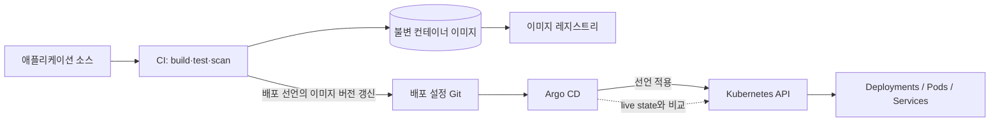
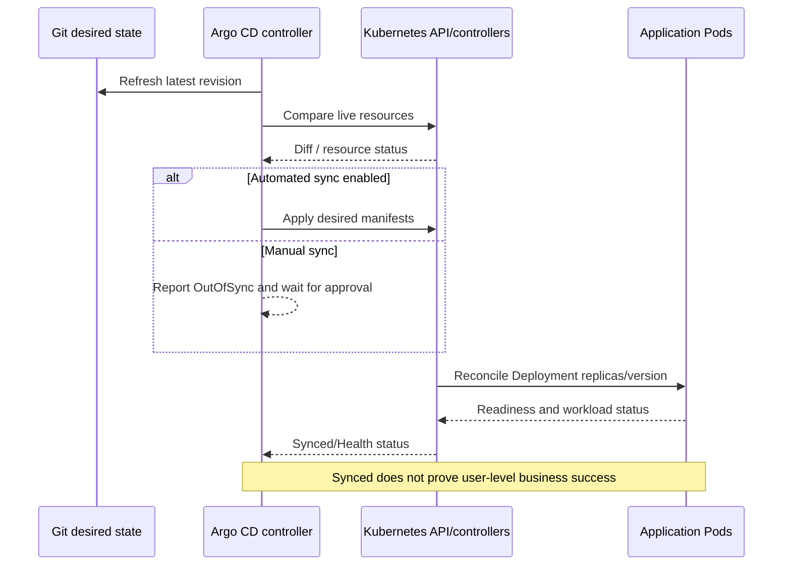
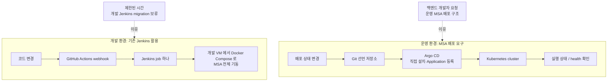

## CI/CD 와 Argo CD 면접 준비

이 문서는 이력서에 적힌 운영 배경을 바탕으로 CI/CD, Jenkins, Kubernetes, GitOps, Argo CD 를 설명하고 면접 답변을 연습하기 위한 자료입니다.

>**경험을 설명할 때 지킬 기준**
>**확인된 사실:** 개발 서버는 기존 Jenkins 로 배포하고 있었지만 서비스마다 수동으로 실행해야 했습니다. 이 절차를 Jenkins job 하나로 모아, GitHub Actions webhook 이 호출하면 Ansible 로 구성한 개발 VM 에서 Docker Compose 로 MSA 전체를 띄우게 했습니다. 운영은 백엔드 개발자가 MSA 배포 구조를 제대로 갖추길 원했고, 개발 환경까지 바꿀 시간은 부족해 **운영부터 본인이 Argo CD 를 설치하고, 서비스별 Application 을 등록하고, 배포 매니페스트를 작성**했습니다. Hi-Tech 에서 Jenkins CI/CD 를 구축한 경험이 바탕이 됐습니다.
>**아직 채울 세부:** 매니페스트 형식(plain YAML/Helm/Kustomize), 자동/수동 sync, 이미지 빌드·태그 규칙, Secret 주입 방식, 롤백 절차. §5 체크리스트에 적어 두고, 기억나지 않으면 "그 세부는 정확히 기억나지 않습니다"라고 한 뒤 원리로 답합니다.

### 1. 빠른 개념 정리

#### CI 와 CD

- **CI(Continuous Integration, 지속적 통합)**: 코드를 자주 합치고, 빌드·테스트·정적 검사 등을 자동으로 실행해 변경 사항의 문제를 빨리 찾는 과정입니다.
- **Continuous Delivery**: 검증된 변경을 배포 가능한 상태로 준비하고, 운영 반영은 승인이나 수동 절차로 진행할 수 있게 하는 방식입니다.
- **Continuous Deployment**: 검증된 변경을 별도 수동 승인 없이 운영까지 자동 반영하는 방식입니다.
- 실무에서는 CD 가 Delivery 와 Deployment 중 무엇을 뜻하는지 맥락에 따라 달라질 수 있으므로 면접에서는 본인이 가리키는 의미를 분명히 하세요.

**비유:** CI 는 조립한 제품이 규격에 맞는지 매번 검사하는 공정이고, Delivery 는 출고 직전까지 준비해 두는 것이며, Deployment 는 검사 통과 제품이 실제 매장에 자동 진열되는 것입니다.

#### Jenkins

Jenkins 는 플러그인과 파이프라인을 이용해 빌드·테스트·배포 작업을 실행하는 자동화 서버입니다. Jenkins Pipeline 은 보통 코드로 단계와 조건을 표현합니다. Jenkins 자체가 Kubernetes 전용 배포 도구인 것은 아니며, 스크립트나 플러그인 등을 통해 다양한 환경에 명령을 내릴 수 있습니다.

**비유:** Jenkins 는 작업 지시서에 따라 빌드, 검사, 배포 담당자에게 일을 시키는 자동화된 작업반장입니다.

#### GitOps 와 Argo CD

**GitOps**는 Git 저장소의 선언형 설정을 시스템의 원하는 상태를 나타내는 기준으로 삼고, 자동화된 컨트롤러가 실제 시스템을 그 상태에 맞추도록 하는 운영 방식입니다. 변경 이력과 리뷰가 Git 에 남고, 실제 환경과 선언된 상태의 차이를 감지할 수 있습니다.

**Argo CD**는 Kubernetes 용 선언형 GitOps 지속적 배포 도구입니다. 저장소에 정의된 Kubernetes 리소스 상태와 클러스터의 실제 상태를 비교하고, 차이를 보여주며 설정에 따라 동기화합니다. Argo CD 는 보통 소스 코드를 빌드하고 테스트하는 CI 역할 전체를 대신하지 않습니다. CI 가 이미지 등을 만들고, 배포 설정 저장소를 갱신하면 Argo CD 가 Kubernetes 에 반영하는 식으로 역할을 나눌 수 있습니다.

**비유:** Git 은 완성하고 싶은 건물의 설계도이고, Kubernetes 는 건물의 현재 상태를 계속 확인하며 설계도에 맞추는 관리 시스템입니다. Argo CD 는 설계도와 실제 건물을 비교해 차이를 알리고, 설정에 따라 필요한 작업을 요청하는 감독관입니다.

이것은 CI 와 CD 를 분리하는 일반적인 흐름입니다. VMMe Pro 운영에서는 이 그림의 Argo CD 와 배포 선언(매니페스트) 부분을 본인이 구성했고, 이미지 빌드와 배포 저장소 갱신 방식은 §5 체크리스트에 적어 둡니다.

#### Kubernetes: 원하는 상태와 실제 상태

Kubernetes 에는 선언한 **원하는 상태(desired state)**와 현재 클러스터의 **실제 상태(actual state)**가 있습니다. 예를 들어 특정 애플리케이션의 복제본 수, 이미지, 서비스 연결 설정 등을 선언할 수 있습니다. Kubernetes 컨트롤러는 실제 상태를 계속 관찰하고, 가능한 범위에서 원하는 상태에 가깝게 맞춥니다. 이 반복적인 비교·조정 과정을 **reconciliation(조정/수렴)**이라고 합니다.

Argo CD 는 Git 에 있는 선언과 클러스터 상태를 비교해 애플리케이션 상태를 `Synced` 또는 `OutOfSync` 등으로 보여줍니다. 동기화가 되었는지(Sync)와 워크로드가 정상인지(Health)는 서로 다른 축입니다. 선언 내용이 반영되어 `Synced` 여도 애플리케이션이 정상 응답한다고 보장하지 않으므로 Health 와 애플리케이션 관측도 확인해야 합니다.

#### Manifest, Helm, Kustomize

- **Manifest**: Kubernetes 에 만들 리소스와 설정을 선언적으로 적은 파일입니다. 흔히 YAML 로 작성합니다.
- **Helm**: 차트(템플릿과 기본값 묶음)에 값을 제공해 Kubernetes 리소스를 만들고 배포하는 패키징 도구입니다.
- **Kustomize**: 공통 YAML 을 바탕으로 환경별 패치를 적용해 변형을 구성하는 도구입니다.
- Argo CD 는 plain YAML, Helm chart, Kustomize 등 여러 소스 형식을 다룰 수 있습니다. 직접 작성한 매니페스트가 어떤 형식이었는지 §5 에 적어 두고 그대로 말합니다.

**비유:** Manifest 는 가구 조립 설명서, Helm 은 여러 모델에 맞게 치수를 바꾸는 조립 키트, Kustomize 는 기본 설명서에 개발·운영 환경별 수정 메모를 붙이는 방식에 가깝습니다.

#### Sync, Health, Rollback

- **Sync**: Git 에 선언된 상태를 클러스터에 적용하는 동기화 작업입니다. 자동 동기화 여부는 애플리케이션 설정에 따라 달라집니다.
- **Health**: Kubernetes 리소스의 상태를 Argo CD 가 평가해 표시하는 건강 상태입니다. `Synced` 와 `Healthy` 는 같은 뜻이 아닙니다.
- **Rollback**: 문제가 생겼을 때 이전 상태로 되돌리는 절차입니다. GitOps 에서는 이전의 정상 선언을 Git 에 되돌리는 방식이 이력과 실제 상태를 일치시키기 쉽습니다. Argo CD 의 UI 에서 이전 상태를 선택하는 기능이 있더라도, Git 을 기준으로 운영하는 환경에서는 Git 에도 그 변경을 반영해야 지속적인 재조정 때 다시 덮어써지지 않습니다. 구체적인 롤백 방식은 해당 환경의 설정과 운영 절차를 확인해야 합니다.

#### Secret 과 환경 승격

비밀값은 일반 텍스트로 Git 에 커밋하면 안 됩니다. Kubernetes Secret 을 사용하더라도 저장소 암호화, 외부 Secret 저장소 연동, RBAC, 암호화 설정 등 실제 비밀 관리 구성을 확인해야 합니다. "Kubernetes Secret 을 썼다"만으로 저장·전송·접근까지 안전하다고 단정할 수 없습니다.

환경 승격은 개발에서 검증된 동일한 애플리케이션 버전을 스테이징·프로덕션으로 이동시키는 절차입니다. 이미지 태그를 환경마다 다르게 만들지, 동일한 불변 이미지 다이제스트를 승격하는지, 설정만 환경별로 바꾸는지 등은 구현에 따라 다릅니다. 이상적인 설명은 "같은 빌드 결과물을 환경별 설정과 승인 절차에 따라 승격하고, 각 환경에서 상태와 헬스체크를 확인한다"입니다. VMMe Pro 는 개발(Compose)과 운영(Kubernetes)의 실행 기반이 달라서, 같은 이미지와 외부 설정 주입이 두 환경의 차이를 줄이는 핵심입니다.

### 2. 왜 Kubernetes 와 Argo CD 가 잘 맞나

Kubernetes 는 원하는 상태를 선언하고 실제 상태를 지속적으로 조정하는 플랫폼입니다. Argo CD 는 Git 에 선언된 애플리케이션 상태와 클러스터 상태를 비교하고 적용하는 GitOps 컨트롤러입니다. 둘 다 선언형 리소스와 반복적인 상태 조정을 중심으로 하므로, Git 의 변경을 Kubernetes 리소스에 반영하는 흐름이 자연스럽습니다.

이 조합은 다음 이점을 줄 수 있습니다.

1. **상태 비교**: 저장소의 선언과 클러스터의 차이를 확인할 수 있습니다.
2. **변경 이력과 리뷰**: 배포 설정의 변경을 Git 커밋과 리뷰로 추적할 수 있습니다.
3. **지속적 수렴**: 설정에 따라 Argo CD 가 차이를 자동 또는 수동 동기화할 수 있습니다.
4. **환경별 관리**: 여러 애플리케이션이나 클러스터의 설정과 상태를 한곳에서 살펴볼 수 있습니다.
5. **배포와 CI 역할 분리**: Jenkins/GitHub Actions 등이 빌드·테스트를 하고 Argo CD 가 Kubernetes 배포 상태를 관리하도록 나눌 수 있습니다.

다만 Argo CD 가 모든 배포 문제를 자동으로 해결하는 것은 아닙니다. 잘못된 선언도 그대로 적용할 수 있고, Secret 관리나 네트워크 정책, 애플리케이션의 데이터베이스 마이그레이션과 호환성은 별도로 설계해야 합니다.

### 2.1. 개발 환경 쪽 개념: 여러 서비스를 함께 띄우기와 Jenkins 호출 경로

#### Kubernetes 없이 여러 서비스를 띄우는 방법: Docker Compose

개발 서버처럼 한 대의 VM 에서 여러 서비스를 함께 띄울 때는 Docker Compose 가 흔한 선택입니다. `compose.yaml` 에 서비스별 이미지(또는 빌드 경로), 포트, 환경 변수, 볼륨, 네트워크를 선언하고 `docker compose up -d` 로 한 번에 올립니다.

- **서비스 이름이 곧 주소:** 같은 Compose 프로젝트의 컨테이너는 기본 네트워크에서 서비스 이름(`http://payment:8080`)으로 서로를 찾습니다.
- **기동 순서와 준비 상태는 다릅니다.** `depends_on` 은 시작 순서만 정합니다. DB 가 실제로 접속을 받을 준비가 될 때까지 기다리려면 `healthcheck` 를 정의하고 `depends_on` 에 `condition: service_healthy` 를 씁니다. 앱 쪽에서도 DB 연결 재시도를 둡니다.
- **반복 적용:** `docker compose up -d` 는 정의가 바뀐 서비스만 다시 만들고 나머지는 그대로 둡니다. 새 이미지를 쓰려면 `docker compose pull` 후 다시 `up -d` 합니다.
- **한계:** 한 호스트 안에서만 동작하고, 재시작 정책(`restart`) 외에 여러 노드 간 재배치·롤링 업데이트·오토스케일 같은 기능은 없습니다.

| 기준 | Docker Compose | Kubernetes |
|---|---|---|
| 범위 | 한 호스트 | 여러 노드의 클러스터 |
| 복구 | 컨테이너 재시작 정책 | 컨트롤러가 원하는 상태로 계속 맞춤(다른 노드로 재배치 포함) |
| 배포 | 컨테이너 재생성 | 롤링 업데이트, readiness 기반 트래픽 전환 |
| 확장 | 수동 | HPA 등 자동 확장 |
| 잘 맞는 곳 | 개발·테스트 환경, 소규모 단일 서버 | 운영 환경, 여러 서비스의 독립 배포·확장 |

개발은 Compose, 운영은 Kubernetes 처럼 실행 기반이 다르면 **설정 주입 방식, 서비스 주소, 헬스체크, 리소스 제한**에서 차이가 생깁니다. 같은 이미지를 쓰고 주소와 설정을 환경 변수로 주입하면 차이를 줄일 수 있습니다.

#### GitHub 이벤트로 Jenkins 를 실행하는 방법들

| 방식 | 흐름 | 필요한 조건 | 주의점 |
|---|---|---|---|
| GitHub webhook → Jenkins | GitHub 서버가 Jenkins 의 webhook URL 을 직접 호출 | Jenkins 가 인터넷에서 접근 가능해야 함 | 사내망·방화벽 뒤 Jenkins 에는 닿지 않음. 서명(`X-Hub-Signature-256`) 검증 필요 |
| GitHub Actions → Jenkins 원격 API | workflow 가 Jenkins 의 `buildWithParameters` 등을 API 토큰으로 호출 | Actions 러너에서 Jenkins 에 접근할 수 있어야 함 | 브랜치·경로 조건을 Actions 에서 걸러낼 수 있음. 토큰은 GitHub Secrets 에 두고, 권한은 해당 job 실행으로 제한 |
| Self-hosted runner → Jenkins | 내부망에 둔 Actions 러너가 GitHub 에 **바깥으로** 접속해 작업을 받고, 내부의 Jenkins 를 호출 | 내부망에 러너 설치 | 인바운드 포트를 열지 않아도 됨. 러너 호스트의 보안과 격리가 중요 |
| Jenkins SCM polling | Jenkins 가 주기적으로 저장소 변경을 확인 | Jenkins 에서 GitHub 로 나가는 연결 | 반영이 늦고 불필요한 조회가 늘어남 |

**Jenkins 를 남겨 두는 흔한 이유:** 개발 서버에 접근하는 자격증명과 에이전트, 기존 배포 스크립트가 이미 Jenkins 에 있고, 그 서버가 외부에서 직접 접근되지 않는 경우입니다. 이때 GitHub Actions 는 "어떤 이벤트에서 배포할지"를 정하는 트리거를, Jenkins 는 "내부 서버에서 실제로 무엇을 실행할지"를 맡습니다. 대가로 파이프라인이 두 시스템에 나뉘어 비밀값 관리 위치와 로그 확인 위치가 둘이 됩니다.

### 3. 본인 배경을 설명하는 기본 답변

#### 짧은 버전

>개발 서버는 Jenkins 로 배포하고 있었지만 서비스마다 수동으로 실행해야 해서 일부가 빠질 위험이 있었습니다. 그래서 GitHub Actions webhook 이 Jenkins job 하나를 호출하면, 그 job 이 개발 VM 에서 Docker Compose 로 MSA 전체를 같은 방식으로 띄우게 했습니다. 운영은 백엔드 개발자가 MSA 배포 구조를 제대로 갖추길 원해서, 제가 Argo CD 를 설치하고 서비스별 Application 과 매니페스트를 작성해 구성했습니다. 개발까지 바꿀 시간은 부족해 두 환경의 도구가 달라졌고, 이 차이는 남은 과제입니다.

#### 경험 중심 버전

>당시 개발 서버에는 Jenkins 배포가 있었지만 서비스마다 따로 실행해야 했습니다. Hi-Tech 에서 Jenkins 로 앱과 백엔드 CI/CD 를 구축해 본 경험을 살려, 수동 절차를 job 하나로 모으고 GitHub Actions webhook 이 그 job 을 호출하게 했습니다. job 은 Ansible 로 구성한 개발 VM 에서 Docker Compose 로 전체 서비스를 띄우므로, 필요할 때 같은 방식으로 개발 환경 전체를 올릴 수 있습니다. 운영은 백엔드 개발자가 서비스별 배포를 일관되게 관리하길 원했습니다. 개발 환경까지 Kubernetes 로 옮길 시간은 부족했기 때문에, 운영부터 Argo CD 를 직접 설치하고 서비스별 Application 등록과 매니페스트 작성을 맡았습니다. 결과적으로 개발은 VM 위의 Compose, 운영은 Kubernetes 위의 Argo CD 라는 과도기 구성이 되었고, 이는 기술적 통일성보다 일정과 운영 요구를 먼저 반영한 선택이었습니다.

다이어그램은 확인된 환경 구분과 요청 배경을 나타냅니다. Argo CD 설치, Application 등록, 매니페스트 작성은 본인이 했습니다. 배포 저장소 분리 방식과 자동 sync 여부는 §5 체크리스트에 채웁니다.

#### 표현을 조정할 부분

- "Argo CD 를 설치하고 서비스별 Application 과 매니페스트를 작성해 production 배포를 구성했다"고 말합니다. 클러스터 생성이나 노드 운영을 직접 하지 않았다면 그 부분은 구분합니다.
- "완전한 MSA 를 구현했다"는 표현은 서비스 경계, 데이터 소유권, 배포 독립성, 통신 방식 등을 실제로 설계·구현했을 때만 사용하세요.
- Argo CD 가 적용되었다고 해서 모든 서비스가 완전한 마이크로서비스 구조가 되었다고 볼 수는 없습니다. 배포 도구와 서비스 아키텍처는 관련은 있지만 별개의 층위입니다.
- Jenkins 를 교체하지 않은 이유는 일정 제약과 기존 개발 환경 유지로 설명할 수 있습니다. 운영상 장단점을 인지하고, 추후 표준화 대상이 될 수 있음을 덧붙이세요.

### 4. 면접 질문과 단계별 꼬리질문

#### 질문 1: CI 와 CD 는 무엇이며, Jenkins 와 Argo CD 는 각각 어떤 역할인가요?

**짧은 답변**

>CI 는 변경한 코드를 자동으로 빌드하고 검사하는 과정이고, CD 는 검증된 결과를 배포 가능한 상태로 만들거나 실제 환경에 반영하는 과정입니다. Jenkins 는 파이프라인 작업을 실행하는 자동화 서버이고, Argo CD 는 Git 의 선언과 Kubernetes 클러스터 상태를 비교·동기화하는 GitOps 배포 도구입니다.

**경험 중심 답변**

>개발 환경에서는 GitHub Actions webhook 이 Jenkins job 을 시작하고, Jenkins 가 개발 VM 에서 Docker Compose 로 서비스를 올립니다. 프로덕션에는 제가 Argo CD 를 설치해 Kubernetes 배포를 구성했습니다. Jenkins 는 정해진 작업 순서를 실행하는 도구이고, Argo CD 는 Git 에 선언된 Kubernetes 상태를 클러스터에 맞추는 도구라 역할이 다릅니다.

**꼬리질문 1 — GitHub Actions 도 있는데 Jenkins 가 왜 필요한가요?**

>GitHub Actions 는 저장소 이벤트를 받아 Jenkins job 을 호출하는 트리거이고, Jenkins 는 개발 VM 에서 Docker Compose 로 전체 서비스를 올리는 실행을 맡았습니다. 개발 서버에 접근하는 기존 배포 작업이 Jenkins 에 있었기 때문에 그 자산을 살리고, 이벤트 연결만 Actions 로 붙인 구조입니다.

**꼬리질문 2 — 그럼 Actions 와 Jenkins 가 중복 아닌가요?**

>일부 중복입니다. Actions 가 트리거만 하므로 실행 계층이 둘로 나뉘고, 비밀값과 로그 위치도 둘이 됩니다. 기존 Jenkins 작업을 살리기 위한 과도기 선택이었고, 장기적으로는 self-hosted runner 로 Actions 하나에 합치는 방향과 Jenkins 쪽으로 모으는 방향을 비용과 운영 역량으로 비교하겠습니다.

#### 질문 2: 왜 프로덕션에 Argo CD 를 적용했나요?

**짧은 답변**

>프로덕션에 MSA 구조를 제대로 갖추고 싶다는 백엔드 개발자의 요청이 있었고, Kubernetes 선언형 배포와 GitOps 방식이 그 요구에 잘 맞았습니다. 개발 환경의 Jenkins 까지 바꿀 시간이 부족해 기존 개발 흐름은 유지하고 프로덕션에 Argo CD 를 구성했습니다.

**경험 중심 답변**

>당시 개발 서버는 이미 Jenkins 를 이용해 운영되고 있었습니다. 백엔드 개발자가 프로덕션에 MSA 배포 구조를 갖추고 싶다고 요청했고, 일정상 개발 환경의 Jenkins 를 함께 마이그레이션하지 못했습니다. 그래서 개발은 기존 webhook→Jenkins 흐름을 유지하고, 프로덕션은 Argo CD 기반으로 구성했습니다. 프로덕션의 선언형 Kubernetes 리소스와 Git 간 변경 이력을 관리하려는 목적이었습니다. Argo CD 설치부터 서비스별 Application 등록, 매니페스트 작성까지 제가 맡았습니다.

**꼬리질문 1 — 왜 Jenkins 를 개발 서버에서도 Argo CD 로 바꾸지 않았나요?**

>일정이 제한되어 있었고, 개발 환경에서 동작하던 Jenkins 흐름을 같은 시점에 전환하는 것보다 프로덕션 요구를 먼저 충족하는 것이 우선이었습니다. 그래서 두 환경이 서로 다른 도구를 쓰는 비용을 감수한 단계적 선택이었습니다.

**꼬리질문 2 — 도구가 달라서 생긴 위험은 무엇이고 어떻게 줄이나요?**

>배포 절차, 권한, 로그 확인 위치, 장애 대응 방법이 달라져 운영자가 혼란을 겪고 환경 간 동작 차이가 생길 수 있습니다. 배포 절차를 문서화하고, 이미지 버전·환경 설정·승인 기준을 일관되게 관리하며, 장기적으로는 팀이 감당할 수 있는 표준 경로로 통합할지 검토해야 합니다.

#### 질문 3: Argo CD 를 직접 어디까지 구현했나요?

**짧은 답변**

>Argo CD 설치, 서비스별 Application 등록, 배포 매니페스트 작성을 직접 했습니다. 운영 배포 경로를 Argo CD 로 구성한 일이고, 서비스 경계 설계나 대규모 트래픽 운영까지 포함한 말은 아닙니다.

**경험 중심 답변**

>Argo CD 를 클러스터에 설치하고, 서비스마다 Application 을 만들어 Git 저장소의 매니페스트 경로를 대상 클러스터와 namespace 에 연결했습니다. 각 서비스의 배포 매니페스트도 작성했습니다. 그래서 배포 변경은 Git 커밋으로 남고, Argo CD 화면에서 서비스별 sync·health 상태를 확인할 수 있습니다.

**꼬리질문 1 — 직접 작성한 파일이나 설정은 무엇이었나요?**

>서비스별 배포 매니페스트(Deployment 와 Service 등)와, 그 매니페스트 경로를 클러스터와 namespace 에 연결하는 Argo CD Application 정의를 작성했습니다. Application 에는 소스 저장소와 경로, 대상 클러스터와 namespace, sync 정책을 적습니다.

매니페스트 형식(plain YAML·Helm·Kustomize)과 Ingress·ConfigMap 같은 다른 리소스가 있었다면 기억대로 덧붙입니다.

**꼬리질문 2 — 자동 동기화였나요, 수동 동기화였나요? 장애 시 누가 승인했나요?**

실제 설정에 맞는 쪽으로 답합니다.

- **자동 sync 였다면:** "Git 에 병합되면 Argo CD 가 바로 반영하도록 자동 sync 를 썼습니다. 그만큼 잘못된 매니페스트도 바로 나가므로, 병합 전 리뷰와 매니페스트 검증이 사실상 승인 단계였습니다."
- **수동 sync 였다면:** "Git 에 병합된 뒤 Argo CD 화면에서 차이(diff)를 확인하고 사람이 Sync 를 눌러 반영했습니다. 운영 반영 시점을 사람이 통제할 수 있지만, 반영을 잊으면 Git 과 클러스터가 어긋난 채로 남습니다."

#### 질문 4: Argo CD 가 Kubernetes 와 잘 맞는 이유는 무엇인가요?

**짧은 답변**

>Kubernetes 는 선언된 원하는 상태를 기준으로 실제 상태를 계속 조정합니다. Argo CD 도 Git 에 선언된 상태와 클러스터 실제 상태를 비교해 차이를 보여주고 동기화하므로, 선언형 리소스와 reconciliation 중심인 Kubernetes 에 자연스럽게 붙습니다.

**경험 중심 답변**

>프로덕션 배포 설정을 Git 에 두고 클러스터 상태와 비교할 수 있다는 점이 MSA 환경에서 유용합니다. 서비스별 선언과 변경 이력을 검토하고, 반영 상태를 확인하는 흐름을 만들 수 있습니다. 다만 Argo CD 가 MSA 를 만들어 주는 것은 아니며, 서비스 경계와 데이터 소유권은 애플리케이션 아키텍처에서 별도로 정해야 합니다.

**꼬리질문 1 — Kubernetes 가 이미 reconciliation 하는데 Argo CD 가 왜 또 필요한가요?**

>Kubernetes 컨트롤러는 클러스터 안에 선언된 리소스의 실제 상태를 원하는 상태로 맞춥니다. Argo CD 는 Git 의 선언을 기준으로 삼아 그 선언과 클러스터 상태를 비교하고, Git 에서 클러스터로 배포 변경을 가져오는 역할을 합니다. 서로 다른 계층에서 보완합니다.

**꼬리질문 2 — Synced 면 서비스도 정상인가요?**

>아닙니다. Synced 는 선언한 리소스가 클러스터에 반영되었는지 보는 상태이고, Health 는 리소스 상태 평가입니다. 둘 다 정상이어도 실제 사용자 요청이 성공하는지는 별도의 로그, 메트릭, 트레이싱, 헬스체크로 확인해야 합니다.

#### 질문 5: Git 의 설정과 클러스터 상태가 다르면 어떻게 되나요?

**짧은 답변**

>Argo CD 가 차이를 감지해 OutOfSync 로 표시합니다. 자동 동기화가 켜져 있으면 설정에 따라 Git 상태로 맞추려 하고, 수동 동기화라면 승인된 시점에 반영합니다. 다만 클러스터에서 직접 수정한 변경이 의도적이었다면 먼저 Git 에 반영해야 지속적인 조정과 충돌하지 않습니다.

**경험 중심 답변**

>GitOps 에서는 Git 을 선언된 기준 상태로 관리하는 것이 핵심입니다. 클러스터를 직접 수정하면 Git 과 실제 상태가 달라질 수 있고, Argo CD 가 그 차이를 보고하거나 다시 맞출 수 있습니다. 긴급 수정은 사후에 원인을 정리해 Git 선언에도 반영하고, 자동 동기화 정책과 예외 절차는 운영 기준에 맞추는 것이 필요합니다. self-heal 이 켜져 있으면 클러스터를 직접 고친 내용이 곧바로 Git 상태로 되돌아가므로, 긴급 조치도 Git 을 거치는 습관이 중요합니다.

**꼬리질문 1 — 운영 중 긴급하게 kubectl 로 수정하면 안 되나요?**

>긴급 상황에서는 임시 조치가 필요할 수 있지만, 추적되지 않은 수동 변경이 기준 상태가 되면 재현성과 감사가 약해집니다. 조치의 위험을 평가하고, 변경 내역·승인을 기록한 뒤 가능한 한 빠르게 선언 저장소에 반영해야 합니다. 자동 동기화가 켜져 있다면 다시 덮일 수 있으므로 그 설정도 확인해야 합니다.

**꼬리질문 2 — Git 에 잘못된 설정이 올라와 자동 적용되면요?**

>자동 동기화가 편리함을 주는 만큼 잘못된 선언도 빠르게 적용할 수 있습니다. 코드 리뷰와 CI 검증, 권한 분리, 환경별 보호 규칙, 헬스 관찰과 롤백 절차가 필요합니다. 프로덕션 자동 동기화가 적절한지는 위험 수준과 승인 요구를 고려해야 합니다.

#### 질문 6: 배포가 실패하면 어떻게 롤백하나요?

**짧은 답변**

>먼저 실패 범위와 영향을 확인하고, GitOps 기준이라면 마지막으로 정상 확인된 선언이나 이미지 버전으로 Git 을 되돌려 Argo CD 가 그 상태를 적용하게 합니다. 단순히 UI 에서 이전 리비전을 선택하는 것만으로는 Git 기준 상태와 다시 달라질 수 있으므로, Git 이력과 실제 클러스터 상태가 일치하는지 확인해야 합니다.

**경험 중심 답변**

>제가 구성한 Argo CD 환경도 Git 이 기준이므로, 롤백은 매니페스트의 이미지 버전을 이전 정상 값으로 되돌리는 커밋으로 하는 것이 원칙입니다. Argo CD 가 그 커밋을 반영하면 Sync 와 Health, 오류율을 확인합니다. Argo CD 화면에서 이전 리비전으로 되돌리는 기능은 급할 때 쓸 수 있지만, Git 에도 같은 변경을 남겨야 다음 sync 때 다시 덮어쓰이지 않습니다. 데이터베이스 변경이나 외부 메시지처럼 되돌리기 어려운 상태는 별도로 살핍니다.

**꼬리질문 1 — 이미지 버전만 되돌리면 되나요?**

>항상 그렇지는 않습니다. 설정 변화, 데이터베이스 스키마와 데이터 변경, 메시지 형식 변경, 외부 시스템에 이미 발생한 부작용이 함께 있을 수 있습니다. 애플리케이션 버전과 설정뿐 아니라 하위 호환성, 마이그레이션의 가역성, 트래픽 영향을 확인해야 합니다.

**꼬리질문 2 — 이전 버전이 데이터베이스와 호환되지 않으면요?**

>배포 순서를 확장 - 전환 - 정리 방식으로 설계해 이전 버전과 새 버전이 일정 기간 함께 동작할 수 있게 하는 방법을 고려합니다. 되돌릴 수 없는 데이터 변경은 백업·복구나 보정 작업까지 포함해 계획해야 합니다. 구체적인 전략은 데이터와 서비스 특성에 맞춰 설계해야 하며, Argo CD 만으로 해결되는 문제는 아닙니다.

#### 질문 7: 개발과 프로덕션에서 배포 도구가 다른 건 설계가 일관되지 않은 것 아닌가요?

**짧은 답변**

>장기적으로는 도구와 운영 절차가 다르면 학습·장애 대응 비용이 생기므로 일관성이 바람직합니다. 당시에는 개발 서버의 Jenkins 흐름을 바꿀 시간이 부족했고, 프로덕션의 MSA 배포 요구가 우선이라 단계적으로 나뉘었습니다. 의도적인 영구 표준이라기보다 일정에 따른 과도기 선택으로 설명하겠습니다.

**경험 중심 답변**

>지적하신 대로 차이가 있습니다. 개발 환경은 GitHub Actions webhook 에서 Jenkins 를 호출해 서버를 올리는 기존 방식이었고, 프로덕션은 백엔드 개발자의 MSA 요구에 따라 Argo CD 기반으로 구성했습니다. 당시에는 제한된 시간 안에 프로덕션 구조를 마련하는 일이 우선이었습니다. 이 결정은 개발·운영 간 절차 차이와 운영 지식 분산이라는 비용을 만들 수 있으므로, 이후 환경별 차이를 문서화하고 팀이 감당할 수 있는 하나의 표준 경로로 정리할 필요가 있습니다.

**꼬리질문 1 — 개발과 프로덕션의 배포 결과가 다르면 어떻게 검증하나요?**

>개발은 VM 위의 Docker Compose, 운영은 Kubernetes 라 실행 기반부터 다릅니다. 그래서 같은 애플리케이션 이미지를 쓰고 차이는 환경 변수 같은 외부 설정으로만 두며, 배포 뒤 같은 API 검증을 두 환경에서 돌리는 것이 차이를 줄이는 방법입니다.

**꼬리질문 2 — 지금 다시 한다면 어떻게 하겠어요?**

>우선 개발·스테이징·프로덕션의 요구와 장애 영향, 승인 절차를 비교하고, 빌드 파이프라인과 배포 컨트롤러의 책임을 분리해 표준을 제안하겠습니다. 가능한 경우 동일한 불변 이미지 아티팩트를 환경별 설정으로 승격하고, 점진적으로 개발 환경도 표준화하겠습니다. 무조건 한 도구로 합치기보다 운영 복잡도와 팀 역량을 함께 평가하겠습니다.

#### 질문 8: MSA 와 Argo CD 는 어떤 관계인가요?

**짧은 답변**

>MSA 는 서비스를 나누는 아키텍처 방식이고, Argo CD 는 Kubernetes 배포를 GitOps 방식으로 관리하는 도구입니다. 서비스가 독립적으로 배포되는 환경에서 Argo CD 가 배포 상태를 관리하는 데 도움이 되지만, Argo CD 를 도입했다고 MSA 가 자동으로 완성되는 것은 아닙니다.

**경험 중심 답변**

>백엔드 개발자는 프로덕션에 MSA 구조를 갖추길 원했고, 저는 배포 측면에서 Argo CD 를 설치하고 서비스별 Application 과 매니페스트를 작성했습니다. 다만 서비스 분리 기준, 데이터 소유권, 서비스 간 통신, 장애 격리까지 모두 제가 결정했다는 의미로 확대하지 않겠습니다. 제가 담당한 부분은 배포 자동화와 운영 구조 중 실제 기여 범위로 한정해 설명하겠습니다.

**꼬리질문 1 — 마이크로서비스의 기준은 서비스 개수인가요?**

>서비스가 많다는 것만으로 MSA 라고 하기는 어렵습니다. 각 서비스가 명확한 도메인 책임과 데이터 소유권을 갖고, 독립적으로 배포·확장될 수 있는지, 서비스 간 결합과 장애 전파를 어떻게 관리하는지가 중요합니다.

**꼬리질문 2 — MSA 의 단점은 무엇인가요?**

>네트워크 호출과 분산 장애, 데이터 일관성, 관측성, 배포·운영 복잡성이 커집니다. 팀과 도메인이 감당할 준비 없이 서비스를 잘게 나누면 모놀리스 내부 호출보다 더 복잡해질 수 있어, 서비스 경계와 운영 능력을 먼저 고려해야 합니다.

#### 질문 9: Secret 과 배포 설정은 Git 에 어떻게 관리하나요?

**짧은 답변**

>비밀값을 평문으로 저장소에 올리지 않습니다. Kubernetes Secret 도 접근 제어와 저장 암호화까지 확인해야 하고, 외부 Secret 관리 도구나 암호화된 GitOps 방식 등을 사용할 수 있습니다.

**경험 중심 답변**

>GitOps 는 선언을 저장소에서 관리하므로 비밀값 노출을 특히 조심해야 합니다. 일반 설정과 민감정보를 분리하고, 민감정보의 암호화·복호화 권한과 클러스터 접근 권한을 제한해야 합니다.

운영 Secret 을 실제로 어떻게 넣었는지(Kubernetes Secret 직접 생성, Sealed Secrets, 외부 Secret Manager 등)를 §5 에 적어 두고, 경험 중심 답변의 첫 문장으로 말합니다.

**꼬리질문 1 — Kubernetes Secret 은 기본적으로 암호화되어 있나요?**

>Secret 은 설정 객체이지 그 자체가 완전한 비밀 관리 체계는 아닙니다. 저장 시 암호화 구성, API 접근 권한, 로그나 CI 출력 노출, 백업 접근을 확인해야 합니다. Base64 인코딩을 암호화로 오해해서도 안 됩니다.

**꼬리질문 2 — GitOps 에서 Secret 을 다루는 일반적인 방법은요?**

>외부 Secret Manager 에서 런타임에 가져오거나, 저장소에 커밋하기 전에 암호화하고 제한된 키로 복호화하는 방법 등을 선택할 수 있습니다. 조직의 키 관리와 감사 요구에 따라 결정하고, 키 자체가 Git 에 들어가지 않게 해야 합니다.

#### 질문 10: 환경 간 버전 승격과 이미지 태그는 어떻게 관리하나요?

**짧은 답변**

>환경마다 같은 소스라도 별도 빌드하면 결과 차이가 날 수 있으므로, 검증된 동일 아티팩트를 버전과 함께 승격하는 편이 추적에 유리합니다. 설정은 환경별로 분리합니다.

**경험 중심 답변**

>매니페스트를 직접 작성하는 입장에서는 이미지 태그를 무엇으로 고정하느냐가 배포 추적의 핵심입니다. 변경 가능한 `latest` 에 의존하면 같은 매니페스트가 다른 이미지를 가리킬 수 있으므로, 커밋 SHA 나 불변 다이제스트로 태그를 정하고 매니페스트의 태그 변경을 커밋으로 남기는 것이 안전합니다.

실제로 쓴 태그 규칙을 §5 에 적어 두고 이 답변의 첫 문장에 넣어 말합니다.

**꼬리질문 1 — 환경마다 설정이 다르면 동일 아티팩트가 맞나요?**

>앱 바이너리나 컨테이너 이미지 같은 빌드 산출물은 같게 유지하고 환경 차이는 외부 설정으로 주입할 수 있습니다. 비밀값은 별도 안전한 경로로 제공해야 합니다. 설정 차이를 검토하고 기록해야 환경별로 예기치 않은 동작이 생기는 것을 줄일 수 있습니다.

**꼬리질문 2 — 이미지 태그가 같은데 내용이 바뀌면 어떻게 추적하나요?**

>변경 가능한 태그는 같은 이름이 다른 이미지 내용을 가리킬 수 있어 재현성이 떨어집니다. 불변 태그나 이미지 다이제스트를 사용하고, 배포 기록에서 소스 커밋과 이미지가 연결되도록 해야 합니다.

#### 질문 11: Kubernetes 가 아닌 개발 서버에서 여러 서비스를 어떻게 함께 띄우나요?

**짧은 답변**

>한 대의 서버라면 Docker Compose 로 서비스별 컨테이너와 네트워크를 선언하고 한 번에 올리는 방식이 일반적입니다. 컨테이너는 서비스 이름으로 서로를 찾고, healthcheck 와 `depends_on` 조건으로 DB 같은 의존 서비스가 준비된 뒤 앱을 띄웁니다. VMMe Pro 개발 서버도 Ansible 로 구성한 VM 에서 Jenkins job 이 Docker Compose 로 MSA 전체를 띄우는 구조였습니다.

**상세 답변**

>`compose.yaml` 하나에 모든 서비스의 이미지, 포트, 환경 변수, 볼륨을 선언해 두면 `docker compose up -d` 한 번으로 같은 구성을 반복해서 올릴 수 있습니다. 서비스마다 수동으로 실행하는 것과 달리 빠지는 서비스가 없고, 정의가 바뀐 서비스만 다시 만듭니다. 대신 한 호스트에서만 동작하고 롤링 업데이트나 자동 확장은 없으므로 개발·테스트 환경에 적합하고, 운영처럼 여러 노드에서 독립 배포·확장이 필요하면 Kubernetes 를 씁니다.

**꼬리질문 1 — `depends_on` 만 쓰면 DB 가 준비되기 전에 앱이 뜨지 않나요?**

>맞습니다. `depends_on` 은 시작 순서만 정합니다. DB 컨테이너에 healthcheck 를 정의하고 `condition: service_healthy` 로 준비될 때까지 기다리게 하며, 앱도 시작 시 DB 연결 재시도를 둬서 순서가 어긋나도 회복되게 합니다.

**꼬리질문 2 — 개발은 Compose, 운영은 Kubernetes 면 무엇이 달라질 수 있나요?**

>설정 주입(환경 변수 vs ConfigMap/Secret), 서비스 주소(Compose 서비스 이름 vs Kubernetes Service DNS), 헬스체크(healthcheck vs probe), 리소스 제한, 재시작과 롤링 방식이 다릅니다. 같은 이미지를 쓰고 주소와 설정을 환경 변수로 받게 하면 차이를 줄일 수 있고, 남는 차이는 문서로 남깁니다.

#### 질문 12: GitHub Actions 와 Jenkins 는 어떻게 연결하나요? 왜 바로 Jenkins 로 webhook 을 보내지 않나요?

**짧은 답변**

>Jenkins 가 내부망에 있어 GitHub webhook 이 직접 닿지 않거나, 내부 서버 접근 권한과 배포 스크립트가 Jenkins 에 있을 때 이렇게 구성합니다. GitHub Actions 가 브랜치·경로 조건으로 이벤트를 거르고 Jenkins 원격 API 를 호출하면, Jenkins 가 내부에서 실제 배포를 실행합니다.

**상세 답변**

>GitHub webhook 은 GitHub 서버가 Jenkins 로 직접 요청을 보내야 하므로 Jenkins 가 인터넷에서 접근 가능해야 합니다. Actions 를 거치면 어떤 브랜치와 경로 변경에서 배포할지 workflow 에서 정하고, Jenkins API 토큰으로 특정 job 만 실행할 수 있습니다. Jenkins 를 외부에 노출하고 싶지 않다면 내부망에 self-hosted runner 를 두어 바깥으로만 연결하게 합니다. 대가로 파이프라인이 두 시스템에 나뉘므로 비밀값과 로그 위치를 정리해 둡니다.

**꼬리질문 1 — Jenkins 를 외부에 노출해야 하나요? 보안은요?**

>GitHub 에서 제공하는 러너가 호출하려면 Jenkins 까지 가는 경로가 필요하므로, IP 허용 목록, job 실행 권한만 가진 전용 계정과 토큰으로 범위를 좁힙니다. 노출하고 싶지 않다면 self-hosted runner 를 내부에 두어 인바운드 포트 없이 연결합니다. 어느 쪽이든 Jenkins 관리 화면은 공개하지 않습니다.

**꼬리질문 2 — 같은 일을 GitHub Actions 하나로 합칠 수 있지 않나요?**

>가능합니다. 개발 서버 근처에 self-hosted runner 를 두고 배포 스크립트를 workflow 로 옮기면 파이프라인이 하나가 됩니다. 대신 기존 Jenkins job 과 자격증명을 옮기는 비용과 러너 운영 비용이 생깁니다. 팀이 운영할 시스템 수를 줄이는 방향이 장기적으로는 유리하다고 봅니다.

### 5. 면접 전 설정에서 확인할 항목

**확인된 사실**

- **개발:** GitHub Actions webhook → Jenkins job 하나 → Ansible 로 구성한 개발 VM 에서 Docker Compose 로 MSA 전체 기동. 서비스마다 수동으로 실행하던 절차를 한 job 으로 모은 것이 본인의 작업입니다.
- **운영:** Kubernetes 클러스터에 본인이 Argo CD 를 설치하고, 서비스별 Application 을 등록하고, 배포 매니페스트를 작성했습니다.

**기억으로 채울 것** — 기억나지 않으면 "그 세부는 정확히 기억나지 않습니다"라고 한 뒤 원리로 답합니다.

- webhook 을 실행한 GitHub 이벤트(브랜치 push 등)와 Jenkins 를 호출한 방식(원격 API 토큰 등)
- Jenkins job 이 이미지를 직접 빌드했는지, 레지스트리에서 받아 왔는지
- 운영 클러스터의 종류와 클러스터를 만든 사람
- 매니페스트 형식(plain YAML/Helm/Kustomize)과 포함한 리소스(Deployment, Service, Ingress, ConfigMap 등)
- 배포 저장소·경로·브랜치 구성
- 자동/수동 sync, self-heal·prune 설정
- 이미지 태그 규칙과 갱신 방법
- 운영 Secret 주입 방식과 접근 권한
- 롤백 절차와 DB 변경 처리

### 6. 기술 질문에서 방어적으로 답하는 원칙

1. **사실 → 이유 → 장단점 → 개선 방향** 순서로 답합니다.
2. 직접 구현한 범위를 팀 전체 성과와 섞지 않습니다.
3. 확인되지 않은 자동 Sync, Helm, 무중단 배포, 롤백 기능을 경험 사실로 만들지 않습니다.
4. 모르는 세부사항은 범위를 밝힌 뒤 원리를 설명합니다.
5. 도구 도입과 MSA 아키텍처 완성을 같은 말로 취급하지 않습니다.
6. "그때는 시간이 없었습니다"로 끝내지 않고, 그 선택의 운영 비용과 정리 방법까지 말합니다.

**모르는 질문의 예시 답변**

>그 세부 설정은 정확히 기억나지 않습니다. 제가 직접 한 일은 Argo CD 설치와 서비스별 Application·매니페스트 작성이고, 그 설정의 원리는 __ 입니다. 다시 정한다면 __ 를 기준으로 고르겠습니다.

### 7. 공식 문서

- [Argo CD 공식 문서](https://argo-cd.readthedocs.io/en/stable/)
- [Argo CD: GitOps](https://argo-cd.readthedocs.io/en/stable/user-guide/)
- [Argo CD: Sync Options](https://argo-cd.readthedocs.io/en/stable/user-guide/sync-options/)
- [Argo CD: Application Health](https://argo-cd.readthedocs.io/en/stable/operator-manual/health/)
- [Jenkins 공식 문서](https://www.jenkins.io/doc/)
- [Jenkins Pipeline 문서](https://www.jenkins.io/doc/book/pipeline/)
- [Kubernetes 공식 문서: 선언형 설정](https://kubernetes.io/docs/tasks/manage-kubernetes-objects/declarative-config/)
- [Kubernetes 공식 문서: 컨트롤러](https://kubernetes.io/docs/concepts/architecture/controller/)
- [Kubernetes 공식 문서: Secret](https://kubernetes.io/docs/concepts/configuration/secret/)
- [Helm 공식 문서](https://helm.sh/docs/)
- [Kustomize 공식 문서](https://kubectl.docs.kubernetes.io/references/kustomize/)
- [Docker Compose 문서](https://docs.docker.com/compose/)
- [Docker Compose: 시작 순서 제어(healthcheck 와 depends_on)](https://docs.docker.com/compose/how-tos/startup-order/)
- [Jenkins Remote Access API](https://www.jenkins.io/doc/book/using/remote-access-api/)
- [GitHub: Self-hosted runners](https://docs.github.com/en/actions/hosting-your-own-runners/managing-self-hosted-runners/about-self-hosted-runners)
- [GitHub: Webhook 서명 검증](https://docs.github.com/en/webhooks/using-webhooks/validating-webhook-deliveries)
