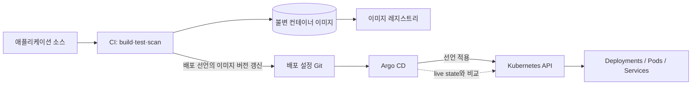
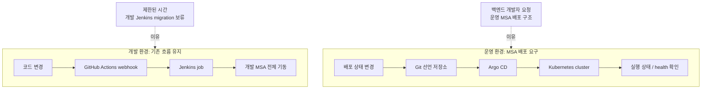

# CI/CD와 Argo CD 면접 준비

이 문서는 이력서에 적힌 운영 배경을 바탕으로 CI/CD, Jenkins, Kubernetes, GitOps, Argo CD를 설명하고 면접 답변을 연습하기 위한 자료입니다.

> **경험을 설명할 때 지킬 기준**  
> 현재 확인된 배경은 개발 서버가 기존 Jenkins 기반이었고, 백엔드 개발자가 프로덕션에 MSA 배포 구조를 제대로 갖추고 싶다고 요청했으며, 제한된 시간 안에 개발 환경의 Jenkins까지 바꾸지 못해 프로덕션에 Argo CD를 구성했다는 것입니다. 개발 환경은 GitHub Actions webhook을 통해 Jenkins를 실행해 서버를 올리는 흐름으로 설명합니다.  
> 저장소 구성, Kubernetes 배포 객체, Helm/Kustomize 사용 여부, Argo CD 동기화 방식, 롤백 방식, 무중단 배포 전략은 확인되지 않았습니다. 본인이 직접 한 일과 팀이 정한 일, 아직 확인할 사실을 구분해 말하세요.

## 1. 빠른 개념 정리

### CI와 CD

- **CI(Continuous Integration, 지속적 통합)**: 코드를 자주 합치고, 빌드·테스트·정적 검사 등을 자동으로 실행해 변경 사항의 문제를 빨리 찾는 과정입니다.
- **Continuous Delivery**: 검증된 변경을 배포 가능한 상태로 준비하고, 운영 반영은 승인이나 수동 절차로 진행할 수 있게 하는 방식입니다.
- **Continuous Deployment**: 검증된 변경을 별도 수동 승인 없이 운영까지 자동 반영하는 방식입니다.
- 실무에서는 CD가 Delivery와 Deployment 중 무엇을 뜻하는지 맥락에 따라 달라질 수 있으므로 면접에서는 본인이 가리키는 의미를 분명히 하세요.

**비유:** CI는 조립한 제품이 규격에 맞는지 매번 검사하는 공정이고, Delivery는 출고 직전까지 준비해 두는 것이며, Deployment는 검사 통과 제품이 실제 매장에 자동 진열되는 것입니다.

### Jenkins

Jenkins는 플러그인과 파이프라인을 이용해 빌드·테스트·배포 작업을 실행하는 자동화 서버입니다. Jenkins Pipeline은 보통 코드로 단계와 조건을 표현합니다. Jenkins 자체가 Kubernetes 전용 배포 도구인 것은 아니며, 스크립트나 플러그인 등을 통해 다양한 환경에 명령을 내릴 수 있습니다.

**비유:** Jenkins는 작업 지시서에 따라 빌드, 검사, 배포 담당자에게 일을 시키는 자동화된 작업반장입니다.

### GitOps와 Argo CD

**GitOps**는 Git 저장소의 선언형 설정을 시스템의 원하는 상태를 나타내는 기준으로 삼고, 자동화된 컨트롤러가 실제 시스템을 그 상태에 맞추도록 하는 운영 방식입니다. 변경 이력과 리뷰가 Git에 남고, 실제 환경과 선언된 상태의 차이를 감지할 수 있습니다.

**Argo CD**는 Kubernetes용 선언형 GitOps 지속적 배포 도구입니다. 저장소에 정의된 Kubernetes 리소스 상태와 클러스터의 실제 상태를 비교하고, 차이를 보여주며 설정에 따라 동기화합니다. Argo CD는 보통 소스 코드를 빌드하고 테스트하는 CI 역할 전체를 대신하지 않습니다. CI가 이미지 등을 만들고, 배포 설정 저장소를 갱신하면 Argo CD가 Kubernetes에 반영하는 식으로 역할을 나눌 수 있습니다.

**비유:** Git은 완성하고 싶은 건물의 설계도이고, Kubernetes는 건물의 현재 상태를 계속 확인하며 설계도에 맞추는 관리 시스템입니다. Argo CD는 설계도와 실제 건물을 비교해 차이를 알리고, 설정에 따라 필요한 작업을 요청하는 감독관입니다.



이것은 CI와 CD를 분리하는 일반적인 흐름입니다. 현재 프로젝트에서 실제로 이미지 생성이나 배포 저장소 갱신을 누가 했는지는 설정을 확인한 뒤 경험으로 설명해야 합니다.

### Kubernetes: 원하는 상태와 실제 상태

Kubernetes에는 선언한 **원하는 상태(desired state)**와 현재 클러스터의 **실제 상태(actual state)**가 있습니다. 예를 들어 특정 애플리케이션의 복제본 수, 이미지, 서비스 연결 설정 등을 선언할 수 있습니다. Kubernetes 컨트롤러는 실제 상태를 계속 관찰하고, 가능한 범위에서 원하는 상태에 가깝게 맞춥니다. 이 반복적인 비교·조정 과정을 **reconciliation(조정/수렴)**이라고 합니다.

Argo CD는 Git에 있는 선언과 클러스터 상태를 비교해 애플리케이션 상태를 `Synced` 또는 `OutOfSync` 등으로 보여줍니다. 동기화가 되었는지(Sync)와 워크로드가 정상인지(Health)는 서로 다른 축입니다. 선언 내용이 반영되어 `Synced`여도 애플리케이션이 정상 응답한다고 보장하지 않으므로 Health와 애플리케이션 관측도 확인해야 합니다.

```mermaid
sequenceDiagram
    participant G as Git desired state
    participant A as Argo CD controller
    participant K as Kubernetes API/controllers
    participant P as Application Pods
    A->>G: Refresh latest revision
    A->>K: Compare live resources
    K-->>A: Diff / resource status
    alt Automated sync enabled
        A->>K: Apply desired manifests
    else Manual sync
        A-->>A: Report OutOfSync; wait for approval
    end
    K->>P: Reconcile Deployment replicas/version
    P-->>K: Readiness and workload status
    K-->>A: Synced/Health status
    Note over A,P: Synced does not prove user-level business success
```

### Manifest, Helm, Kustomize

- **Manifest**: Kubernetes에 만들 리소스와 설정을 선언적으로 적은 파일입니다. 흔히 YAML로 작성합니다.
- **Helm**: 차트(템플릿과 기본값 묶음)에 값을 제공해 Kubernetes 리소스를 만들고 배포하는 패키징 도구입니다.
- **Kustomize**: 공통 YAML을 바탕으로 환경별 패치를 적용해 변형을 구성하는 도구입니다.
- Argo CD는 plain YAML, Helm chart, Kustomize 등 여러 소스 형식을 다룰 수 있습니다. 이 프로젝트에서 무엇을 썼는지는 확인된 사실만 답하세요.

**비유:** Manifest는 가구 조립 설명서, Helm은 여러 모델에 맞게 치수를 바꾸는 조립 키트, Kustomize는 기본 설명서에 개발·운영 환경별 수정 메모를 붙이는 방식에 가깝습니다.

### Sync, Health, Rollback

- **Sync**: Git에 선언된 상태를 클러스터에 적용하는 동기화 작업입니다. 자동 동기화 여부는 애플리케이션 설정에 따라 달라집니다.
- **Health**: Kubernetes 리소스의 상태를 Argo CD가 평가해 표시하는 건강 상태입니다. `Synced`와 `Healthy`는 같은 뜻이 아닙니다.
- **Rollback**: 문제가 생겼을 때 이전 상태로 되돌리는 절차입니다. GitOps에서는 이전의 정상 선언을 Git에 되돌리는 방식이 이력과 실제 상태를 일치시키기 쉽습니다. Argo CD의 UI에서 이전 상태를 선택하는 기능이 있더라도, Git을 기준으로 운영하는 환경에서는 Git에도 그 변경을 반영해야 지속적인 재조정 때 다시 덮어써지지 않습니다. 구체적인 롤백 방식은 해당 환경의 설정과 운영 절차를 확인해야 합니다.

### Secret과 환경 승격

비밀값은 일반 텍스트로 Git에 커밋하면 안 됩니다. Kubernetes Secret을 사용하더라도 저장소 암호화, 외부 Secret 저장소 연동, RBAC, 암호화 설정 등 실제 비밀 관리 구성을 확인해야 합니다. “Kubernetes Secret을 썼다”만으로 저장·전송·접근까지 안전하다고 단정할 수 없습니다.

환경 승격은 개발에서 검증된 동일한 애플리케이션 버전을 스테이징·프로덕션으로 이동시키는 절차입니다. 이미지 태그를 환경마다 다르게 만들지, 동일한 불변 이미지 다이제스트를 승격하는지, 설정만 환경별로 바꾸는지 등은 구현에 따라 다릅니다. 이상적인 설명은 “같은 빌드 결과물을 환경별 설정과 승인 절차에 따라 승격하고, 각 환경에서 상태와 헬스체크를 확인한다”입니다. 실제로 이렇게 구성했는지는 확인 후 말하세요.

## 2. 왜 Kubernetes와 Argo CD가 잘 맞나

Kubernetes는 원하는 상태를 선언하고 실제 상태를 지속적으로 조정하는 플랫폼입니다. Argo CD는 Git에 선언된 애플리케이션 상태와 클러스터 상태를 비교하고 적용하는 GitOps 컨트롤러입니다. 둘 다 선언형 리소스와 반복적인 상태 조정을 중심으로 하므로, Git의 변경을 Kubernetes 리소스에 반영하는 흐름이 자연스럽습니다.

이 조합은 다음 이점을 줄 수 있습니다.

1. **상태 비교**: 저장소의 선언과 클러스터의 차이를 확인할 수 있습니다.
2. **변경 이력과 리뷰**: 배포 설정의 변경을 Git 커밋과 리뷰로 추적할 수 있습니다.
3. **지속적 수렴**: 설정에 따라 Argo CD가 차이를 자동 또는 수동 동기화할 수 있습니다.
4. **환경별 관리**: 여러 애플리케이션이나 클러스터의 설정과 상태를 한곳에서 살펴볼 수 있습니다.
5. **배포와 CI 역할 분리**: Jenkins/GitHub Actions 등이 빌드·테스트를 하고 Argo CD가 Kubernetes 배포 상태를 관리하도록 나눌 수 있습니다.

다만 Argo CD가 모든 배포 문제를 자동으로 해결하는 것은 아닙니다. 잘못된 선언도 그대로 적용할 수 있고, Secret 관리나 네트워크 정책, 애플리케이션의 데이터베이스 마이그레이션과 호환성은 별도로 설계해야 합니다.

## 3. 본인 배경을 설명하는 기본 답변

### 짧은 버전

> 개발 서버는 기존 Jenkins 흐름을 사용하고 있었습니다. 당시 백엔드 개발자가 MSA 구조를 프로덕션에 제대로 갖추고 싶다고 요청했고, 일정상 개발 서버의 Jenkins까지 마이그레이션할 시간은 부족했습니다. 그래서 개발 환경은 GitHub Actions webhook에서 Jenkins를 실행하는 흐름으로 유지하고, 프로덕션에는 Argo CD 기반 배포 구성을 마련했습니다. 두 환경의 도구가 다른 이유는 단계적으로 구성했기 때문입니다. 제가 직접 맡은 범위와 클러스터 세부 설정은 이력과 설정을 기준으로 정확히 나눠 설명드리겠습니다.

### 경험 중심 버전

> 당시 개발 서버에는 Jenkins 기반 배포 흐름이 이미 있었습니다. 백엔드 개발자가 서비스의 MSA 구조를 프로덕션에 갖추고 싶다고 요청했지만, 정해진 시간 안에 개발 환경의 Jenkins를 전부 바꾸는 것은 현실적으로 어려웠습니다. 그래서 개발 서버는 GitHub Actions webhook이 Jenkins 작업을 시작해 서버를 올리는 기존 흐름을 유지하고, 프로덕션에는 Kubernetes와 GitOps 흐름에 맞는 Argo CD를 구성했습니다. 결과적으로 환경별 도구가 일치하지 않는 과도기 구성이 되었고, 이는 기술적 통일성보다 일정과 프로덕션 요구를 반영한 선택이었습니다. 제가 실제로 구성한 저장소 연결, 애플리케이션 정의, 동기화·권한 설정 범위는 확인된 항목만 구체적으로 말씀드리겠습니다.



다이어그램은 확인된 환경 구분과 요청 배경을 나타냅니다. 저장소 분리 방식, 자동 sync 여부, 누가 클러스터와 Argo CD를 설치했는지는 실제 설정에서 확인해 채우세요.

### 표현을 조정할 부분

- 실제로 Kubernetes를 다루지 않았다면 “Kubernetes를 구축했다”고 하지 말고 “Argo CD 기반 프로덕션 배포 구성을 도왔다/구성했다”처럼 본인 기여에 맞추세요.
- “완전한 MSA를 구현했다”는 표현은 서비스 경계, 데이터 소유권, 배포 독립성, 통신 방식 등을 실제로 설계·구현했을 때만 사용하세요.
- Argo CD가 적용되었다고 해서 모든 서비스가 완전한 마이크로서비스 구조가 되었다고 볼 수는 없습니다. 배포 도구와 서비스 아키텍처는 관련은 있지만 별개의 층위입니다.
- Jenkins를 교체하지 않은 이유는 일정 제약과 기존 개발 환경 유지로 설명할 수 있습니다. 운영상 장단점을 인지하고, 추후 표준화 대상이 될 수 있음을 덧붙이세요.

## 4. 면접 질문과 단계별 꼬리질문

### 질문 1: CI와 CD는 무엇이며, Jenkins와 Argo CD는 각각 어떤 역할인가요?

**짧은 답변**

> CI는 변경한 코드를 자동으로 빌드하고 검사하는 과정이고, CD는 검증된 결과를 배포 가능한 상태로 만들거나 실제 환경에 반영하는 과정입니다. Jenkins는 파이프라인 작업을 실행하는 자동화 서버이고, Argo CD는 Git의 선언과 Kubernetes 클러스터 상태를 비교·동기화하는 GitOps 배포 도구입니다.

**경험 중심 답변**

> 저희 개발 환경에는 GitHub Actions webhook이 Jenkins 작업을 시작해 서버를 올리는 흐름이 있었습니다. 프로덕션에는 Kubernetes 기반 MSA 배포 요구에 맞춰 Argo CD를 구성했습니다. Jenkins는 작업 파이프라인을 실행하고, Argo CD는 선언된 Kubernetes 상태의 반영을 담당한다는 점에서 역할이 다릅니다. 두 도구를 같은 역할의 대체재로만 보지는 않습니다.

**꼬리질문 1 — GitHub Actions도 있는데 Jenkins가 왜 필요한가요?**

> GitHub Actions는 이벤트를 받아 Jenkins 작업을 시작하는 연결점으로 사용된 것으로 이해하고 있습니다. 실제 빌드·배포 단계 중 어느 작업을 Actions가 하고 어느 작업을 Jenkins가 했는지는 파이프라인 설정을 확인해 구분해야 합니다. 이 경험에서는 webhook으로 Jenkins를 시작해 개발 서버를 올리는 흐름이라고 설명할 수 있습니다.

**꼬리질문 2 — 그럼 Actions와 Jenkins가 중복 아닌가요?**

> 중복이 될 수 있습니다. GitHub Actions가 단순 webhook 전달만 한다면 실행 계층이 둘로 나뉘어 복잡성이 늘 수 있습니다. 기존 Jenkins 작업과 팀의 운영 경험을 유지하기 위한 과도기 선택이었는지 확인하고, 이후에는 하나의 CI 실행 경로로 통합할지 비용과 운영 역량을 비교하겠습니다.

### 질문 2: 왜 프로덕션에 Argo CD를 적용했나요?

**짧은 답변**

> 프로덕션에 MSA 구조를 제대로 갖추고 싶다는 백엔드 개발자의 요청이 있었고, Kubernetes 선언형 배포와 GitOps 방식이 그 요구에 잘 맞았습니다. 개발 환경의 Jenkins까지 바꿀 시간이 부족해 기존 개발 흐름은 유지하고 프로덕션에 Argo CD를 구성했습니다.

**경험 중심 답변**

> 당시 개발 서버는 이미 Jenkins를 이용해 운영되고 있었습니다. 백엔드 개발자가 프로덕션에 MSA 배포 구조를 갖추고 싶다고 요청했고, 일정상 개발 환경의 Jenkins를 함께 마이그레이션하지 못했습니다. 그래서 개발은 기존 webhook→Jenkins 흐름을 유지하고, 프로덕션은 Argo CD 기반으로 구성했습니다. 프로덕션의 선언형 Kubernetes 리소스와 Git 간 변경 이력을 관리하려는 목적이었습니다. 다만 제가 담당한 구체적 범위는 저장소와 설정을 기준으로 설명드리겠습니다.

**꼬리질문 1 — 왜 Jenkins를 개발 서버에서도 Argo CD로 바꾸지 않았나요?**

> 일정이 제한되어 있었고, 개발 환경에서 동작하던 Jenkins 흐름을 같은 시점에 전환하는 것보다 프로덕션 요구를 먼저 충족하는 것이 우선이었습니다. 그래서 두 환경이 서로 다른 도구를 쓰는 비용을 감수한 단계적 선택이었습니다.

**꼬리질문 2 — 도구가 달라서 생긴 위험은 무엇이고 어떻게 줄이나요?**

> 배포 절차, 권한, 로그 확인 위치, 장애 대응 방법이 달라져 운영자가 혼란을 겪고 환경 간 동작 차이가 생길 수 있습니다. 배포 절차를 문서화하고, 이미지 버전·환경 설정·승인 기준을 일관되게 관리하며, 장기적으로는 팀이 감당할 수 있는 표준 경로로 통합할지 검토해야 합니다. 실제로 어떤 통제를 적용했는지는 제가 확인한 범위에서만 답하겠습니다.

### 질문 3: Argo CD를 직접 어디까지 구현했나요?

**짧은 답변**

> 프로덕션 배포에 Argo CD 기반 구성을 적용한 경험이 있습니다. 다만 “Argo CD를 썼다”는 말이 클러스터 구축부터 서비스 배포 전략까지 모두 혼자 설계했다는 뜻은 아닙니다. 제가 직접 설정한 저장소 연결, 앱 정의, 권한과 동기화 범위를 구분해서 말씀드리겠습니다.

**경험 중심 답변**

> 제가 설명할 수 있는 배경은 기존 개발 Jenkins 흐름은 유지했고, 프로덕션에서 MSA 배포를 위해 Argo CD를 구성했다는 점입니다. 면접 전에는 제가 직접 만든 설정 파일과 저장소 변경 이력을 확인해, 클러스터 생성, Argo CD 설치, 애플리케이션 등록, 매니페스트 작성, 동기화 정책, 권한 설정 중 각각 누가 맡았는지 정리하겠습니다. 실제로 맡지 않은 부분은 팀의 구성으로 분리해서 말씀드리겠습니다.

**꼬리질문 1 — 직접 작성한 파일이나 설정은 무엇이었나요?**

> 이 질문은 실제 저장소를 확인한 뒤 파일명과 역할로 답해야 합니다. 예를 들어 제가 직접 작성한 것이 Application 정의라면 Argo CD가 어느 저장소 경로를 어떤 클러스터와 namespace에 연결하는지 기술했다고 설명하겠습니다. 매니페스트나 Helm 설정을 작성하지 않았다면 그렇게 명확히 구분하겠습니다.

**꼬리질문 2 — 자동 동기화였나요, 수동 동기화였나요? 장애 시 누가 승인했나요?**

> 설정을 확인하지 않고 추정하지 않겠습니다. 자동·수동 동기화 여부와 승인 절차는 `Application` 설정, 프로젝트 정책, 조직의 운영 규칙으로 확인할 수 있습니다. 면접 전 실제 설정을 점검해 말씀드리겠습니다. 당시 세부사항을 확인하지 못했더라도, 두 방식의 차이와 선택 시 고려사항은 설명드릴 수 있습니다.

### 질문 4: Argo CD가 Kubernetes와 잘 맞는 이유는 무엇인가요?

**짧은 답변**

> Kubernetes는 선언된 원하는 상태를 기준으로 실제 상태를 계속 조정합니다. Argo CD도 Git에 선언된 상태와 클러스터 실제 상태를 비교해 차이를 보여주고 동기화하므로, 선언형 리소스와 reconciliation 중심인 Kubernetes에 자연스럽게 붙습니다.

**경험 중심 답변**

> 프로덕션 배포 설정을 Git에 두고 클러스터 상태와 비교할 수 있다는 점이 MSA 환경에서 유용합니다. 서비스별 선언과 변경 이력을 검토하고, 반영 상태를 확인하는 흐름을 만들 수 있습니다. 다만 Argo CD가 MSA를 만들어 주는 것은 아니며, 서비스 경계와 데이터 소유권은 애플리케이션 아키텍처에서 별도로 정해야 합니다.

**꼬리질문 1 — Kubernetes가 이미 reconciliation 하는데 Argo CD가 왜 또 필요한가요?**

> Kubernetes 컨트롤러는 클러스터 안에 선언된 리소스의 실제 상태를 원하는 상태로 맞춥니다. Argo CD는 Git의 선언을 기준으로 삼아 그 선언과 클러스터 상태를 비교하고, Git에서 클러스터로 배포 변경을 가져오는 역할을 합니다. 서로 다른 계층에서 보완합니다.

**꼬리질문 2 — Synced면 서비스도 정상인가요?**

> 아닙니다. Synced는 선언한 리소스가 클러스터에 반영되었는지 보는 상태이고, Health는 리소스 상태 평가입니다. 둘 다 정상이어도 실제 사용자 요청이 성공하는지는 별도의 로그, 메트릭, 트레이싱, 헬스체크로 확인해야 합니다.

### 질문 5: Git의 설정과 클러스터 상태가 다르면 어떻게 되나요?

**짧은 답변**

> Argo CD가 차이를 감지해 OutOfSync로 표시합니다. 자동 동기화가 켜져 있으면 설정에 따라 Git 상태로 맞추려 하고, 수동 동기화라면 승인된 시점에 반영합니다. 다만 클러스터에서 직접 수정한 변경이 의도적이었다면 먼저 Git에 반영해야 지속적인 조정과 충돌하지 않습니다.

**경험 중심 답변**

> GitOps에서는 Git을 선언된 기준 상태로 관리하는 것이 핵심입니다. 클러스터를 직접 수정하면 Git과 실제 상태가 달라질 수 있고, Argo CD가 그 차이를 보고하거나 다시 맞출 수 있습니다. 긴급 수정은 사후에 원인을 정리해 Git 선언에도 반영하고, 자동 동기화 정책과 예외 절차는 운영 기준에 맞추는 것이 필요합니다. 제가 있던 환경의 self-heal 설정 여부는 구성으로 확인해 답하겠습니다.

**꼬리질문 1 — 운영 중 긴급하게 kubectl로 수정하면 안 되나요?**

> 긴급 상황에서는 임시 조치가 필요할 수 있지만, 추적되지 않은 수동 변경이 기준 상태가 되면 재현성과 감사가 약해집니다. 조치의 위험을 평가하고, 변경 내역·승인을 기록한 뒤 가능한 한 빠르게 선언 저장소에 반영해야 합니다. 자동 동기화가 켜져 있다면 다시 덮일 수 있으므로 그 설정도 확인해야 합니다.

**꼬리질문 2 — Git에 잘못된 설정이 올라와 자동 적용되면요?**

> 자동 동기화가 편리함을 주는 만큼 잘못된 선언도 빠르게 적용할 수 있습니다. 코드 리뷰와 CI 검증, 권한 분리, 환경별 보호 규칙, 헬스 관찰과 롤백 절차가 필요합니다. 프로덕션 자동 동기화가 적절한지는 위험 수준과 승인 요구를 고려해야 하며, 실제 구성은 확인해서 답하겠습니다.

### 질문 6: 배포가 실패하면 어떻게 롤백하나요?

**짧은 답변**

> 먼저 실패 범위와 영향을 확인하고, GitOps 기준이라면 마지막으로 정상 확인된 선언이나 이미지 버전으로 Git을 되돌려 Argo CD가 그 상태를 적용하게 합니다. 단순히 UI에서 이전 리비전을 선택하는 것만으로는 Git 기준 상태와 다시 달라질 수 있으므로, Git 이력과 실제 클러스터 상태가 일치하는지 확인해야 합니다.

**경험 중심 답변**

> 프로덕션에서 Argo CD를 사용했다는 사실만으로 제가 특정 롤백 전략까지 구현했다고 말하지 않겠습니다. 일반적으로는 이전 정상 버전의 선언을 Git에 되돌리고 Sync와 Health를 확인하며, 데이터베이스 변경이나 외부 메시지처럼 되돌리기 어려운 상태도 별도로 살핍니다. 실제 환경의 롤백 권한, 승인, 이미지 태그 정책은 운영 문서와 설정으로 확인해야 합니다.

**꼬리질문 1 — 이미지 버전만 되돌리면 되나요?**

> 항상 그렇지는 않습니다. 설정 변화, 데이터베이스 스키마와 데이터 변경, 메시지 형식 변경, 외부 시스템에 이미 발생한 부작용이 함께 있을 수 있습니다. 애플리케이션 버전과 설정뿐 아니라 하위 호환성, 마이그레이션의 가역성, 트래픽 영향을 확인해야 합니다.

**꼬리질문 2 — 이전 버전이 데이터베이스와 호환되지 않으면요?**

> 배포 순서를 확장-전환-정리 방식으로 설계해 이전 버전과 새 버전이 일정 기간 함께 동작할 수 있게 하는 방법을 고려합니다. 되돌릴 수 없는 데이터 변경은 백업·복구나 보정 작업까지 포함해 계획해야 합니다. 구체적인 전략은 데이터와 서비스 특성에 맞춰 설계해야 하며, Argo CD만으로 해결되는 문제는 아닙니다.

### 질문 7: 개발과 프로덕션에서 배포 도구가 다른 건 설계가 일관되지 않은 것 아닌가요?

**짧은 답변**

> 장기적으로는 도구와 운영 절차가 다르면 학습·장애 대응 비용이 생기므로 일관성이 바람직합니다. 당시에는 개발 서버의 Jenkins 흐름을 바꿀 시간이 부족했고, 프로덕션의 MSA 배포 요구가 우선이라 단계적으로 나뉘었습니다. 의도적인 영구 표준이라기보다 일정에 따른 과도기 선택으로 설명하겠습니다.

**경험 중심 답변**

> 지적하신 대로 차이가 있습니다. 개발 환경은 GitHub Actions webhook에서 Jenkins를 호출해 서버를 올리는 기존 방식이었고, 프로덕션은 백엔드 개발자의 MSA 요구에 따라 Argo CD 기반으로 구성했습니다. 당시에는 제한된 시간 안에 프로덕션 구조를 마련하는 일이 우선이었습니다. 이 결정은 개발·운영 간 절차 차이와 운영 지식 분산이라는 비용을 만들 수 있으므로, 이후 환경별 차이를 문서화하고 팀이 감당할 수 있는 하나의 표준 경로로 정리할 필요가 있습니다.

**꼬리질문 1 — 개발과 프로덕션의 배포 결과가 다르면 어떻게 검증하나요?**

> 가능한 한 동일한 애플리케이션 빌드 결과물을 사용하고, 차이는 외부 설정으로 관리하며, 배포 후 동일한 계약·통합 검증을 수행하는 것이 좋습니다. 다만 실제로 동일 이미지 승격을 했는지는 확인되지 않았으므로 경험 사실처럼 말하지 않겠습니다. 제가 담당했던 검증 방식과 파이프라인을 확인해 답하겠습니다.

**꼬리질문 2 — 지금 다시 한다면 어떻게 하겠어요?**

> 우선 개발·스테이징·프로덕션의 요구와 장애 영향, 승인 절차를 비교하고, 빌드 파이프라인과 배포 컨트롤러의 책임을 분리해 표준을 제안하겠습니다. 가능한 경우 동일한 불변 이미지 아티팩트를 환경별 설정으로 승격하고, 점진적으로 개발 환경도 표준화하겠습니다. 무조건 한 도구로 합치기보다 운영 복잡도와 팀 역량을 함께 평가하겠습니다.

### 질문 8: MSA와 Argo CD는 어떤 관계인가요?

**짧은 답변**

> MSA는 서비스를 나누는 아키텍처 방식이고, Argo CD는 Kubernetes 배포를 GitOps 방식으로 관리하는 도구입니다. 서비스가 독립적으로 배포되는 환경에서 Argo CD가 배포 상태를 관리하는 데 도움이 되지만, Argo CD를 도입했다고 MSA가 자동으로 완성되는 것은 아닙니다.

**경험 중심 답변**

> 백엔드 개발자는 프로덕션에 MSA 구조를 갖추길 원했고, 저는 배포 측면에서 Argo CD 기반 구성을 마련하는 데 참여했습니다. 다만 서비스 분리 기준, 데이터 소유권, 서비스 간 통신, 장애 격리까지 모두 제가 결정했다는 의미로 확대하지 않겠습니다. 제가 담당한 부분은 배포 자동화와 운영 구조 중 실제 기여 범위로 한정해 설명하겠습니다.

**꼬리질문 1 — 마이크로서비스의 기준은 서비스 개수인가요?**

> 서비스가 많다는 것만으로 MSA라고 하기는 어렵습니다. 각 서비스가 명확한 도메인 책임과 데이터 소유권을 갖고, 독립적으로 배포·확장될 수 있는지, 서비스 간 결합과 장애 전파를 어떻게 관리하는지가 중요합니다.

**꼬리질문 2 — MSA의 단점은 무엇인가요?**

> 네트워크 호출과 분산 장애, 데이터 일관성, 관측성, 배포·운영 복잡성이 커집니다. 팀과 도메인이 감당할 준비 없이 서비스를 잘게 나누면 모놀리스 내부 호출보다 더 복잡해질 수 있어, 서비스 경계와 운영 능력을 먼저 고려해야 합니다.

### 질문 9: Secret과 배포 설정은 Git에 어떻게 관리하나요?

**짧은 답변**

> 비밀값을 평문으로 저장소에 올리지 않습니다. Kubernetes Secret도 접근 제어와 저장 암호화까지 확인해야 하고, 외부 Secret 관리 도구나 암호화된 GitOps 방식 등을 사용할 수 있습니다. 제가 실제로 쓴 방식은 설정을 확인해 구체적으로 답하겠습니다.

**경험 중심 답변**

> GitOps는 선언을 저장소에서 관리하므로 비밀값 노출을 특히 조심해야 합니다. 일반 설정과 민감정보를 분리하고, 민감정보의 암호화·복호화 권한과 클러스터 접근 권한을 제한해야 합니다. 이 프로젝트에서 어떤 Secret 관리 솔루션을 사용했는지는 확인된 사실이 없으므로 추측하지 않겠습니다.

**꼬리질문 1 — Kubernetes Secret은 기본적으로 암호화되어 있나요?**

> Secret은 설정 객체이지 그 자체가 완전한 비밀 관리 체계는 아닙니다. 저장 시 암호화 구성, API 접근 권한, 로그나 CI 출력 노출, 백업 접근을 확인해야 합니다. Base64 인코딩을 암호화로 오해해서도 안 됩니다.

**꼬리질문 2 — GitOps에서 Secret을 다루는 일반적인 방법은요?**

> 외부 Secret Manager에서 런타임에 가져오거나, 저장소에 커밋하기 전에 암호화하고 제한된 키로 복호화하는 방법 등을 선택할 수 있습니다. 조직의 키 관리와 감사 요구에 따라 결정하고, 키 자체가 Git에 들어가지 않게 해야 합니다.

### 질문 10: 환경 간 버전 승격과 이미지 태그는 어떻게 관리하나요?

**짧은 답변**

> 환경마다 같은 소스라도 별도 빌드하면 결과 차이가 날 수 있으므로, 검증된 동일 아티팩트를 버전과 함께 승격하는 편이 추적에 유리합니다. 설정은 환경별로 분리합니다. 실제로 이미지 태그나 다이제스트를 어떻게 사용했는지는 파이프라인을 확인해야 합니다.

**경험 중심 답변**

> 제가 확인한 배경만으로는 동일 이미지 승격 여부를 단정할 수 없습니다. 면접 전에 Jenkins 작업과 프로덕션 Argo CD 저장소를 확인해 이미지가 어디서 빌드되는지, 태그를 어떻게 정하는지, 프로덕션으로 어떤 방식으로 전달되는지 정리하겠습니다. 일반적으로는 변경 가능한 `latest`에 의존하기보다 커밋 SHA나 불변 다이제스트로 정확한 빌드 결과를 식별하는 것이 안전합니다.

**꼬리질문 1 — 환경마다 설정이 다르면 동일 아티팩트가 맞나요?**

> 앱 바이너리나 컨테이너 이미지 같은 빌드 산출물은 같게 유지하고 환경 차이는 외부 설정으로 주입할 수 있습니다. 비밀값은 별도 안전한 경로로 제공해야 합니다. 설정 차이를 검토하고 기록해야 환경별로 예기치 않은 동작이 생기는 것을 줄일 수 있습니다.

**꼬리질문 2 — 이미지 태그가 같은데 내용이 바뀌면 어떻게 추적하나요?**

> 변경 가능한 태그는 같은 이름이 다른 이미지 내용을 가리킬 수 있어 재현성이 떨어집니다. 불변 태그나 이미지 다이제스트를 사용하고, 배포 기록에서 소스 커밋과 이미지가 연결되도록 해야 합니다. 실제 환경의 사용 여부는 확인해서 답하겠습니다.

## 5. 면접 전 설정에서 확인할 항목

아래는 문서의 예시를 실제 경험으로 바꾸기 위한 체크리스트입니다. 확인하지 못한 항목은 “기억이 확실하지 않아 설정을 확인해야 합니다”라고 답해도 됩니다.

- 개발 webhook은 GitHub Actions에서 어떤 이벤트로 실행되며, Jenkins의 어떤 Job을 호출했는가?
- Jenkins 파이프라인에서 빌드, 테스트, 이미지 생성, 배포 중 실제로 무엇을 했는가?
- 프로덕션은 실제 Kubernetes 클러스터였는가? 클라우드/온프레미스와 관리 주체는 누구였는가?
- Argo CD 설치, 등록, Application 정의, RBAC, 저장소 연결 중 내가 직접 한 일은 무엇인가?
- 배포 선언은 plain YAML, Helm, Kustomize 중 무엇을 사용했는가?
- 저장소와 경로, 브랜치 또는 태그는 어떻게 연결되어 있었는가?
- 자동 Sync 여부, self-heal/prune 설정, 수동 승인 절차는 어떠했는가?
- Health 상태와 배포 성공 여부를 어떤 기준으로 확인했는가?
- 이미지 태그 또는 다이제스트를 어떻게 만들고 갱신했는가?
- Secret은 어디에 저장했고, 누가 읽고 갱신할 수 있었는가?
- 실패 시 롤백 책임자와 절차는 무엇이었는가? DB 변경은 별도로 어떻게 다뤘는가?
- 내가 설계한 부분, 구현한 부분, 다른 개발자가 정한 부분을 각각 한 문장으로 구분할 수 있는가?

## 6. 기술 질문에서 방어적으로 답하는 원칙

1. **사실 → 이유 → 장단점 → 개선 방향** 순서로 답합니다.
2. 직접 구현한 범위를 팀 전체 성과와 섞지 않습니다.
3. 확인되지 않은 자동 Sync, Helm, 무중단 배포, 롤백 기능을 경험 사실로 만들지 않습니다.
4. 모르는 세부사항은 범위를 밝힌 뒤 원리를 설명합니다.
5. 도구 도입과 MSA 아키텍처 완성을 같은 말로 취급하지 않습니다.
6. “그때는 시간이 없었습니다”로 끝내지 않고, 그 선택의 운영 비용과 정리 방법까지 말합니다.

**모르는 질문의 예시 답변**

> 그 세부 설정은 제가 지금 정확히 기억하지 못해 경험 사실로 단정하지 않겠습니다. 제가 이해한 원리는 __입니다. 당시 설정 파일과 배포 이력을 확인하면 사실을 구분할 수 있습니다. 설계 관점에서는 __를 확인하고 결정하겠습니다.

## 7. 공식 문서

- [Argo CD 공식 문서](https://argo-cd.readthedocs.io/en/stable/)
- [Argo CD: GitOps](https://argo-cd.readthedocs.io/en/stable/user-guide/)
- [Argo CD: Sync Options](https://argo-cd.readthedocs.io/en/stable/user-guide/sync-options/)
- [Argo CD: Application Health](https://argo-cd.readthedocs.io/en/stable/operator-manual/health/)
- [Jenkins 공식 문서](https://www.jenkins.io/doc/)
- [Jenkins Pipeline 문서](https://www.jenkins.io/doc/book/pipeline/)
- [Kubernetes 공식 문서: 선언형 설정](https://kubernetes.io/docs/tasks/manage-kubernetes-objects/declarative-config/)
- [Kubernetes 공식 문서: 컨트롤러](https://kubernetes.io/docs/concepts/architecture/controller/)
- [Kubernetes 공식 문서: Secret](https://kubernetes.io/docs/concepts/configuration/secret/)
- [Helm 공식 문서](https://helm.sh/docs/)
- [Kustomize 공식 문서](https://kubectl.docs.kubernetes.io/references/kustomize/)
