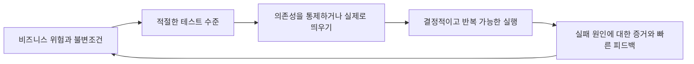
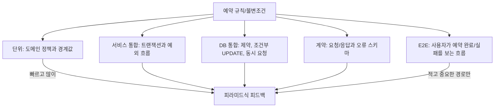
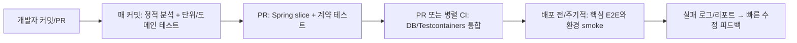

# 테스트 전략: 무엇을, 어느 층에서, 어떻게 검증할까

> **면접 핵심:** 테스트 개수나 coverage 숫자부터 말하지 않는다. 먼저 지켜야 할 비즈니스 규칙을 찾고, 그 규칙을 가장 빠르고 믿을 수 있게 검증하는 테스트 층을 고른다.

## 이력서 경험의 범위

이력서에는 Flutter 테스트를 상당한 규모로 작성했고, **303개 테스트**, 도메인/클린 아키텍처에 따른 분리, CI 경험이 기재되어 있다. 이는 면접에서 강하게 말할 수 있는 증거다. 다만 백엔드 Spring/JPA, 메시지 큐, Kubernetes 테스트를 직접 소유하거나 운영했다고 추정해서는 안 된다.

경험 설명의 기본 문장:

> “제가 직접 경험한 강점은 Flutter 앱에서 테스트를 작성하고, 도메인 로직과 UI/의존성을 분리해 검증 가능한 구조를 만들며, 303개 테스트와 CI 피드백을 활용한 것입니다. Spring/JPA나 메시지 큐, Kubernetes 테스트를 제가 운영했다고 말할 수는 없습니다. 다만 같은 테스트 원칙을 백엔드에 적용한다면 도메인 규칙은 단위 테스트로 빠르게 확인하고, 실제 DB 매핑과 트랜잭션은 통합 테스트, API 계약은 계약 테스트, 중요한 사용자 흐름은 소수의 E2E로 나누겠습니다.”

## Mental model: 위험에서 증거까지

**테스트 전략은 테스트 프레임워크를 나열하는 일이 아니라, 실패 비용이 큰 규칙을 어떤 환경에서 신뢰성 있게 확인할지 정하는 일**이다.

비유하면 테스트는 **건물 안전 점검**과 같다. “건물이 안전하다”는 목표만으로는 검사 방법이 정해지지 않는다. 기둥의 강도는 재료/구조 검사, 문이 잘 열리는지는 현장 작동 검사, 소방 시스템 연동은 실제 설비를 연결한 통합 점검으로 확인한다. 테스트도 같은 방식으로 비즈니스 위험에 맞는 층을 선택한다.

### 예시: 마지막 좌석 한 개의 예약

예약 도메인의 불변조건은 “좌석 수는 음수가 되지 않고, 같은 요청 재시도로 예약이 중복 생성되지 않으며, 좌석 차감과 예약 생성이 함께 성공하거나 함께 실패한다”이다.

- 순수 도메인 규칙은 빠른 단위 테스트에서 다양한 경우를 돌린다.
- Spring 서비스 경계와 트랜잭션 전파/롤백은 필요한 Spring 컨텍스트를 띄운 통합 테스트에서 본다.
- JPA 쿼리, 제약조건, 방언 차이, 동시 갱신은 실제 운영과 같은 DB 엔진을 띄운 통합 테스트로 확인하는 편이 신뢰도가 높다.
- API 응답 형식은 API/계약 테스트로 확인하고, 주요 사용자 여정만 E2E로 검증한다.

## 테스트 피라미드: 층마다 다른 질문에 답한다

테스트 피라미드는 “unit이 반드시 몇 퍼센트여야 한다”는 정량 규칙이 아니다. 보통 **빠르고 작은 테스트를 많이, 느리고 비싼 전체 흐름 테스트는 적고 핵심적인 경로에** 둔다는 설계 지침이다.

| 테스트 층 | 주로 확인하는 것 | 장점 | 한계/비용 |
| --- | --- | --- | --- |
| 단위/도메인 | 계산, 상태 전이, 입력 경계, 정책 | 빠르고 실패 원인이 좁음 | 실제 프레임워크·DB 연결을 검증하지 않음 |
| Spring slice | MVC 바인딩/검증, JPA repository 등 한 계층 | 관련 구성만 로드해 전체 컨텍스트보다 가벼움 | slice에서 제외된 설정/빈 조합은 검증하지 않음 |
| 통합 | 서비스와 DB, Spring transaction, 외부 어댑터 연결 | 실제 배선과 저장 동작을 확인 | 느리고 테스트 환경/데이터 격리가 중요 |
| 계약 | 소비자와 제공자 사이의 요청·응답 또는 이벤트 형식 | 독립 배포 시 호환성 위험을 조기에 발견 | 전체 운영 의미나 런타임 장애를 모두 검증하지 않음 |
| E2E | 실제 앱/서버가 연결된 사용자 핵심 흐름 | 현실에 가까운 신뢰도 | 느리고 흔들리며 실패 원인 파악이 어려움 |

좋은 전략은 피라미드의 모양을 맹목적으로 맞추는 것이 아니라 실패 위험과 실행 비용을 균형 있게 배치한다. 특히 테스트가 느리거나 flaky하면 개발자가 실행을 피하게 되므로, 테스트 개수보다 **유용한 신호 대 실행 시간**을 본다.

## 어느 테스트 층을 선택할까

### 1. 단위 테스트와 도메인 테스트

입력과 출력, 상태 변화를 명확히 표현할 수 있는 순수 규칙을 확인한다. 예를 들어 `수량이 0이면 예약 불가`, `요청 수량이 1 이상`, `취소 가능 기간` 등의 정책은 DB를 띄우지 않고 빠르게 검사한다.

도메인 테스트에서는 동작/결과를 확인한다. private method나 내부 호출 횟수에 과도하게 결합하면 리팩터링만으로 테스트가 깨질 수 있다. 테스트 이름은 `given/when/then` 구조 또는 기대 동작을 문장으로 드러낸다.

### 2. Spring slice와 통합 테스트

Spring MVC controller의 요청 바인딩/검증/응답 매핑은 `@WebMvcTest` 같은 웹 slice로, JPA repository 동작은 `@DataJpaTest` 같은 데이터 slice로 확인할 수 있다. 전체 Spring Boot 컨텍스트 테스트는 실제 설정 조합을 확인하기 좋지만 시작이 무거우므로, 모든 작은 규칙을 여기에 몰지 않는다.

Spring 서비스 통합 테스트는 실제 빈, 트랜잭션, 보안/예외 처리 등 확인하려는 설정을 포함한다. 어떤 어노테이션이 빠져도 테스트가 통과할 수 있으므로, **테스트가 실제로 포함하는 구성요소가 무엇인지** 명시한다. 테스트 트랜잭션이 자동 rollback된다는 점도 주의한다. 비동기 작업, 별도 스레드, 별도 커넥션에서 실행한 변경은 테스트 메서드의 트랜잭션 rollback 범위 밖일 수 있다.

### 3. DB와 Testcontainers

Mock repository는 애플리케이션 코드가 repository를 호출했는지만 보여줄 수 있고, SQL 문법·JPA 매핑·DB 제약·격리 수준·방언 차이가 맞는지는 보여주지 못한다. JPA 쿼리나 조건부 갱신, unique 제약, 동시성처럼 DB에 의존하는 속성은 가능하면 운영과 같은 종류의 DB를 Testcontainers로 띄워 확인한다.

Testcontainers는 테스트 중 일회용 DB/메시지 브로커 등을 컨테이너로 띄워 현실적인 통합 테스트를 돕는다. 장점은 로컬 설치에 덜 의존하고 테스트마다 정해진 초기 상태를 만들 수 있다는 점이다. 단점은 Docker와 이미지 시작으로 실행 시간이 늘고, 네트워크/리소스 및 병렬 실행을 관리해야 한다는 점이다. 모든 테스트에 컨테이너를 붙이지 않고 DB 동작에 대한 핵심 테스트를 선별한다.

예약 경합 테스트는 단일 트랜잭션에서 요청을 순서대로 호출하는 것만으로는 동시성 검증이 되지 않는다. 독립 트랜잭션/스레드에서 같은 재고를 동시에 갱신하고, 최종적으로 성공 개수 1, 실패 개수 1, 잔여 수량 0, 예약 행 1을 확인한다. 동시성 테스트는 타이밍을 sleep으로 추측하지 말고 barrier/latch 같은 동기화 지점으로 경쟁 시작을 맞추고 결과 불변조건을 확인한다. 재시도 정책을 넣었다면 timeout과 재시도 횟수도 제한한다.

### 4. 계약 테스트: REST API와 이벤트 스키마

서비스가 분리되어 독립 배포된다면 소비자와 제공자 사이의 기대를 확인해야 한다. HTTP에서는 요청 경로·필드·nullable 여부·상태 코드·오류 응답을 확인한다. 메시지 이벤트는 topic/라우팅 키, 필수 필드, schema version, 호환 가능한 변경 여부를 확인한다.

Consumer-driven contract 테스트에서는 소비자가 실제로 사용하는 상호작용을 계약으로 기록하고 제공자가 그 계약을 만족하는지 검증할 수 있다. 정적 OpenAPI/JSON Schema 검증과 계약 테스트는 보완 관계다. 계약 테스트는 예시 요청/응답의 호환성을 확인하지만, 브로커 장애·중복 전달·처리 순서까지 모두 검증하지는 않는다.

### 5. End-to-End 테스트

E2E는 사용자의 관점에서 핵심 흐름을 실제 API/UI와 가능한 한 실제 의존성에 가깝게 연결한다. 예를 들면 “상품 조회 → 예약 요청 → 성공 화면 또는 좌석 부족 오류”다. 중요한 사용자 여정, 주요 통합 경계에 사용하고 모든 조합을 E2E로 만들지 않는다. 데이터·시간·네트워크·환경이 통제되지 않으면 flaky하고 원인 분석이 어렵다.

## Test double과 실제 의존성의 선택

| 선택지 | 의미 | 적합한 목적 | 주의점 |
| --- | --- | --- | --- |
| Fake | 실제 규칙 일부를 갖춘 가벼운 대체 구현(예: 메모리 저장소) | 빠른 도메인/서비스 테스트 | 실제 DB와 의미가 달라질 수 있음 |
| Stub | 미리 정한 응답을 반환 | 특정 반환/오류 경로 재현 | 너무 단순하면 현실 동작과 멀어짐 |
| Mock | 호출/인자/호출 횟수까지 검증 | 외부 경계 호출 자체가 동작 계약일 때 | 내부 구현 변경에 민감해질 수 있음 |
| 실제 의존성 | 테스트 DB/브로커/HTTP 서버 사용 | SQL·직렬화·설정·통합 동작 확인 | 느리고 격리 및 관리 비용이 듦 |

핵심 규칙을 mock으로만 검증하면 mock이 실제 구현과 다를 수 있다. 반대로 모든 테스트에서 실제 네트워크/DB를 쓰면 느리고 실패 원인이 넓어진다. 단위 테스트에는 대체물을 쓰되, 각 중요 경계에 실제 의존성을 확인하는 통합/계약 테스트를 둔다. 타사 API는 응답 형식을 stub/mock으로 테스트하고, 별도 소수의 sandbox/contract smoke test로 실제 연결을 확인할 수 있다.

## 신뢰할 수 있는 테스트: 결정성, 데이터, 격리

테스트는 같은 코드와 입력이면 같은 결과를 내야 한다. 현재 시각, 랜덤 값, 네트워크, 환경 변수, 테스트 실행 순서, 공유 DB 상태, 비동기 경합을 통제한다.

- 시간은 고정 가능한 `Clock` 같은 추상화로 주입한다.
- 난수/ID 생성기는 테스트에서 제어하거나 결과를 검증 가능한 속성으로 확인한다.
- 테스트 데이터는 테스트마다 독립적으로 생성하고, 전역 공유 fixture를 수정하지 않는다.
- DB는 각 테스트 전후 정리, rollback, schema 재생성 등 명확한 격리 방식을 정한다.
- 순서에 의존하지 않고 반복/병렬 실행해도 성공해야 한다.
- `sleep(1000)`으로 타이밍을 맞추지 말고 latch, barrier, polling with deadline 등 명시적인 동기화를 쓴다.
- 실패한 테스트는 로그, request/response, DB 상태 등 조사할 증거를 남기되 비밀정보는 출력하지 않는다.

**Flaky test**는 같은 코드 변경 없이도 간헐적으로 통과/실패하는 테스트다. 원인을 시간·공유상태·환경·비동기로 분류하고, 재현과 격리를 먼저 한다. CI에서 무조건 재시도만 해 green으로 덮으면 실제 불안정성을 숨길 수 있다. 임시 quarantine은 원인과 담당자, 복구 기한을 두고 관리한다.

## Coverage, Mutation, Property-based testing

### Coverage가 알려주는 것과 못 알려주는 것

Line/branch coverage는 코드가 실행된 범위를 보여주지만 assertion이 올바른지, 중요한 실패 조건을 검증했는지 보장하지 않는다. 100% coverage도 잘못된 기대값을 검증할 수 있고, 낮은 coverage가 곧바로 큰 위험을 뜻하는 것도 아니다. 위험한 규칙의 대표 성공·실패·경계 사례와 불변조건이 테스트되는지 리뷰한다.

### Mutation testing

Mutation testing은 코드의 비교 연산을 바꾸거나 검증을 제거하는 작은 오류(mutant)를 넣어 기존 테스트가 이를 잡는지 본다. 테스트가 실제로 오류를 감지하는지 확인하는 도구다. 실행 비용이 크므로 돈·권한·재고처럼 중요한 모듈이나 테스트 품질이 의심되는 부분에 선택적으로 적용한다. mutant가 살아남았다고 항상 버그인 것은 아니며 테스트 가능성과 요구 규칙을 함께 검토한다.

### Property-based testing

Property-based test는 입력 몇 개를 직접 적는 대신 입력 범위를 생성하고, 모든 입력에서 지켜져야 할 속성을 확인한다. 예를 들어 모든 유효 수량 입력에서 차감 후 재고가 음수가 되지 않는다, 예약을 취소했다가 다시 계산해도 합계 불변식이 맞는다 같은 성질이다. 반례가 나오면 입력을 줄여 최소 실패 사례를 찾는 도구도 있다. 일반 예시 테스트를 대체하는 것이 아니라 경계값 조합이 많은 순수 규칙에 선택적으로 더한다.

## CI에서 어디서 무엇을 돌릴까

일반 원칙은 가장 빠른 테스트를 가장 자주 실행하고, 느린 검증은 PR이나 배포 전 단계로 둬 피드백 시간과 리스크를 균형 잡는 것이다. 단, CI의 실제 구분은 팀의 파이프라인과 실패 비용에 맞춘다. flaky 테스트나 외부 자원 의존은 별도 job/격리 환경에서 관리하되, 핵심 회귀 검증을 개발자 로컬에서 재현할 수 있어야 한다.

## 면접 질문과 단계별 답변

### 1. 테스트 전략은 어떻게 세우나요?

**짧은 답변:** “먼저 지켜야 할 비즈니스 규칙과 실패 비용을 정하고, 각 규칙을 가장 빠르고 믿을 수 있게 검증할 단위·통합·계약·E2E 층에 배치합니다. 의존성과 데이터를 통제해 테스트를 결정적으로 만들고 CI에서 빠른 피드백을 줍니다.”

**상세 답변:** “예약이라면 재고 음수 방지와 중복 예약 방지 같은 불변조건부터 정합니다. 도메인 정책은 단위 테스트로 많이 확인하고, Spring wiring과 트랜잭션은 통합 테스트, JPA 제약과 동시 갱신은 운영 DB와 같은 엔진의 Testcontainers, API/이벤트 호환성은 계약 테스트, 핵심 사용자 흐름은 소수의 E2E로 확인합니다. 각 테스트가 잡으려는 위험과 속도/유지비를 함께 보고 CI에 배치합니다.”

**경험 답변:** “제가 직접 경험한 것은 Flutter에서 도메인/화면 책임을 나눠 테스트를 작성하고, 303개 테스트와 CI를 통해 변경 피드백을 받았던 부분입니다. 백엔드 JPA나 DB 동시성 테스트를 제가 소유했다고 말할 수는 없습니다. 백엔드라면 같은 원칙으로 도메인 규칙과 실제 DB 동작을 서로 다른 층에서 검증하겠습니다.”

**꼬리 질문 1 — 테스트 피라미드를 꼭 따라야 하나요?**  
**답변:** “정해진 테스트 비율을 맞추는 규칙으로 보지는 않습니다. 빠른 테스트를 많이 두고 느리고 비싼 테스트는 핵심 위험에 집중하면 피드백이 빨라지는 경향이 있습니다. 시스템의 주요 실패가 통합 배선에서 난다면 통합 테스트 비중이 커질 수 있습니다.”

**꼬리 질문 2 — 단위 테스트가 많은데 프로덕션 버그가 계속 나면요?**  
**답변:** “테스트가 중요한 경계나 실제 실패 모드를 검증했는지 봅니다. 단위 테스트는 통과하지만 실제 SQL/직렬화/설정에서 실패했다면 해당 경계의 통합·계약 테스트가 부족한 겁니다. 장애 사례를 회귀 테스트로 추가하되, 가장 낮고 현실적인 테스트 층에서 재현하겠습니다.”

### 2. Mock과 실제 DB 중 무엇을 쓰나요?

**짧은 답변:** “순수 비즈니스 규칙에는 fake/mock으로 빠르게 테스트하고, SQL·JPA 매핑·제약·트랜잭션은 실제 DB 기반 통합 테스트로 확인합니다. Mock만으로 DB 동작을 검증했다고 보지는 않습니다.”

**상세 답변:** “Mock은 결과와 오류를 통제하기 좋지만 실제 DB의 SQL 문법, 제약조건, 격리 수준을 증명하지 못합니다. 반대로 모든 테스트에서 DB를 띄우면 느려집니다. 그래서 도메인 단위 테스트는 가볍게 하고, 데이터 접근 계층에는 운영과 같은 엔진을 Testcontainers로 띄우는 테스트를 둡니다. repository mock에만 의존하지 않고 실제 쿼리 결과와 롤백을 확인합니다.”

**경험 답변:** “제 강점은 Flutter 테스트에서 외부 의존성을 분리해 도메인 규칙을 검증한 경험입니다. Spring/JPA 테스트에서 Testcontainers를 직접 운영했다고 주장하지 않습니다. 백엔드 업무에서는 우선 테스트 목표를 나누고, 쿼리와 제약을 실제 DB에서 검증하는 방식을 적용하겠습니다.”

**꼬리 질문 1 — Mock은 언제 문제가 되나요?**  
**답변:** “테스트가 실제 구현의 동작이 아니라 mock 설정을 검증할 때입니다. mock은 특정 호출 순서에 결합해 리팩터링을 어렵게 할 수도 있습니다. 외부 경계 응답을 통제할 때 쓰고, 통합 경계에는 실제 의존성 테스트를 보완합니다.”

**꼬리 질문 2 — H2 같은 인메모리 DB면 충분하지 않나요?**  
**답변:** “빠르고 편리하지만 운영 DB와 SQL 방언, 타입, 제약, 격리 동작이 다를 수 있습니다. 도메인 논리 테스트에는 적절할 수 있지만 운영 DB에 의존하는 쿼리와 동시성은 실제 엔진을 사용한 검증이 더 신뢰할 만합니다.”

### 3. 마지막 재고 1개에 동시 예약이 오면 어떻게 테스트하나요?

**짧은 답변:** “독립 트랜잭션 두 개를 실제 DB에 동시에 보내고, 결과 성공 1·실패 1, 잔여 수량 0, 예약 행 1이라는 불변조건을 확인합니다. sleep에 기대지 않고 barrier/latch로 동시 시작을 맞춥니다.”

**상세 답변:** “테스트 데이터로 재고 1개를 만들고 각 요청은 다른 트랜잭션과 커넥션에서 같은 재고를 차감합니다. 동시에 시작하도록 동기화한 뒤 모든 작업이 끝날 때까지 기다리고, 응답 상태만이 아니라 DB의 최종 재고와 예약 수를 확인합니다. 재시도/낙관적 락 예외 처리도 함께 확인합니다. 테스트 트랜잭션 자동 rollback을 쓰면 스레드별 트랜잭션을 제대로 격리했는지 확인하고, 테스트 후 상태를 명시적으로 정리합니다.”

**경험 답변:** “실제 백엔드 재고 경합 테스트를 만든 경험은 없습니다. 이력서의 테스트 실적은 Flutter 앱 쪽입니다. 여기서는 동시성 불변조건을 실제 DB에서 재현하는 설계를 설명하고 있으며, 구현한다면 실행 안정성과 독립 트랜잭션을 먼저 확인하겠습니다.”

**꼬리 질문 1 — 단위 테스트에서 두 번 호출하면 동시성 테스트 아닌가요?**  
**답변:** “순서대로 호출하면 경쟁 상황을 만들지 않습니다. 두 호출이 같은 잔여 수량을 읽고 경쟁하도록 별도 스레드/트랜잭션과 동기화 장치가 필요합니다. 그래도 실행 스케줄에 따라 경쟁이 충분히 발생하지 않을 수 있어 반복 실행이나 통제 가능한 barrier를 둡니다.”

**꼬리 질문 2 — 테스트 한 번 통과하면 동시성 버그가 없나요?**  
**답변:** “아닙니다. 한 테스트 실행은 특정 스케줄만 관찰합니다. DB 제약/원자 UPDATE 같은 보장 수단을 검토하고, 동시 실행 반복·실패 주입·실행계획/격리 수준 확인을 보완합니다. 테스트와 설계 보장을 함께 봅니다.”

### 4. Spring 테스트에서 slice와 전체 컨텍스트 통합 테스트는 어떻게 나누나요?

**짧은 답변:** “Controller 바인딩/검증은 웹 slice, JPA repository 동작은 데이터 slice, 실제 서비스 wiring·트랜잭션·보안 조합은 필요한 경우 전체 통합 테스트로 검증합니다. 원하는 테스트가 어떤 설정을 실제로 로드하는지 확인합니다.”

**상세 답변:** “작은 단위 검증마다 전체 Spring 컨텍스트를 띄우면 느리고 설정 실패 원인도 넓습니다. `@WebMvcTest`는 MVC 계층, `@DataJpaTest`는 JPA 계층처럼 해당 경계에 가까운 slice를 쓸 수 있습니다. 여러 빈의 조합이나 트랜잭션 경계, 보안 필터까지 검증해야 할 때 전체 컨텍스트 통합 테스트를 둡니다. 어노테이션 이름만 믿지 말고 실제 import된 빈과 설정을 확인하고, 자동 rollback이 비동기/별도 트랜잭션까지 덮지 않는 점을 고려합니다.”

**경험 답변:** “Spring slice 테스트를 직접 구성한 경험은 이력서에 없습니다. Flutter에서 책임 단위로 테스트를 분리한 경험을 기반으로, Spring에서는 확인하려는 계층만 로드하는 slice와 설정 조합을 보는 통합 테스트를 구분해 배우겠습니다.”

**꼬리 질문 1 — 왜 전체 `@SpringBootTest`를 매번 쓰지 않나요?**  
**답변:** “컨텍스트 시작이 무겁고 실패 원인이 넓어져 피드백이 느려질 수 있습니다. 모든 빈이 함께 동작하는 위험을 확인할 때는 유용하지만, controller 한 계층의 바인딩 검증은 slice가 더 빠르고 원인이 명확합니다.”

**꼬리 질문 2 — 테스트 트랜잭션이 rollback되니 데이터 정리가 필요 없나요?**  
**답변:** “같은 트랜잭션에 참여한 작업만 rollback됩니다. 별도 스레드/커넥션의 트랜잭션이나 비동기 작업은 범위 밖일 수 있고, 테스트 과정에서 commit을 명시할 수도 있습니다. 실행 방식에 맞춰 격리와 정리 전략을 확인해야 합니다.”

### 5. Contract test와 E2E는 어떻게 다르죠?

**짧은 답변:** “계약 테스트는 소비자와 제공자 사이의 요청/응답 또는 이벤트 형식과 호환성을 검증하고, E2E는 여러 구성요소를 연결한 실제 사용자 흐름을 검증합니다. 계약 테스트는 빠른 경계 피드백, E2E는 통합된 동작 증거에 강합니다.”

**상세 답변:** “모바일 앱이 API를 쓰는 예에서 계약 테스트는 실제 사용하는 필드, nullable 규칙, 상태 코드, 오류 스키마가 서버 변경 뒤에도 호환되는지 확인합니다. 이벤트라면 schema version과 필드 호환성을 봅니다. E2E는 상품 조회부터 예약 결과 화면까지 연결합니다. 계약 테스트가 통과해도 사용 흐름 전체나 운영 장애가 맞는 건 아니고, E2E는 느리고 flaky하기 쉬우므로 중요한 경로 위주로 둡니다.”

**경험 답변:** “Flutter 앱과 백엔드 사이의 계약 테스트를 직접 소유했다고 말할 수는 없습니다. 앱 테스트 경험은 있지만, Pact 기반 consumer/provider 검증이나 이벤트 schema 검증을 했다고 주장하지 않습니다. API 의존성이 있는 팀에서는 계약을 CI에 넣어 독립 배포 호환성을 확인하는 접근을 제안하겠습니다.”

**꼬리 질문 1 — OpenAPI 스키마만 검사하면 계약 테스트가 되나요?**  
**답변:** “스키마 검증은 필드 구조와 형식의 계약을 확인하는 좋은 방법이지만, 실제 소비자가 쓰는 상호작용과 제공자 동작을 재생해 검증하는 계약 테스트와 범위가 다릅니다. 두 방식은 중복이 아니라 보완 관계가 될 수 있습니다.”

**꼬리 질문 2 — 메시지 큐 이벤트는 무엇을 계약으로 보나요?**  
**답변:** “이벤트 이름/topic, 필수 필드와 타입, schema version, 호환 가능한 변경, key/partition 의미, 중복 전달 가능성 등을 봅니다. 스키마 검증만으로 순서나 재전달 동작은 확인할 수 없으므로 consumer 동작 테스트와 브로커 통합 테스트를 더할 수 있습니다.”

### 6. Flaky test는 어떻게 다루나요?

**짧은 답변:** “먼저 시간·공유 데이터·순서 의존·네트워크·비동기 경합 중 원인을 분류하고 재현합니다. 무작정 CI 재시도로 통과시키지 않고, 테스트 간 격리와 결정적 입력/동기화를 고칩니다.”

**상세 답변:** “반복 실행과 병렬 실행에서 실패를 재현하고, 로그를 통해 환경/시간/상태를 좁힙니다. 랜덤과 clock을 주입해 고정하고, 테스트 데이터 격리, async 기다림의 timeout, 네트워크 stub, `sleep` 제거 등을 합니다. 일시 quarantine이 필요하면 원인·책임자·기한을 남깁니다. CI retry는 인프라 일시 오류를 구분하는 보조 수단이지 품질 해결책이 아닙니다.”

**경험 답변:** “303개 Flutter 테스트와 CI를 다룬 경험에서 자동 테스트의 빠른 피드백이 중요하다는 점을 배웠습니다. 구체적인 flaky 테스트 해결 사례는 실제 경험을 확인해 설명하겠습니다. 백엔드 테스트에서도 재시도만으로 숨기지 않고 시간과 상태 의존성을 먼저 찾겠습니다.”

**꼬리 질문 1 — CI에서만 실패하면 무엇을 보나요?**  
**답변:** “환경 변수, timezone/locale, 병렬 실행, 리소스 제약, 네트워크 접근, 파일 시스템 경로, 테스트 순서 의존을 봅니다. CI에서만 재현되는 실행 조건을 로컬에서 흉내 내거나 로그/환경 정보를 비교합니다.”

**꼬리 질문 2 — flaky 테스트를 잠깐 빼도 되나요?**  
**답변:** “릴리스 차단을 계속 일으키면 임시 격리는 가능하지만, 위험과 사유를 기록하고 담당자와 기한을 정해야 합니다. 테스트를 영구 비활성화하거나 실패를 retry로 덮으면 회귀 신호를 잃습니다.”

### 7. Coverage 100%가 목표인가요?

**짧은 답변:** “Coverage는 실행된 코드 범위를 보여줄 뿐 테스트가 올바른 결과를 주장하는지는 보장하지 않습니다. 중요한 규칙과 경계 조건을 검증하고, coverage는 빠진 영역을 찾는 보조 지표로 씁니다.”

**상세 답변:** “라인/브랜치가 실행돼도 assertion이 부족하거나 잘못된 기대값이면 버그를 잡지 못합니다. 반대로 단순한 generated code까지 같은 수준으로 테스트할 필요는 없을 수 있습니다. 재고 음수 금지, 중복 요청, 권한 실패처럼 실패 비용이 큰 속성을 기준으로 성공/실패/경계 사례를 선정하고 coverage를 보조적으로 살핍니다. Mutation testing은 일부 핵심 모듈에서 테스트가 작은 잘못된 변경을 잡는지 선택적으로 점검할 수 있습니다.”

**경험 답변:** “이력서의 303개 테스트는 검증 규모의 근거로 말할 수 있지만, 그 숫자만으로 품질이나 coverage를 주장하지 않겠습니다. 어떤 기능과 규칙을 테스트했는지, CI에서 어떻게 실행했는지를 함께 설명하겠습니다.”

**꼬리 질문 1 — Mutation testing은 무엇인가요?**  
**답변:** “코드에 비교 연산 반전이나 조건 제거 같은 작은 변형을 넣고 기존 테스트가 실패하는지 봅니다. 살아남은 mutant가 있으면 테스트가 놓친 동작이 있는지 조사합니다. 비싸므로 위험도가 높은 코드에 선별적으로 적용합니다.”

**꼬리 질문 2 — Property-based testing은 예시 테스트와 무엇이 다른가요?**  
**답변:** “예시 테스트가 특정 입력과 기대값을 확인한다면, property-based test는 여러 입력을 생성해 항상 성립해야 하는 불변식을 확인합니다. 수량이 음수가 되지 않는 것처럼 입력 공간이 넓은 규칙에 유용하지만 대표 예시 테스트를 완전히 대체하지는 않습니다.”

### 8. 이력서의 Flutter 테스트 경험을 Spring 백엔드에 어떻게 적용하겠습니까?

**짧은 답변:** “도메인 규칙과 외부 의존성을 분리해 빠르게 검증하고, 실제 Spring wiring·DB·API 계약은 그 경계에 맞는 통합 테스트로 보완하겠습니다. 기존 경험은 Flutter 테스트와 CI이며, 백엔드 프레임워크의 테스트 운영 경험은 별도로 쌓아야 합니다.”

**상세 답변:** “Flutter에서 도메인 로직을 UI와 분리하면 단위 테스트가 쉬워졌던 것처럼, 백엔드에서도 예약 정책을 순수한 도메인 규칙으로 표현하면 빠르게 검증할 수 있습니다. 다만 Spring transaction이나 JPA query는 순수 단위 테스트만으로 보장되지 않으므로 실제 DB 기반 통합 테스트를 더하고, API 소비자와 계약 테스트, 핵심 사용자 흐름 E2E를 나눕니다. 303개라는 수량보다 테스트가 어떤 위험을 줄였고 CI에서 어떤 피드백을 줬는지 설명하겠습니다.”

**경험 답변:** “제가 실제로 해 온 것은 Flutter 테스트, 도메인 분리, CI에서의 자동 실행입니다. Spring/JPA·MQ·Kubernetes 테스트를 이미 운영했다고 과장하지 않고, 원칙을 백엔드 환경에 맞게 적용하겠다고 답하겠습니다.”

**꼬리 질문 1 — 백엔드 테스트 경험이 부족하면 바로 기여할 수 있나요?**  
**답변:** “도메인 규칙을 명확히 만들고 테스트 가능한 경계를 나누는 경험은 바로 적용할 수 있습니다. 다만 Spring/JPA 특유의 트랜잭션, 실제 DB 격리와 Testcontainers는 팀의 기존 테스트를 따라 작은 테스트부터 작성하며 익히겠습니다.”

**꼬리 질문 2 — 테스트를 추가하는 데 시간이 너무 많이 들면요?**  
**답변:** “모든 코드를 같은 깊이로 테스트하지 않고 변경의 실패 비용과 불변조건을 우선합니다. 먼저 값싼 도메인 테스트와 이번 수정의 회귀 사례를 추가하고, 실제 DB/계약/E2E는 해당 경계의 위험이 있을 때 보완합니다.”

## 면접 직전 체크리스트

- 테스트를 쓰기 전에 어떤 비즈니스 규칙과 실패 비용을 지키는지 말한다.
- 단위 테스트는 빠른 도메인 규칙, 통합 테스트는 실제 wiring/DB 경계를 검증한다고 구분한다.
- Mock은 외부 의존성을 제어하지만 실제 DB 의미를 보장하지 않는다고 설명한다.
- 동시성은 독립 트랜잭션과 최종 DB 불변조건으로 확인한다.
- API/이벤트 계약 테스트와 전체 사용자 E2E의 목적을 나눈다.
- CI 재시도나 coverage 숫자를 품질의 대리 지표로 삼지 않는다.
- 본인 경험은 Flutter·303 tests·도메인 분리·CI라고 명확히 하고, 백엔드 테스트 경험은 과장하지 않는다.

## 공식 문서와 참고 자료

- [Flutter 테스트 개요](https://docs.flutter.dev/testing/overview) — unit/widget/integration 테스트의 목적과 trade-off
- [Flutter unit test 소개](https://docs.flutter.dev/cookbook/testing/unit/introduction) — Dart 로직 단위 테스트
- [Flutter integration test 소개](https://docs.flutter.dev/cookbook/testing/integration/introduction) — 전체 앱의 통합 흐름 테스트
- [Spring Boot Testing](https://docs.spring.io/spring-boot/reference/testing/) — Spring Boot 테스트 지원
- [Spring Boot Test Slices](https://docs.spring.io/spring-boot/appendix/test-auto-configuration/slices.html) — `@WebMvcTest`, `@DataJpaTest` 등 slice
- [Testcontainers for Java](https://java.testcontainers.org/) — 일회용 DB/브로커 컨테이너를 이용한 통합 테스트
- [Pact Consumer Tests](https://docs.pact.io/implementation_guides/go/docs/consumer) — consumer-driven contract 테스트 흐름
- [Pact 문서](https://docs.pact.io/) — consumer와 provider 간 계약 테스트
- [jqwik User Guide](https://jqwik.net/docs/current/user-guide) — JUnit Platform 기반 property-based testing
- [Google Testing Blog: Test Pyramid](https://testing.googleblog.com/2015/) — 테스트 피라미드 관련 글 모음
