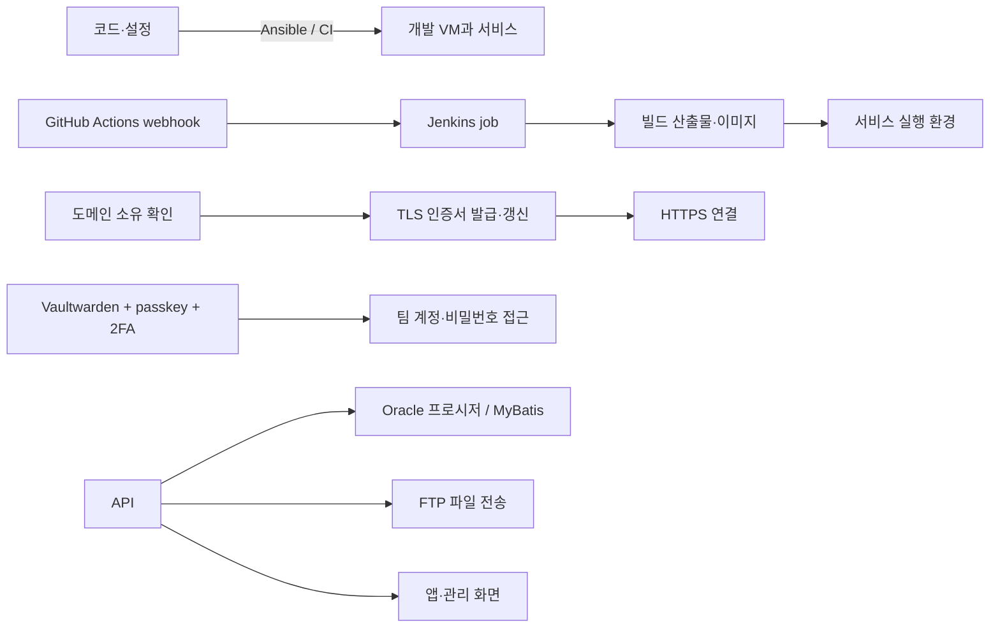
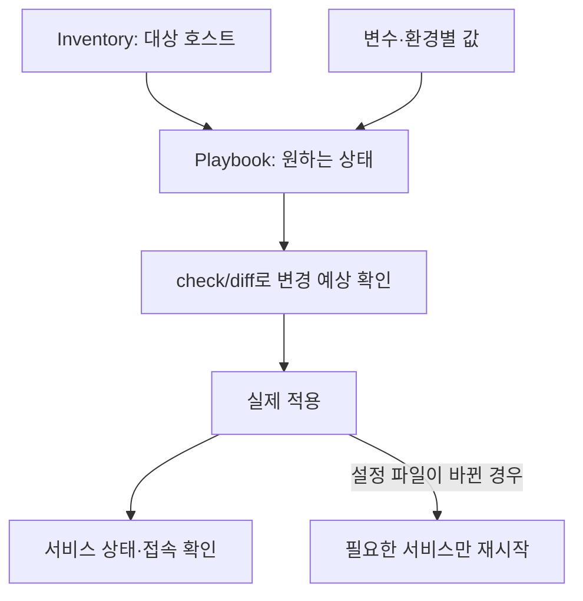
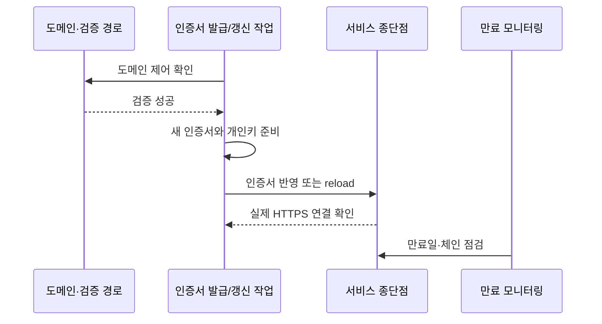
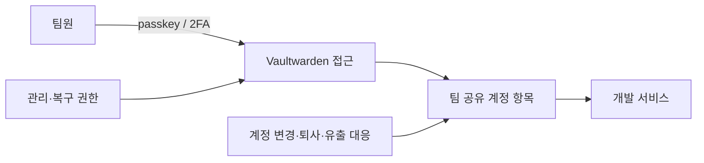
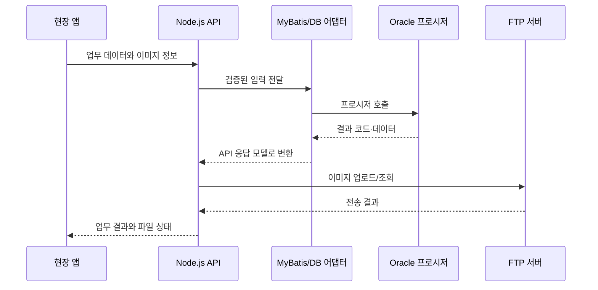

## 이력서의 운영·통합 경험: 실제로 만든 것과 확인할 것

앞선 문서가 백엔드 면접의 중심 개념을 다뤘다면, 이 문서는 이력서에 직접 적힌 운영·통합 키워드를 빠짐없이 짚습니다. 특히 면접에서는 기술 이름보다 **내가 바꾼 상태, 실패했을 때 확인한 증거, 안전성을 보장한 방법**을 물을 수 있습니다.

>이력서와 공개 저장소([youngmin-gwon/ansibles](https://github.com/youngmin-gwon/ansibles))로 확인된 사실은 답변에 넣었습니다. 각 절의 "내가 확인할 것"은 기억으로 채울 세부이며, 기억나지 않으면 이력서 수준으로 말하고 원리로 이어갑니다.

### 1. Ansible: VM 을 원하는 상태로 맞추기

**비유:** 매번 서버를 손으로 세팅하는 대신, "이 서버에는 사용자·패키지·설정 파일·서비스가 이 상태여야 한다"는 작업 지침을 반복 적용하는 것입니다.

Ansible playbook 은 대상 호스트에 수행할 작업을 선언합니다. idempotent 한 작업은 원하는 상태에 이미 도달했으면 불필요한 변경을 하지 않습니다. 하지만 임의의 shell 명령은 반복 실행해도 안전하다고 보장되지 않으므로 작업별로 확인해야 합니다. Check mode 는 변경 전 예상 결과를 점검하는 데 도움을 주지만, 모든 모듈과 조건식을 완벽하게 시뮬레이션하지는 않습니다.

Playbook 을 읽거나 설명할 때는 아래 구성요소를 실제 파일과 연결합니다.

- **Inventory:** 어느 VM/그룹에 적용하는지, 개발·운영 대상을 어떻게 구분하는지
- **Variables/templates:** 포트·경로·도메인처럼 환경마다 다른 값과 생성 설정의 템플릿
- **Tasks/modules:** 패키지 설치, 디렉터리/권한, 설정 파일, 서비스 상태처럼 원하는 결과를 선언하는 작업
- **Handlers:** 설정 변경이 있을 때만 서비스 reload/restart 를 한 번 실행하도록 연결
- **Secrets:** 비밀번호·키를 저장소에 평문으로 넣지 않고 제한된 방식으로 전달·보관
- **Verification:** 적용 결과, 변경 수, 서비스 health 와 실제 접속으로 확인

반복 적용 시 `changed=0` 이 되는지는 유용한 신호지만, 그것만으로 전체 서버의 재현성과 안전성이 증명되지는 않습니다. 대상 환경, 외부 패키지 버전, 조건문, shell 명령의 부작용, 비밀값 주입, 서비스 검증까지 함께 봅니다.

**질문: Ansible 을 왜 썼고, 멱등성이란 무엇인가요?**

- **짧은 답:** "개발 VM 의 초기 구성을 코드로 남겨 재생성이나 변경 때 같은 절차를 적용하려고 썼습니다. 멱등성은 같은 작업을 반복 적용해도 목표 상태가 이미 맞으면 추가 변경이 발생하지 않는 성질입니다."
- **경험형 답:** "개인 개발 환경을 Ansible 로 관리하던 방식을 개발 서버 VM 에 옮겼습니다. 공개해 둔 개인 playbook 은 도구마다 역할(role)을 나누고 OS 별로 태스크를 분기하며, 프로젝트 안에 고정한 Ansible 버전과 Galaxy collection 으로 누가 실행해도 같은 도구 버전으로 돌게 했고, ansible-lint 를 GitHub Actions 에서 돌립니다. 개발 VM 도 같은 방식으로 구성해, 여러 번 적용해도 원하는 상태로 수렴하게 했습니다."

**공개 개인 playbook 에서 말할 수 있는 설계 (README·설정 기준)**

- **사람이 해야 하는 일만 스크립트에 남김:** 브라우저 OAuth 로그인과 SSH 키 passphrase 입력만 `provision` 스크립트에 두고, 나머지는 playbook 이 매번 같은 상태로 수렴시키며 무엇이 바뀌었는지 보여 줍니다.
- **권한 분리:** 관리자 권한이 필요한 태스크에 `privileged` 태그를 붙여, `--skip-tags privileged` 로 sudo 없이 사용자 영역만 적용할 수 있습니다.
- **비밀값을 저장소 밖에 둠:** Ansible Vault 를 쓰지 않고, 토큰은 실행 시 환경 변수나 extra vars 로 넣습니다. 특정 비밀 관리 도구에 저장소를 묶지 않으려는 선택입니다.
- **조용한 실패 방지:** `inject_facts_as_vars = False` 로 옛 fact 이름을 미리 꺼서, 이름이 사라졌을 때 `when` 조건이 경고 없이 항상 거짓이 되는 문제를 바로 드러나게 했습니다.

>위 네 가지는 개인 playbook 의 사실입니다. 개발 VM playbook 에도 그대로 적용했는지는 기억대로 말합니다.

**꼬리질문 1: 멱등성과 재현성은 같은 말인가요?**

**답변:** "관련은 있지만 같은 의미는 아닙니다. 멱등성은 반복 적용 시 불필요한 상태 변경이 없는 성질이고, 재현성은 동일한 코드·입력·환경 조건에서 원하는 결과를 다시 얻는 성질입니다. 외부 저장소의 최신 패키지처럼 입력이 바뀌면 멱등하게 실행해도 결과 버전은 달라질 수 있습니다."

**꼬리질문 2: 서버에 잘못된 설정을 적용하면 어떻게 확인하고 복구하나요?**

**답변:** "변경 범위와 대상 호스트를 확인하고, 가능한 작업은 check/diff 로 예상 결과를 검토합니다. 적용 뒤에는 서비스 상태와 실제 접속 경로를 확인하고 실패 시 변경 전 설정으로 되돌리거나 수정 playbook 을 적용합니다. 설정이 코드로 남아 있으므로 Git 에서 이전 커밋으로 되돌려 다시 적용하는 것이 가장 확실한 복구입니다."

**꼬리질문 3: 같은 playbook 을 여러 번 돌리면 항상 안전한가요?**

**답변:** "항상은 아닙니다. Ansible 모듈은 원하는 상태를 확인하는 방식으로 반복 실행을 안전하게 만들 수 있지만, 임의의 shell 명령이 파일을 매번 append 하거나 사용자를 중복 생성하면 부작용이 납니다. 변경 여부를 정확히 보고하도록 만들고, 개발 VM 에서 반복 적용해 두 번째 실행의 변경과 서비스 동작을 확인해야 합니다."

**꼬리질문 4: 비밀번호나 API key 는 playbook 변수에 넣나요?**

**답변:** "저장소에 평문으로 커밋하지 않습니다. 제 개인 playbook 은 Ansible Vault 도 쓰지 않고, 비밀값을 저장소 밖에 둔 채 실행할 때 환경 변수나 extra vars 로 넣습니다. 예를 들어 GitHub 토큰은 비밀번호 관리자 CLI 에서 꺼내 환경 변수로 넘깁니다. 저장소가 특정 비밀 관리 도구에 묶이면 그 도구가 없는 환경에서 오히려 막히기 때문입니다. 실행 로그에 값이 찍히지 않도록 `no_log` 와 권한 범위도 함께 봅니다."

**꼬리질문 5: 개인용 playbook 을 팀 개발 VM 에 옮길 때 무엇을 바꿔야 하나요?**

**답변:** "개인 경로와 계정, 고정 IP, 개인 비밀값을 분리하고 팀의 inventory·권한·환경변수 기준에 맞춥니다. 대상 호스트를 제한해 적용하고, check/diff 검토와 서비스 검증을 둡니다. 문서화되지 않은 수동 선행조건을 찾아 제거해야 다른 팀원도 같은 결과를 얻을 수 있습니다. 개인 playbook 에서도 사람이 꼭 해야 하는 일(브라우저 로그인, 키 passphrase 입력)만 남기고 나머지는 playbook 으로 옮겨, 남은 수동 단계가 무엇인지 README 에 분명히 적었습니다."

**내가 확인할 것:** 관리한 호스트·OS, 패키지와 계정, 설정 파일, 서비스 재시작 방식, inventory 와 환경별 변수, 비밀값 저장 방식, check mode 사용 여부, 실행 결과 확인법, 두 번째 실행에서 changed 수가 어떻게 달라지는지, 실패 시 복구법, 개인 playbook 에서 팀 개발 VM 으로 옮길 때 바꾼 점.

### 2. SSL 인증서 자동 갱신: 발급 성공에서 HTTPS 적용까지

**비유:** 인증서는 웹서비스의 신분증입니다. 새 신분증을 발급받는 일만 자동화해도, 실제 서비스가 새 신분증을 읽고 연결을 계속 제공하는지 확인해야 자동화가 완성됩니다.

인증서 갱신은 보통 도메인 제어 확인, 인증서 발급, 파일/서비스 반영, 웹 서버 또는 로드밸런서 재적용, 만료 모니터링으로 이어집니다. 이력서에는 Ncloud 설정으로 수동 갱신을 자동화했다고만 적혀 있으므로 ACME, DNS challenge, Ncloud 특정 기능 중 무엇을 사용했는지는 구현 사실을 확인하기 전까지 단정하지 않습니다.

**질문: 인증서 갱신을 자동화했다고 했는데 무엇을 자동화했나요?**

- **짧은 답:** "Ncloud 설정을 조정해 수동으로 하던 SSL 인증서 갱신 절차를 자동화했습니다. 사람이 갱신 시점을 기억해야 하는 절차를 없애, 인증서가 만료돼 서비스 접속이 끊길 위험을 줄였습니다."
- **경험형 답:** "인증서 갱신은 사람이 기억에 의존하면 언젠가 놓치는 종류의 일이라 자동화 대상이었습니다. 자동 갱신은 새 인증서 발급만으로 끝나지 않고, 도메인 검증, 서비스(로드밸런서 등)에 새 인증서 반영, 갱신 실패 감지까지 이어져야 완성된다고 봅니다."

**꼬리질문 1: 갱신 작업이 성공했다고 나오면 끝인가요?**

**답변:** "아닙니다. 파일이 새로 만들어졌어도 웹 서버나 로드밸런서가 이전 인증서를 계속 제공할 수 있습니다. 실제 외부 연결에서 인증서의 만료일과 도메인, 체인을 확인하고, 서비스가 reload/restart 후 정상 응답하는지 확인해야 합니다."

**꼬리질문 2: 자동 갱신이 실패하면 어떻게 알 수 있나요?**

**답변:** "작업 결과만 남기지 말고 만료 임박 알림과 갱신 실패 알림을 둬야 합니다. 장애가 나면 인증서 만료일, 도메인 검증, 권한/경로, 서비스 반영 로그를 순서대로 확인합니다."

**내가 확인할 것:** Ncloud 에서 조정한 기능, 인증서 발급 주체, 검증 방식, 갱신 주기/트리거, 인증서가 적용되는 위치(서버·LB·Ingress 등), reload 여부, 성공 검증, 실패 알림, 개인키 권한과 백업.

### 3. Vaultwarden, passkey, 2 단계 인증: 계정 관리 경계

Vaultwarden 은 비밀번호 관리 서버이고, passkey 는 공개키 암호를 이용하는 로그인 자격증명입니다. 2 단계 인증은 비밀번호 외에 추가 증거를 요구하는 인증 방식의 범주입니다. 서비스 계정의 비밀번호를 한곳에 모으는 것은 공유와 회수를 쉽게 하지만, 저장소 관리자 계정과 복구 절차가 새로운 중요 보안 경계가 됩니다.

**질문: Vaultwarden 을 도입한 이유와 보안상 주의점은 무엇인가요?**

- **짧은 답:** "흩어진 개발 계정과 비밀번호를 팀이 정한 한곳에서 관리하고 접근 절차를 통일하려고 도입했습니다. 저장소 자체의 접근 통제와 복구·회수 절차도 함께 관리해야 합니다."
- **경험형 답:** "팀 서비스 계정을 흩어진 문서 대신 자체 호스팅 Vaultwarden 에 정리하고, 접근에는 passkey 와 2 단계 인증을 적용했습니다. 계정 공유를 편하게 만드는 동시에 저장소 접근 권한이 넓어지지 않도록 팀 규칙을 정리한 작업입니다."

**꼬리질문 1: passkey 와 2 단계 인증은 같은 건가요?**

**답변:** "같은 말은 아닙니다. passkey 는 공개키 기반 로그인 자격증명이고, 2 단계 인증은 두 가지 이상의 독립된 인증 요소를 요구하는 개념입니다. passkey 를 어떤 로그인 정책으로 쓰느냐에 따라 인증 단계의 의미가 달라집니다. 저희는 Vaultwarden 접근에 passkey 와 2 단계 인증을 함께 적용해, 비밀번호 하나가 새어도 금고에 들어갈 수 없게 했습니다."

**꼬리질문 2: 팀원이 퇴사하거나 비밀번호가 유출되면요?**

**답변:** "Vaultwarden 접근 권한을 회수하고, 영향을 받은 서비스 자격증명을 회전한 다음 사용처를 확인해야 합니다. 저장소 관리자와 복구 수단도 별도로 보호해야 합니다. 도입 자체가 비밀값 회전까지 자동으로 해주지는 않으므로 계정별 담당과 회수 절차가 필요합니다. 관리자 페이지도 공격 지점이라, 제 개인 playbook 의 Vaultwarden 역할은 관리자 페이지를 기본으로 꺼 두고 필요할 때만 Argon2 해시 토큰을 실행 시 넣어 켜게 했습니다."

**내가 확인할 것:** 서버 운영 주체와 백업·복구 책임, 멤버 추가/회수 권한, passkey 와 2FA 실제 설정, 팀 공유 컬렉션 권한, 계정 회전 규칙, 서비스별 비밀값을 코드·로그에 노출하지 않도록 한 방법.

### 4. Oracle 프로시저·MyBatis·FTP: 레거시 경계에서 실패를 다루기

**비유:** API 는 새 접수 창구, 저장 프로시저는 기존 업무 시스템 안의 절차서, MyBatis 는 SQL 과 입력·결과 객체를 연결하는 어댑터입니다. FTP 는 업무 데이터와 별도로 움직이는 파일 운송 경로입니다.

- 저장 프로시저를 호출할 때 입력값, 결과값, 오류 코드를 애플리케이션의 계약으로 명확히 바꿔야 합니다.
- 트랜잭션을 애플리케이션과 DB 중 어디서 시작·커밋하는지 확인해야 합니다. 파일 전송은 보통 DB 트랜잭션 하나로 원자 처리되지 않으므로 상태 추적과 재처리 규칙이 필요합니다.
- 파일 전송은 임시 이름으로 올린 뒤 완료 시 최종 이름으로 바꾸고, 크기/체크섬을 확인하며, 재시도와 중복 전송, 오래된 임시 파일 정리 정책을 둘 수 있습니다. 실제로 적용한 방식만 본인 경험으로 말하세요.
- Django API 를 Node.js 로 전환할 때는 응답 형식, 상태 코드, 데이터 변환, 오류 동작의 호환성을 비교해야 합니다. 기존 클라이언트를 한 번에 바꾸기 어렵다면 호환 가능한 단계적 전환이 중요합니다.

**질문: 저장 프로시저와 MyBatis 는 각각 어떤 역할인가요?**

- **짧은 답:** "저장 프로시저는 DB 안에서 실행되는 업무 처리 절차이고, MyBatis 는 애플리케이션의 SQL 과 입력·결과 객체를 연결하는 매퍼입니다."
- **경험형 답:** "공정·입고·출입 검사 업무를 Flutter 앱과 Node.js API 로 다시 만들면서 저장 프로시저 매퍼 13 종을 구현해 기존 Oracle 시스템과 연결했습니다. 기존 업무 규칙은 프로시저에 둔 채 호출하고, API 는 앱과 프로시저 사이에서 입력과 결과·오류 코드를 변환하는 역할이었습니다. 이미지는 FTP 로 따로 전송했습니다."

**꼬리질문 1: FTP 전송 도중 연결이 끊기면 어떻게 하나요?**

**답변:** "DB 반영과 파일 전송을 하나의 원자 트랜잭션으로 간주하면 안 됩니다. 파일별 전송 상태와 식별자를 기록하고, 재시도 시 중복을 판별하며, 완료 파일의 크기나 체크섬을 확인하는 방식을 고려합니다. Nportverse 에서 기기 간 파일 전송을 설계할 때도 파일 설명과 체크섬을 본문보다 먼저 보내, 받는 쪽이 저장하기 전에 손상을 알아차리게 한 것과 같은 원리입니다."

**꼬리질문 2: Django 에서 Node.js 로 바꿀 때 호환성을 어떻게 확인하나요?**

**답변:** "기존 요청과 응답의 계약, 상태 코드, 오류 케이스, DB 영향이 같은지 비교해야 합니다. 대표 입력과 경계 사례를 계약 테스트나 회귀 테스트로 고정하고, 배포 전후 데이터를 확인합니다. 기존 앱이 같은 응답 형식을 기대하므로, 응답 스키마와 오류 코드를 바꾸지 않는 것이 전환의 첫 조건입니다."

**내가 확인할 것:** MyBatis mapper 가 호출한 프로시저 13 종의 업무, 입력/출력·오류코드, 커밋 책임, connection/세션 관리, FTP 모드와 파일 크기, 부분 업로드 대응, 파일명 규칙, 재시도·중복 처리, Django→Node 전환 범위와 호환성 검증.

### 5. API·컨테이너·배포에서 이어지는 질문

#### REST API 계약

리소스와 HTTP method 의 의미, 요청 검증, 성공/오류 상태 코드, 오류 응답 형식, 페이지네이션, 하위 호환성을 하나의 계약으로 봅니다. `POST` 재시도처럼 같은 요청이 여러 번 도착할 수 있는 작업은 idempotency key 나 업무상 중복 방지 규칙이 필요한지 판단합니다. 모든 endpoint 가 이를 지원한다고 가정하지 말고 실제 구현과 학습 설계를 구분합니다.

**질문: 모바일에서 요청 타임아웃이 나면 결제/예약 요청을 그대로 다시 보내도 되나요?**

**답변:** "클라이언트가 응답을 못 받은 것과 서버가 작업을 수행하지 않은 것은 다릅니다. 서버가 이미 처리했을 수 있으므로 같은 업무 요청을 구별할 idempotency key 나 고유 제약을 두고, 재시도 결과가 중복 생성되지 않게 해야 합니다."

#### Docker 이미지와 설정

컨테이너 이미지는 실행에 필요한 애플리케이션과 런타임의 배포 단위입니다. 이미지 태그는 재사용될 수 있으므로 배포 대상의 실제 콘텐츠를 고정하려면 digest 가 유용합니다. 보통 CI 가 이미지를 빌드·검증·레지스트리에 올리고, CD 는 같은 산출물을 환경에 배포합니다. 비밀값과 환경별 설정은 이미지에 구워 넣지 않고 배포 환경에서 주입합니다.

**질문: 개발과 운영에서 같은 이미지를 쓰는 이유는 무엇인가요?**

**답변:** "환경마다 다시 빌드하면 빌드 차이 때문에 검증한 코드와 운영 코드가 달라질 수 있습니다. 검증된 동일 산출물을 승격하고 설정만 환경별로 주입하면 변경 원인을 좁히고 추적하기 쉽습니다. VMMe Pro 는 개발이 Docker Compose, 운영이 Kubernetes 라 실행 기반부터 달라서, 같은 이미지를 두 환경에 쓰는 것이 차이를 줄이는 핵심입니다."

#### 데이터베이스 스키마의 안전한 배포

코드 롤백은 가능해도 스키마 변경은 자동으로 되돌릴 수 없는 경우가 있습니다. 구버전과 신버전이 함께 실행되는 롤링 배포를 고려해 `expand → migrate → contract` 순서로 하위 호환성을 유지합니다: 먼저 새 컬럼/테이블을 추가하고, 양쪽 코드가 호환되게 전환한 뒤, 사용하지 않는 구 구조를 나중에 제거합니다. Flyway/Liquibase 는 마이그레이션 이력을 관리하는 대표 도구지만, 이력서에 사용했다고 적혀 있지 않으므로 개념으로만 준비합니다.

#### 관측 가능성

- **로그:** 특정 요청에서 어떤 일이 있었는지 설명합니다. 비밀번호·토큰 같은 민감정보는 남기지 않고 request/correlation ID 로 연결합니다.
- **메트릭:** 요청률·오류율·지연시간처럼 시간에 따른 추세와 알림 조건을 보여줍니다.
- **분산 추적:** 여러 서비스에 걸친 한 요청의 호출 경로와 지연 구간을 연결합니다.
- **헬스 체크:** 프로세스가 살아 있는지(liveness)와 트래픽을 받아도 되는지(readiness)를 구분합니다.

**질문: MSA 에서 API 오류가 늘었을 때 어디부터 보나요?**

**답변:** "먼저 오류율·지연시간이 증가한 서비스와 배포 시점을 확인하고, 요청 ID 로 관련 로그와 trace 를 연결합니다. 해당 서비스의 DB·외부 호출·메시지 소비 지표를 확인해 병목과 오류 경계를 좁힙니다. 로그를 무작정 더 찍기보다 요청 맥락을 안전하게 연결하는 식별자가 중요합니다."

### 6. 배포 경로를 구체적으로 설명하기 위한 사실 확인

이력서에는 **개발: GitHub Actions webhook → Jenkins 가 MSA 전체 기동**, **운영: Argo CD**라고 적혀 있습니다. 면접 전에 아래 흐름을 실제 설정 파일과 job 기준으로 채우세요.

| 확인 항목 | 내가 설명할 실제 사실 |
|---|---|
| 개발 환경에서 전체 서비스를 올린 방법과 대상 VM/클러스터 | ✅ Ansible 로 구성한 개발 VM 에서 Jenkins job 하나가 Docker Compose 로 MSA 전체 기동 |
| 운영 Argo CD 의 구성 주체 | ✅ 본인이 Argo CD 설치, 서비스별 Application 등록, 배포 매니페스트 작성 |
| webhook 을 보낸 이벤트와 인증 방식 | (기억으로 채움) |
| Jenkins job 이 이미지를 빌드했는지, registry 와 tag 규칙 | (기억으로 채움) |
| 운영 Argo CD 가 감시하는 Git 경로·브랜치 | (기억으로 채움) |
| 환경별 설정·비밀값 주입 위치 | (기억으로 채움) |
| 서비스 readiness, 실행 실패, 로그 확인 방법 | (기억으로 채움) |
| 잘못된 배포를 되돌리는 방법 | (기억으로 채움) |

**질문: Jenkins 와 Argo CD 가 각각 무엇을 했나요?**

**답변:** "개발에서는 서비스마다 수동으로 띄우던 절차를 Jenkins job 하나로 모았습니다. GitHub Actions webhook 이 그 job 을 호출하면, Ansible 로 구성한 개발 VM 에서 Docker Compose 로 MSA 전체가 같은 방식으로 올라갑니다. 운영은 제가 Argo CD 를 설치하고 서비스별 Application 과 매니페스트를 작성해, Git 에 선언한 상태를 Kubernetes 에 반영하게 했습니다. Jenkins 는 정해진 작업을 실행하는 도구, Argo CD 는 선언과 실제 상태를 맞추는 도구로 역할이 다릅니다."

### 빠진 내용 점검 결과

| 이력서 키워드 | 기존 자료 | 이번 보강 |
|---|---|---|
| DB·Spring·JPA·Redis·OAuth2 | 충분히 다룸 | 실제 구현 사실 확인 항목 유지 |
| MSA·Kubernetes·MQ·Argo CD | 충분히 다룸 | 배포 경로별 실제 build/artifact/target 확인 |
| DDD·테스트 | 충분히 다룸 | 별도 추가 불필요 |
| Ansible·인증서·Vaultwarden | 이름만 언급되거나 빠짐 | 핵심 개념과 꼬리질문 보강 |
| Oracle·MyBatis·프로시저·FTP·Django→Node | 부분 언급 | 통합 경계와 부분 실패 질문 보강 |
| REST·Docker·스키마 배포·관측 | 얕거나 빠짐 | 백엔드 면접 핵심만 압축 보강 |
| Flutter·Widgetbook·Compose·로봇 P2P 등 | 백엔드 문서에는 불필요 | 품질·경계 설계 경험 질문에서 전이 사례로 활용 |

### 참고 자료

- [Ansible: desired state와 idempotency](https://docs.ansible.com/ansible/2.7/user_guide/playbooks_intro.html)
- [Ansible: check mode와 diff mode](https://docs.ansible.com/projects/ansible-core/2.13/user_guide/playbooks_checkmode.html)
- [Let's Encrypt 문서](https://letsencrypt.org/docs/)
- [OWASP Secrets Management Cheat Sheet](https://cheatsheetseries.owasp.org/cheatsheets/Secrets_Management_Cheat_Sheet.html)
- [OWASP Transport Layer Security Cheat Sheet](https://cheatsheetseries.owasp.org/cheatsheets/Transport_Layer_Security_Cheat_Sheet.html)
- [Docker image digests](https://docs.docker.com/dhi/explore/security-concepts/digests/)
